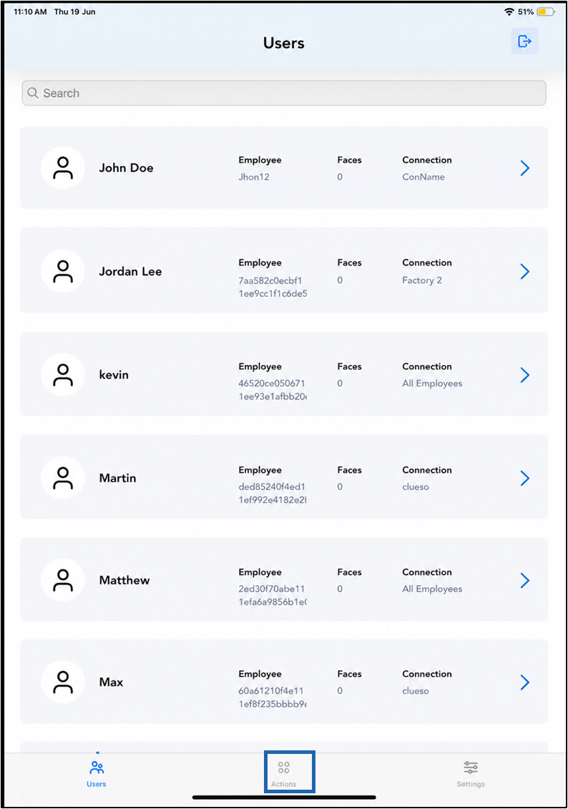
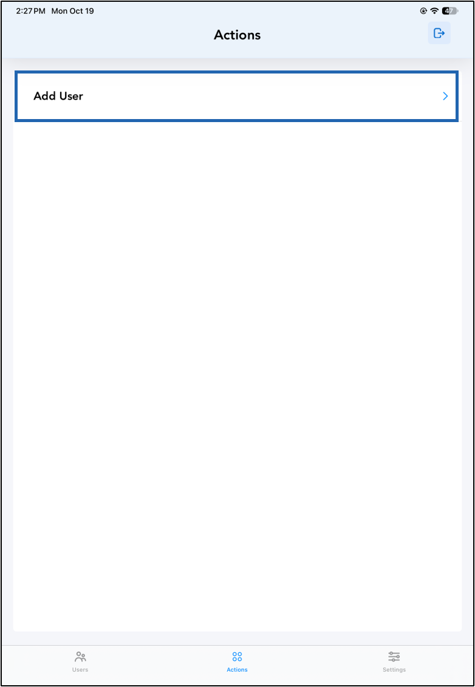
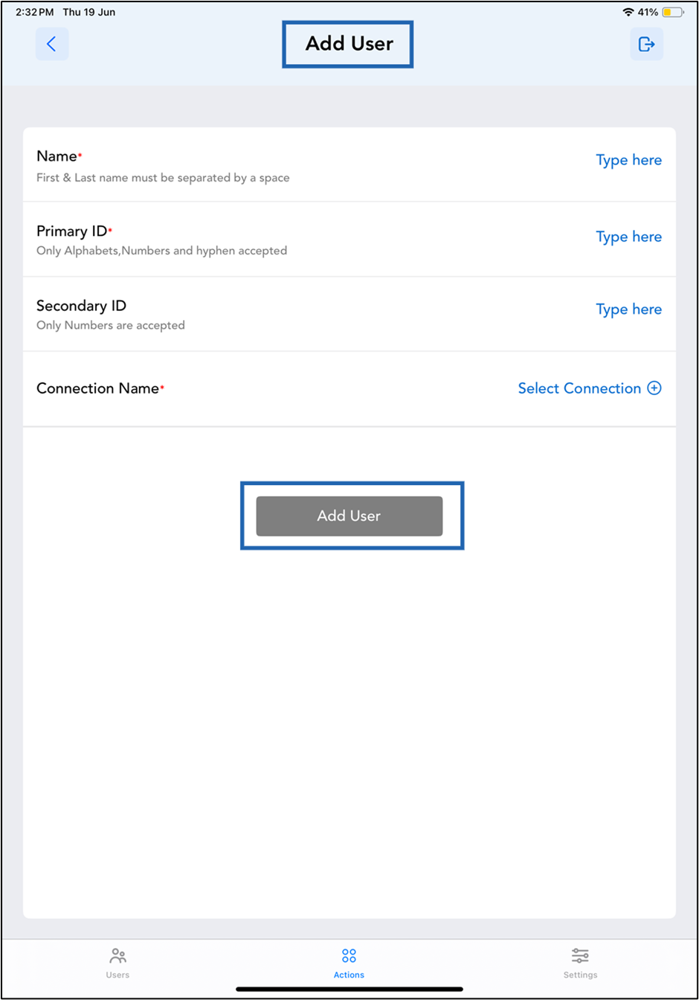
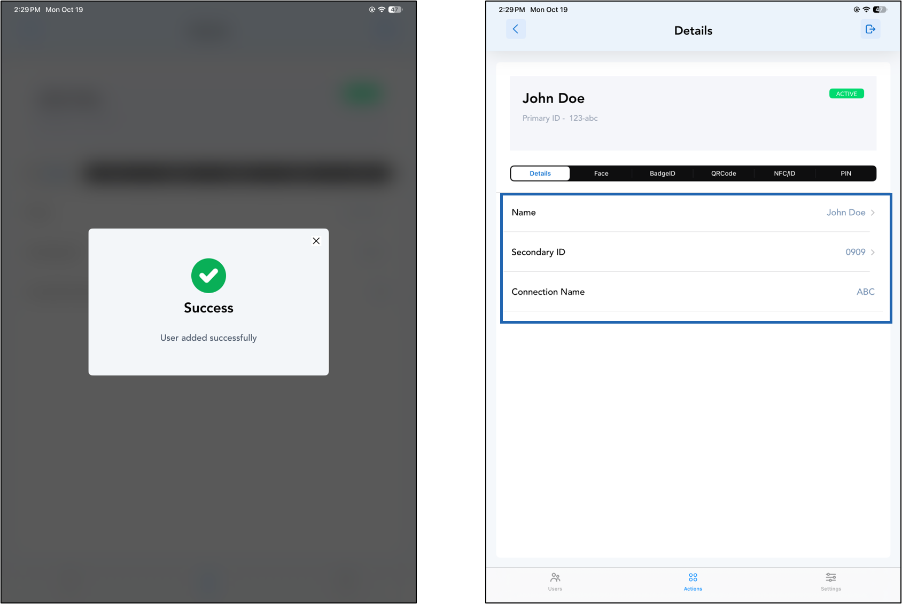

{/* Source: Intercom article 8601079 - https://oloid.help/en/articles/8601079-oloid-connect-how-to-add-a-user */}
{/* Generated by intercom_to_mintlify.py - re-running overwrites this file. */}

## Introduction

This document provides instructions to add a user using the Oloid Connect app.

<Note>
  **Note:** Endpoint pairing is not required to complete this action.
</Note>

## Prerequisites

- You must have access to the Tenant Admin Portal or Supervisor account.
- Supervisor privileges should be enabled to allow the supervisor to add user. For more, refer to [Windows Login - How to Enable Add/Delete Users in Tenant Admin Portal for Supervisors](/platforms/windows/supervisor-app/windows-login-how-to-enable-add-delete-users-in-tenant-admin-portal)

## Steps to Add User

1. Launch the **Oloid Connect** app.

   

2. Log in to Admin mode in Oloid Connect app. For more details, refer to [How to Log in to Admin Mode in the Oloid Connect App](/platforms/ios/time-clock/oloid-connect/how-to-log-in-to-admin-mode-in-the-oloid-connect-app)
   The **Users** screen is displayed.
3. Tap **Actions** on the menu at the bottom of the screen.

   

   The **Actions** screen is displayed.
4. Tap **Add User**.

   

   The **Add User** screen is displayed.
5. Do the following:
   1. Enter **Name**.
      First name and Last name should be separated by a space.
   2. Enter **Primary ID**.
      Only alphabets, numbers, and hyphen are accepted.
   3. Enter **Secondary ID**. (Optional)
      Only numbers are accepted.
   4. Select connection name from **Connection Name** list.
6. Tap **Add User**.

   

   A new user is **added** successfully, and user details are displayed in Details screen.

   
