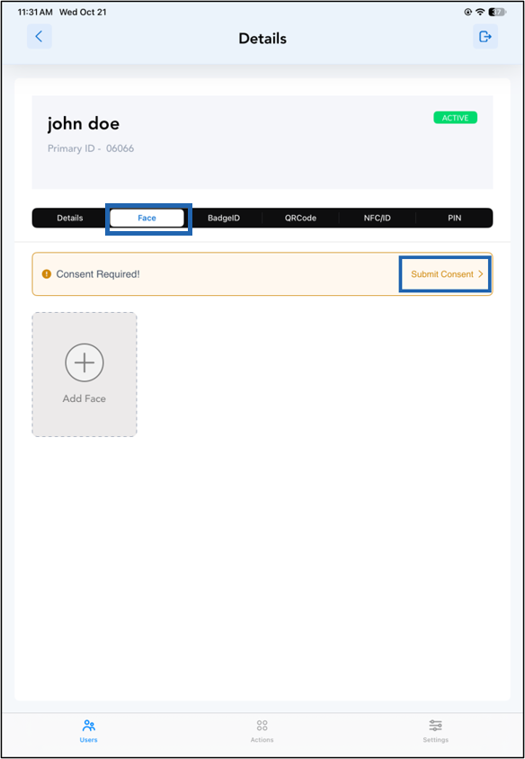
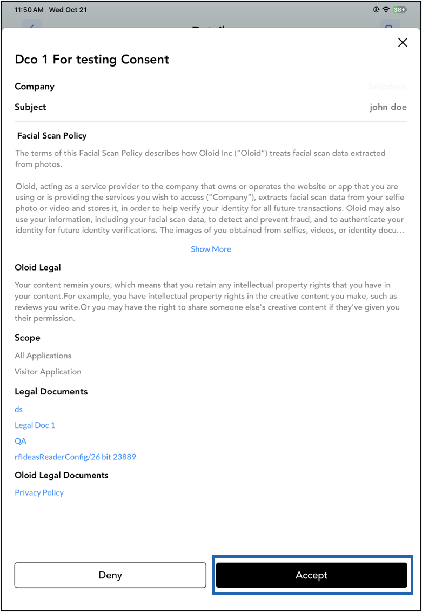
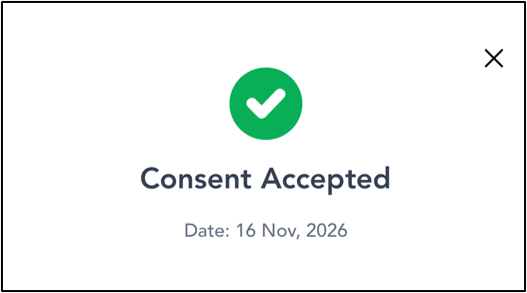
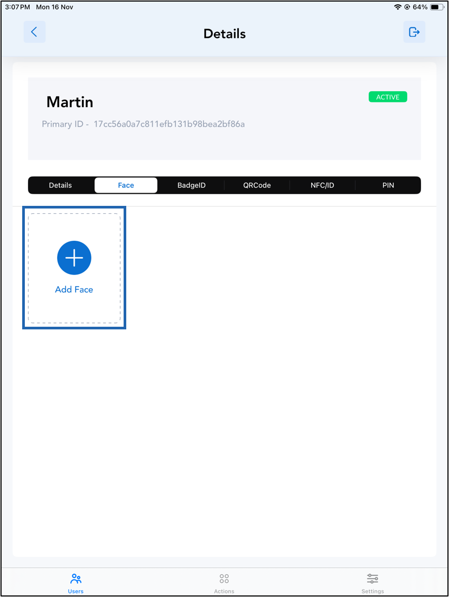
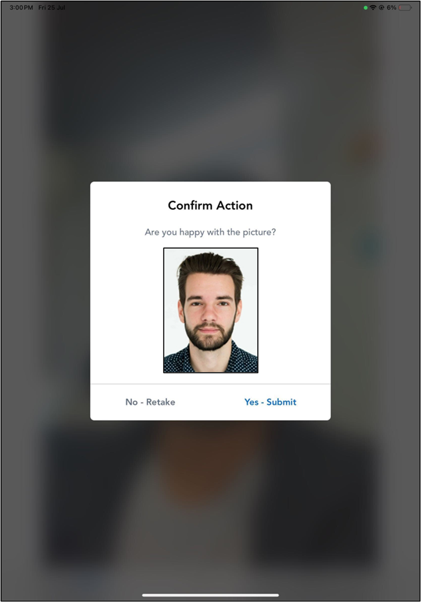

{/* Source: Intercom article 8536726 - https://oloid.help/en/articles/8536726-oloid-connect-how-to-add-face-for-a-user */}
{/* Generated by intercom_to_mintlify.py - re-running overwrites this file. */}

## Introduction

This document provides step-by-step instructions to add face for a user using the Oloid Connect app.

<Note>
  **Note:** If user consent is enabled in the connection, the app will ask for permission before uploading the picture. To enable refer [Tenant Admin Portal - How to add a Consent Template to a Connection in the Tenant Admin Portal](/platform/tenant-admin-portal/tenant-admin-portal-how-to-add-a-consent-template-to-a-connection-in)
</Note>

## Prerequisites

- You must have Tenant Admin or Supervisor access to the Oloid Connect app.
- The user must be added. For more, refer to [Oloid Connect - Add User](/platforms/ios/time-clock/oloid-connect/oloid-connect-how-to-add-a-user)
- The Oloid Connect endpoint must be paired. To pair, refer to [How to pair Oloid Connect endpoint on iPhone](/platforms/ios/time-clock/oloid-connect/how-to-pair-oloid-connect-endpoint-on-iphone)

## Steps to add face for a user

1. Launch the **Oloid Connect** app.

   

2. Log in to Admin mode in Oloid Connect app. For more details, refer to [How to Log in to Admin Mode in the Oloid Connect App](/platforms/ios/time-clock/oloid-connect/how-to-log-in-to-admin-mode-in-the-oloid-connect-app)
   The **Users** screen is displayed.

   

3. Select the preferred **Username** from the list.

   <Note>
     **Note:** You can also search for the user using the search bar at the top.
   </Note>

   

   The User Details screen is displayed.
4. If **User consent** is enabled Tap **Submit Consent**.

   

5. The consent form is displayed. Tap **Accept**.

   

   The consent is accepted successfully.

   

   <Note>
     **Note:** If user consent is not enabled, skip steps 4 and 5.
   </Note>

6. Do the following:
   **a.** Tap **+Add Face.**
   **b.** Place your face within the oval frame on the screen to confirm your identity.

   

   The pop-up screen appears with the captured image.
7. Do one of the following:
   1. Tap **Yes- Submit** to submit the image.
   2. Tap **No- Retake** to take the image again.

      

The face credential is submitted successfully.

<Note>
  **Note:**

  - A maximum of five faces can be added per user. For more, refer to [Guidelines for Face Enrollment /Onboarding images](/platforms/web/webkey/guidelines-for-face-enrollment-onboarding-images)
  - If the Supervisor is unable to complete these steps, contact [Oloid Support](mailto:support@oloid.ai).
</Note>
