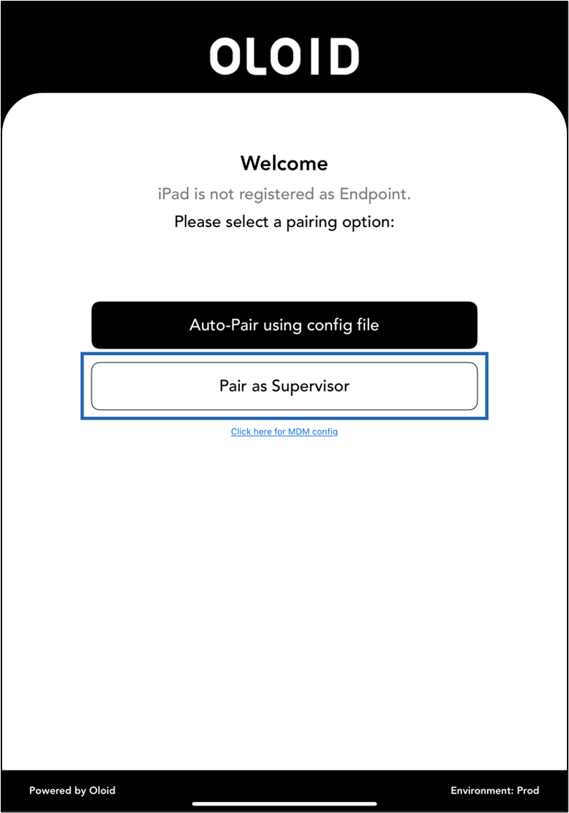
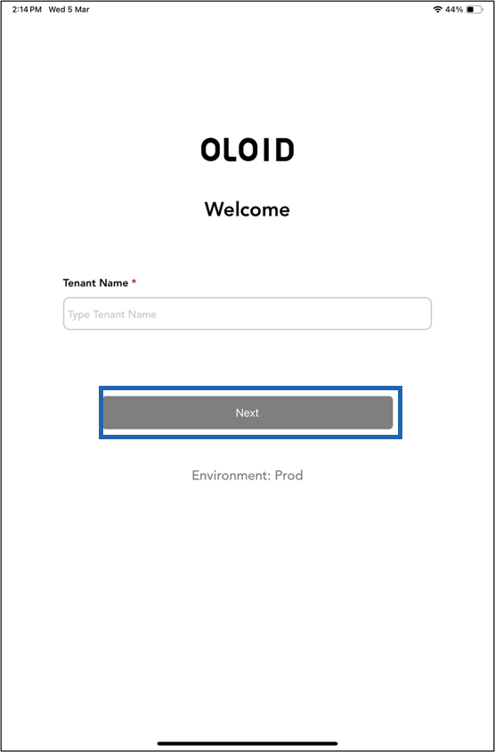
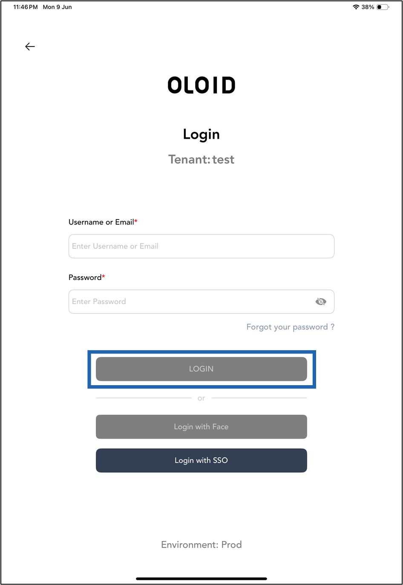
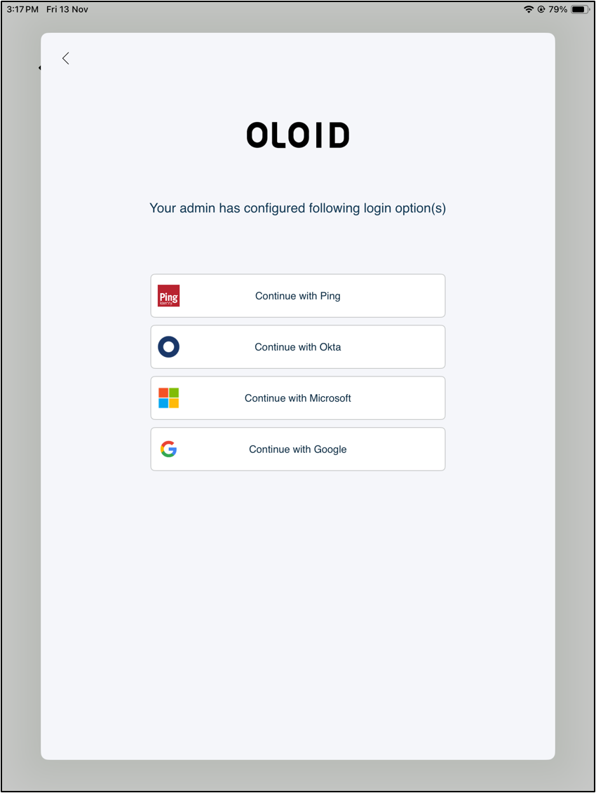
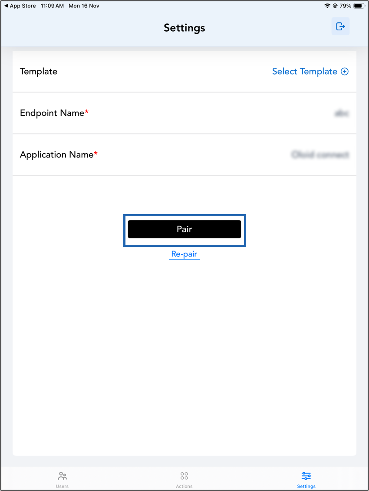
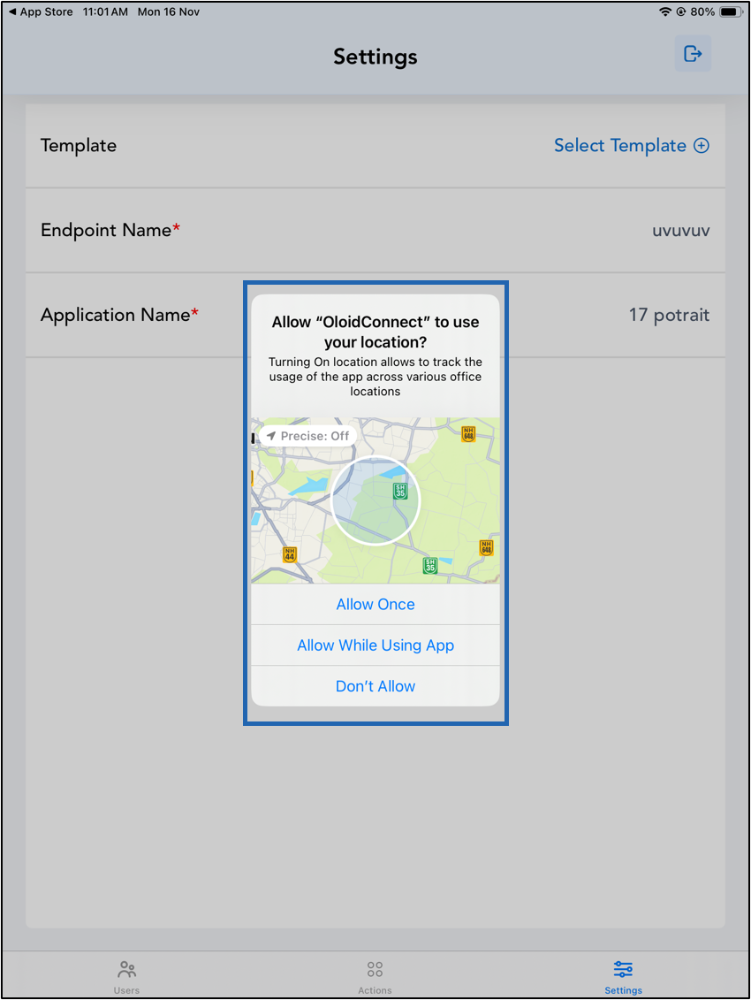

{/* Source: Intercom article 8601123 - https://oloid.help/en/articles/8601123-oloid-connect-how-to-add-location-to-an-endpoint */}
{/* Generated by intercom_to_mintlify.py - re-running overwrites this file. */}

## Introduction

The Oloid Connect app allows Tenant Admins to assign a location to an endpoint during the setup process. Adding a location ensures accurate tracking and management of endpoints within your organization, enabling the system to associate activity and transactions with the correct physical site.

## Prerequisite

- You should be a Tenant Admin and Supervisor.
- You must download the Oloid Connect app. To download refer [How to Download and Install the Oloid Connect App](/platforms/ios/time-clock/oloid-connect/oloid-connect-how-to-download-and-install-on-ipad).

## Steps to add location to an endpoint

1. Launch the **Oloid Connect** app.

   

   The Welcome screen is displayed.
2. Tap **Pair as Supervisor.**

   

   The Welcome screen is displayed.
3. Enter **Tenant Name,** then tap **Next**.

   

   The **Login** screen is displayed.
4. Do the following:
   1. Enter your email ID in the **Email** text field.
   2. Enter your password in the **Password** text field.
   3. Tap **LOGIN**.

<Note>
  **Note:**

  - If the Tenant Admin’s face is added in the Tenant Admin Portal, tap **Log in with Face** to log in using face authentication.
  - To log in using SSO, tap **Log in using SSO**, and then continue with [Google](/platforms/ios/time-clock/oloid-connect/oloid-connect-login-using-google-sso), [Microsoft](/platforms/ios/time-clock/oloid-connect/oloid-connect-login-using-microsoft-sso), [Ping](/platforms/ios/time-clock/oloid-connect/oloid-connect-login-using-ping-one-sso)or [Okta](/platforms/ios/time-clock/oloid-connect/oloid-connect-login-using-okta-sso).

    

</Note>

5. Do the following:
   1. Enter or select the **Endpoint Name**.
   2. Select the application from the **Application Name** drop-down list.
   3. Tap **Pair**.

      

      The **Location** access pop-up is displayed.
6. On the pop-up box, select an option:
   - **Allow Once:** Each time you open the app, it will request access your location.
   - **Allow While Using App:** The app can access your location only when you are actively using it.
   - **Don't Allow:** The app cannot access your location, even while you are using it.

     <Note>
       **Note:** You can also update location from the device settings. To update refer [How to update Location for Oloid Connect](/platforms/ios/time-clock/oloid-connect/how-to-update-location-for-oloid-connect)
     </Note>

     

     <Note>
       **Note:** Log in to the **Tenant Admin Portal** to view the location added to the endpoint.
     </Note>
