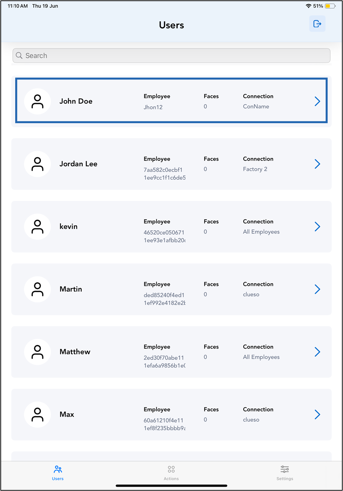
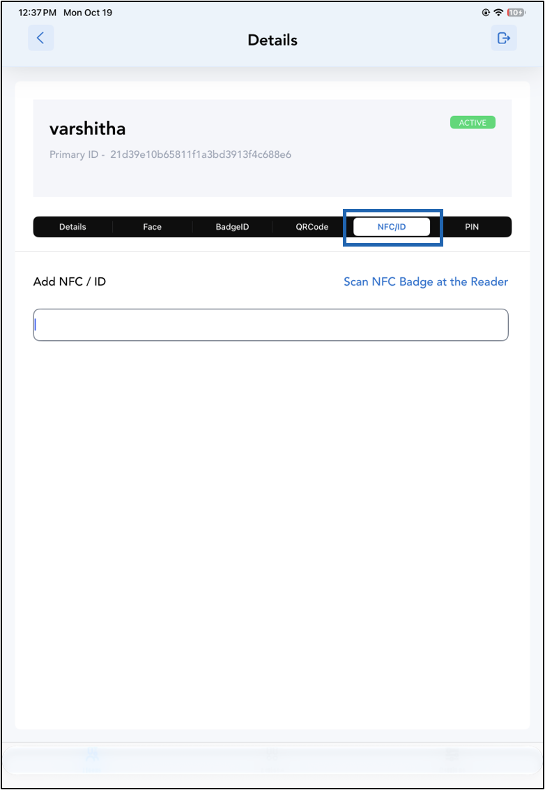
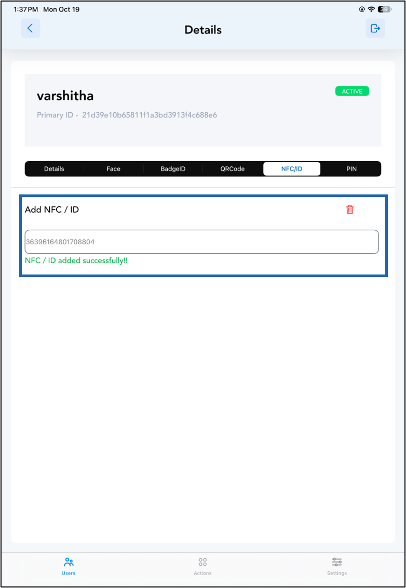

{/* Source: Intercom article 10304065 - https://oloid.help/en/articles/10304065-oloid-connect-how-to-add-nfc-id-for-a-user */}
{/* Generated by intercom_to_mintlify.py - re-running overwrites this file. */}

## Introduction

This document provides instructions to add NFC/ID for a user using the Oloid Connect app.

## Prerequisites

- You must have access to the Tenant Admin Portal or Supervisor account.
- The user must be added. For more, refer to [Oloid Connect - How to Add a User](/platforms/ios/time-clock/oloid-connect/oloid-connect-how-to-add-a-user)
- An NFC reader must be connected to the iPad.

## Steps to add NFC/ID for a user

1. Launch the **Oloid Connect** app.

   

2. Log in to Admin mode in Oloid Connect app. For more details, refer to [How to Log in to Admin Mode in the Oloid Connect App](/platforms/ios/time-clock/oloid-connect/how-to-log-in-to-admin-mode-in-the-oloid-connect-app)
   The **Users** screen is displayed.

   

3. Select the preferred **Username** from the list.

   <Note>
     **Note:** You can also search for the user using the search bar at the top.
   </Note>

   

   The user's details screen is displayed.
4. Go to **NFC/ID** tab.

   

5. Scan the **NFC Badge** on the **NFC reader**.

   

   The **NFC/ID** is successfully assigned to the user.
