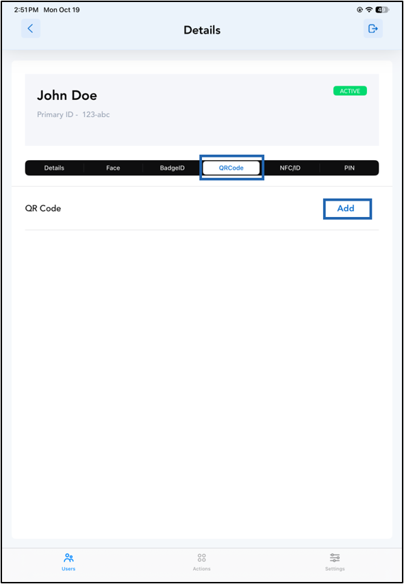
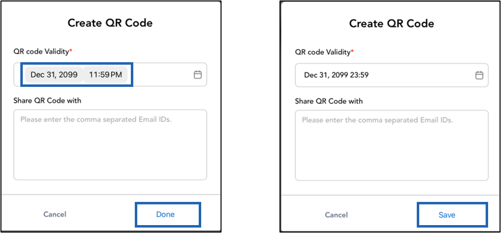
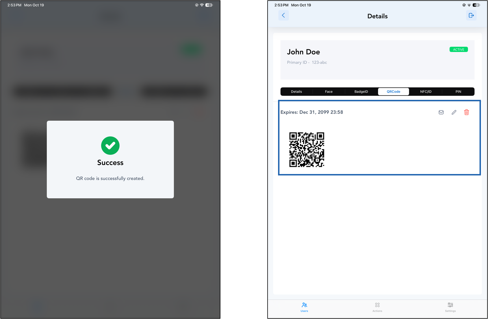

{/* Source: Intercom article 8764539 - https://oloid.help/en/articles/8764539-oloid-connect-how-to-add-qr-code-for-a-user */}
{/* Generated by intercom_to_mintlify.py - re-running overwrites this file. */}

## Introduction

This document provides instructions to add a QR Code for a user using the Oloid Connect app.

## Prerequisites

- You must have access to the Tenant Admin Portal or Supervisor account.
- The user must be added. For more, refer to [Oloid Connect - How to Add a User](/platforms/ios/time-clock/oloid-connect/oloid-connect-how-to-add-a-user)

## Steps to Add QR Code

1. Launch the **Oloid Connect** app.

   

2. Log in to Admin mode in Oloid Connect app. For more details, refer to [How to Log in to Admin Mode in the Oloid Connect App](/platforms/ios/time-clock/oloid-connect/how-to-log-in-to-admin-mode-in-the-oloid-connect-app)
   The **Users** screen is displayed.

   

3. Select the preferred **Username** from the list.

   <Note>
     **Note:** You can also search for the user using the search bar at the top.
   </Note>

   

   The user'sDetails screen is displayed.
4. Go to **QR Code** tab > tap **Add**.

   

   The **Create QR Code** pop-up box is displayed.
5. In the **QR code Validity** field, do the following:
   1. Tap the **date**, and then select the preferred expiry date.
   2. Tap the **time**, and then select the preferred expiry time.

Tap **Done**, and then tap **Save**.

The QR code is successfully assigned to the user.

