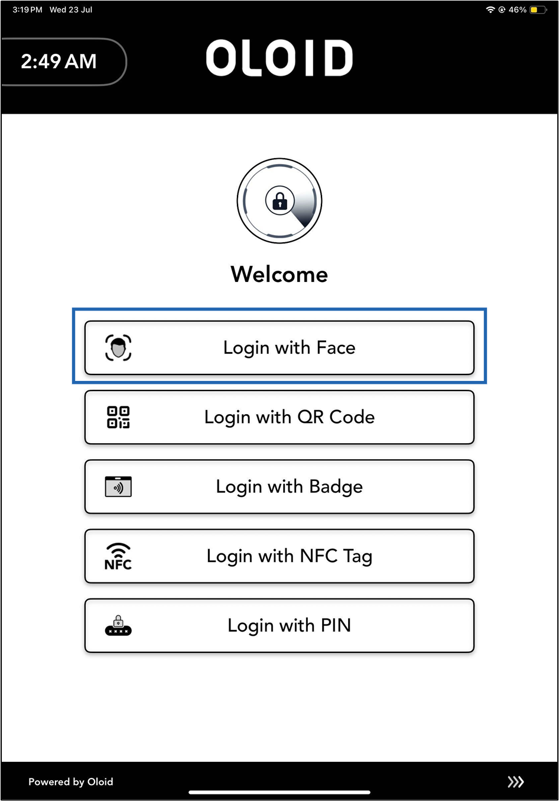
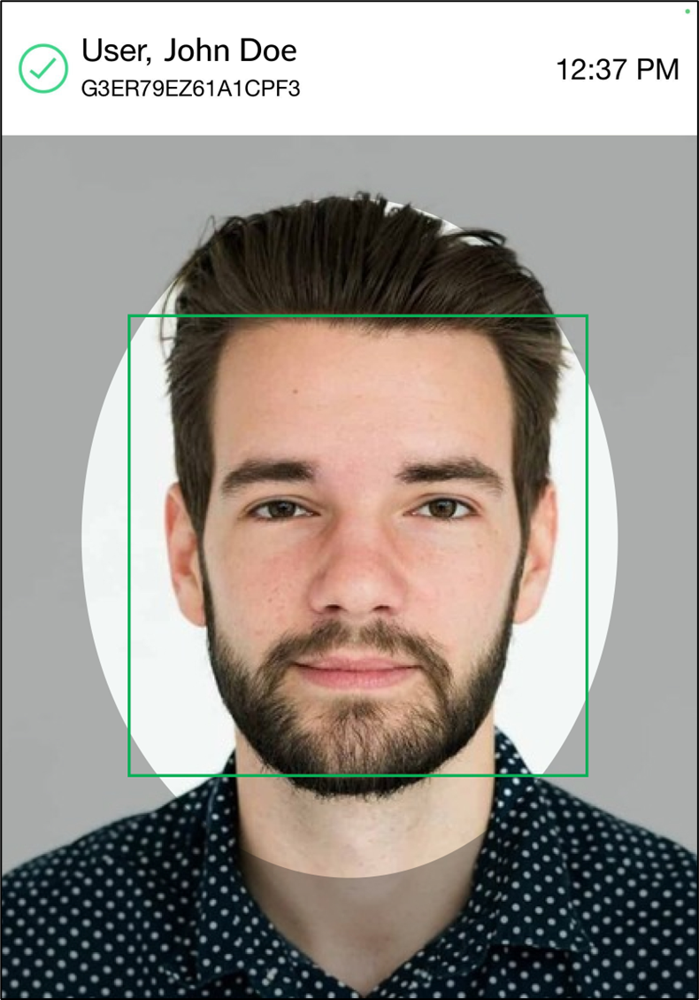
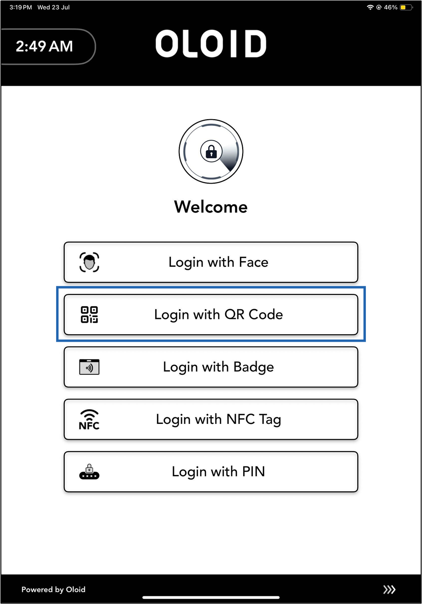
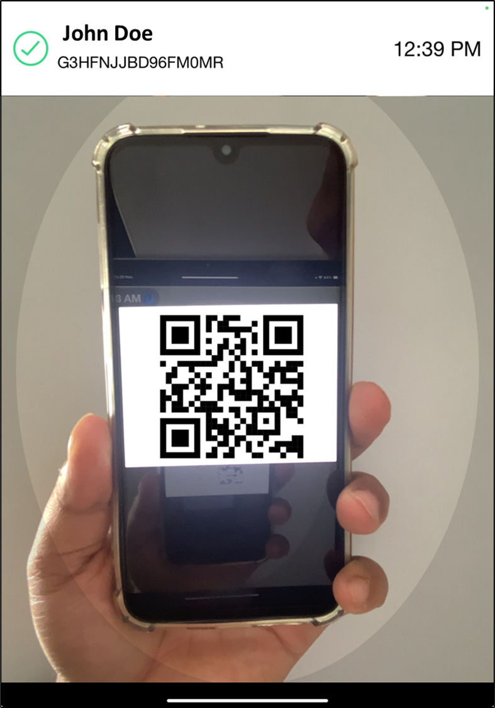
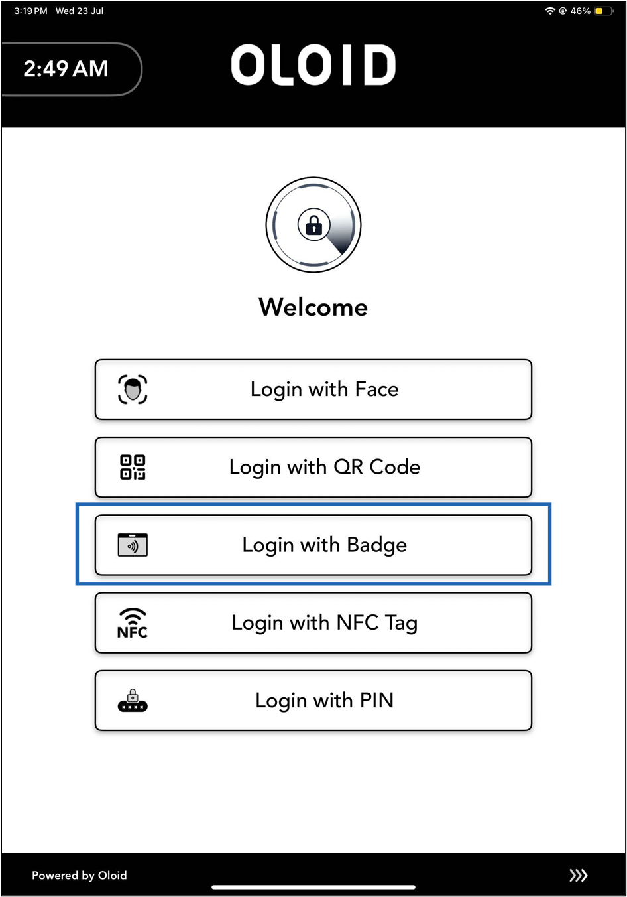
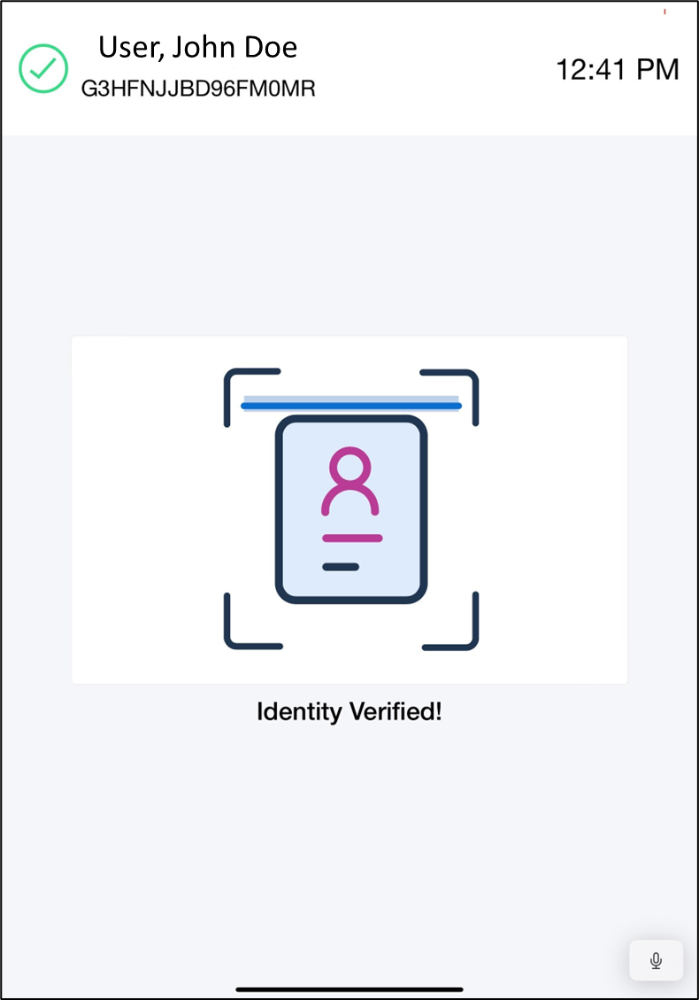
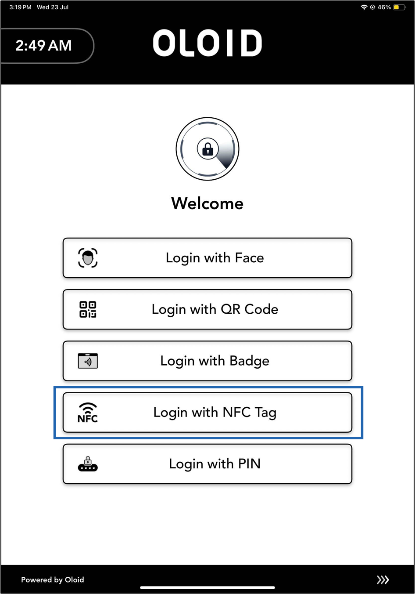
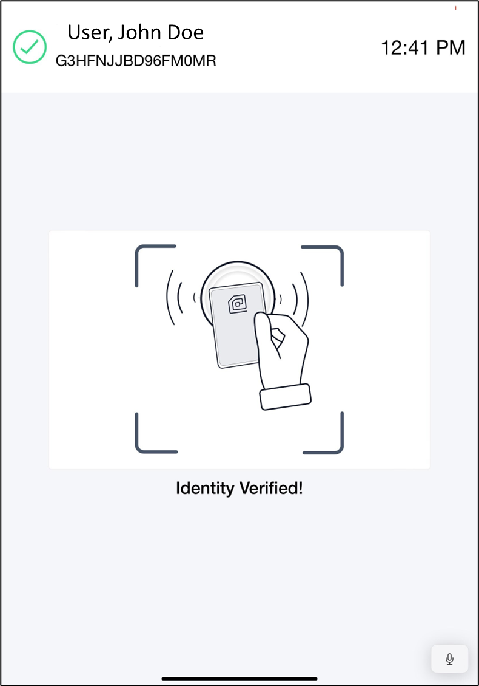
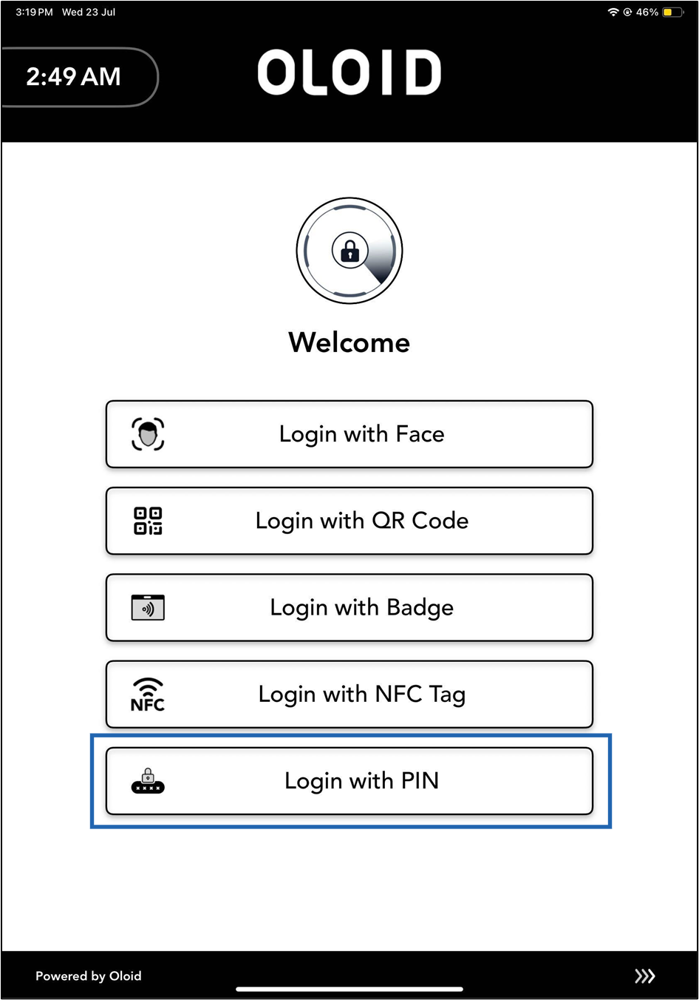
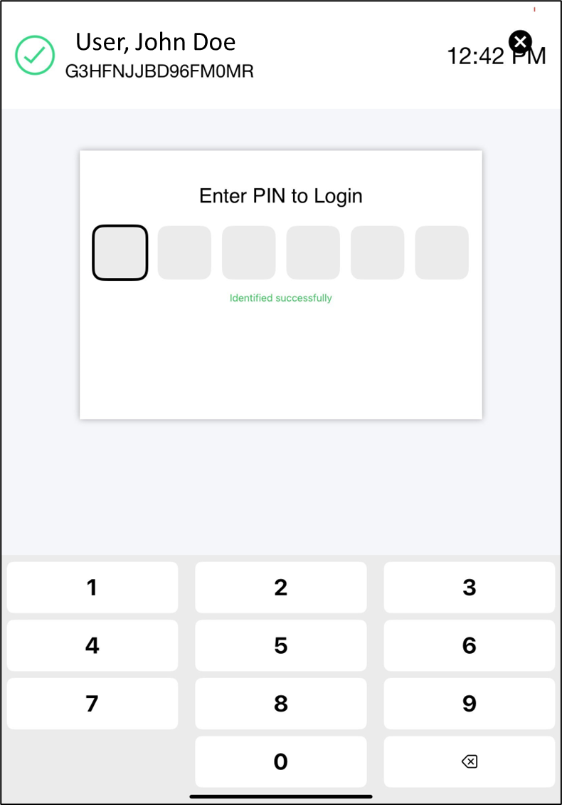

{/* Source: Intercom article 10337624 - https://oloid.help/en/articles/10337624-oloid-connect-how-to-authenticate-a-user-using-credentials */}
{/* Generated by intercom_to_mintlify.py - re-running overwrites this file. */}

## Introduction

The Oloid Connect app supports five authentication methods: Face, QR Code, Badge ID, NFC/ID, and PIN. These methods allow users to authenticate quickly and securely on a paired endpoint.

## Prerequisites

- The endpoint device must be paired with the application. For more, refer to[Oloid Connect – How to Pair an Endpoint](/platforms/ios/time-clock/oloid-connect/oloid-connect-how-to-pair-an-endpoint)
- The user must be added. For more, refer to [Oloid Connect - How to Add a User](/platforms/ios/time-clock/oloid-connect/oloid-connect-how-to-add-a-user)

## Steps to authenticate a user using credentials

Authenticate using any one of the following methods:

1. [Authenticate using Face](#authenticate-using-face)
2. [Authenticate using QR Code](#authenticate-using-qr-code)
3. [Authenticate using Badge](#authenticate-using-badge-id)
4. [Authenticate using NFC/ID](#authenticate-using-nfc-id)
5. [Authenticate using PIN](#authenticate-using-pin)

### Authenticate using Face

This section helps the user authenticate by scanning their face with the device camera.

#### Prerequisite

- The user’s face must be registered in the Oloid Connect app.

#### Steps to Authenticate Using Face

1. Launch the **Oloid Connect**  **App**.
   The **Welcome** screen is displayed.
2. Tap **Login with Face**.

   

   The Camera opens to capture the user's face.
3. Place your face inside the oval frame in the screen.
   After Successful authentication, the user details displayed at the top of the screen.

   

### Authenticate using QR Code

This section helps the user authenticate by scanning their assigned QR Code with the device camera.

#### Prerequisite

- A QR Code must be assigned to the user.

#### Steps to authenticate using QR Code

1. Launch the **Oloid Connect**  **App**.
   The **Welcome** screen is displayed.
2. Tap **Login with QR code**.

   

   The Camera opens to scan the **QR Code**.
3. Place the QR Code within the oval frame on the screen.
   After successful authentication, the user details displayed at the top of the screen.

   

### Authenticate using Badge ID

This section helps the user authenticate by scanning their assigned badge at the badge reader.

#### Prerequisites

- A Badge ID must be assigned to the user.
- The badge reader must be connected to the endpoint.

#### Steps to Authenticate Using Badge ID

1. Launch the **Oloid Connect**  **App**.
   The **Welcome** screen is displayed.
2. Tap **Login with Badge**.

   

   The **Scan Badge at the Reader** screen is displayed.
3. Scan the **Badge** at the Reader.
   After successful authentication, the user details displayed at the top of the screen.

   

### Authenticate using NFC/ID

This section helps the user authenticate by tapping their NFC tag at the reader.

#### Prerequisites

- The user must have an NFC tag assigned to them.
- The NFC/ID reader must be connected to the endpoint.

#### Steps to authenticate using NFC/ID

1. Launch the **Oloid Connect**  **App**.
   The **Welcome** screen is displayed.
2. Tap **Login with NFC tag**.

   

   The **Tap NFC Tag at the Device** screen is displayed.
3. Tap NFC Tag at the reader.
   After successful authentication, the user details are displayed at the top of the screen.

   

### Authenticate using PIN

This section helps the user authenticate by entering their registered PIN.

#### Prerequisite

- A PIN must be set for the user.

#### Steps to authenticate using PIN

1. Launch the **Oloid Connect**  **App**.
   The **Welcome** screen is displayed.
2. Tap **Login with PIN**.

   

   The **Enter PIN to Login** screen is displayed.
3. Enter the PIN.
   After successful authentication, the user details are displayed at the top of the screen.

   
