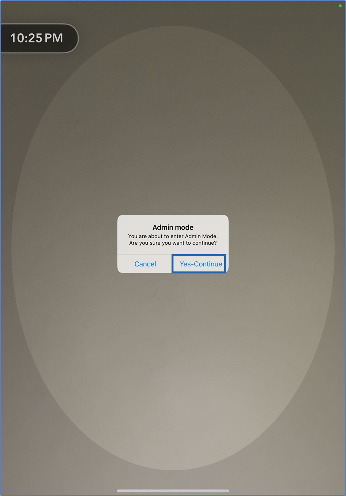
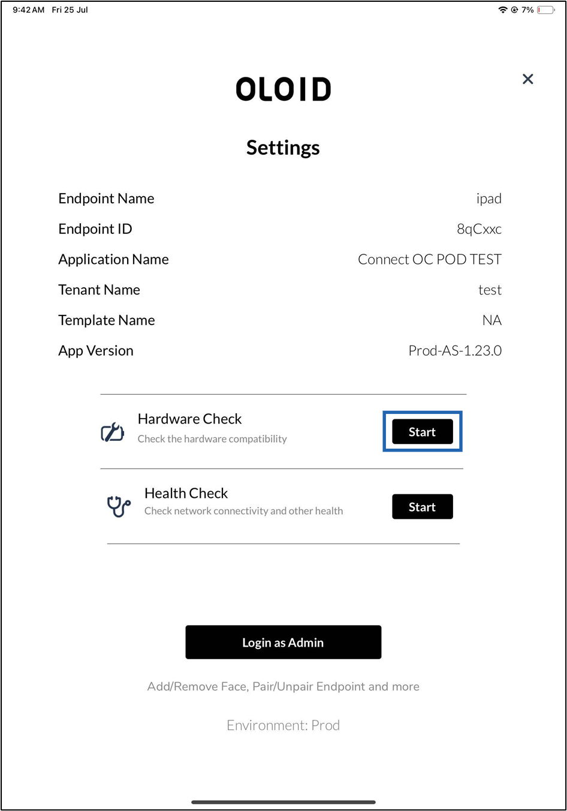
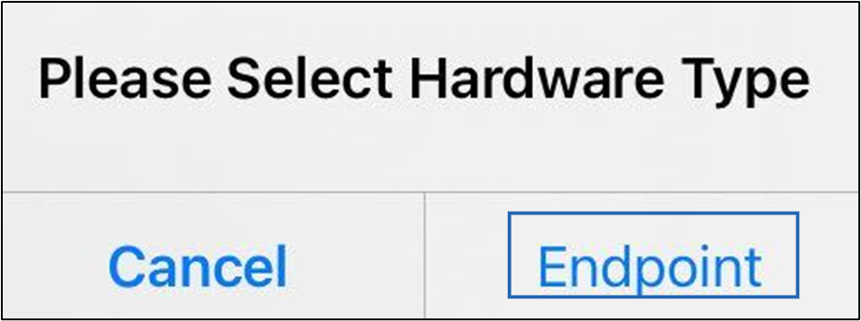
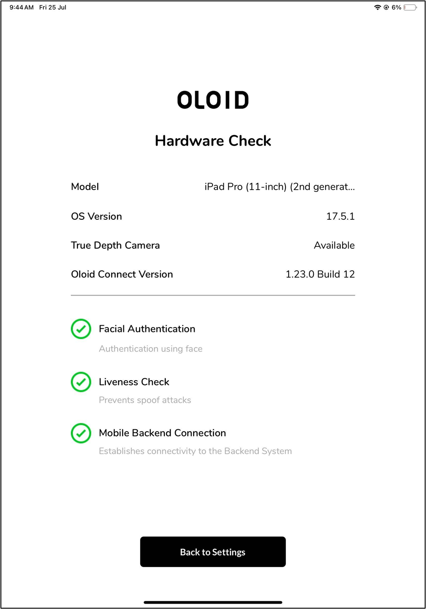

{/* Source: Intercom article 10308108 - https://oloid.help/en/articles/10308108-oloid-connect-how-to-check-hardware-compatibility */}
{/* Generated by intercom_to_mintlify.py - re-running overwrites this file. */}

## Introduction

The Hardware Check feature in the Oloid Connect app allows Tenant Admins and Supervisors to verify that the endpoint meets the required hardware specifications. This check helps confirm that the device can run the Oloid Connect app properly.

## Prerequisites

- The user must be a Tenant Admin or Supervisor.
- The endpoint must be paired. For more details, refer to [Oloid Connect – How to Pair an Endpoint](/platforms/ios/time-clock/oloid-connect/oloid-connect-how-to-pair-an-endpoint)

## Steps to check hardware compatibility

1. Launch the **Oloid Connect App**.

   

   The preview screen is displayed.

   <Note>
     **Note:** Since the endpoint is already paired, the app launches in preview mode.
   </Note>

   

2. Double-tap the preview screen with two fingers to launch Admin Mode.
3. Tap **Yes- Continue.**

   

   The **Settings** screen is displayed.
4. In the **Hardware Check** section, tap **Start**.

   

   The Hardware type selection pop-up box is displayed.

On the pop-up, tap **Endpoint**.

The **Hardware Check** details are displayed successfully.

