{/* Source: Intercom article 13212909 - https://oloid.help/en/articles/13212909-oloid-connect-how-to-configure-offline-intent-screen-in-tenant-admin-portal */}
{/* Generated by intercom_to_mintlify.py - re-running overwrites this file. */}

## Introduction

This document explains how to set up the **Offline Intent Screen** in the Oloid Connect application. The Offline Intent Screen allow users choose an intent even when the device is offline. You can enable the Offline intent screen, show an offline message, and configure intent buttons that appear on the screen.

## Prerequisites

- You must have access to Tenant Admin Portal.
- The **Oloid Connect application** must be created and configured in the Tenant Admin Portal. For more, refer to [How to create and configure Oloid Connect Application in Tenant Admin Portal](/platforms/ios/time-clock/oloid-connect/oloid-connect-how-to-create-and-configure-application-in-tenant-admin)
- You must pair the oloid connect Endpoint. For more information, refer [How to pair an Oloid Connect endpoint](/platforms/ios/time-clock/oloid-connect/oloid-connect-how-to-pair-an-endpoint)
- Ensure that the authentication method(FR Mode) is set to **Hybrid**, as it supports both online and offline authentication. For more, refer to [How to Set FR mode](/platforms/ios/time-clock/oloid-connect/oloid-connect-how-to-create-and-configure-application-in-tenant-admin))
- Ensure that the user and endpoint are added to the appropriate group. For more information, refer [How to Configure Group](/platform/tenant-admin-portal/tenant-admin-portal-how-to-configure-group)

## Steps to configure Offline Intent Screen

1. Log in to the **Tenant Admin Portal**.
2. On the **Applications** page, click on the preferred Oloid Connect application.

   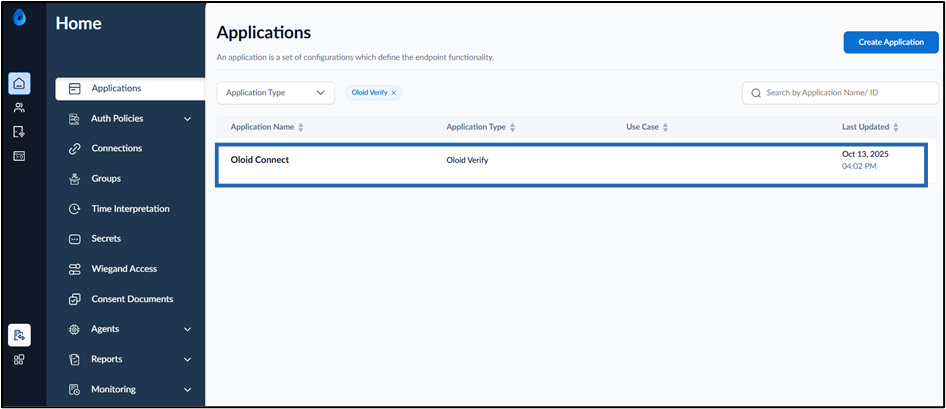

   The application **details** page is displayed.

   

3. Go to **Configure** tab > **Offline Intent Screen.**

   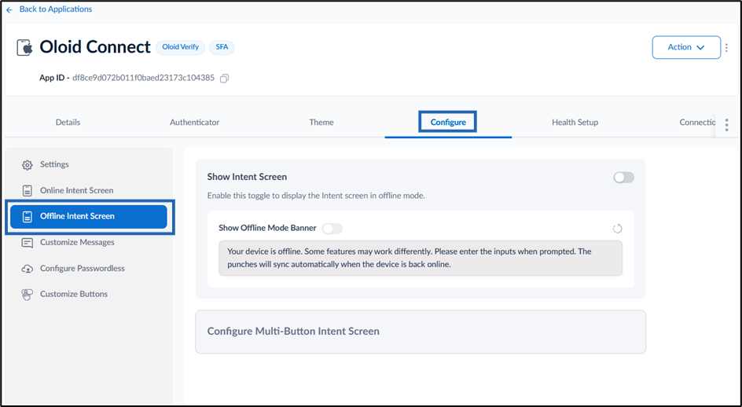

4. Do the following:
   1. [Configure Show Intent Screen](#configure-show-intent-screen)
   2. [Configure Multi Button Intent Screen](#configure-multi-button-intent-screen)
      The Offline Intent Screen is configured successfully.

### Configure Show Intent Screen

1. Enable **Show Intent Screen** toggle.
2. Do the following:
   1. Turn on **Show Offline Mode Banner** toggle.
   2. Review or edit the banner message displayed to users on the Intent Screen.(Optional)

      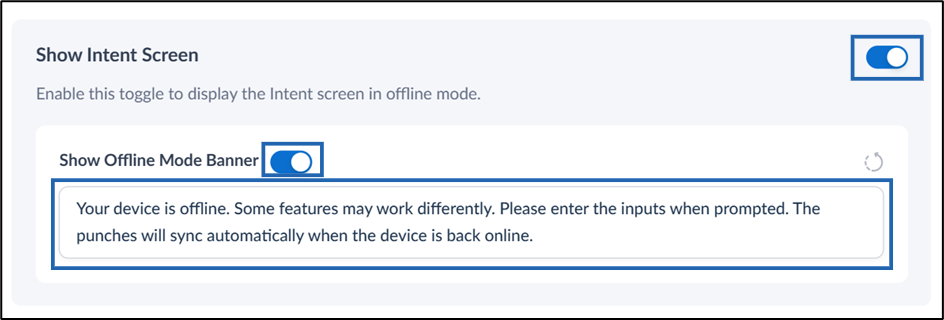

      The **Show Intent Screen** is configured successfully.

### Configure Multi Button Intent Screen

1. Enter a title in the **Intent Screen Heading** field. This title appears at the top of the intent screen.
2. Type a short description in the **Intent Screen Description** field.

   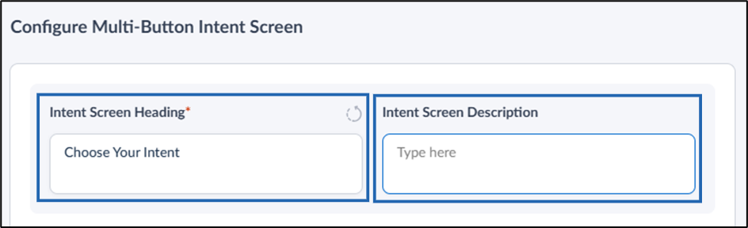

#### Configure Intent Screen Buttons

You can configure at least one and up to six intent buttons.

1. Do the following:
   1. Click **+Add Button** to add an intent button.
      The button section is displayed.
   2. Select **1 Column** or **2 Column** from the **Show Buttons in** dropdown, to define how intent buttons appear on the Intent Screen.
      - **2 Column** (default): Displays intent buttons in two columns.
      - **1 Column**: Displays intent buttons in a single column.

        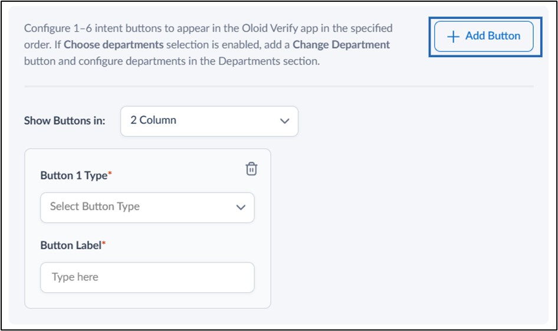

   3. Select **Button Type** from the dropdown.
   4. Enter **Button Label**.

      <Note>
        **Note:** The label is displayed on the intent screen.
      </Note>

#### Configure Advanced Settings

1. Select **Show Pop up** to display a confirmation pop-up box when a user taps the intent button.
   1. In the **Popup Heading** field**,** enter the title text that appears at the top of the popup.
      This heading should clearly describe the purpose of the popup.
   2. In the **Popup Content** field, enter the main message or instructions displayed inside the popup.
      This content should provide clear and concise information to the user.

      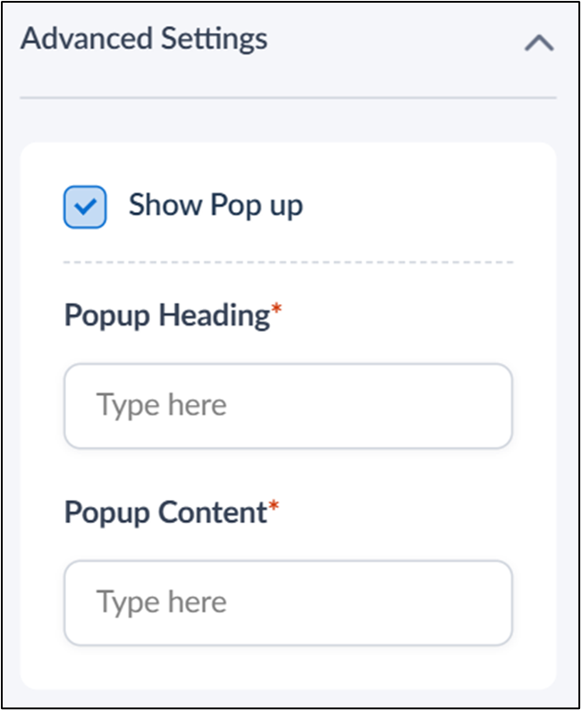

2. Select **Show Selection Dropdown 1** (or Dropdown 2 if required).
3. Configure the following fields:
   - **Heading** – Enter the title displayed on the dropdown screen.
   - **Sub-heading** – (Optional) Provide additional context.
   - **Dropdown Label** – Enter the label shown for the dropdown field.
4. Enable the **Full Width Button** toggle (Optional).
5. Click **View and Edit Options**.

   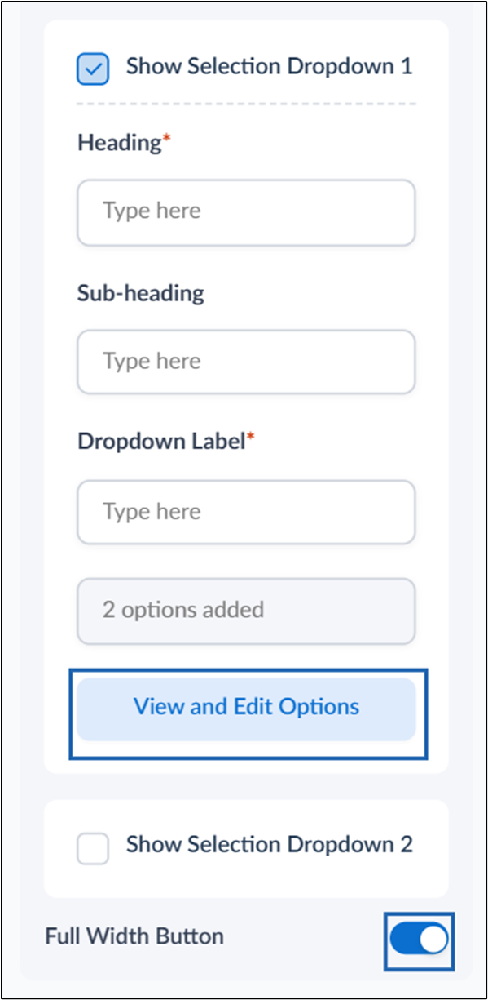

   The **View or Edit Dropdown Options** pop-up box is displayed.
6. Click **Download Template** and select one of the following formats:
   - CSV
   - XLSX
7. Open the downloaded file and add or update the dropdown values as required.
8. Upload the CSV/XLSX file using one of the following options:
   - **Drag and drop** the file.
   - **Click to upload** and select the file from your system.

     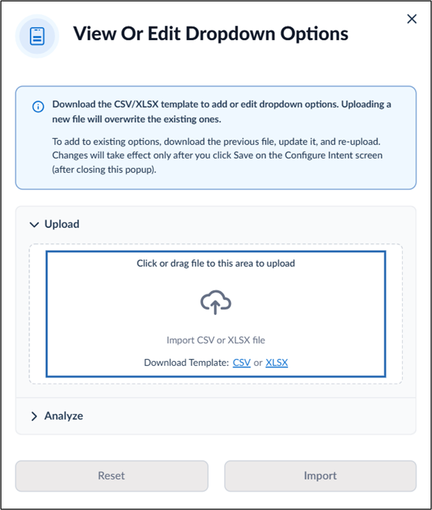

9. After the file is uploaded, review the **Analyze** section.
   - Ensure the result displays **"result": "ok"**, indicating a successful validation.
10. Click **Import**.

    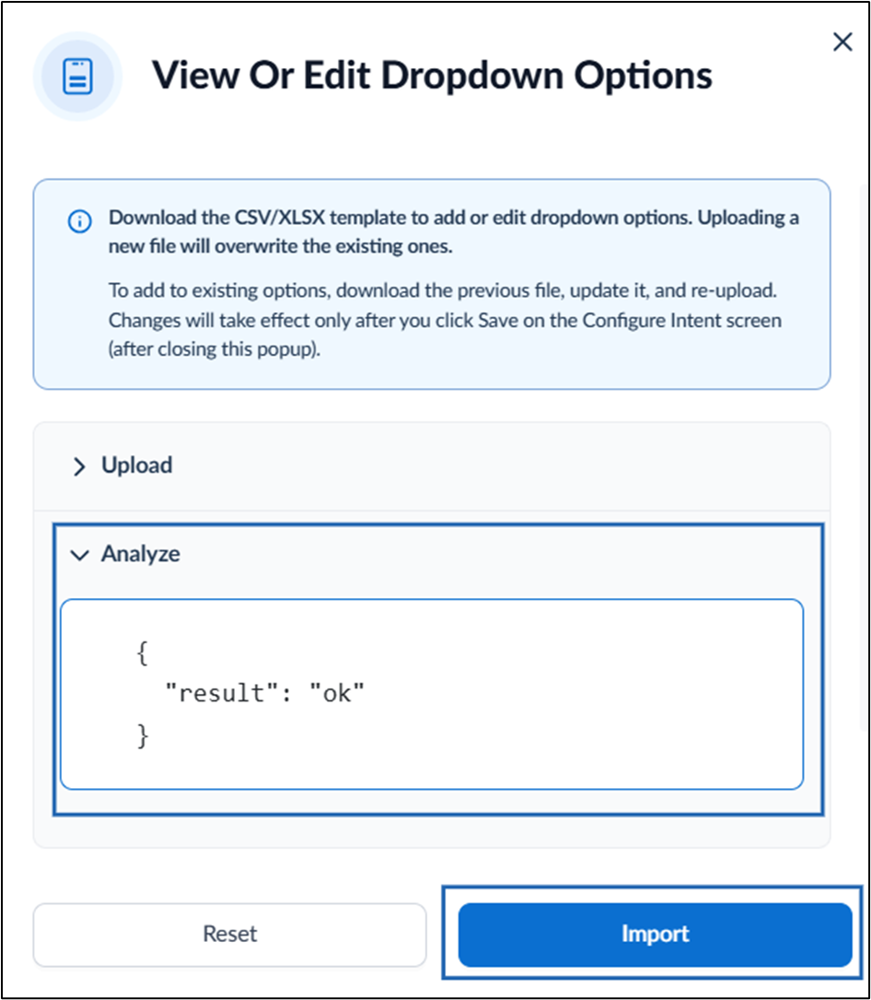

    The Offline Intent Screen is configured successfully.

    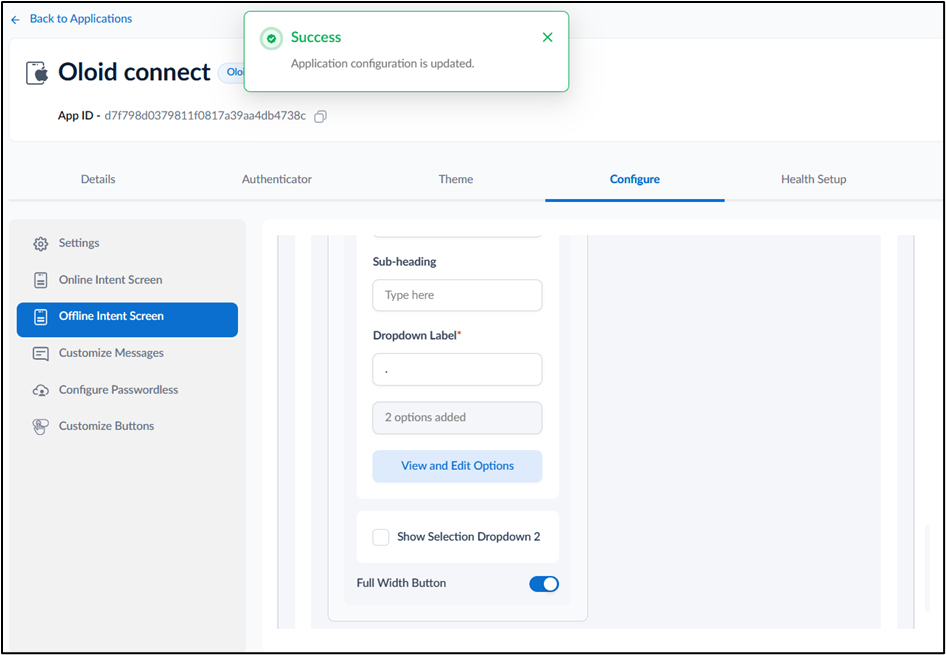

##### Sample Intent Screen

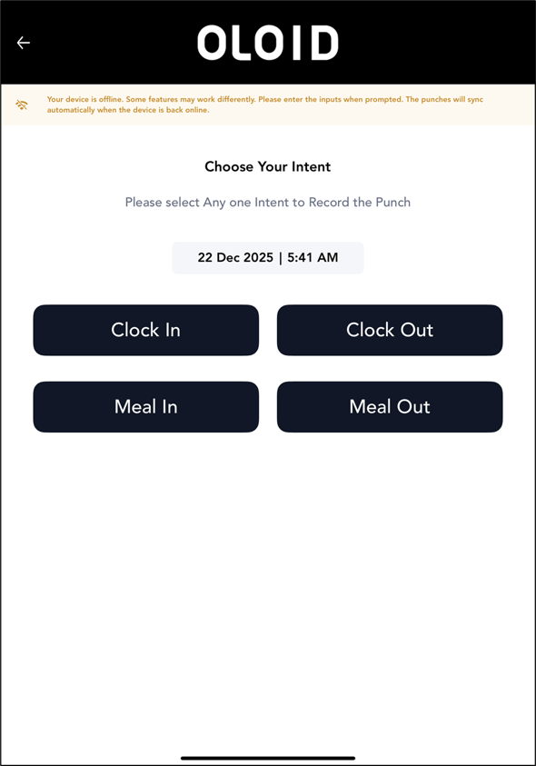
