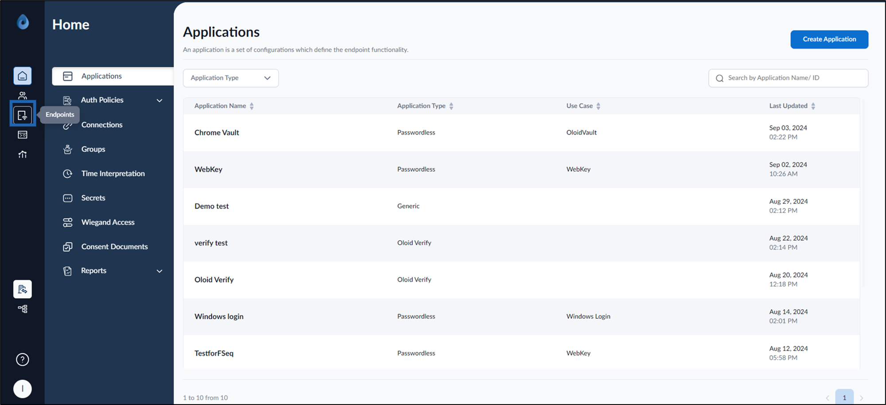
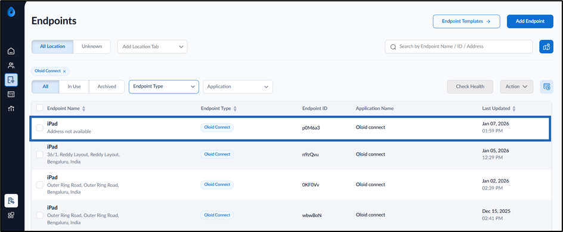
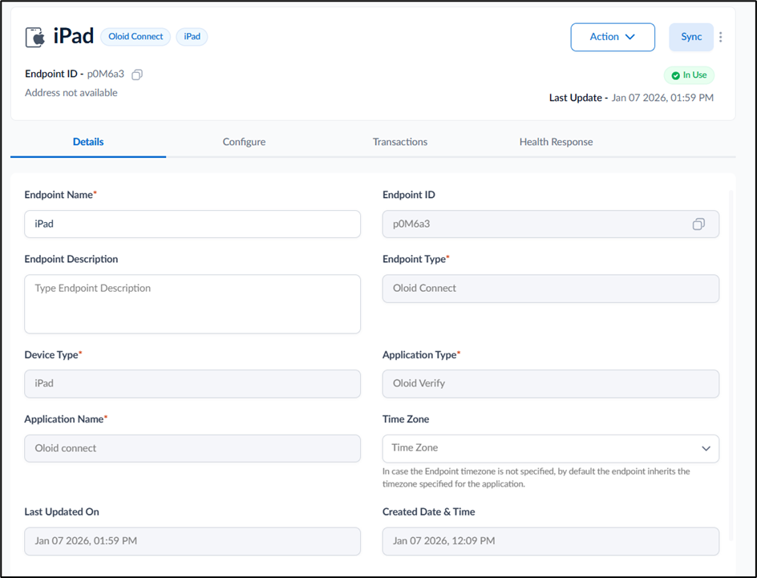
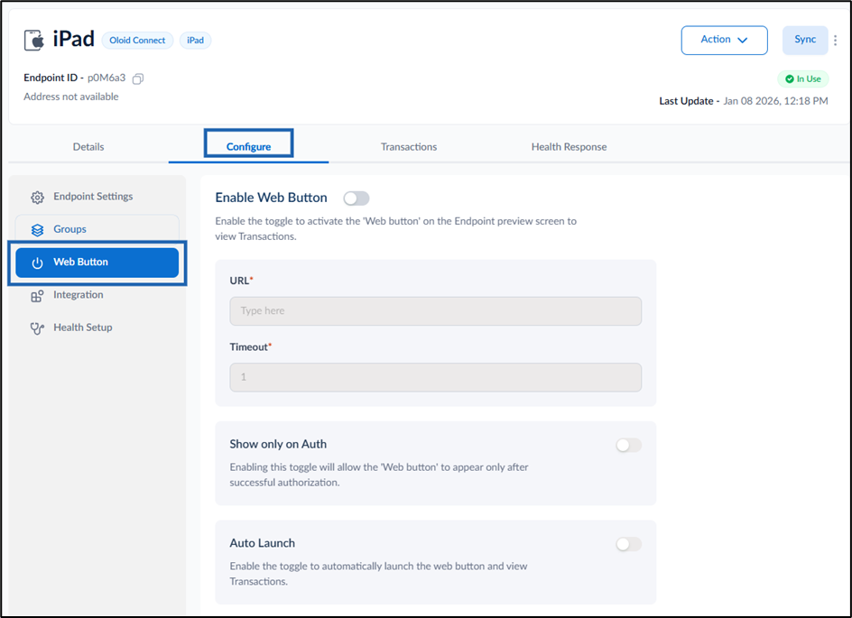
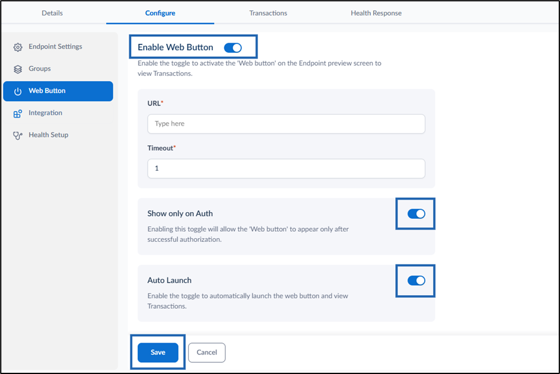
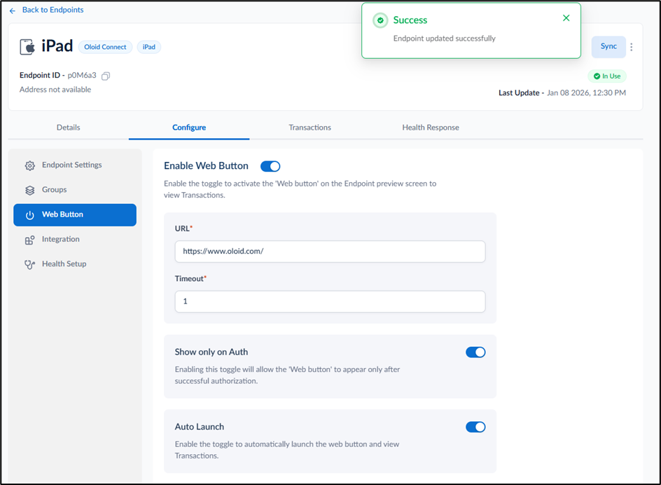

{/* Source: Intercom article 8410896 - https://oloid.help/en/articles/8410896-oloid-connect-how-to-configure-web-button */}
{/* Generated by intercom_to_mintlify.py - re-running overwrites this file. */}

## Introduction

The **Web Button** feature allows users to view transaction or punch details directly from an Oloid Connect endpoint. This document explains how to quickly configure the Web Button from the Tenant Admin Portal.

## Prerequisite

You must pair Oloid Connect endpoint. To pair refer [How to pair an Oloid Connect endpoint](/platforms/ios/time-clock/oloid-connect/oloid-connect-how-to-pair-an-endpoint).

## Steps to configure Web Button

1. Log in to the **Tenant Admin Portal**.
2. On the home page of the portal, click **Endpoints** on the left menu panel.

   

   The **Endpoints** page is displayed.
3. Select the paired Oloid Connect Endpoint.

   

   The **Endpoint Details** page is displayed.

   

4. Go to **Configure** Tab > Click **Web Button**.

   

5. Do the following:
   1. **Enable Web Button** toggle to display the Web Button on the endpoint preview screen. This button allows users to view transactions.
      1. In the **URL** field, enter the complete URL of the website where users will review punch data.

         <Note>
           **Note:** You have to enter the URL of the website where the user will review the punches.
         </Note>

      2. In the **Timeout** field, enter the delay (in minutes) before the URL launches.
   2. (Optional) Enable **Show only on Auth** to display the Web Button only after the user is successfully authorized.
   3. (Optional) Enable **Auto Launch** to automatically launch the web button and view transaction.

Click **Save**.

The Web Button tab is configured successfully.

