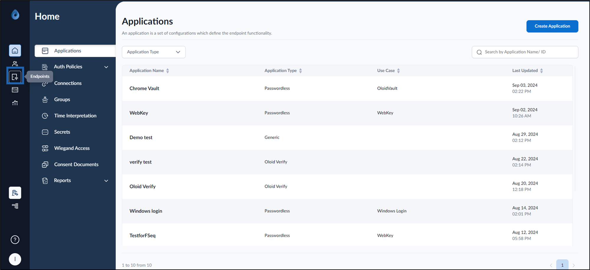
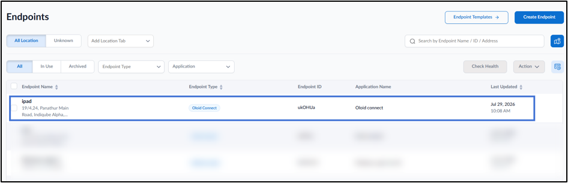
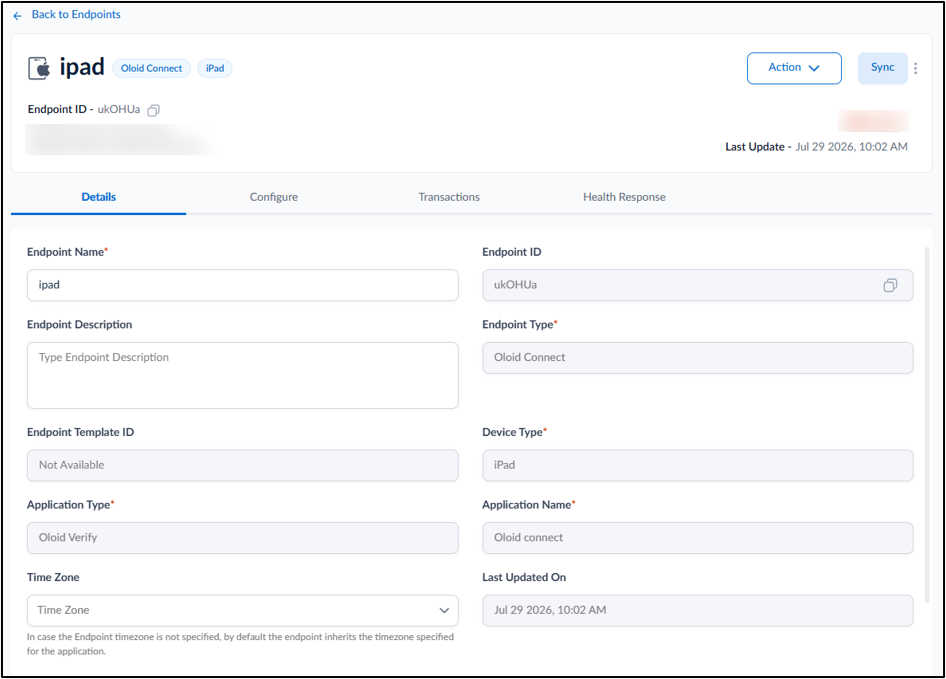
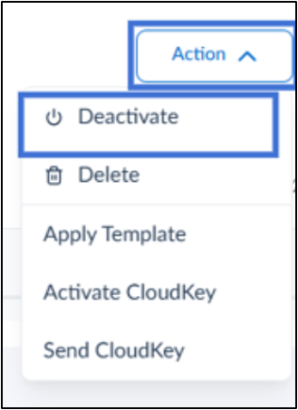
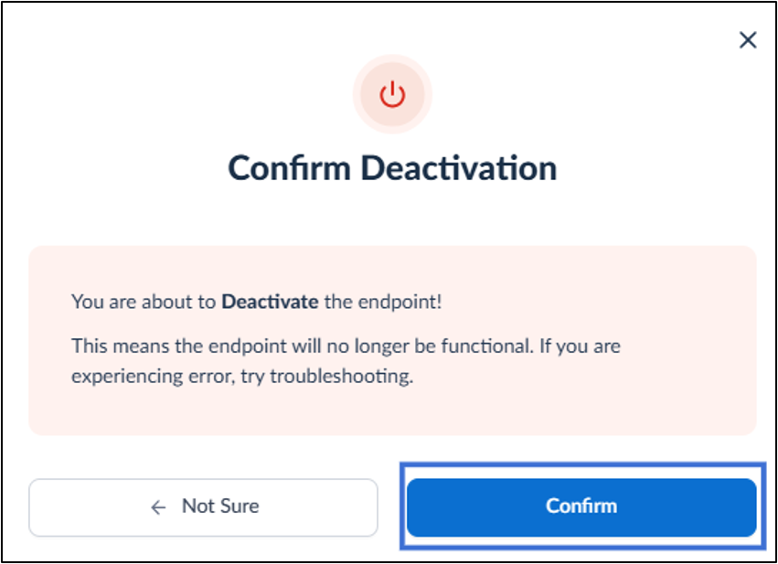
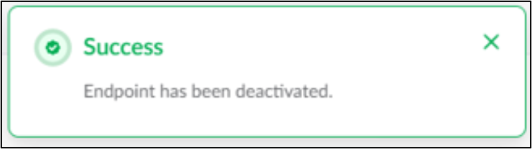

{/* Source: Intercom article 16096126 - https://oloid.help/en/articles/16096126-oloid-connect-how-to-deactivate-endpoint-in-tenant-admin-portal */}
{/* Generated by intercom_to_mintlify.py - re-running overwrites this file. */}

## Introduction

An Oloid Connect endpoint that is already paired and in use can be deactivated when it is no longer required for active use.

<Note>
  **Note:** Once you pair an endpoint with Oloid Connect application, it gets saved and appears in the Tenant Admin Portal.
</Note>

## Prerequisites

- You must have Admin access to the Tenant Admin Portal.
- The Oloid Connect endpoint must be paired and available in the Tenant Admin Portal. For more, refer to[Oloid Connect – How to Pair an Endpoint](/platforms/ios/time-clock/oloid-connect/oloid-connect-how-to-pair-an-endpoint)

## Steps to Deactivate Endpoint

1. Log in to the **Tenant Admin Portal**.
2. On the home page of the portal, click **Endpoints** on the left menu panel.

   

   The **Endpoints** page is displayed.
3. Select the Oloid Connect Endpoint.

   

   The **Endpoint Details** page is displayed.

   

4. Do the following to deactivate the endpoint:
   1. Click **Action**.
   2. From the drop-down menu, click **Deactivate**.

      

      The **Confirm Deactivation** Pop up box is displayed.

Click **Confirm**.

The Oloid Connect Endpoint is deactivated successfully.

