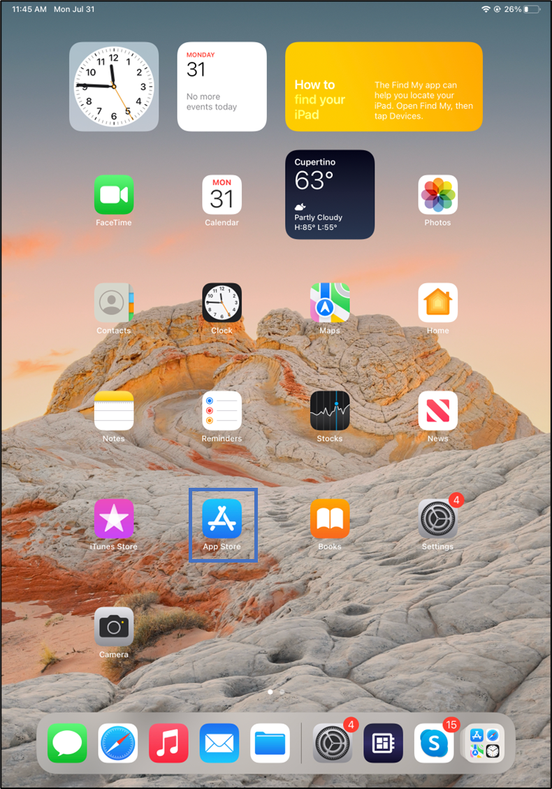
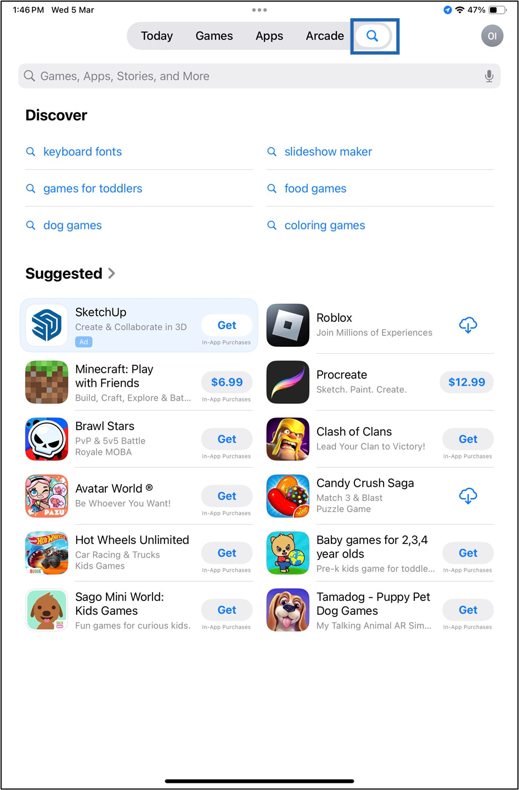
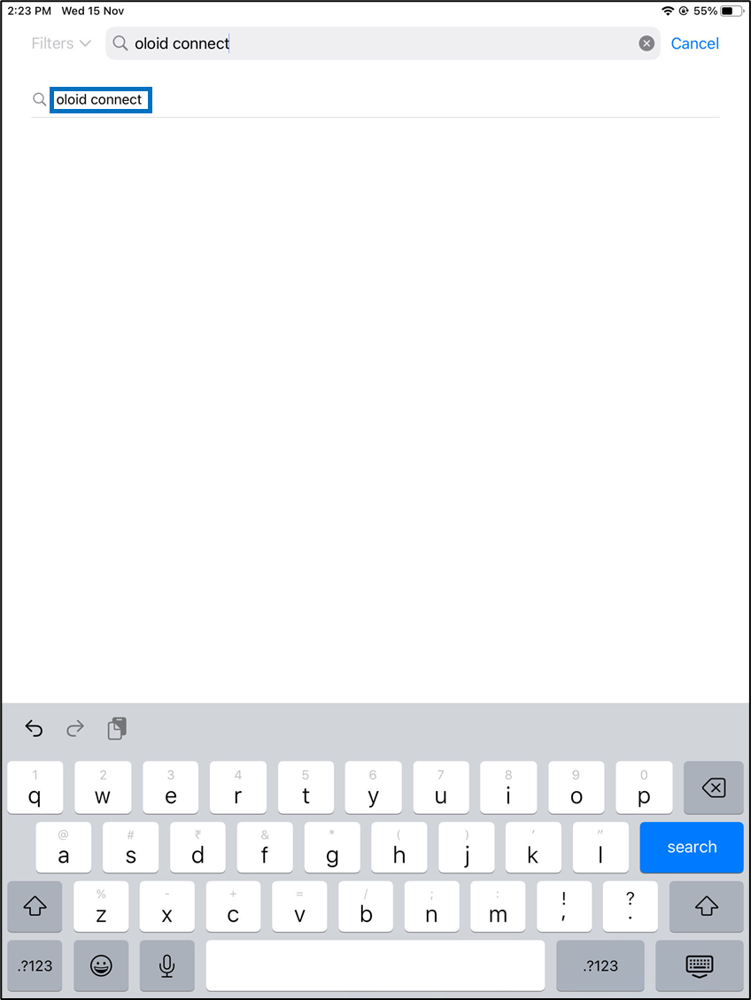
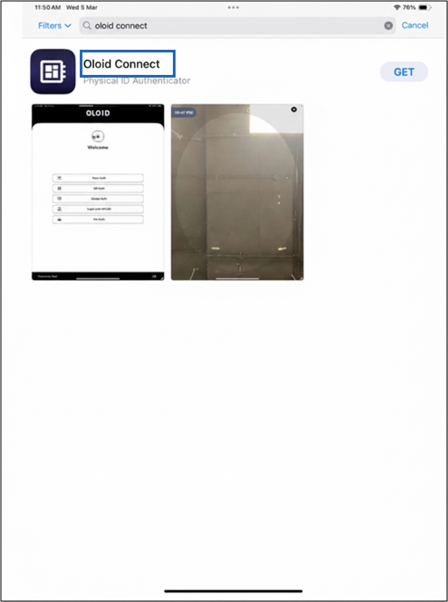
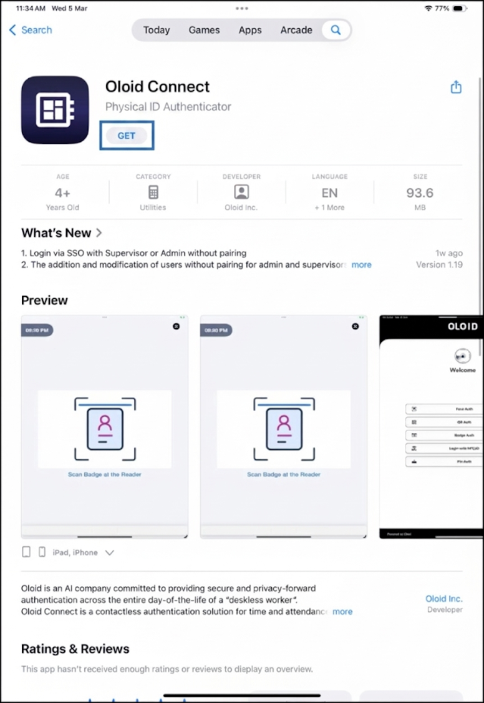
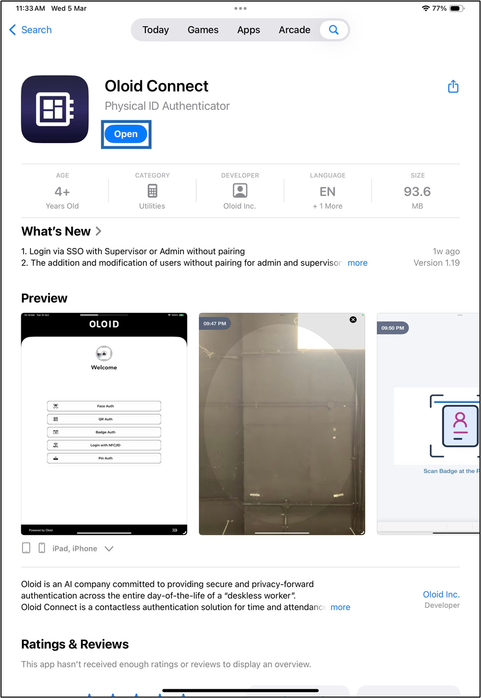

{/* Source: Intercom article 8592076 - https://oloid.help/en/articles/8592076-oloid-connect-how-to-download-and-install-on-ipad */}
{/* Generated by intercom_to_mintlify.py - re-running overwrites this file. */}

## Introduction

The Oloid Connect app allows users to authenticate securely on an iPad using Oloid’s passwordless access solutions. Once installed, the app can be paired as an endpoint and used for authentication.

## Prerequisites

- The iPad must have an Apple ID with access to the App Store.
- A stable internet connection is required.
- The device must meet the minimum hardware and software requirements. For more, refer to [Oloid Connect - Hardware and Software Requirements](/platforms/ios/time-clock/oloid-connect/oloid-connect-hardware-and-software-requirements)

### Steps to download and install Oloid Connect app on iPad

1. On the home screen of the iPad, tap **App Store**.

   

   The **App Store** is displayed.
2. Tap on the **Search** icon located at the top right corner of the screen.

   

   The search bar is displayed.
3. In the search bar, enter **Oloid Connect**.

   

   Select **Oloid Connect** app.
4. Tap the **Oloid Connect** app from the search results.

   <Note>
     **Note:** If you are downloading the app for the first time from the App Store, you will see the **Get** button; otherwise, the **download** icon will appear.
   </Note>

   

5. Tap the **Get** button located next to the **Oloid Connect** app icon.

   

   <Note>
     **Note:** If prompted, enter your Apple ID password or use Touch ID/Face ID to confirm the download.
   </Note>

   After the installation is complete, the **Get** button changes to **Open**.
6. Tap the **Open** button to launch the **Oloid Connect** app.

   

   The welcome screen is displayed.

   
