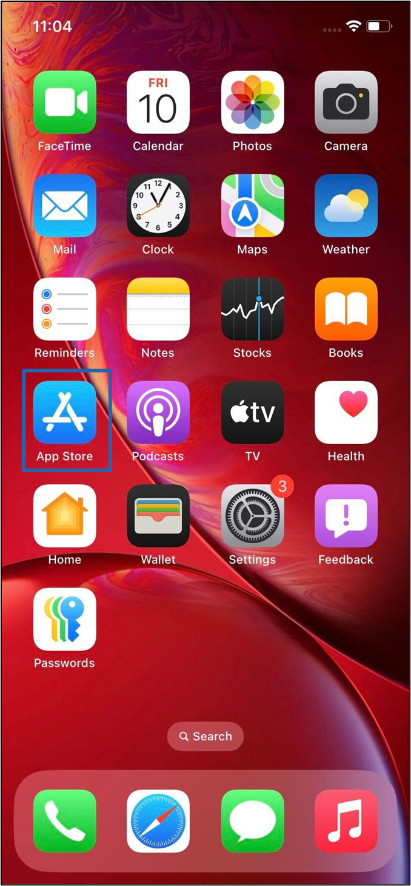
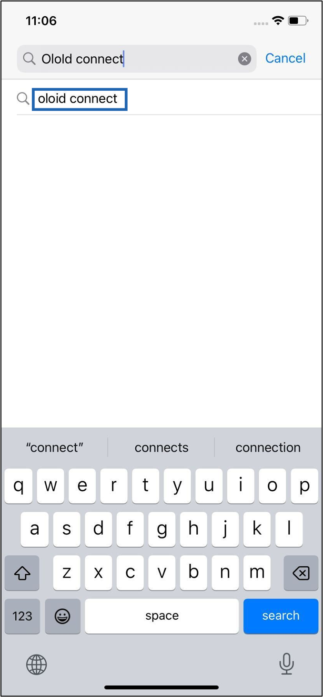
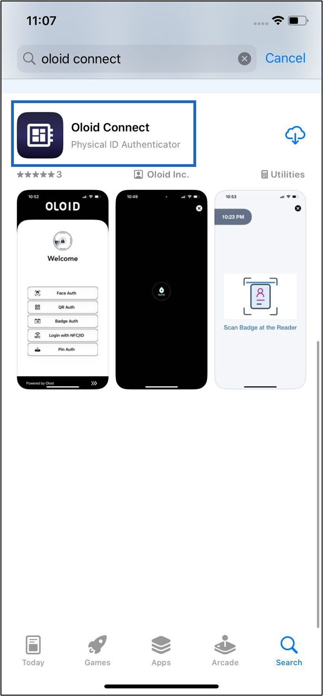
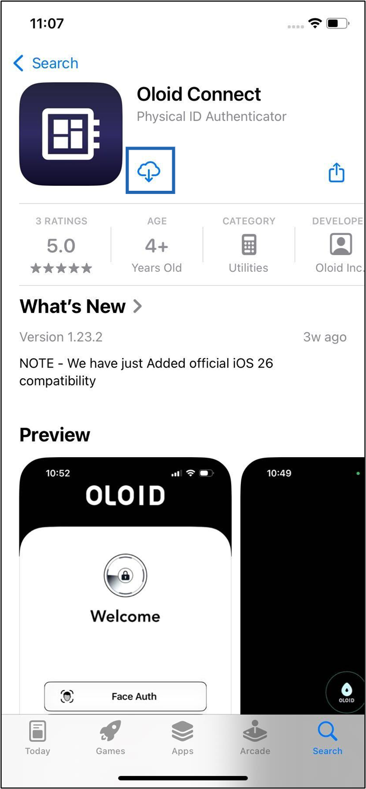
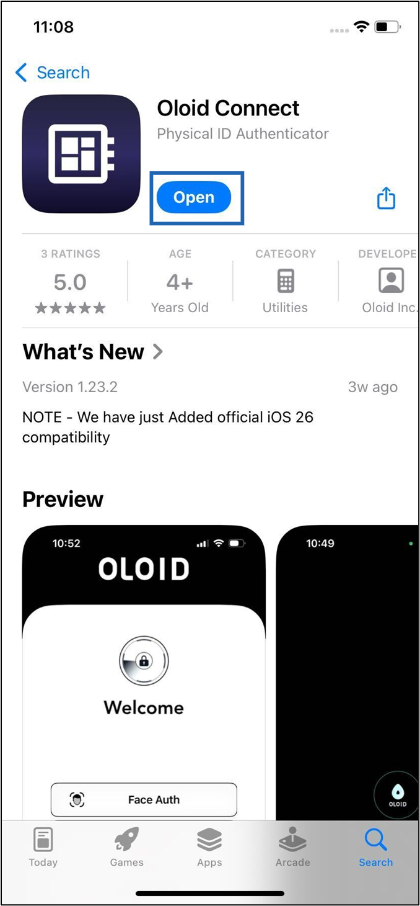
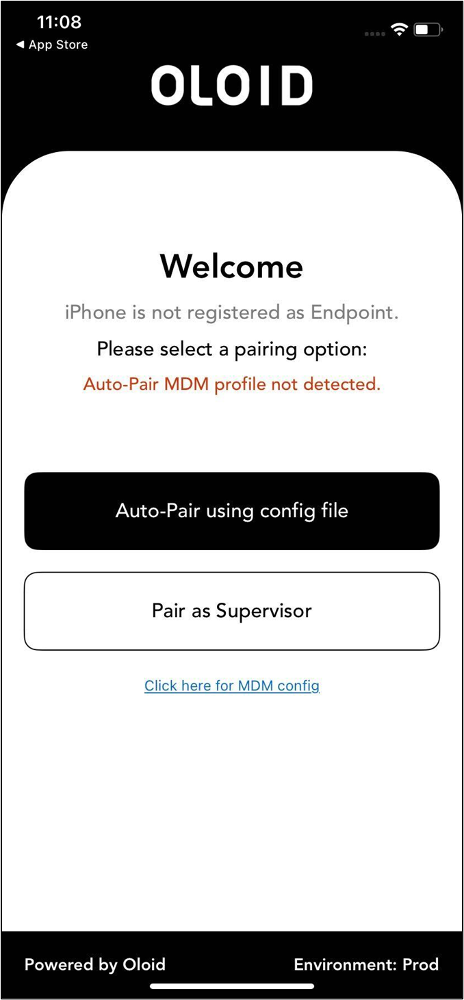

{/* Source: Intercom article 12554658 - https://oloid.help/en/articles/12554658-oloid-connect-how-to-download-and-install-on-iphone */}
{/* Generated by intercom_to_mintlify.py - re-running overwrites this file. */}

## Introduction

This document provides instructions to download and install the Oloid Connect app on an iPhone.

## Prerequisites

- Your iPhone must run **iOS 15 or later**.
- You must have an **Apple ID** and access to the **App Store**.
- Make sure you have a stable internet connection.
- Make sure your device meets the minimum hardware and software requirements. For more details, refer [Oloid Connect - Hardware and Software Requirements](/platforms/ios/time-clock/oloid-connect/oloid-connect-hardware-and-software-requirements)

## Steps to download and install Oloid Connect App

1. Locate the **App Store** on your home screen and tap on it to launch the application.

   

2. In the search bar, Enter **Oloid Connect**.

   

3. Select **Oloid Connect** app.

   <Note>
     **Note:** If you are downloading the app for the first time from the App Store, you will see the **Get** button; otherwise, the **download** icon will appear.
   </Note>

   

4. Tap the **Get** button located next to the **Oloid Connect** app icon.

   

   <Note>
     **Note:** If prompted, enter your Apple ID password or use Touch ID/Face ID to confirm the download.
   </Note>

   After the installation is complete, the **Get** button changes to **Open**.

Tap the **Open** button to launch the **Oloid Connect** app.

The welcome screen is displayed.

The Oloid Connect app is **installed** successfully.
