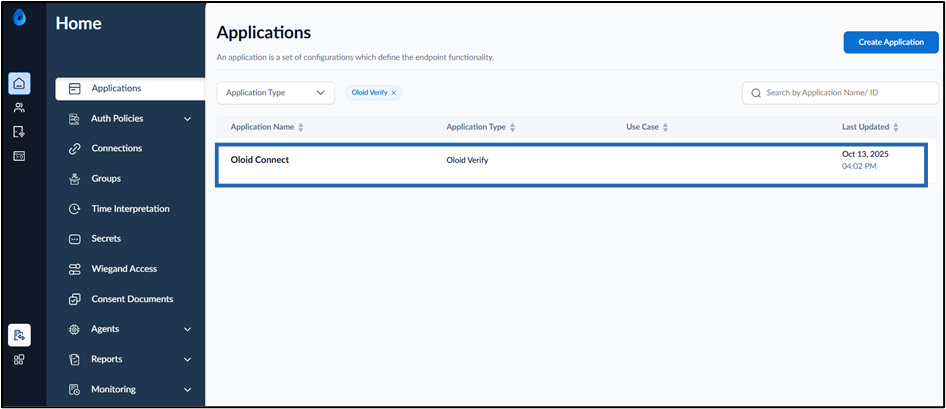
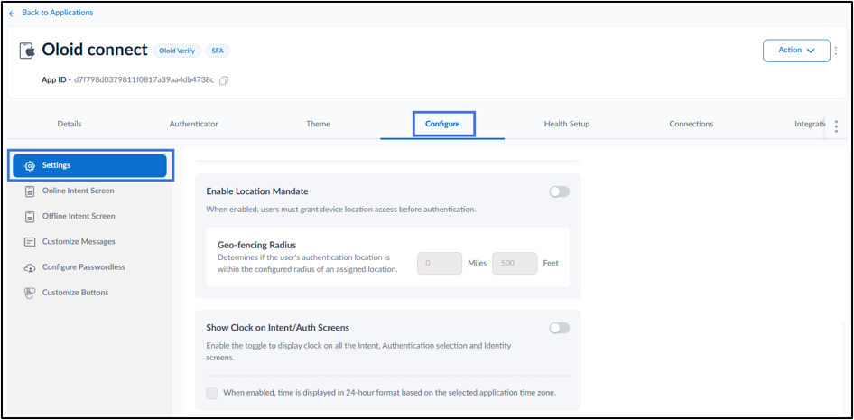
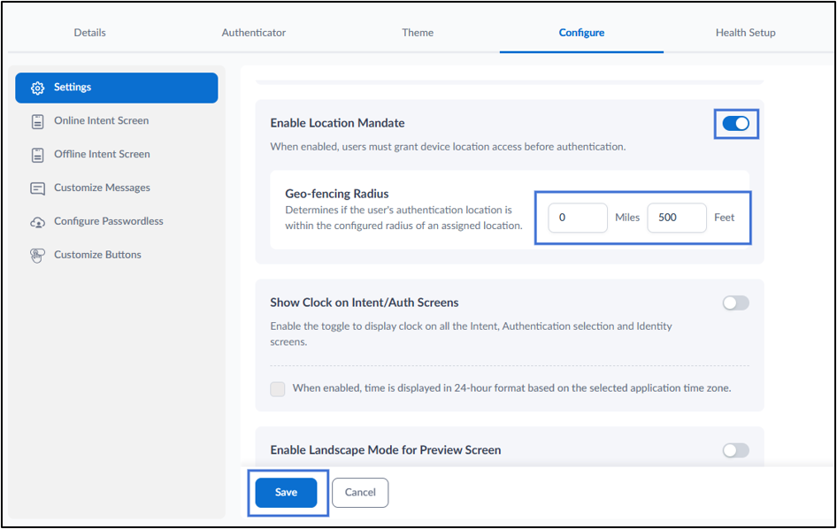
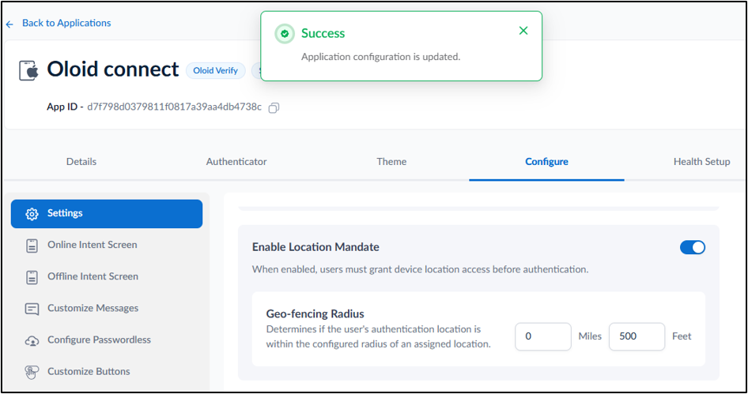

{/* Source: Intercom article 15869578 - https://oloid.help/en/articles/15869578-oloid-connect-how-to-enable-location-mandate-and-configure-geo-fencing-radius-in-tenant-admin-portal */}
{/* Generated by intercom_to_mintlify.py - re-running overwrites this file. */}

## Introduction

This document explains how to enable **Location Mandate** feature and configure **Geo-Fencing Radius** for the Oloid Connect application.

## Prerequisites

- You must have Admin access to the Tenant Admin Portal.
- You must create and configure Oloid Connect application in the Tenant Admin Portal. For more, refer to [How to Create and Configure Oloid Connect Application in Tenant Admin Portal](/platforms/ios/time-clock/oloid-connect/oloid-connect-how-to-create-and-configure-application-in-tenant-admin)

## Steps to Enable Location Mandate

1. Log in to the **Tenant Admin Portal**.
2. On the **Applications** page, click on **Oloid Connect** application.

   

   The application **details** page is displayed.

   

3. Go to **Configure** tab > **Settings.**

   

   The settings page is displayed.
4. **Enable Location Mandate** toggle.

   <Note>
     **Note:** When enabled, users must grant device location access before authentication.
   </Note>

5. In the **Geo-fencing Radius** section, configure the allowed authentication distance:
   **Miles** – Enter the allowed radius in miles.
   **Feet** – Enter the allowed radius in feet.

Click **Save.**

The Location Mandate is configured successfully.

