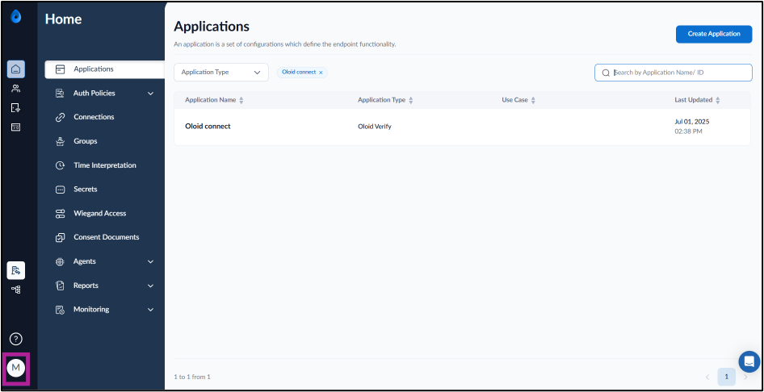
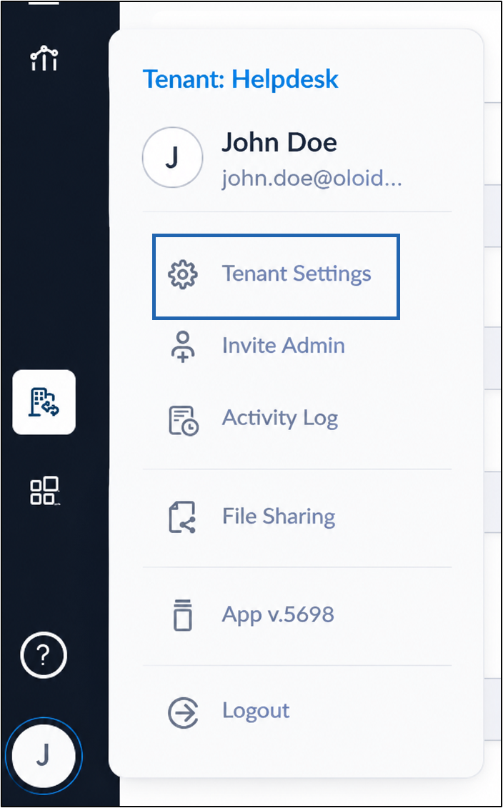
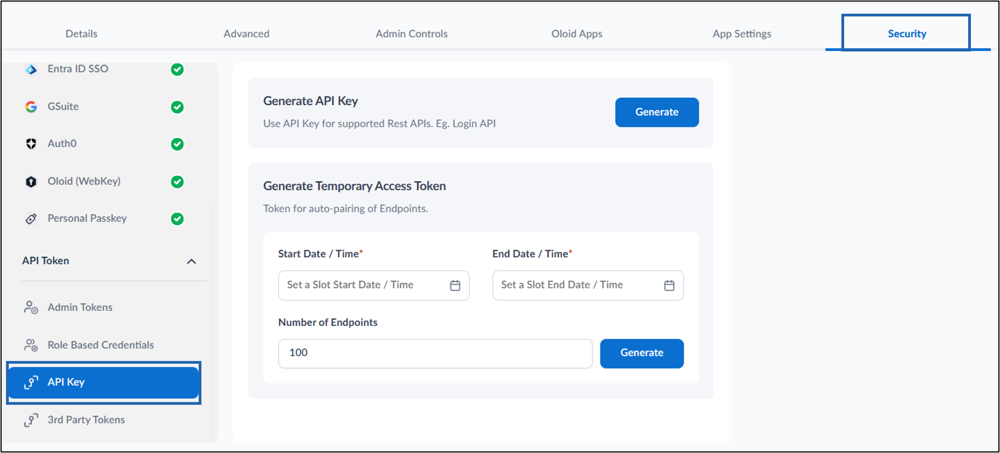
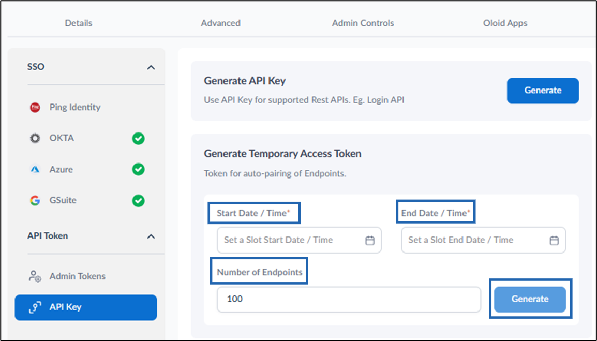
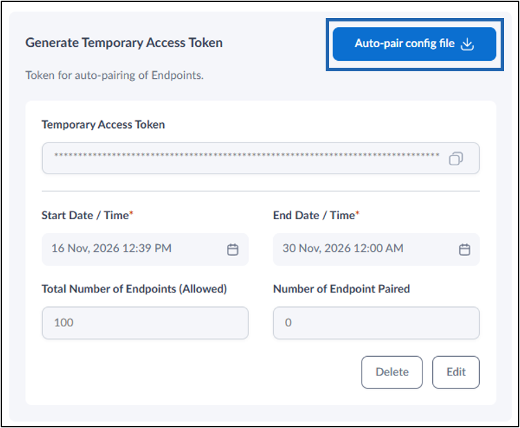
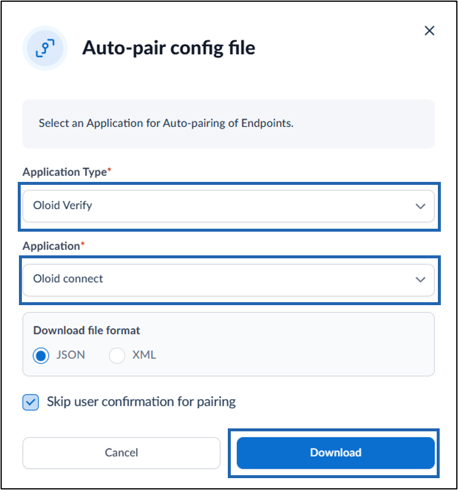

{/* Source: Intercom article 11513590 - https://oloid.help/en/articles/11513590-oloid-connect-how-to-generate-auto-pair-config-file-in-the-tenant-admin-portal */}
{/* Generated by intercom_to_mintlify.py - re-running overwrites this file. */}

## Introduction

The Auto-Pair Config File feature in the Tenant Admin Portal allows Tenant Admins to automate endpoint pairing for the Oloid Connect app. Once the file is uploaded to an endpoint, the endpoint can pair automatically without manual confirmation, which ensures faster setup and consistent configuration across devices.

## Prerequisites

- The user must have a Tenant Admin account.
- An Oloid Connect application must be created. For more, refer to [Oloid Connect - How to Create and Configure Application in Tenant Admin Portal](/platforms/ios/time-clock/oloid-connect/oloid-connect-how-to-create-and-configure-application-in-tenant-admin)

## Steps to generate auto-pair config file

1. Log in to the **Tenant Admin Portal**.
2. On the home page of the portal, click the **user profile** icon in the bottom-left corner of the menu panel.

   

   The **User profile** menu is displayed.
3. Click **Tenant Settings**.

   

   The **Tenant Settings** page is displayed.
4. Go to **Security** tab > **API Token** > **API Key**.

   

5. In the **Generate Temporary Access Token** section, do the following:
   1. Click the **Start Date/Time** date picker, select the date or click **Now**, and then click **OK**.
   2. Click the **End Date/Time** date picker, select the date, and then click **OK**.
   3. Enter the **Number of Endpoints** that can be paired using the token. (Optional)
   4. Click **Generate**.

      

      The Auto-pair config file is generated successfully.
6. Click **Auto-pair config file**.

   

   The Auto-pair config file pop-up box is displayed.
7. On the pop-up, do the following:
   1. Select **Oloid Verify** from the **Application Type** drop-down list.
   2. Select the application for the endpoints to pair with from the **Select Application** drop-down list.
   3. Under **Download file format**, select one of the following:
      - **JSON:** For local device setup.
      - **XML:** For MDM deployment.
   4. Select the **Skip user confirmation for pairing** checkbox to pair endpoints automatically without user confirmation. (Recommended)

      <Note>
        **Note:** If this checkbox isn’t selected, a confirmation pop-up is displayed to the user before pairing is completed.
      </Note>

   5. Click **Download**.

      

      The auto-pair config file is downloaded successfully.
