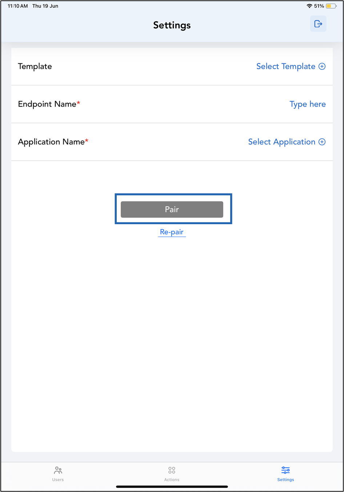
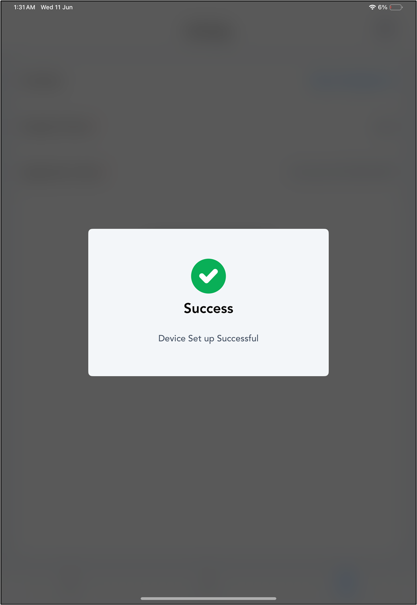
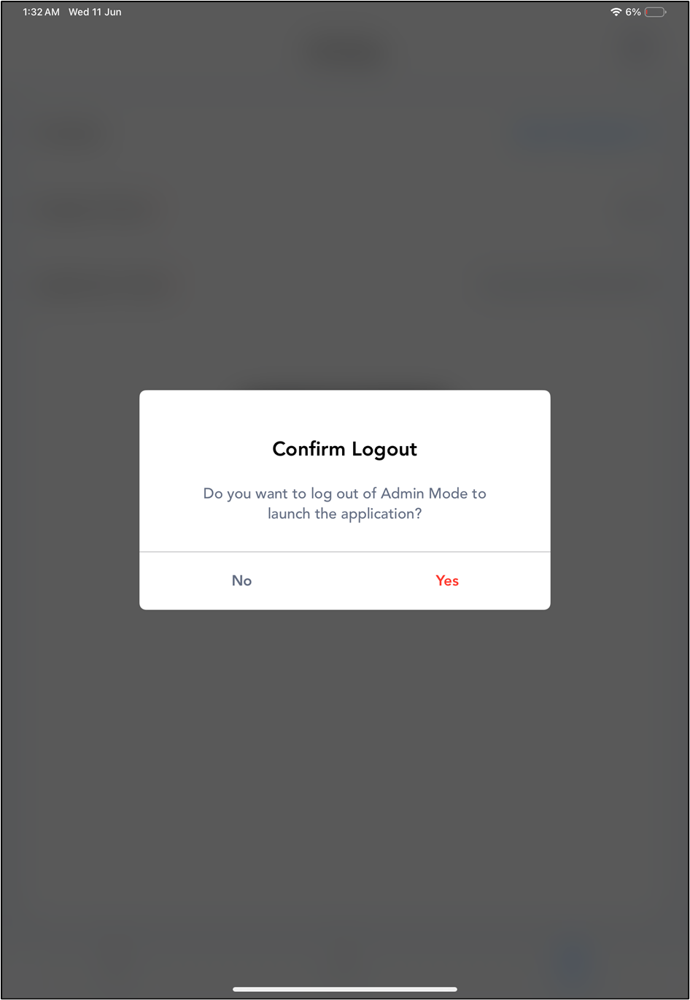

{/* Source: Intercom article 8616268 - https://oloid.help/en/articles/8616268-oloid-connect-how-to-pair-an-endpoint */}
{/* Generated by intercom_to_mintlify.py - re-running overwrites this file. */}

## Introduction

This document explains how to pair an endpoint using the **Oloid Connect** application. Pairing connects the endpoint to the Oloid Connect application in the Tenant Admin Portal and prepares the endpoint for authentication and transaction activities.

## Prerequisite

- You must have Admin or Supervisor access.
- You must install Oloid Connect and complete the Admin setup before pairing an endpoint. For more, refer to [How to Download and Install the Oloid Connect App](/platforms/ios/time-clock/oloid-connect/oloid-connect-how-to-download-and-install-on-ipad)

## Steps to Pair an Endpoint

1. Log in to **Oloid Connect**  app.
   The **Welcome** screen is displayed.

   

   <Note>
     **Note:** You must Complete the Admin setup**.** For more information, refer to[Oloid Connect - Admin Setup](/platforms/ios/time-clock/oloid-connect/oloid-connect-admin-setup)
   </Note>

   The Settings page is displayed on a successful login.
2. Do the following:
   1. Add **Template** (optional).

      <Note>
        **Note:** Templates allow Admins to configure Endpoints at scale. A template has to be created in Tenant Admin Portal. For more, refer to [How to create and configure Oloid Connect endpoint template](/platforms/ios/time-clock/oloid-connect/oloid-connect-how-to-create-and-configure-endpoint-template-in-the)
      </Note>

   2. Enter **Endpoint Name**.
   3. Select **Application Name** from **Application Name** dropdown list.
   4. Tap **Pair**.

      

      The settings are saved and endpoint is successfully paired.

      

      The application prompts you to log out of Admin mode.
3. Do one of the following:
   1. Tap **Yes** to log out and launch the application (**preview mode**).
      The app displays preview mode and allows you to do the transactions.
   2. Tap **No** to stay logged in to the admin mode.

      
