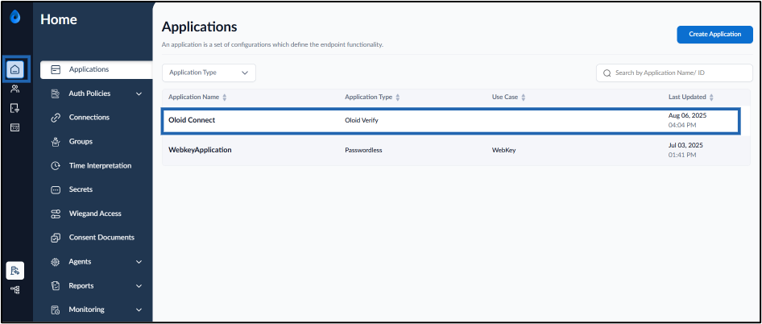
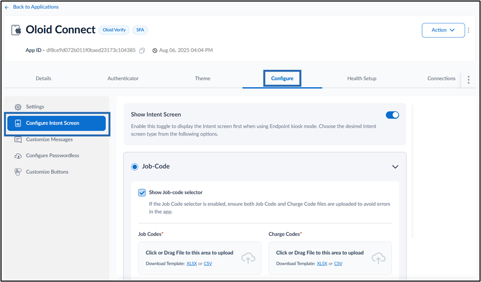
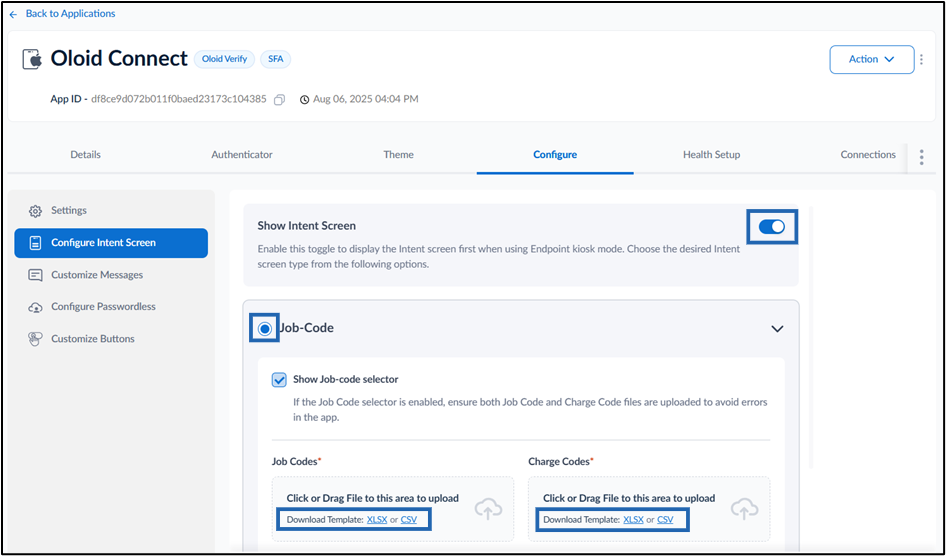
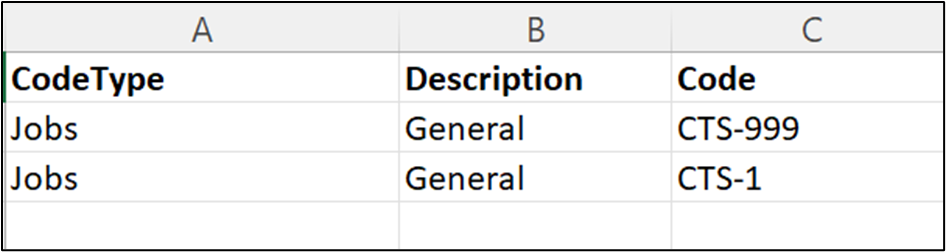
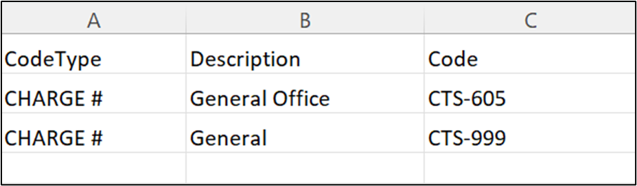

{/* Source: Intercom article 11948333 - https://oloid.help/en/articles/11948333-oloid-connect-how-to-prepare-job-and-charge-code-template */}
{/* Generated by intercom_to_mintlify.py - re-running overwrites this file. */}

## Steps to prepare Job and Charge Code template

1. Log in to Tenant Admin Portal.
2. On the home page of the portal, click **Oloid connect** application.

   

   The Oloid Connect application page is displayed.
3. Go to **Oloid Connect Application**  > **Configure** tab > **Configure Intent screen**.

   

4. Enable **Show Intent screen** > Select **Job-Code >** Click **Download Template** under **Job Codes** and **Charge Codes** to download the templates.

   

5. Open the downloaded template in Excel.
6. Prepare the following templates:
   1. **Job Code** template
      OR
   2. **Charge Code** template
      The Job and Charge Code templates are prepared and ready to use.

## Job Code Template

### Steps to prepare Job Code template

Open the template and do the following:

1. Enter **Code Type.**
   - Enter Jobs in this column for all rows.
     This value indicates that the entry is a job code.
2. Enter **Description.**
   - Provide a short description of the job.
     Example: General, Supervisor, Technician etc.
3. Enter **Code.**
   - Enter the unique job code identifier.
     Example: CTS-999, CTS-1

     

     The Job code template prepared successfully.

## Charge Code Template

### Steps to prepare Job Code template

Open the template and do the following:

1. Enter **Code Type.**
   - Enter Charge in this column for all rows.
     This value indicates that the entry is a Charge code.
2. Enter **Description.**
   - Provide a short description of the job.
     Example: General, Supervisor, Technician etc.
3. Enter **Code.**
   - Enter the unique job code identifier.
     Example: CTS-605, CTS-999

The Charge code template prepared successfully.
