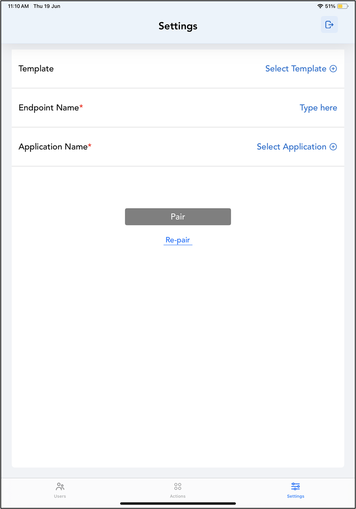
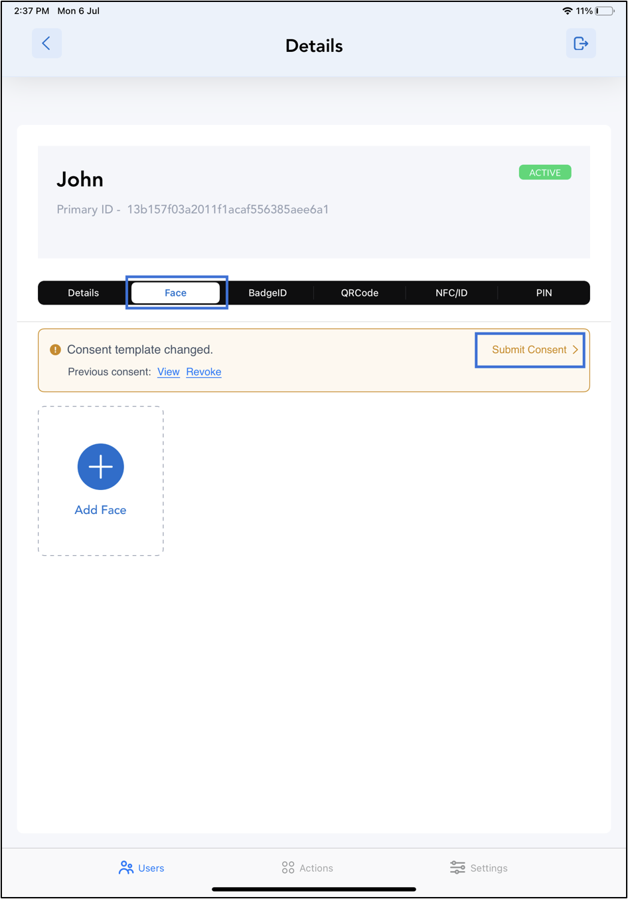
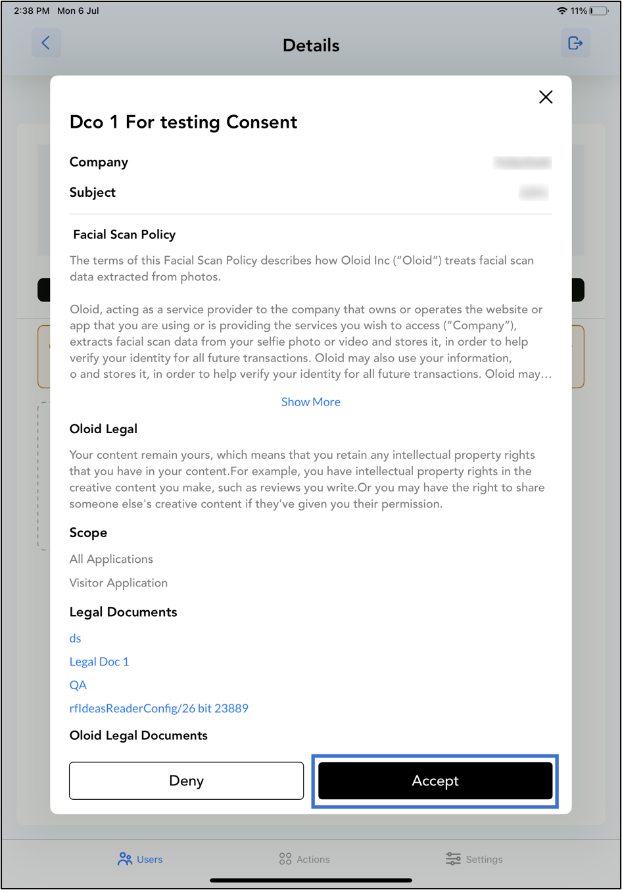
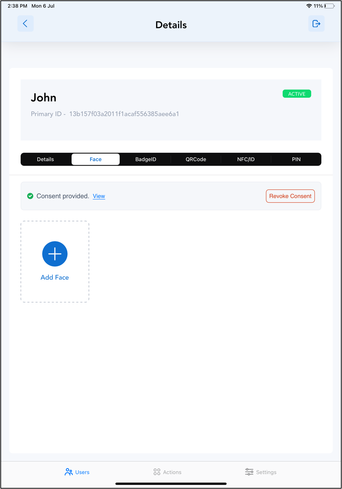

{/* Source: Intercom article 14594718 - https://oloid.help/en/articles/14594718-oloid-connect-how-to-re-submit-consent-on-the-endpoint */}
{/* Generated by intercom_to_mintlify.py - re-running overwrites this file. */}

## Introduction

If the consent template is updated in the Tenant Admin Portal after a face credential is added, the previously submitted consent becomes outdated. The admin must submit the updated consent again in the Oloid Connect endpoint.

## Prerequisite

Face credential must be added for the user. For more, refer to

[Oloid Connect - Add Face](/platforms/ios/time-clock/oloid-connect/oloid-connect-how-to-add-face-for-a-user).

## Step to Re-Submit Consent on the Endpoint

1. Launch the **Oloid Connect**  app.

   <Note>
     **Note:** For more information about how to log in to the Oloid Connect, refer to [How to log in to the Admin mode in Oloid Connect App.](/platforms/ios/time-clock/oloid-connect/how-to-log-in-to-admin-mode-in-the-oloid-connect-app)
   </Note>

   The **Settings** page is displayed.
2. Tap **Users** on the menu at the bottom of the screen.

   

   The **Users** page with list of users is displayed.
3. Tap on the selected user to Re-Submit consent, or search for a user using the search bar at the top.

   

   The Details screen is displayed.
4. Tap **Face** tab > Tap **Submit Consent.**

   

   The consent form is displayed.

Tap **Accept**.

The consent is submitted successfully.

