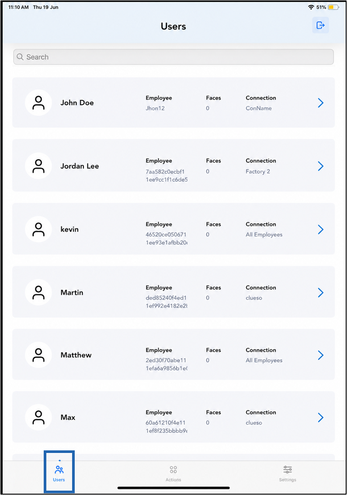
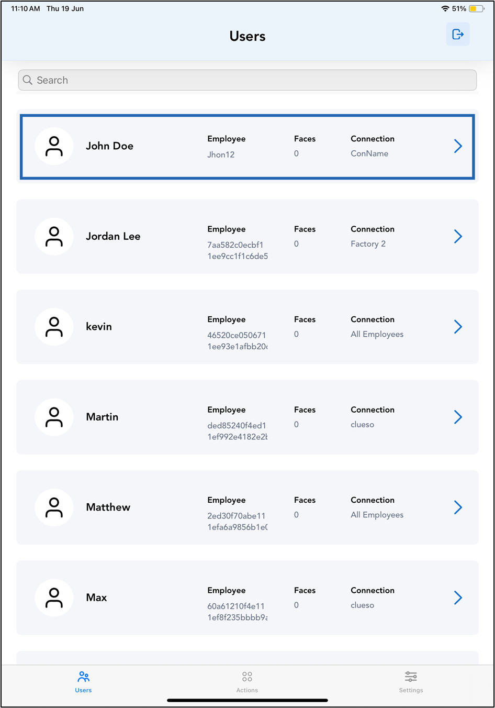
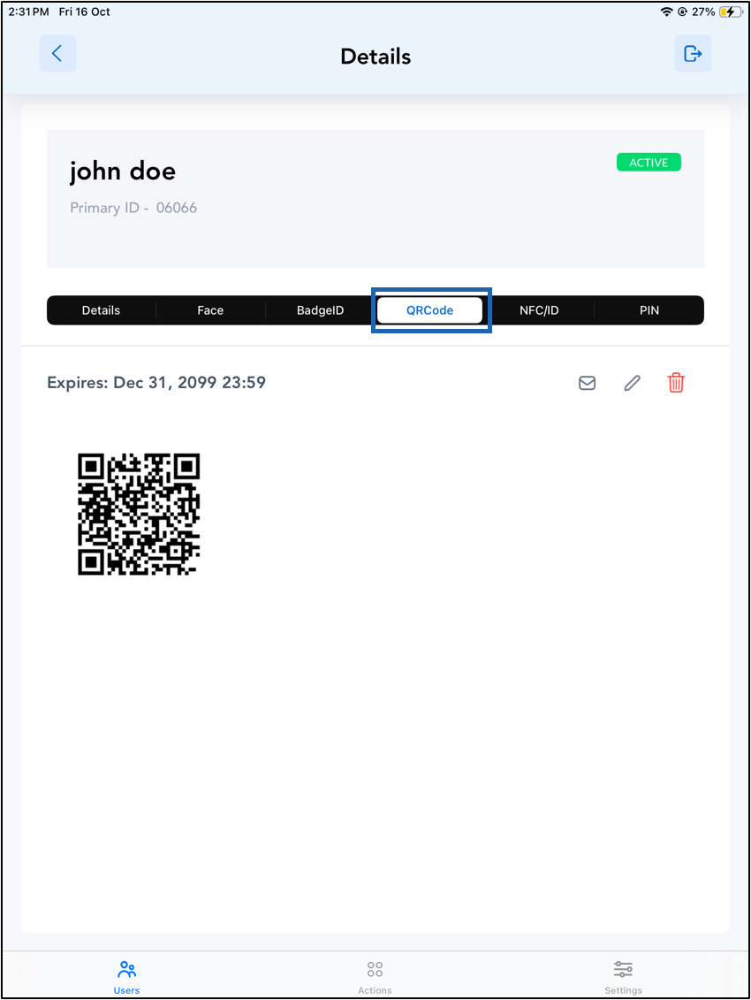
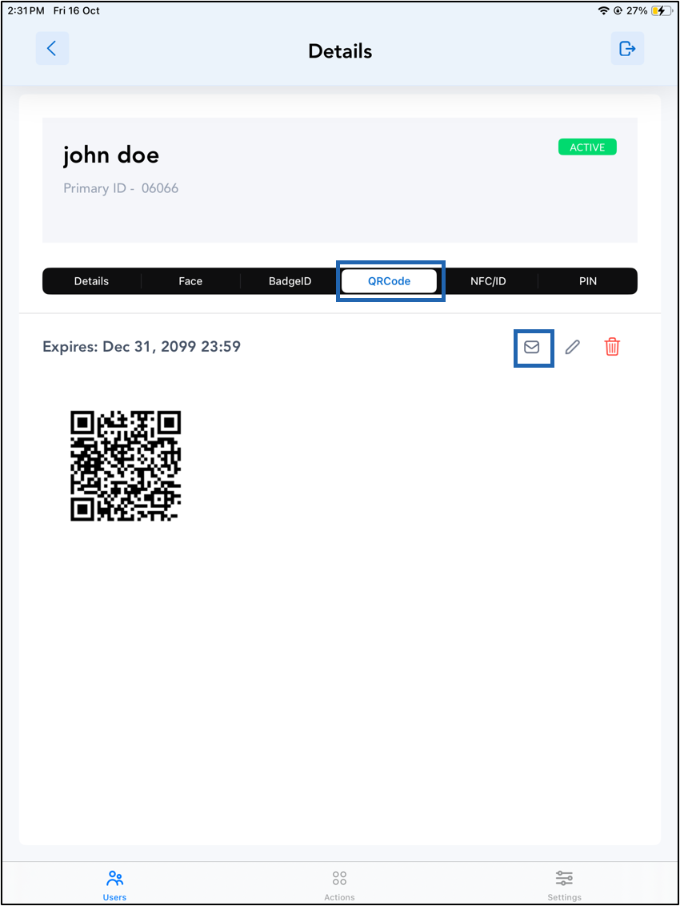
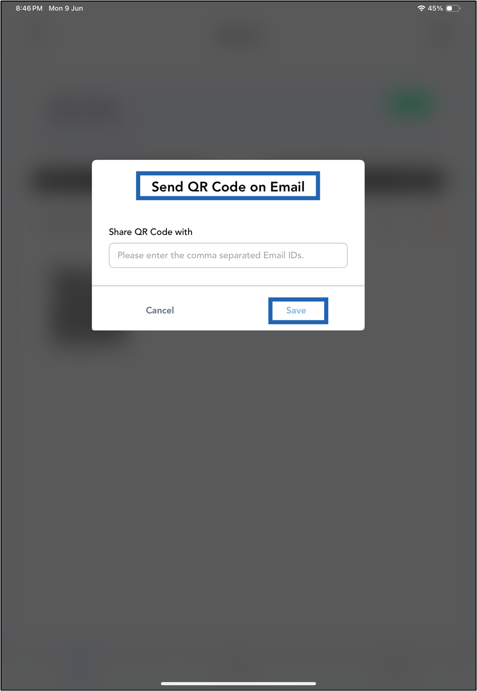
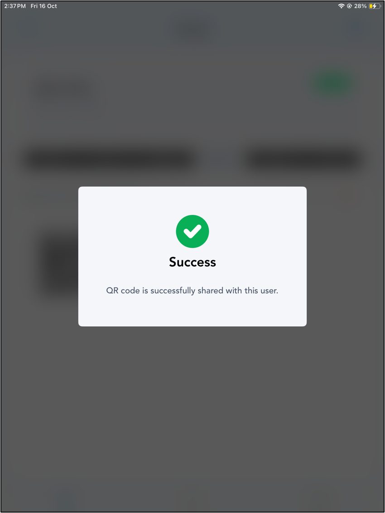

{/* Source: Intercom article 8789251 - https://oloid.help/en/articles/8789251-oloid-connect-how-to-send-qr-code-to-user */}
{/* Generated by intercom_to_mintlify.py - re-running overwrites this file. */}

## Introduction

This document provides instructions to send a QR Code to a user on email using the Oloid Connect app.

## Prerequisites

- You must have access to the Tenant Admin Portal or Supervisor account.
- A QR Code must be created for the user. For more, refer to [Oloid Connect - How to Add QR Code for a User](/platforms/ios/time-clock/oloid-connect/oloid-connect-how-to-add-qr-code-for-a-user)
- Make sure the Endpoint device is paired with the application. For more, refer to [Oloid Connect – How to Pair an Endpoint](/platforms/ios/time-clock/oloid-connect/oloid-connect-how-to-pair-an-endpoint)

## Steps to send QR Code via email

1. Launch the **Oloid Connect** app.

   

2. Log in to Admin mode in Oloid Connect app. For more details, refer to [How to Log in to Admin Mode in the Oloid Connect App](/platforms/ios/time-clock/oloid-connect/how-to-log-in-to-admin-mode-in-the-oloid-connect-app)
   The **Users** screen is displayed.

   

3. Select the preferred **Username** from the list.

   <Note>
     **Note:** You can also search for the user using the search bar at the top.
   </Note>

   

   The User details screen is displayed.
4. Tap **QR Code** tab.

   

   The QR Code is displayed.
5. Tap **Email** icon.

   

   The **Send QR Code on Email** pop-up box is displayed.
6. Enter the recipient email addresses to share the QR code.

Tap **Save**.

The QR code is **sent** successfully to the user's email id.

