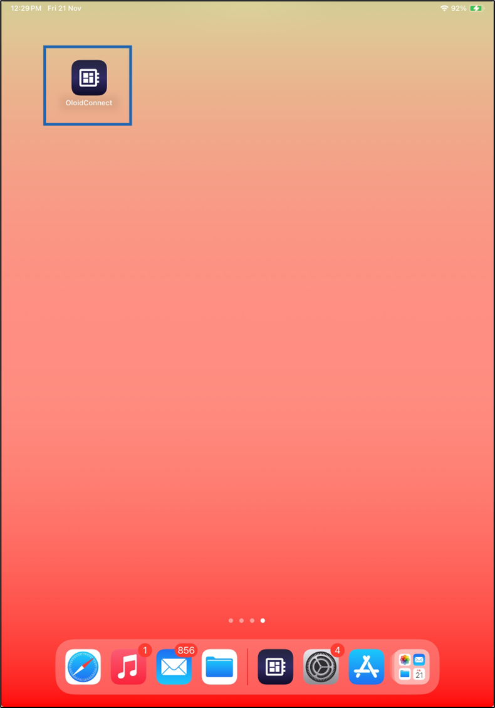
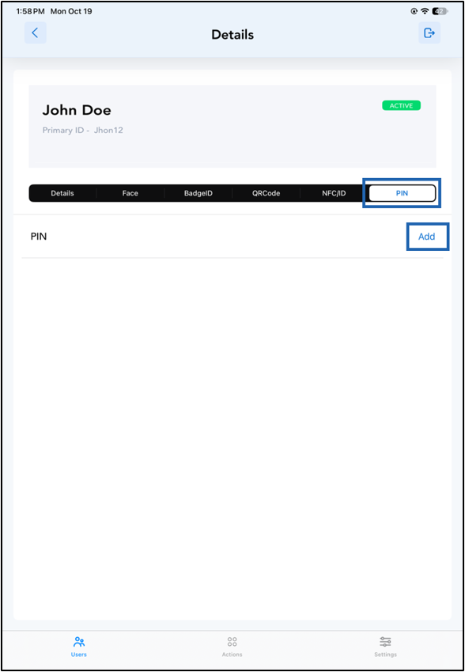
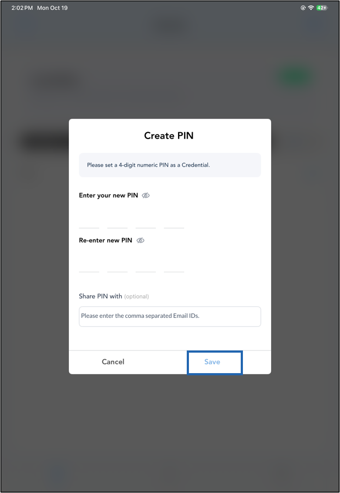
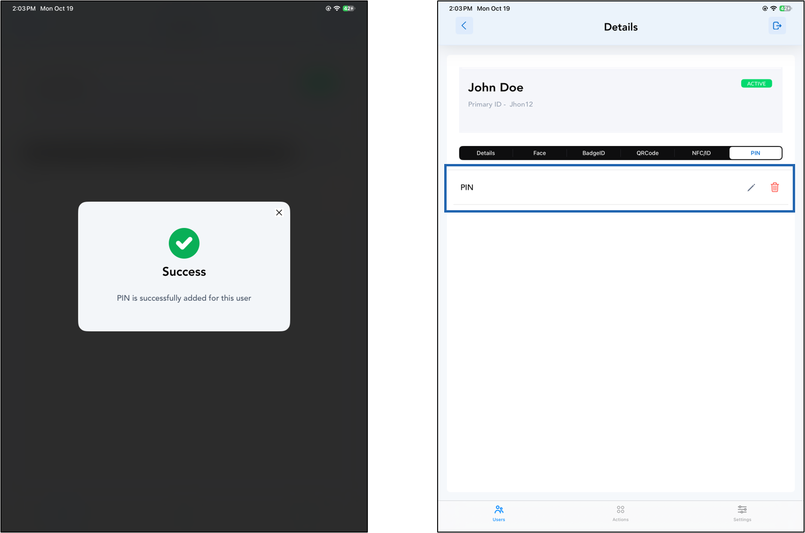

{/* Source: Intercom article 8768778 - https://oloid.help/en/articles/8768778-oloid-connect-how-to-set-pin-for-a-user */}
{/* Generated by intercom_to_mintlify.py - re-running overwrites this file. */}

## Introduction

This document provides instructions to set PIN for a user using the Oloid Connect app.

## Prerequisites

- You must have access to the Tenant Admin Portal or Supervisor account.
- The user must be added. For more, refer to [Oloid Connect - How to Add a User](/platforms/ios/time-clock/oloid-connect/oloid-connect-how-to-add-a-user)

## Steps to Set PIN

1. Launch the **Oloid Connect** app.

   

2. Log in to Admin mode in Oloid Connect app. For more details, refer to [How to Log in to Admin Mode in the Oloid Connect App](/platforms/ios/time-clock/oloid-connect/how-to-log-in-to-admin-mode-in-the-oloid-connect-app)
   The **Users** screen is displayed.

   

3. Select the preferred **Username** from the list.

   <Note>
     **Note:** You can also search for the user using the search bar at the top.
   </Note>

   

   The user's details screen is displayed.
4. Go to the **PIN** tab > tap **Add**.

   

   The **Create PIN** pop-up box is displayed.
5. Do the following:
   1. Enter your new PIN.
   2. Re-enter new PIN.
   3. Enter recipient **Email ID(s)** to share **PIN**. (Optional)
   4. Tap **Save**.

      

      The PIN credential is successfully **created** for the user.

      
