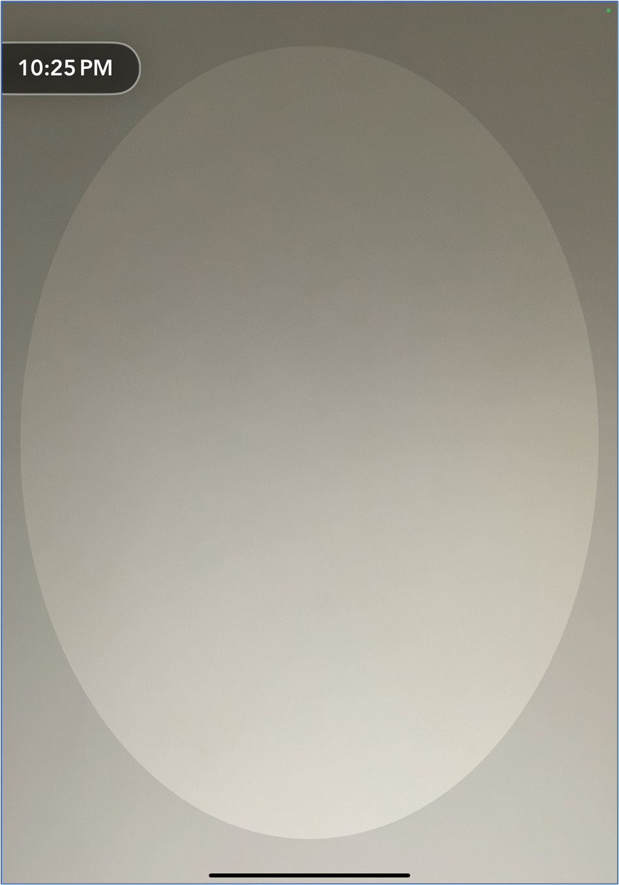
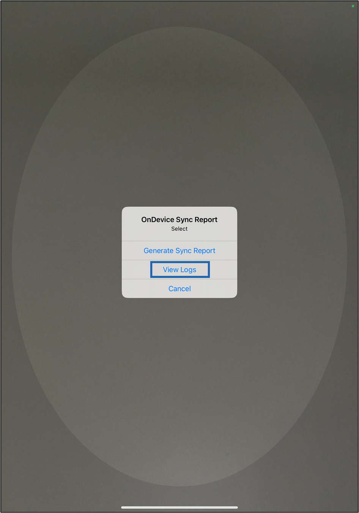
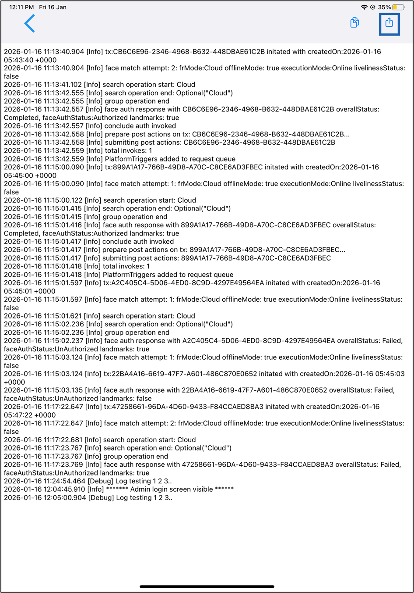
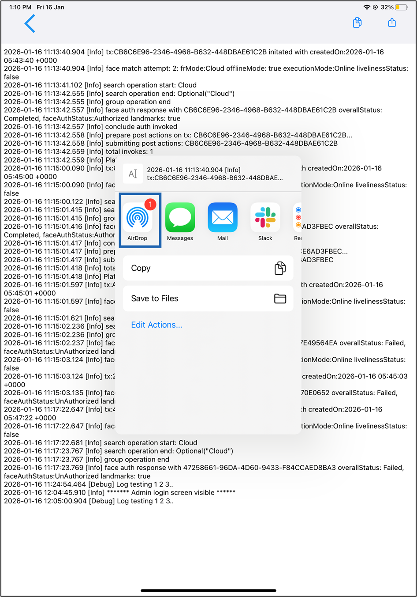
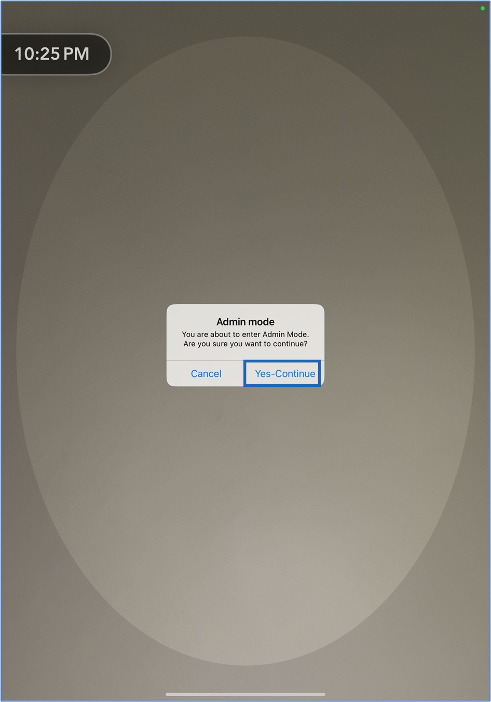
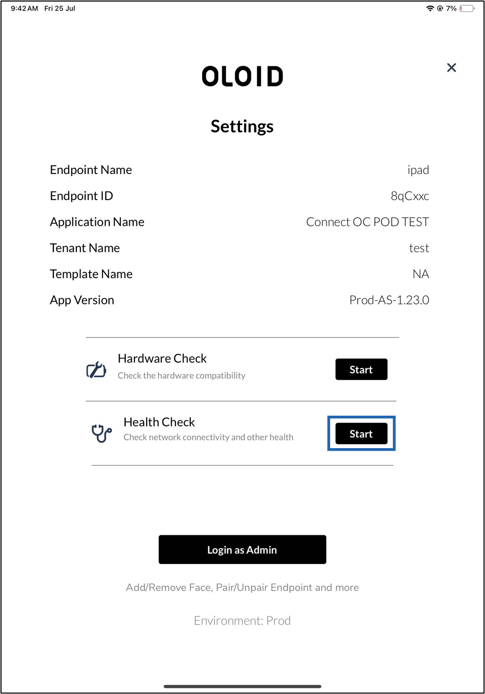
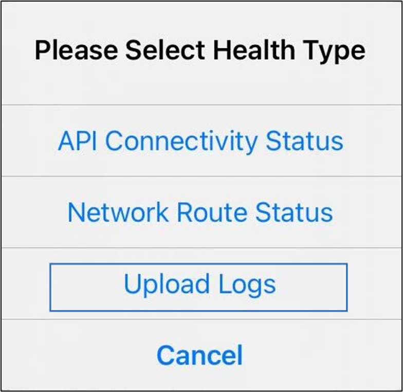
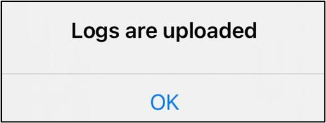

{/* Source: Intercom article 13405850 - https://oloid.help/en/articles/13405850-oloid-connect-how-to-share-logs-with-app-developer */}
{/* Generated by intercom_to_mintlify.py - re-running overwrites this file. */}

On the **Oloid Connect** app, you can share logs with the app developer in two ways:

View and Share App Logs with the Developer
[Upload Logs to the App Developer](#upload-logs-to-the-app-developer)

## Prerequisite

Endpoint configuration for Debug Logs should be enabled in the Tenant Admin Portal. For more information, refer to [How to Enable Debug Logs](/platforms/ios/time-clock/oloid-connect/oloid-connect-how-to-configure-endpoint-in-the-tenant-admin-portal)

## View and Share Logs with the App Developer

### Steps to View and Share Logs

1. Launch the **Oloid Connect App**.

   <Note>
     **Note:** Since the endpoint is already paired, the App will launch in the initial screen of the App. For more, refer to [How to pair an Oloid Connect endpoint](/platforms/ios/time-clock/oloid-connect/oloid-connect-how-to-pair-an-endpoint).
   </Note>

2. Tap the screen four times using a single finger.

   

   The **OnDevice Sync Report** pop-up box is displayed.
3. Tap **View Logs.**

   

   The log report is displayed on the screen.
4. On the top right corner of the report page, tap share button to send the log report to the developer.

   

   <Note>
     **Note:** use **AirDrop** to transfer the logs to another iPad or iOS device where the Mail app is configured. Once transferred, you can email the logs from that device.
   </Note>

   

## Upload Logs to the App Developer

### Steps to Upload Logs

1. Launch the **Oloid Connect App**.

   <Note>
     **Note:** Since the endpoint is already paired, the App will launch in the preview screen of the App. For more details, refer to [How to pair an Oloid Connect endpoint](/platforms/ios/time-clock/oloid-connect/oloid-connect-how-to-pair-an-endpoint).
   </Note>

   

2. Double tap with two fingers on the preview screen to launch the Admin Mode.
3. Tap **Yes- Continue.**

   

   The **Settings** screen is displayed.
4. Tap **Start** in the **Health Check** section.

   

   The **Please Select Health Type** pop-up box is displayed.
5. Tap **Upload Logs.**

   

   The logs are successfully uploaded and automatically shared with the app developer.

   
