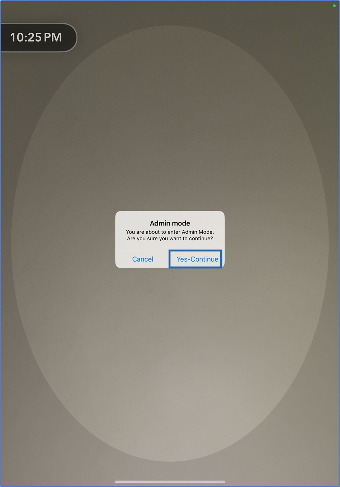
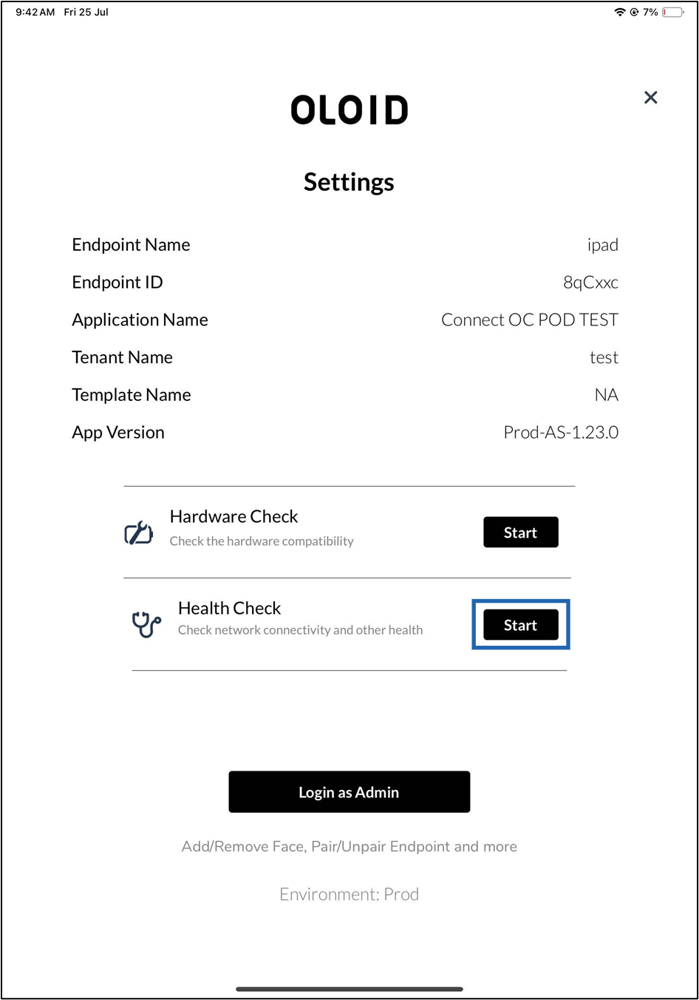
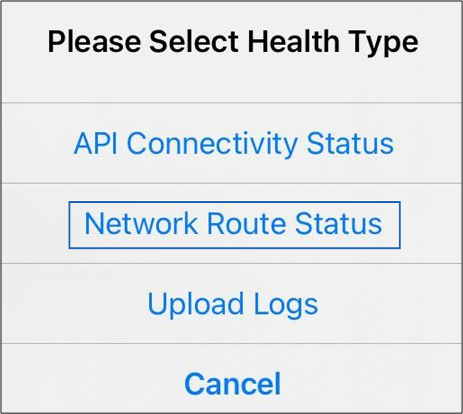
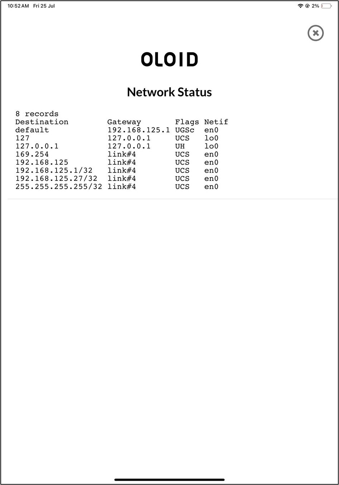

{/* Source: Intercom article 8611826 - https://oloid.help/en/articles/8611826-oloid-connect-how-to-test-network-connectivity-on-the-oloid-connect-endpoint */}
{/* Generated by intercom_to_mintlify.py - re-running overwrites this file. */}

## Introduction

The Health Check feature in the Oloid Connect app allows Tenant Admins and Supervisors to test the network connectivity of an endpoint. The Network Route Status check shows whether the endpoint can reach the required network routes, which helps identify connectivity issues.

## Prerequisites

- The user must be a Tenant Admin or Supervisor.
- The endpoint must be paired with the Oloid Connect application. For more, refer to [Oloid Connect – How to Pair an Endpoint](/platforms/ios/time-clock/oloid-connect/oloid-connect-how-to-pair-an-endpoint)

## Steps to test network connectivity status

1. Launch the **Oloid Connect App**.

   

   The preview screen is displayed.

   <Note>
     **Note:** Since the endpoint is already paired, the app launches in preview mode.
   </Note>

   

2. Double-tap the preview screen with **Two fingers** to launch Admin Mode.
3. Tap **Yes- Continue.**

   

   The **Settings** screen is displayed.
4. In the **Health Check** section, tap **Start**.

   

   The **Please Select Health Type** pop-up box is displayed.
5. On the pop-up box, tap **Network Route Status**.

The **Network Status** screen is displayed successfully.

