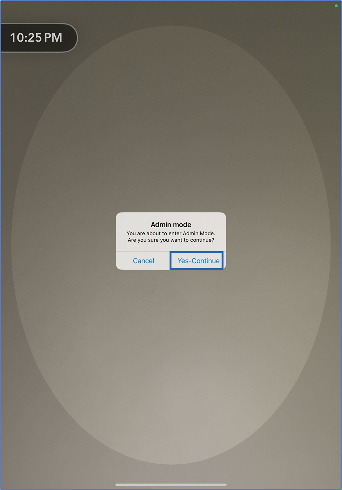
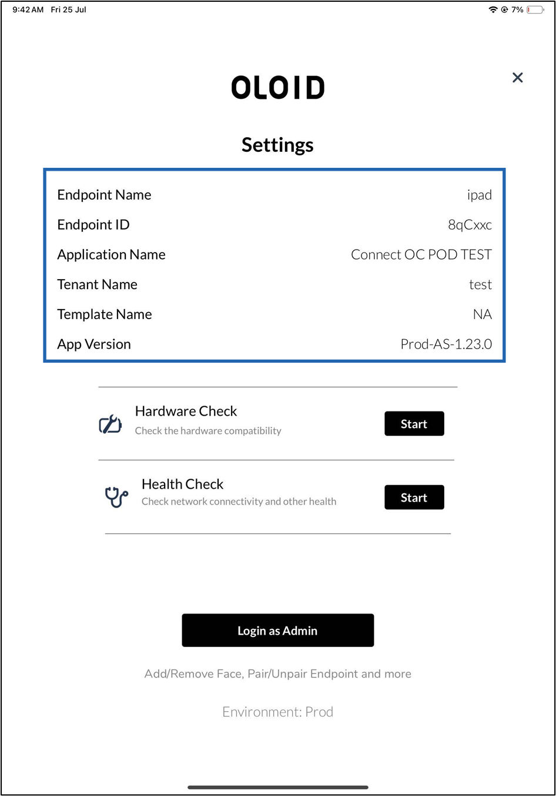

{/* Source: Intercom article 8616263 - https://oloid.help/en/articles/8616263-oloid-connect-how-to-view-endpoint-details-on-the-oloid-connect-app */}
{/* Generated by intercom_to_mintlify.py - re-running overwrites this file. */}

## Introduction

The Oloid Connect app allows Tenant Admins and Supervisors to view endpoint details directly from the device. These details help verify the endpoint’s configuration, troubleshoot issues, and confirm that the endpoint is set up correctly.

## Prerequisites

- The user must be a Tenant Admin or Supervisor.
- The endpoint must be paired with the Oloid Connect application. For more, refer to [Oloid Connect – How to Pair an Endpoint](/platforms/ios/time-clock/oloid-connect/oloid-connect-how-to-pair-an-endpoint)

## Steps to view endpoint details

1. Launch the **Oloid Connect App**.

   

   <Note>
     **Note:** Since the endpoint is already paired, the app launches in preview mode.
   </Note>

   

2. Double-tap the preview screen with two fingers to launch Admin Mode.
3. Tap **Yes- Continue.**

   

   The **Settings** screen is displayed with the endpoint details.

   
