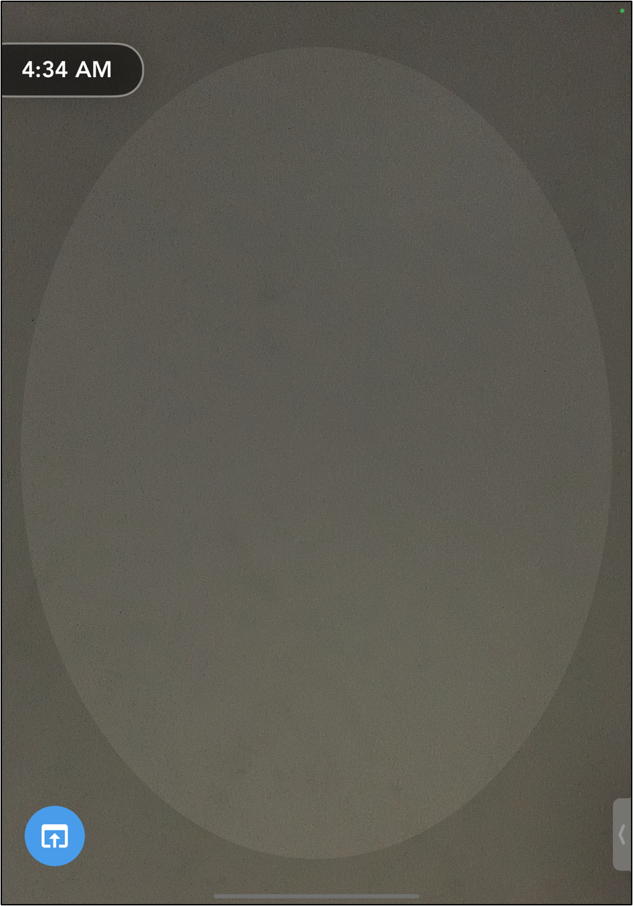
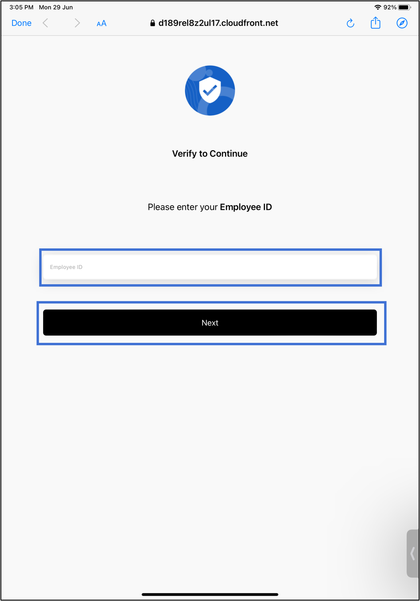
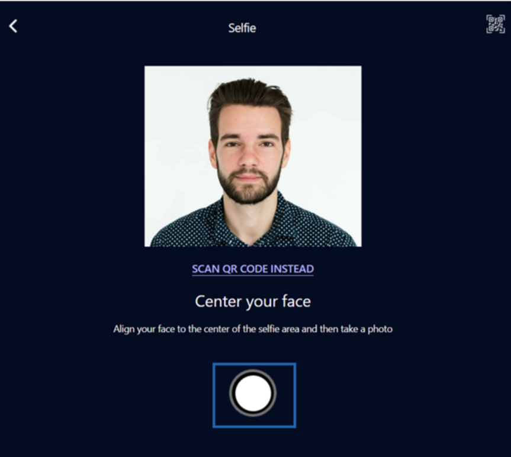
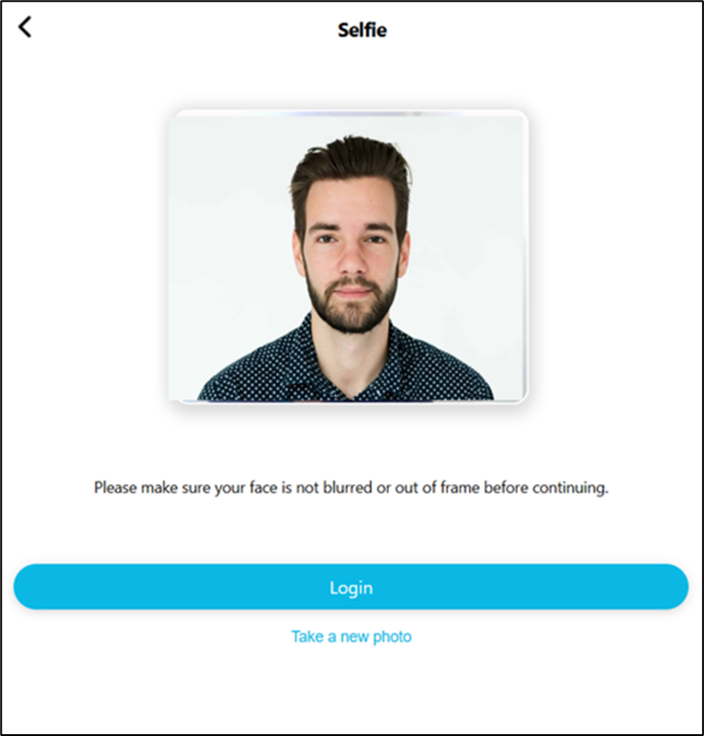
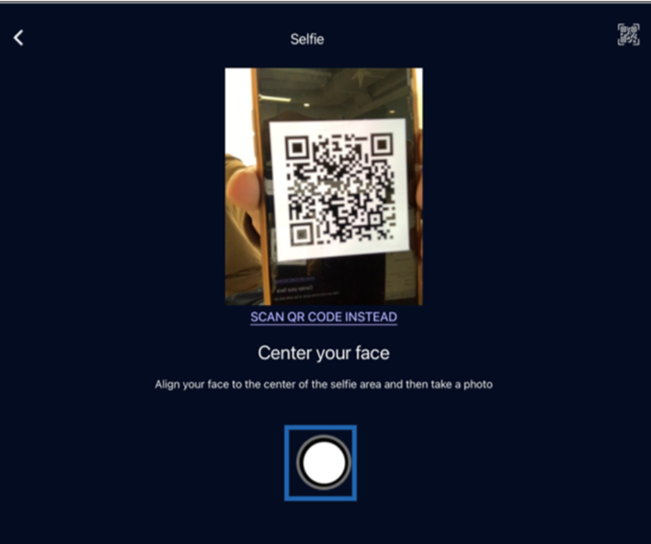
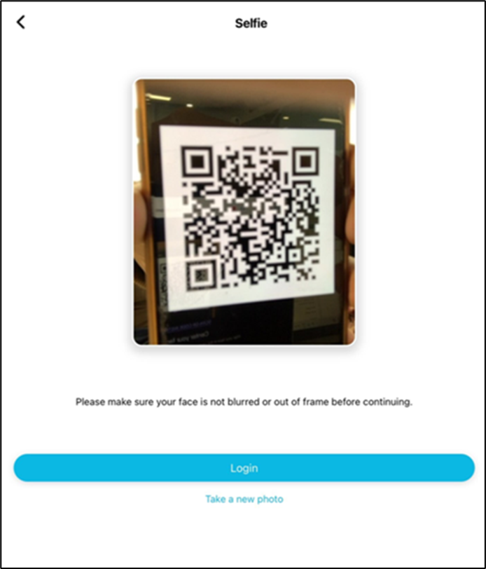
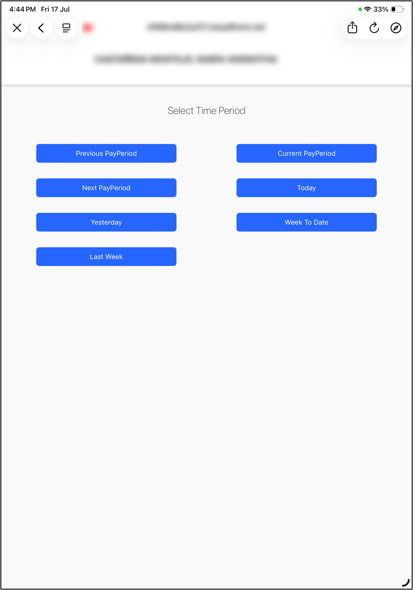

{/* Source: Intercom article 15690970 - https://oloid.help/en/articles/15690970-oloid-connect-how-to-view-punch-details */}
{/* Generated by intercom_to_mintlify.py - re-running overwrites this file. */}

## Introduction

The view punch details feature in the Oloid Connect app allows User to review their recent verification activity and access detailed transaction records. By logging in through the app’s secure face or QR-based verification flow.

## Prerequisites

- You must configure the Oloid Connect endpoint Web button in the Tenant Admin Portal. For more, refer to [Configure Web Button](/platforms/ios/time-clock/oloid-connect/oloid-connect-how-to-configure-endpoint-in-the-tenant-admin-portal)
- Oloid Connect endpoint must be paired. For more, refer to[Oloid Connect – How to Pair an Endpoint](/platforms/ios/time-clock/oloid-connect/oloid-connect-how-to-pair-an-endpoint)
- You must have your Employee ID.
- You must have one of the following:
  - You must have your QR Code credential.
    or
  - Your face must be registered in the Oloid Connect app.

## Steps to view Punch details

1. Tap the **Web Button** from the bottom left corner.

   

   The **Verify to Continue** screen is displayed.

Enter your **Employee ID** > tap **Next**.

The **Camera** is opened to capture Face or QR Code.

Do one of the following authentication methods:

### Authenticate using Face

1. Place your face inside the frame.
2. Tap **Capture**.

   

   The confirmation screen is displayed.
3. Do one of the following:
   1. Tap **Login** to continue.
   2. Tap **Take a new photo** to recapture the face.

### Authenticate Using QR Code

1. Place your QR code inside the frame.
2. Tap capture button.

   

   The confirmation screen is displayed.
3. Do one of the following:
   1. Tap **Login** to continue.
   2. Tap **Take a new photo** to recapture the QR Code.

      

      The **Select Time Period** screen is displayed. Tap the required time period button to view the details.

      

---

### SEO Keywords

|Oloid Connect punch details | View punch details Oloid Connect| Oloid Connect transaction history|
