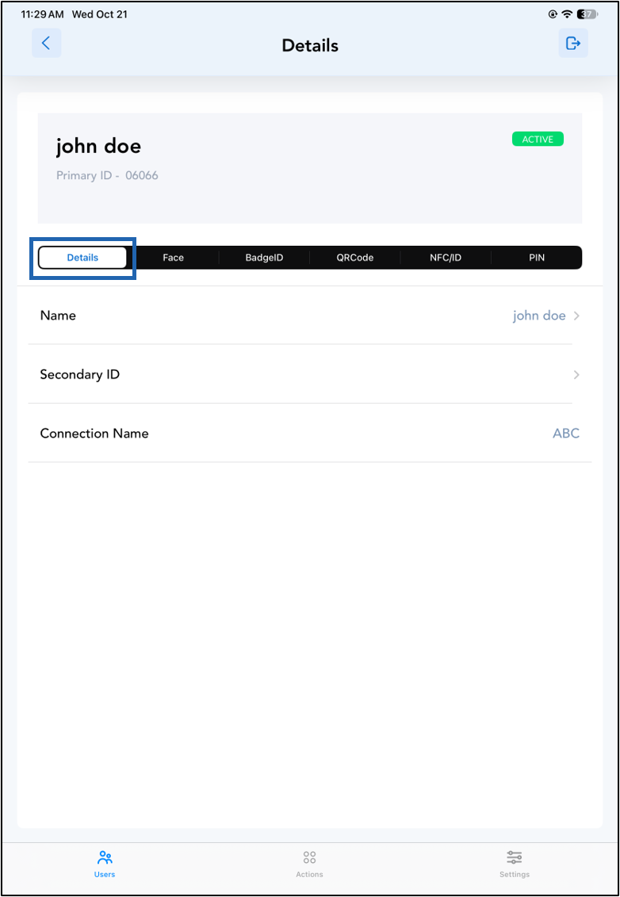

{/* Source: Intercom article 8616669 - https://oloid.help/en/articles/8616669-oloid-connect-how-to-view-user-details */}
{/* Generated by intercom_to_mintlify.py - re-running overwrites this file. */}

## Introduction

This document provides instructions to view user details using the Oloid Connect app.

## Prerequisites

- You must have access to the Tenant Admin Portal or Supervisor account.
- The user must be added. For more, refer to [Oloid Connect - Add User](/platforms/ios/time-clock/oloid-connect/oloid-connect-how-to-add-a-user)

## Steps to view user details

1. Launch the **Oloid Connect** app.

   

2. Log in to Admin mode in Oloid Connect app. For more details, refer to [How to Log in to Admin Mode in the Oloid Connect App](/platforms/ios/time-clock/oloid-connect/how-to-log-in-to-admin-mode-in-the-oloid-connect-app)
   The **Users** screen is displayed.

   

Select the preferred **Username** from the list.

<Note>
  **Note:** You can also search for the user using the search bar at the top.
</Note>

The User Details screen is displayed.

