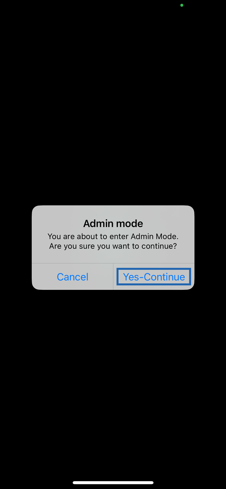
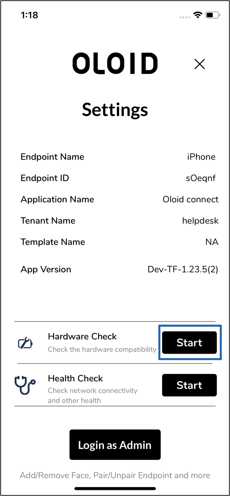
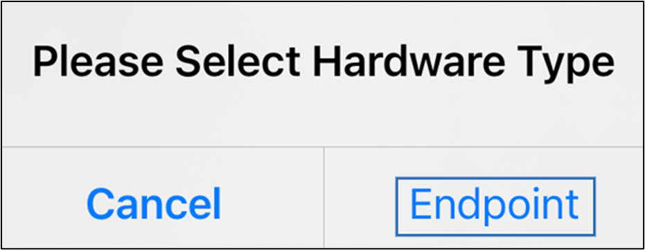
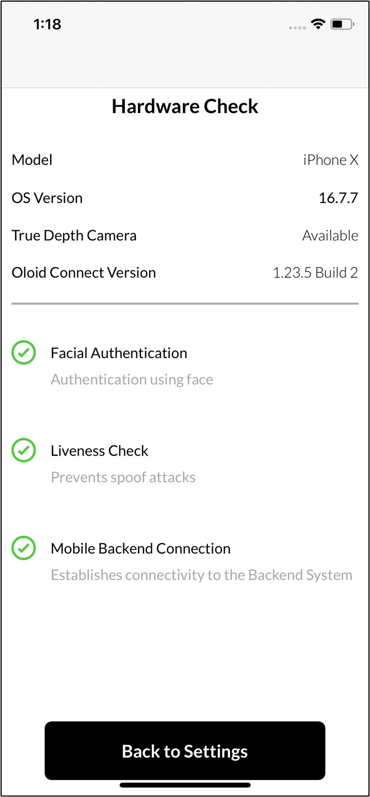

{/* Source: Intercom article 13427870 - https://oloid.help/en/articles/13427870-oloid-connect-iphone-how-to-check-hardware-compatibility */}
{/* Generated by intercom_to_mintlify.py - re-running overwrites this file. */}

## Introduction

To check hardware compatibility using the Oloid Connect app, you can perform a hardware check through Admin Mode to ensure the device meets the required specifications for proper functionality.

## Prerequisite

- The user must be a Tenant Admin or Supervisor.
- The endpoint must be paired.
  For more, refer to [How to pair an Oloid Connect endpoint on iPhone](/platforms/ios/time-clock/oloid-connect/how-to-pair-oloid-connect-endpoint-on-iphone)

## Steps to Check Hardware Compatibility

1. Launch the **Oloid Connect App**.

   <Note>
     **Note:** Since the endpoint is already paired, the App will launch in the initial screen of the App.
   </Note>

   

2. Double tap with two fingers on the initial screen to launch the Admin Mode.
   The Admin mode pop up box is displayed.
3. Tap **Yes- Continue.**

   

   The **Settings** screen is displayed.
4. Tap **Start** in the **Hardware Check** section.

   

   The pop-up to **select Hardware Type** is displayed.

Select **Endpoint**.

The **Hardware Check** screen is displayed to check the details.

