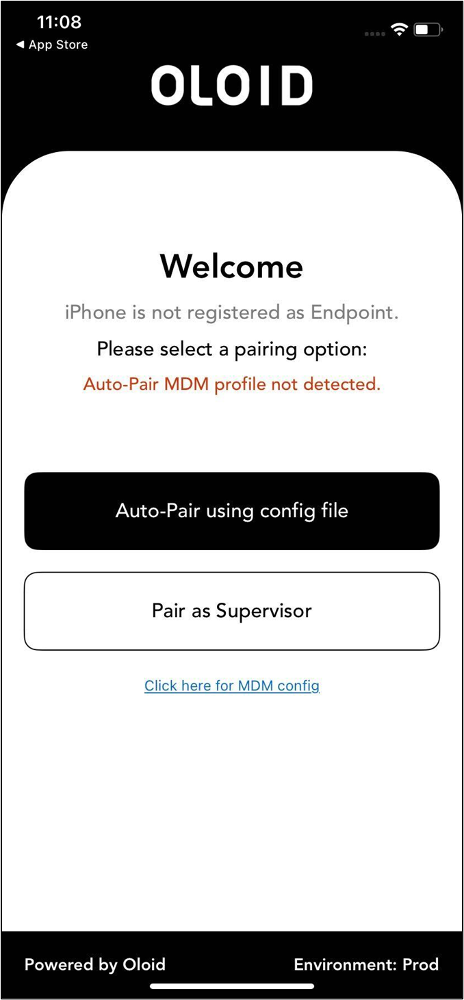
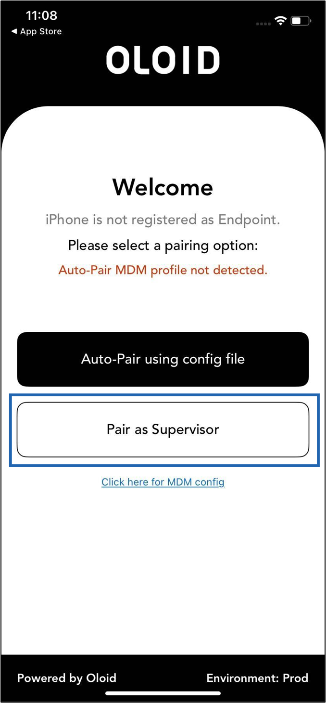
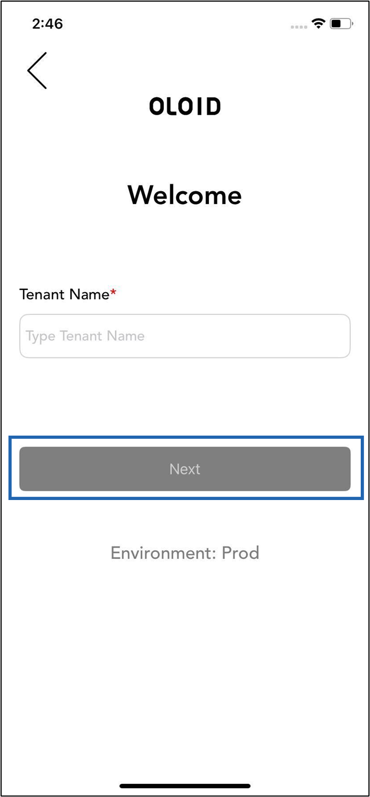
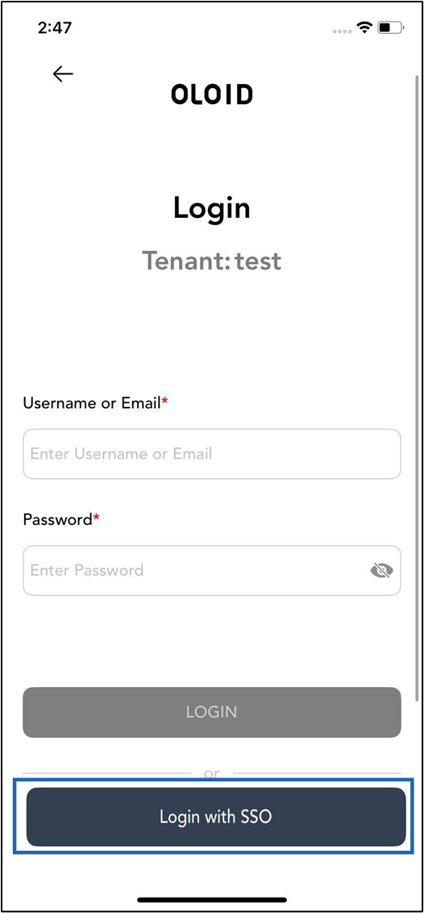
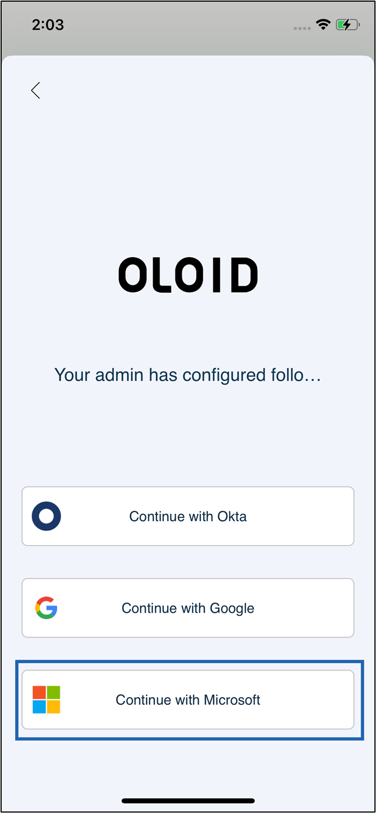
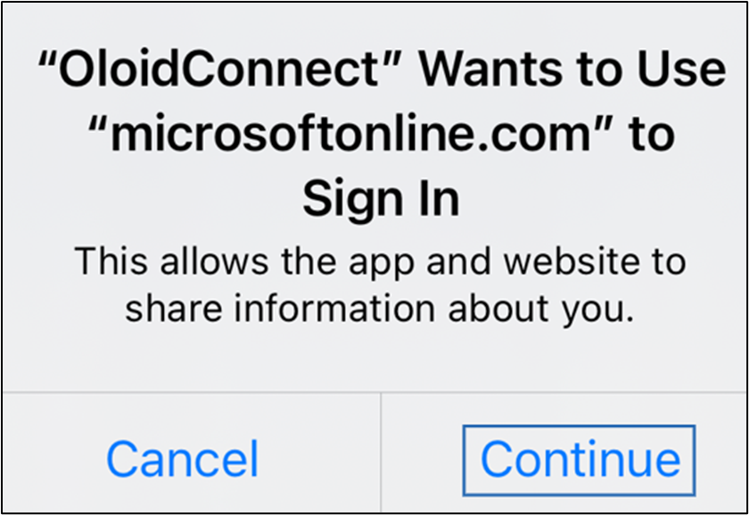
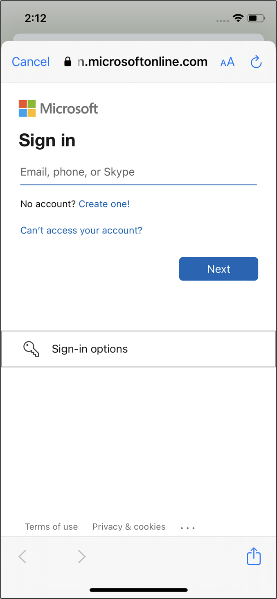
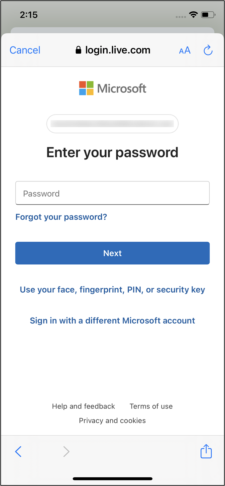
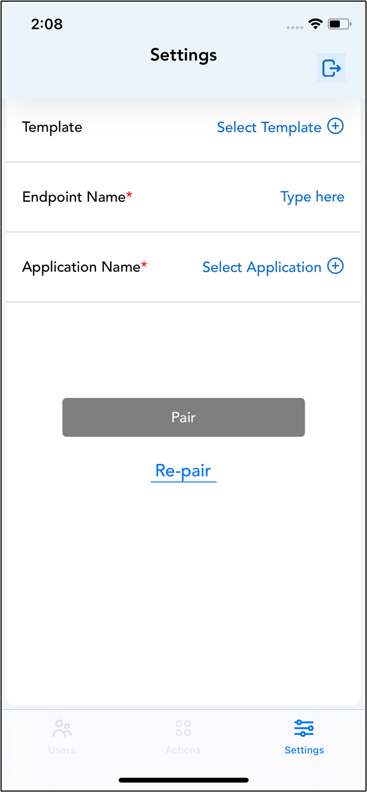

{/* Source: Intercom article 13595980 - https://oloid.help/en/articles/13595980-oloid-connect-iphone-login-using-microsoft-sso */}
{/* Generated by intercom_to_mintlify.py - re-running overwrites this file. */}

## Introduction

This document provides instructions to log in to the **Oloid Connect** application using **Microsoft Single Sign On (SSO)**.

## Prerequisite

- You must create and configure the **Oloid Connect** application in the **Tenant Admin Portal**. For more, refer to [How to create and configure Oloid Connect Application in Tenant Admin Portal](/platforms/ios/time-clock/oloid-connect/oloid-connect-how-to-create-and-configure-application-in-tenant-admin)
- You must install the **Oloid Connect** app from the App Store. For more, refer to [How to Download and Install the Oloid Connect App on iPhone](/platforms/ios/time-clock/oloid-connect/oloid-connect-how-to-download-and-install-on-iphone)

## **Steps to log in with Microsoft** SSO

1. Launch the **Oloid Connect**  app.

   

   The **Welcome** screen is displayed.
2. Tap **Pair as Supervisor.**

   

   The Welcome screen is displayed.
3. Enter **Tenant Name**, then tap **Next**.

   

   TheLogin page is displayed.
4. Tap **Login with SSO**.

   

   The screen with **SSO options** is displayed.
5. Select **Continue with Microsoft**.

   

   The confirmation pop-up is displayed.
6. Click **Continue**.

   

   The **Sign in** page is displayed.
7. Do the following:
   1. Enter **Email ID**.
   2. Tap **Next**.

      

      The **Enter password** screen is displayed.
8. Do the following:
   1. Enter **Password**.
   2. Tap **Next**.

You are successfully logged in to Oloid Connect Admin Mode.

