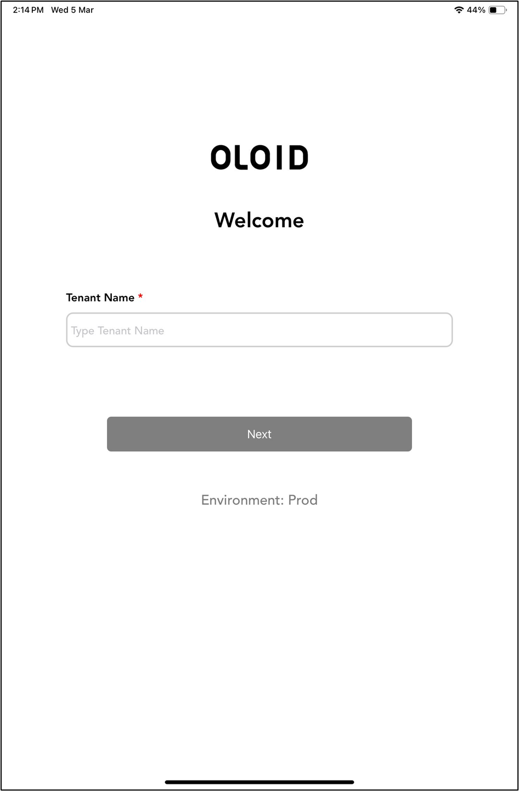
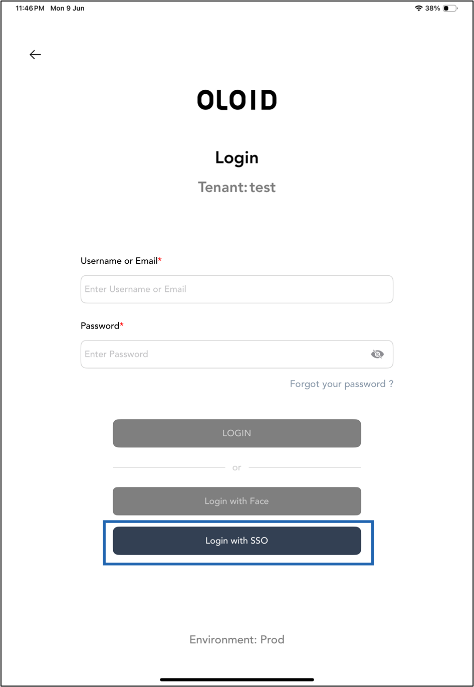
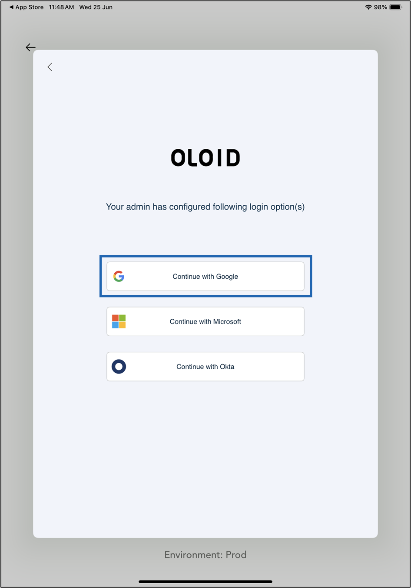
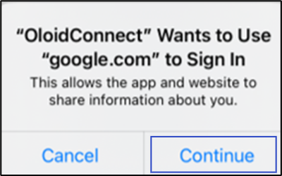
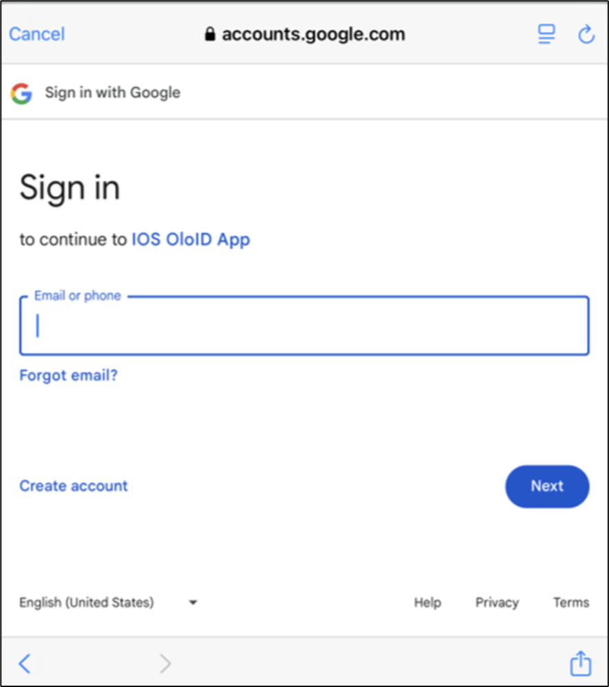
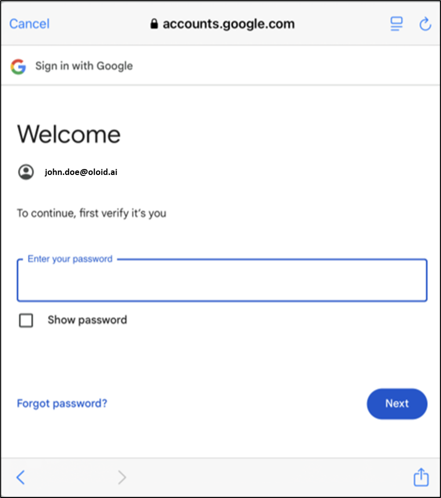
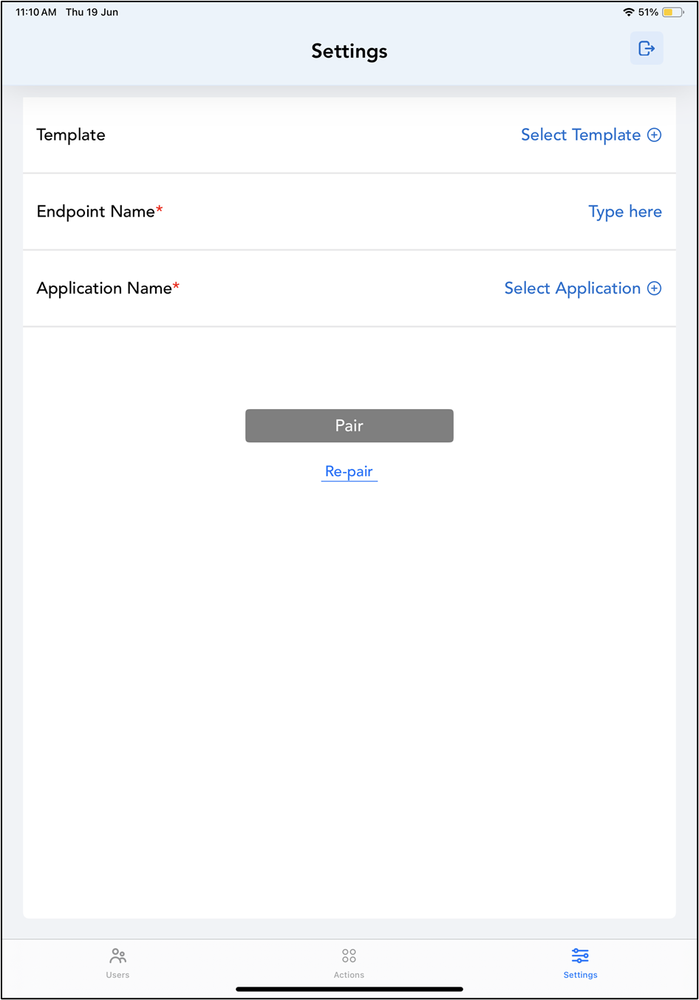

{/* Source: Intercom article 10293811 - https://oloid.help/en/articles/10293811-oloid-connect-login-using-google-sso */}
{/* Generated by intercom_to_mintlify.py - re-running overwrites this file. */}

## Introduction

This document explains how a Tenant Admin or Supervisor logs in to Admin Mode in the Oloid Connect app using Google single sign-on (SSO). With Google SSO, you sign in with your organization’s Google credentials instead of a separate email and password. While your Google sign-in session is active, you won’t need to enter your password again.

## Prerequisites

- You must have a Tenant Admin account.
- The Oloid Connect app must be downloaded and installed from the App Store. For details, refer [How to download Oloid Connect app](/platforms/ios/time-clock/oloid-connect/oloid-connect-how-to-download-and-install-on-ipad).
- SSO must be configured in the Tenant Admin Portal.

## Steps to Login with Google SSO

1. Launch the **Oloid Connect** app.

   

   The Welcome screen is displayed.
2. Tap **Pair as Supervisor.**

   

3. Enter **Tenant Name.**
4. Tap **Next**.

   

   TheLogin screen is displayed.
5. Tap **Login with SSO**.

   

   The SSO options screen is displayed.
6. Tap **Continue with Google**.

   

   The confirmation pop-up box is displayed.
7. Tap **Continue**.

   

   The **Google sign-in** screen is displayed.
8. Do the following:
   1. Enter **Email ID**.
   2. Tap **Next**.

      

      The **Google Welcome** screen is displayed.
9. Do the following:
   1. Enter **Password**.
   2. Tap **Next**.

      <Note>
        **Note:** Google may save your account for later logins. While your Google sign-in session is active, you won’t need to enter your password again.
      </Note>

      

You are now successfully logged in to Admin Mode in the Oloid Connect app with Google SSO.

