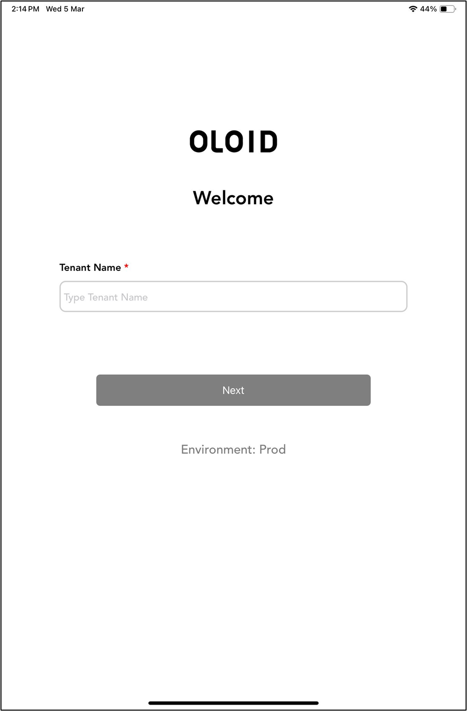
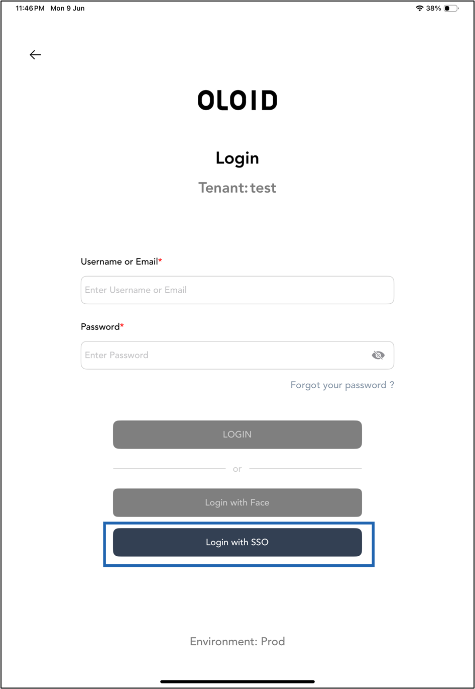
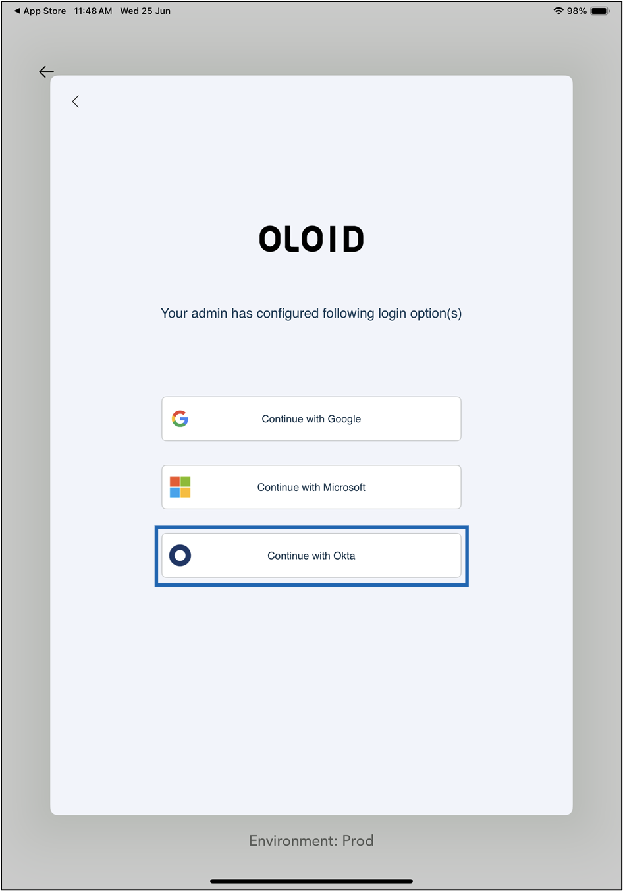
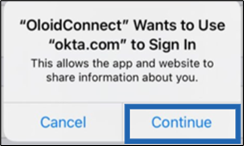
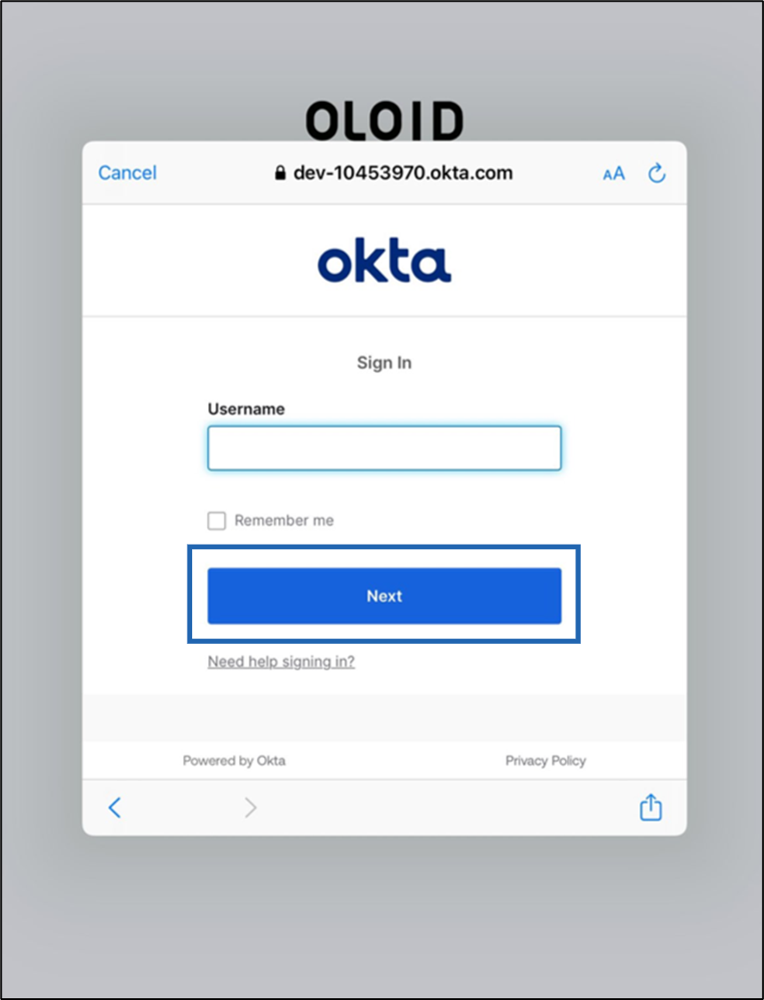
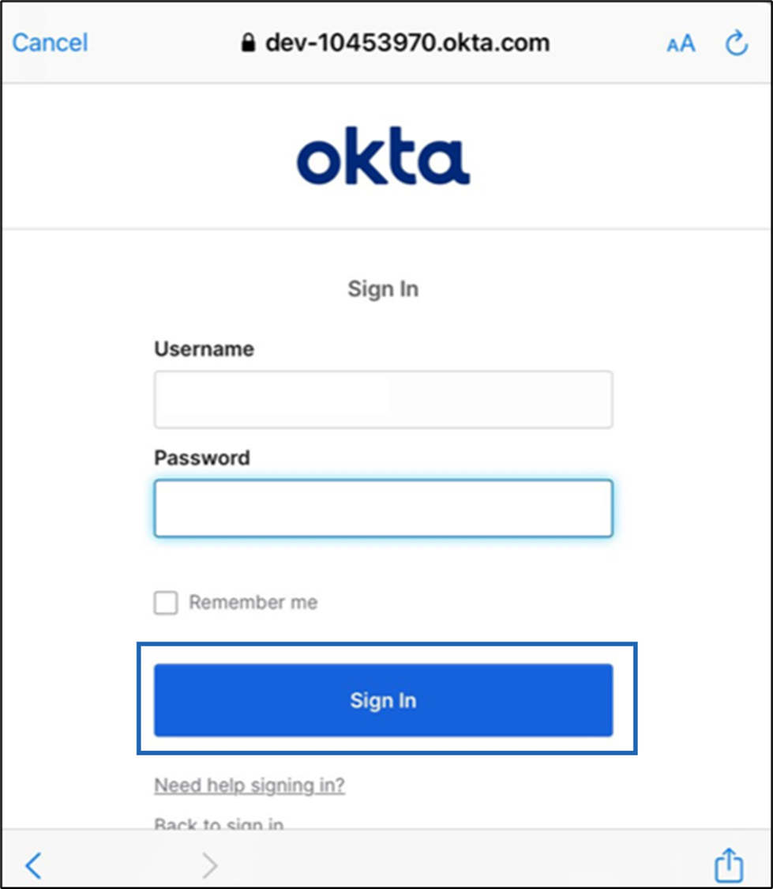
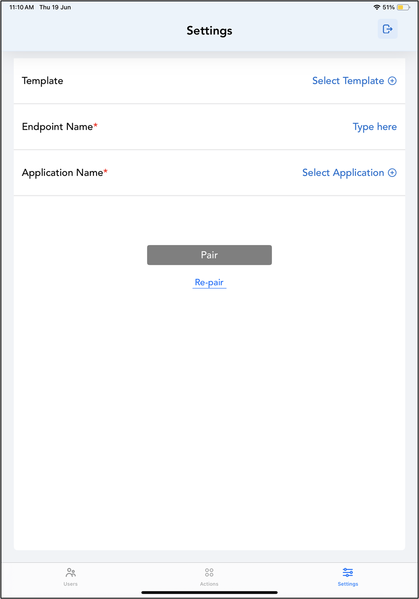

{/* Source: Intercom article 10345413 - https://oloid.help/en/articles/10345413-oloid-connect-login-using-okta-sso */}
{/* Generated by intercom_to_mintlify.py - re-running overwrites this file. */}

## Introduction

This document explains how a Tenant Admin or Supervisor logs in to Admin Mode in the Oloid Connect app using Okta single sign-on (SSO). With Okta SSO, you sign in securely with your organization’s Okta credentials instead of a separate email and password.

## Prerequisites

- You must have admin access to the Tenant Admin Portal.
- The Oloid Connect app must be downloaded and installed from the App Store. For details, refer to [How to download Oloid Connect app](/platforms/ios/time-clock/oloid-connect/oloid-connect-how-to-download-and-install-on-ipad).
- Okta SSO must be enabled in the Tenant Admin Portal.

## Steps to log in with Okta SSO

1. Launch the **Oloid Connect** app on your device.

   

   The Welcome screen is displayed.
2. Tap **Pair as Supervisor** to begin the pairing process.

   

3. Enter your **Tenant Name** > **Next** to proceed.

   

   The Login screen is displayed.
4. Select **Login with SSO**.

   

   The screen with **SSO options** are displayed.
5. Select **Continue with Okta**.

   

   The confirmation pop-up box is displayed.
6. Tap **Continue**.

   

   The **Sign In** screen is displayed.
7. Do the following
   1. Enter **Username.**
   2. Tap **Next**.

      

8. Do the following:
   1. Enter **Password**.
   2. Tap **Sign In**.

      

      Once authentication is successful, you are logged in to **Admin Mode** in the Oloid Connect app using Okta SSO.

