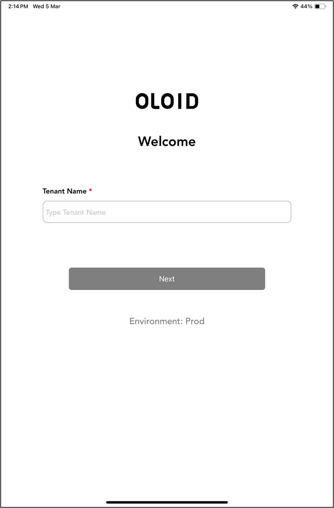
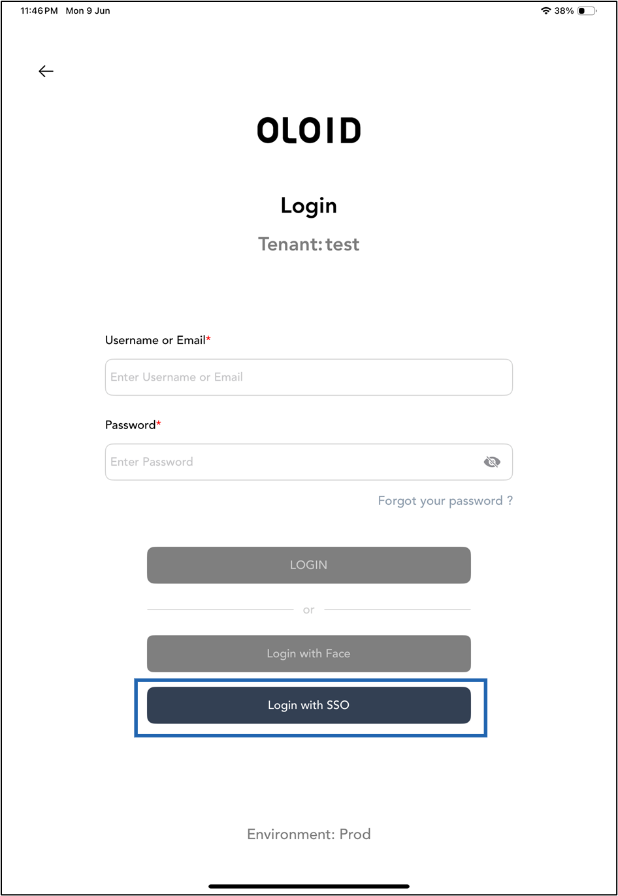
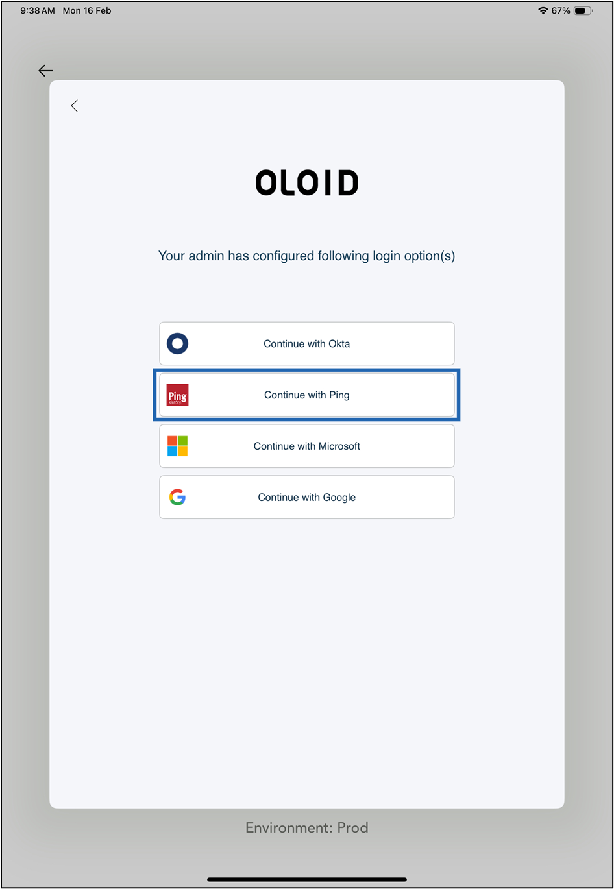
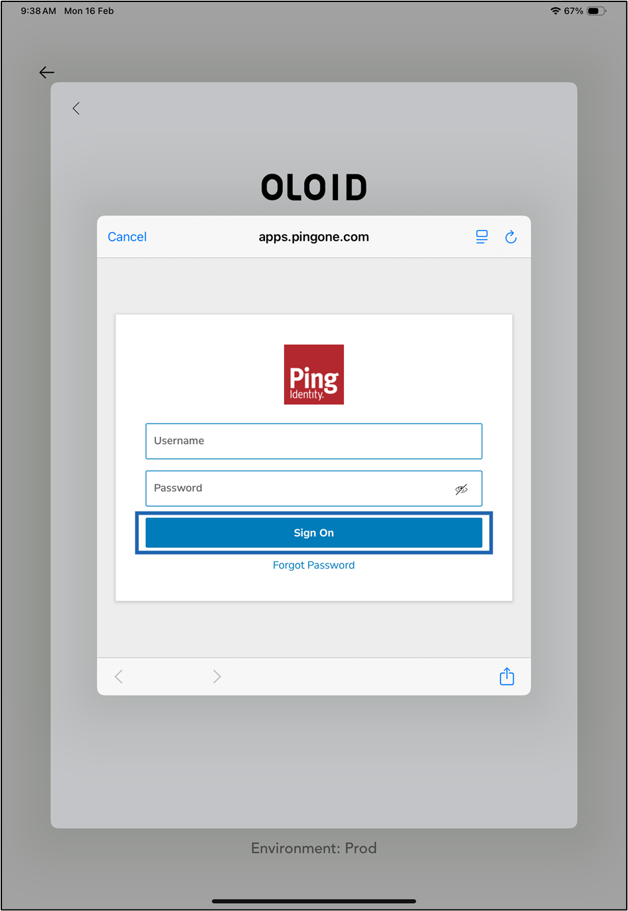
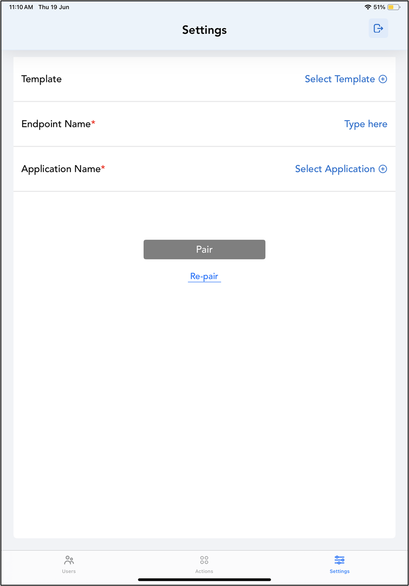

{/* Source: Intercom article 13866936 - https://oloid.help/en/articles/13866936-oloid-connect-login-using-ping-one-sso */}
{/* Generated by intercom_to_mintlify.py - re-running overwrites this file. */}

## Introduction

The PingOne SSO Login feature in the Oloid Connect App allows Tenant Admin and Supervisor to securely access Admin Mode using PingOne SSO credentials.

## Prerequisite

You must download the Oloid Connect app from App Store. For more details, refer [How to download Oloid Connect app](/platforms/ios/time-clock/oloid-connect/oloid-connect-how-to-download-and-install-on-ipad).

## Steps to log in with Ping One SSO

1. Launch the **Oloid Connect**  app.
   The **Welcome** screen is displayed.
2. Tap **Pair as Supervisor.**

   

   The **Welcome** page is displayed.
3. Enter **Tenant Name.**
4. Tap **Next**.

   

   The **Login** page is displayed.
5. Tap **Login with SSO**.

   

   The screen with **SSO options** is displayed.
6. Select **Continue with Ping**.

   

   The Sign on screen is displayed.
7. Do the following:
   1. Enter **Username.**
   2. Enter **Password.**
8. Tap **Sign On**.

   

   You are logged in to Admin Mode successfully.

   
