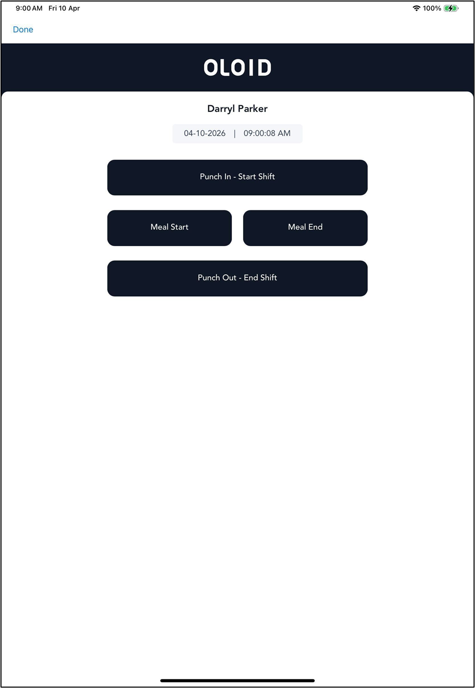
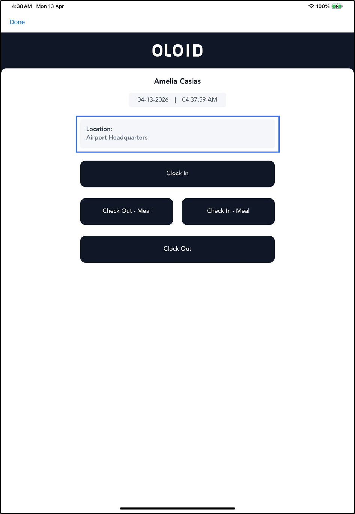
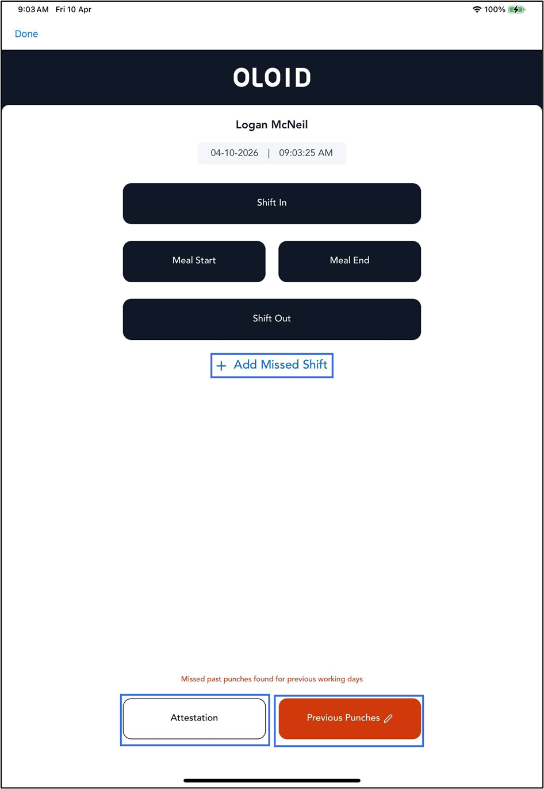
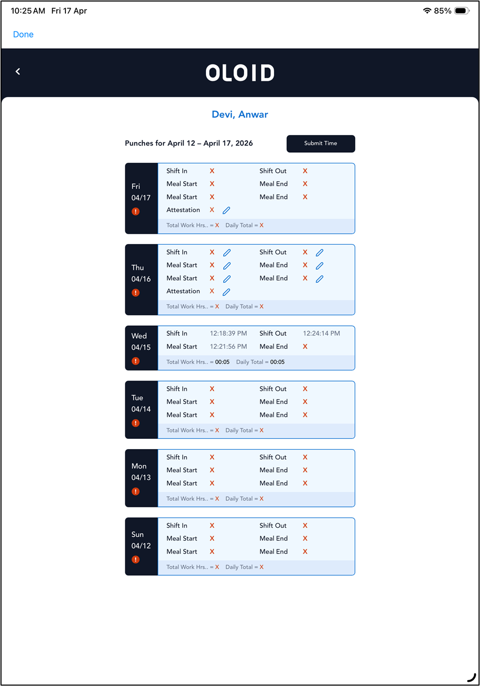
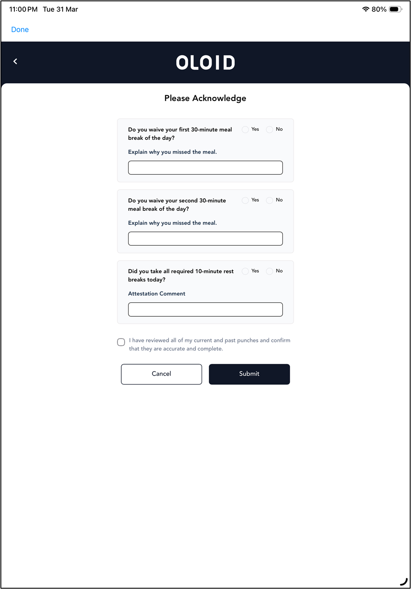
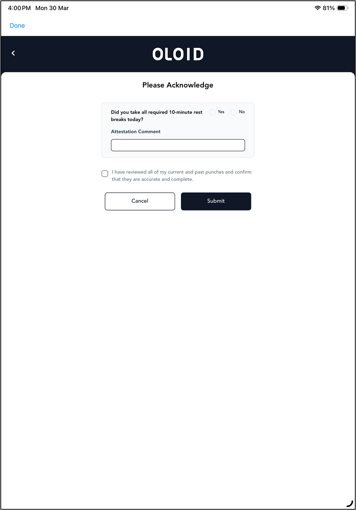
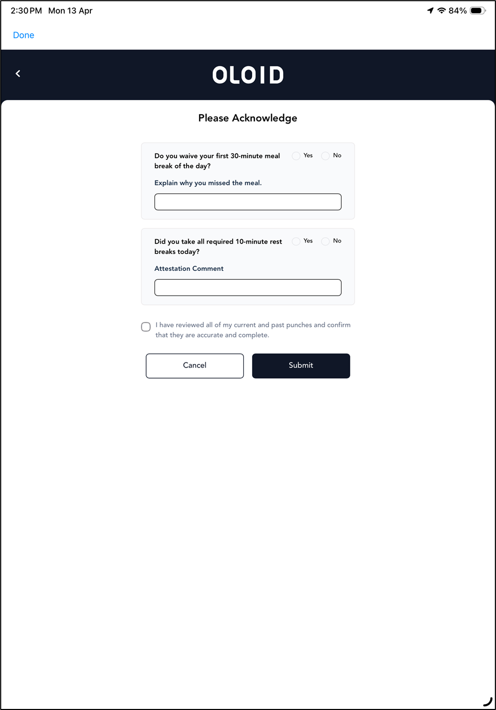

{/* Source: Intercom article 14632843 - https://oloid.help/en/articles/14632843-oloid-connect-punch-management-using-user-authentication */}
{/* Generated by intercom_to_mintlify.py - re-running overwrites this file. */}

## Introduction

This document explains how User can authenticate and manage punches using Oloid Connect.

## Prerequisites

- The Oloid Connect application is created and configured. For more, refer to[How to Create and Configure Oloid Connect Application in Tenant Admin Portal](/platforms/ios/time-clock/oloid-connect/oloid-connect-how-to-create-and-configure-application-in-tenant-admin)
- You must configure Workday Punch Integration in the Oloid Connect Application. For more, refer to Configure [Workday Punch Integration](/platforms/ios/connect-passwordless/how-to-create-and-configure-oloid-connect-passwordless-application-in).-,Configure%20Passwordless,-The%20Configure%20Passwordless)
- The endpoint must be paired with the Oloid Connect application. For more, refer to [How to Pair Oloid Connect Endpoint](/platforms/ios/time-clock/oloid-connect/oloid-connect-how-to-pair-an-endpoint)

## Steps to Authenticate and Punch

1. Authenticate using provided credentials. For More, refer to[Oloid Connect - How to Authenticate a User Using Credentials](/platforms/ios/time-clock/oloid-connect/oloid-connect-how-to-authenticate-a-user-using-credentials)
   After successful authentication, the Intent screen is displayed.
2. Record your punch as required. See use cases for details [Punch Management Use Cases](#punch-management-use-cases)

   

   User is authenticated and punch is recorded successfully.

## Punch Management Use Cases

## Use Case – 1: Record Shift Using Standard Punch Options

#### Introduction

This use case explains how to record a work shift using standard punch options such as starting a shift, managing meal breaks, and ending a shift.

---

#### Prerequisites

- The device is powered on and connected to the network.
- The intent screen is displayed.

---

#### Steps

1. Tap **Punch In – Start Shift**.
2. Tap **Meal Start** to begin a break.
3. Tap **Meal End** to resume work.
4. Tap **Punch Out – End Shift**.

   

---

#### Outcome

The system records all actions with the current date and time.

---

## Use Case – 2: Record Shift with Location-Based Punch

#### Introduction

This use case explains how to record a shift when location details are displayed on the Punch Management screen.

---

#### Prerequisites

- The device is powered on and connected to the network.
- Location is displayed on the intent screen.

  <Note>
    **Note:** Contact [Oloid Support](mailto:support@oloid.ai) to Configure location.
  </Note>

---

#### Steps

1. Verify the displayed **Location**.
2. Tap **Clock In** to start the shift.
3. Tap **Check Out – Meal** to begin a break.
4. Tap **Check In – Meal** to resume work.
5. Tap **Clock Out** to end the shift.

   

---

#### Outcome

The system records punch actions along with the associated location.

---

## Use Case – 3: Manage Missed Punches and Submit Attestation

#### Introduction

This use case explains how to manage missed, incorrect punch records and Submit Attestation.

---

#### Prerequisites

- The device is powered on and connected to the network.
- Missed punch options are enabled.

  <Note>
    **Note:** The **Add Missed Shift**, **Attestation**, and **Previous Punches** buttons are pre-configured. For any queries related to these, please contact [Oloid Support](mailto:support@oloid.ai).
  </Note>

---

#### Steps

1. Tap **+ Add Missed Shift** to add a missing punch entry.
2. Tap **Previous Punches** to review or edit existing records.
3. Tap **Attestation** to confirm punch details (if applicable).

   

---

### Edit Previous Punches

If there are missed or incomplete punches, you can edit previous punches.

<Note>
  **Note:** Only punches for the **current day and previous 24 hours** can be edited.
</Note>

#### Steps to Edit

1. Tap **Previous Punches**.
2. The **Previous Punches screen** is displayed with punch details for past days.
3. Identify the missing or incorrect entry.
4. Tap the **Edit icon** next to the required punch.
5. Enter or update the punch details.
6. Tap **Submit Time**.

   

---

### Submit Attestation

Attestation is required based on system configuration (for example, early punch-in before configured meal duration).

<Note>
  **Note:** If the user performs a punch that violates configured rules (for example, entering before a 30-minute meal window), the attestation screen is displayed.
</Note>

#### Steps to Complete Attestation Form

1. Review the attestation questions.
2. Select **Yes** or **No** for each question.
3. Enter details in the **Attestation Comment** field (if required).
4. Select the confirmation checkbox:
   - I have reviewed all of my current and past punches and confirm that they are accurate and complete.
5. Tap **Submit**.

   

#### Attestation Scenarios

Based on configuration, one or more of the following may be displayed:

#### Scenario 1: Rest Break Confirmation

- Confirm if required rest breaks were taken.

  

#### Scenario 2: Meal Break Waiver

- Confirm if the meal break was waived.
- Provide a reason for missing the meal.

#### Scenario 3: Multiple Meal Checks

- Confirm first and second meal breaks.
- Provide explanations if missed.

  

  <Note>
    **Note:** The attestation questions are configured by the system admin and may vary.
  </Note>

---
