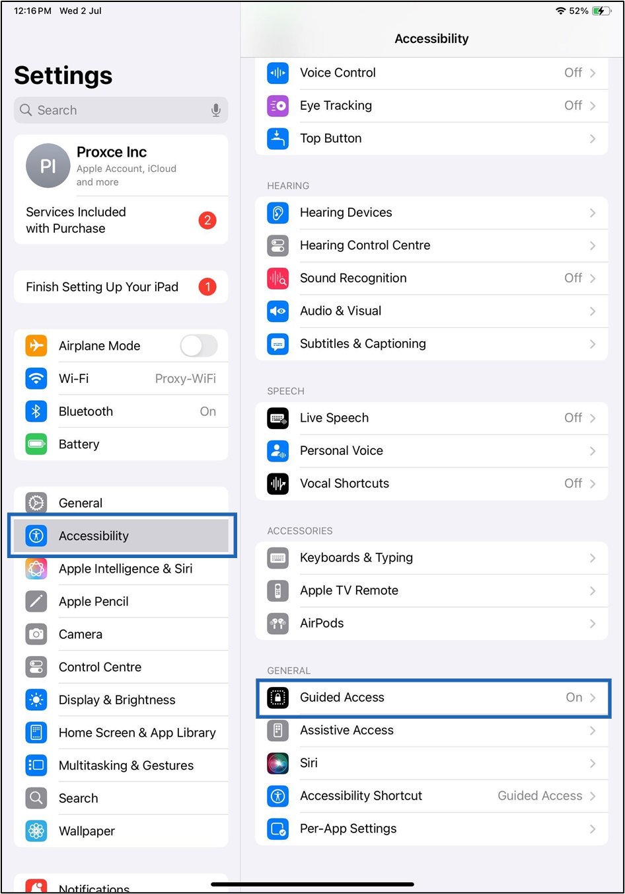
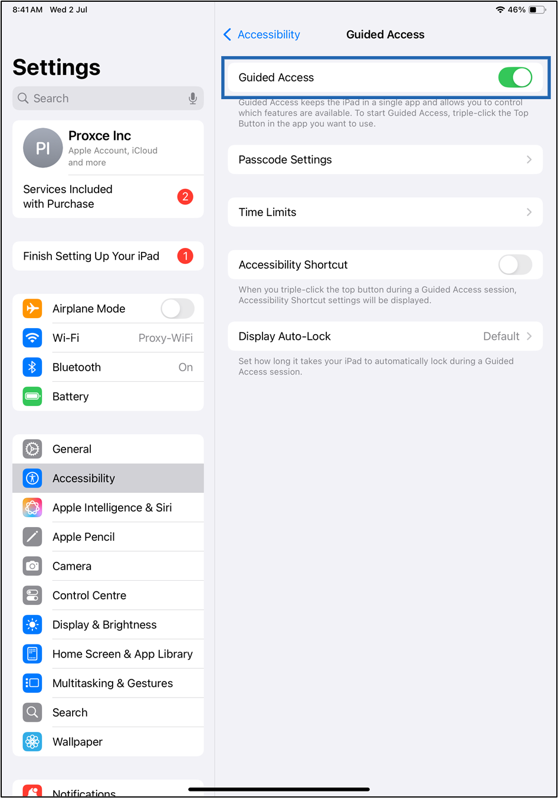
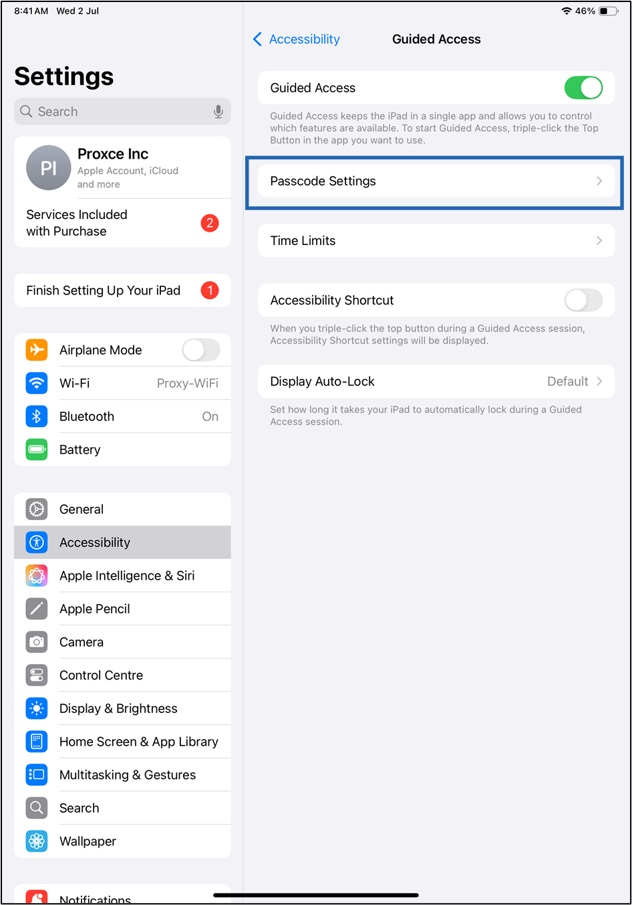
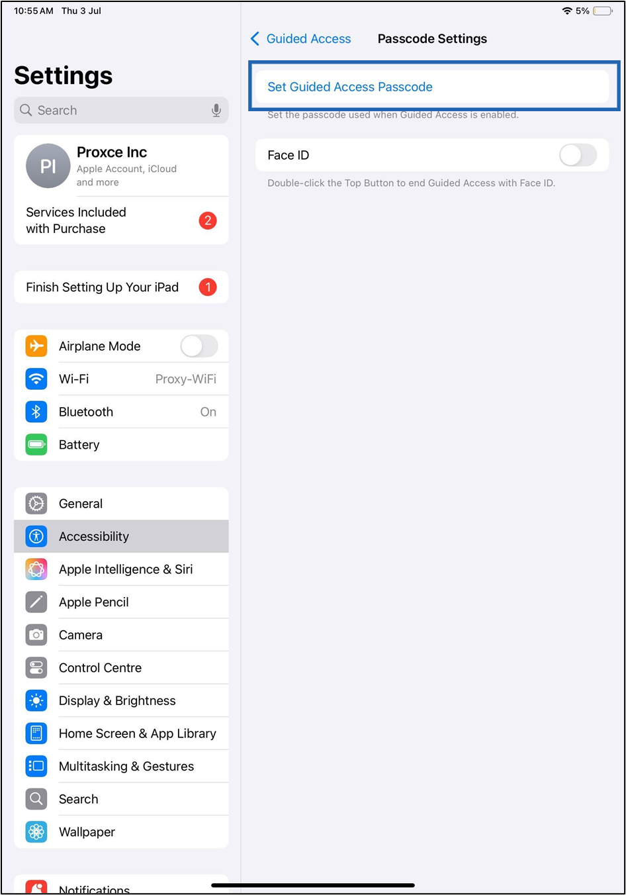
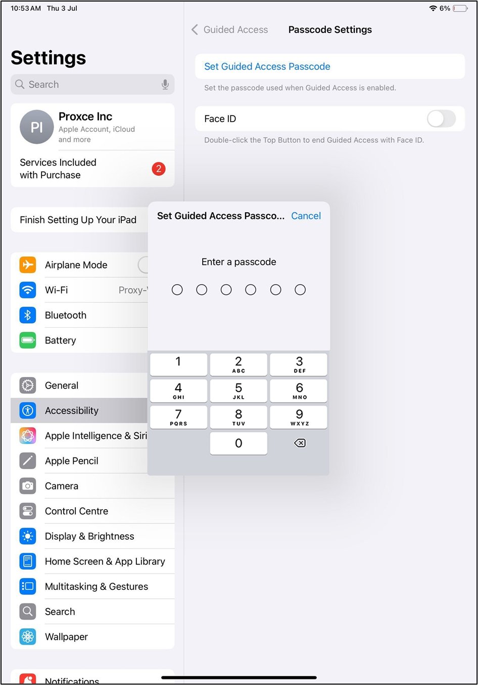
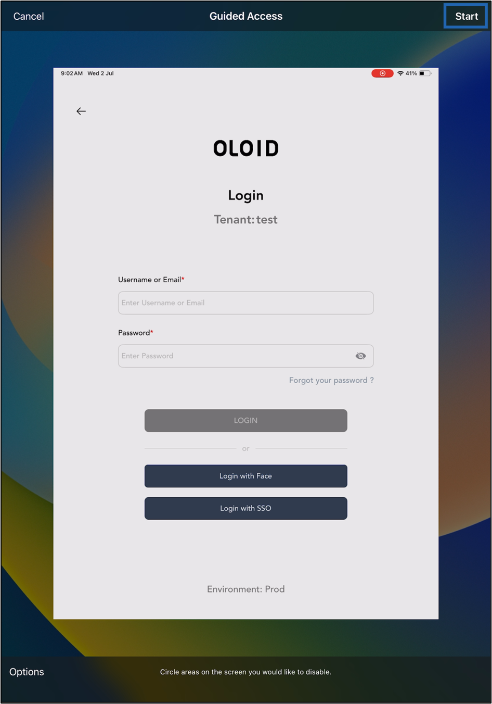
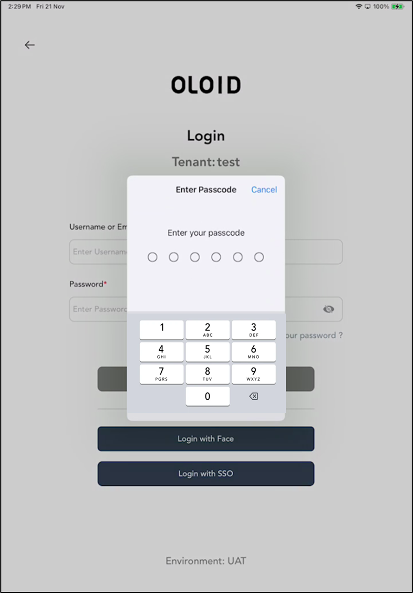
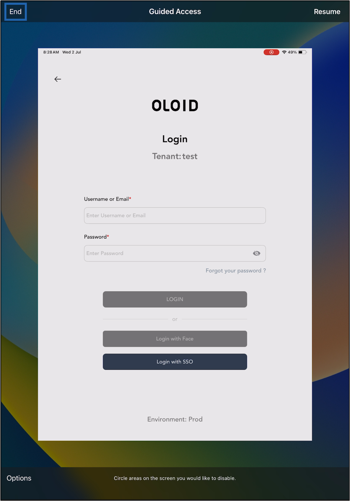

{/* Source: Intercom article 8655926 - https://oloid.help/en/articles/8655926-oloid-connect-set-up-ipad-in-guided-access-mode-or-kiosk-mode */}
{/* Generated by intercom_to_mintlify.py - re-running overwrites this file. */}

## Introduction

Guided Access Mode restricts the iPad to a specific app, preventing users from switching to other apps or accessing certain features. This is useful for check-ins, time tracking, or using the iPad as a display screen. For more information, refer to [Use Guided Access with iPhone and iPad](https://support.apple.com/en-in/111795).

#### This document covers the following topics

- Set up Guided Access in iPad
- Start Guided Access Mode in iPad
- End Guided Access Mode in iPad

## Steps to Set up Guided Access

1. Open your iPad.
2. Go to **Settings** > **Accessibility** > **Guided Access**.

   

3. Turn on the **Guided Access** toggle.

   

4. Tap **Passcode Settings**.

   

5. Tap **Set Guided Access Passcode.**

   

6. Enter a **passcode.**
7. Re-enter the **passcode** to confirm.

   

   The Guided Access is now set up successfully.

## Steps to Start Guided Access Mode

1. Launch **Oloid Connec**t app.

   

2. Quickly press the **Home/Power** button **three** times.
3. Tap **Start**.

   

   The Guided Access mode is Started successfully.

## Steps to End Guided Access Mode

1. Quickly press the **Home/Power** button **three** times.
   The enter passcode pop-up box is displayed.
2. Enter your **passcode** when prompted.

   

3. Tap **End**.

   

   The Guided Access mode is Ended successfully.
