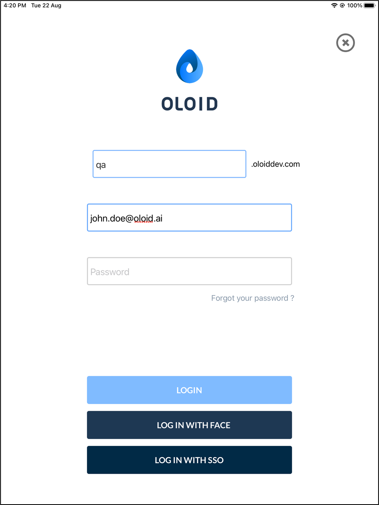
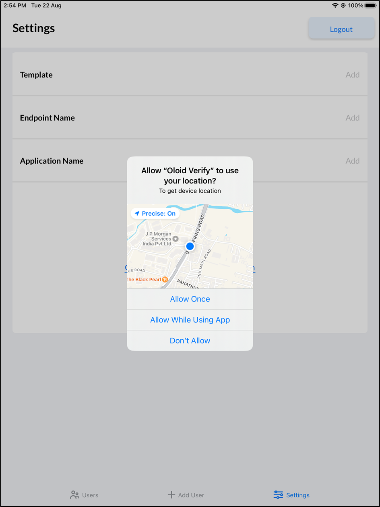
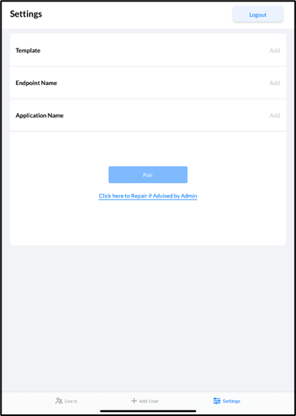
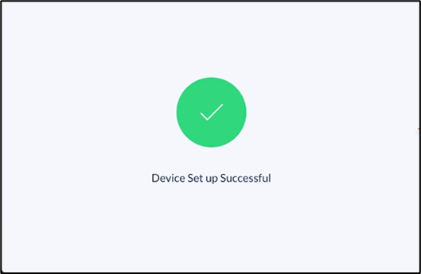
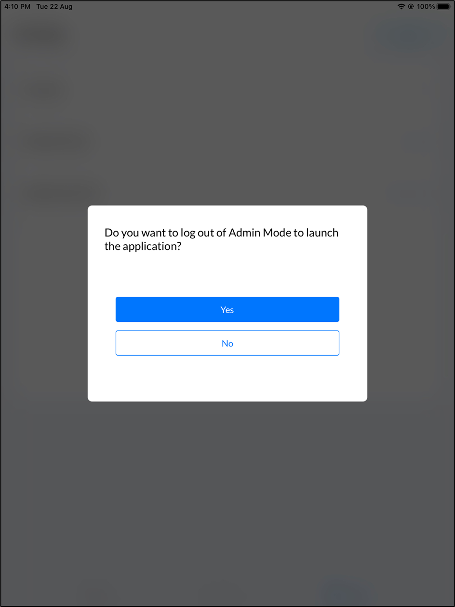

{/* Source: Intercom article 8266981 - https://oloid.help/en/articles/8266981-oloid-verify-how-to-add-location-to-an-endpoint-using-the-oloid-verify-connect-app */}
{/* Generated by intercom_to_mintlify.py - re-running overwrites this file. */}

## Introduction

This document provides step-by-step instructions for enabling location access for an endpoint using the Oloid Verify/Connect app.

## Prerequisite

- You must have a Tenant Admin account.

## Steps to add location to an endpoint

1. Go to **App Store** and download **Oloid Verify/Connect App**.
2. Install the application and upon successful installation, **launch the app**.

   

   The login page is displayed.
3. Enter **Tenant Name**.
4. Enter your email id in the **Email** text field.
5. Enter your password in the **Password** text field.
6. Tap **LOGIN**.

   <Note>
     **Note:** If your face is added to the Tenant Portal as a Tenant Admin, you can tap on **LOG IN WITH FACE** to log in using your face. You can also use **LOG IN WITH SSO**. For more information, refer **[Oloid Verify - How to Log In to Admin Mode as an Admin or Supervisor](/platforms/ios/time-clock/oloid-verify/oloid-verify-how-to-log-in-to-admin-mode-as-admin-or-supervisor)**
   </Note>

   

   The **Allow "Oloid Verify" to use your location?** pop-up box is displayed.
7. On the pop-up box, tap a permission type.
8. Select an option:
   - **Allow Once**: Every time you open the app, it’ll ask to use your location.
   - **Allow While Using App:** The app can use your location only when you're using that app.
   - **Don't Allow:** The app cannot use your location, even when you’re using the app.

     

     The **Settings** page is displayed.
9. Do the following on the **Settings** page.
   a. Add **Template** (optional).
   b. Enter **Endpoint Name**.
   c. Select Application Name from **Application Name** list.
   d. Tap **Pair.**

   

   The settings are saved and the Device Setup success message is displayed.

   

   The application prompts you to log out of Admin mode.
10. Do one of the following:
    a. Click **Yes** to log out and launch the application (**preview mode**).
    The app displays preview mode and allows you to capture live Images for facial transactions.

    <Note>
      **Note:** To go back to admin mode, double-click on preview mode and tap **Yes- To Continue**.
    </Note>

    b. Click **No** to stay logged in to the admin mode.

    

You can now log in to the **Tenant Admin Portal** to check the location that is added to the specific endpoint.
