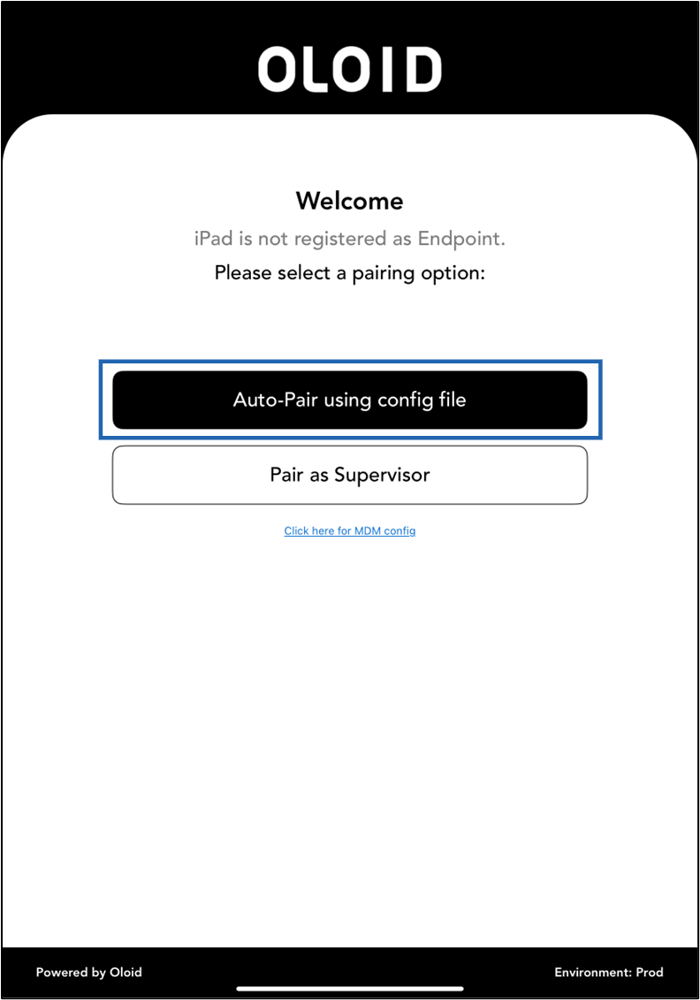
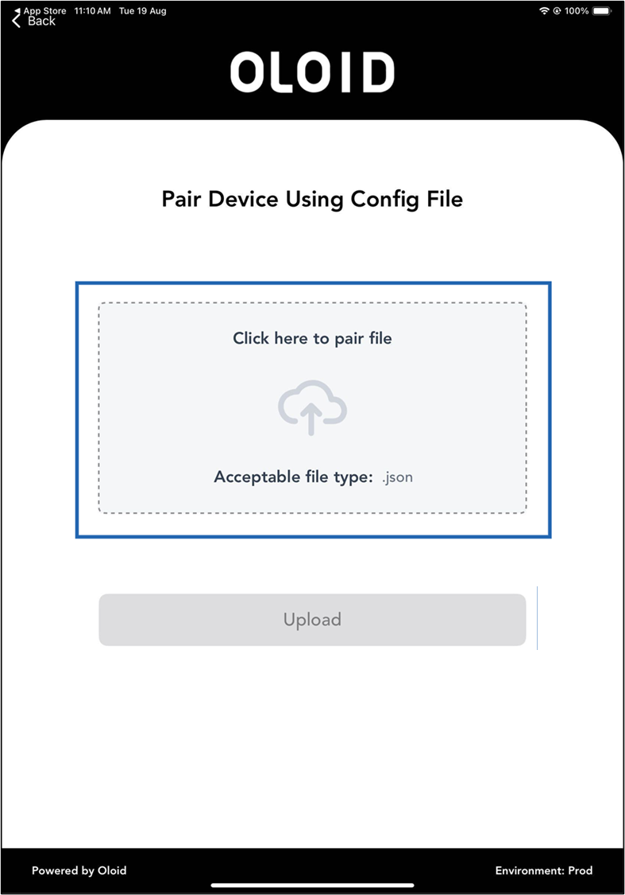
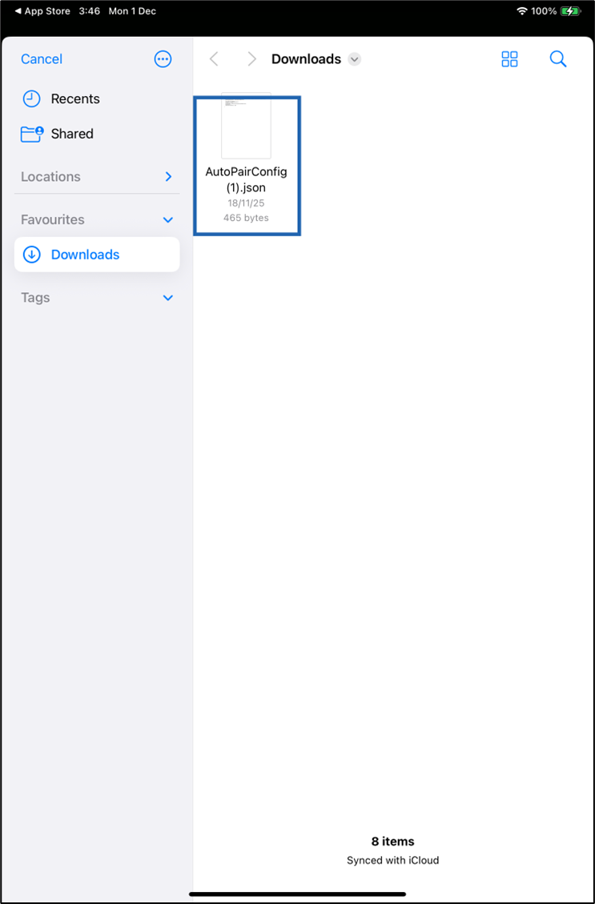
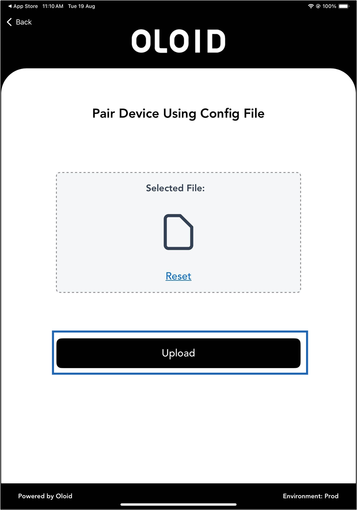
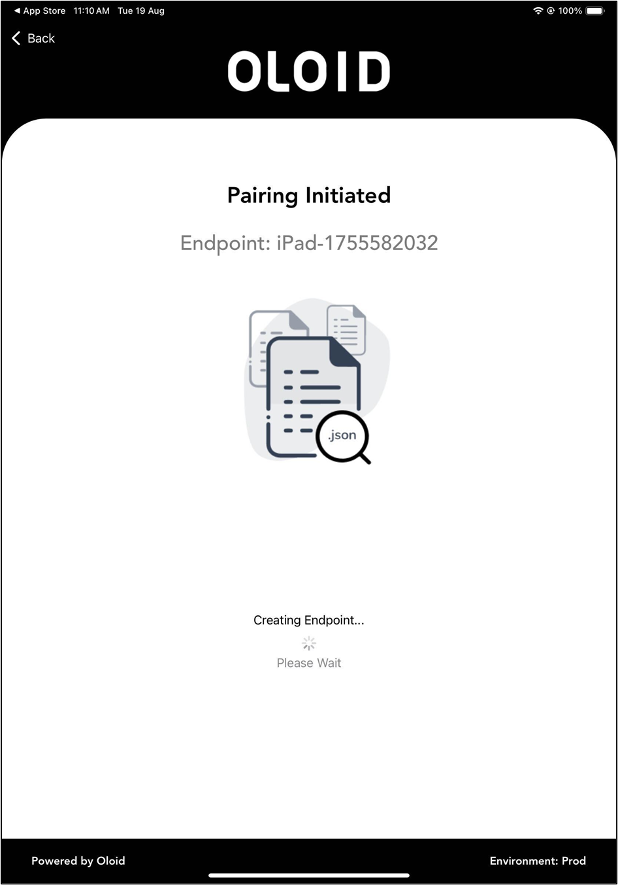
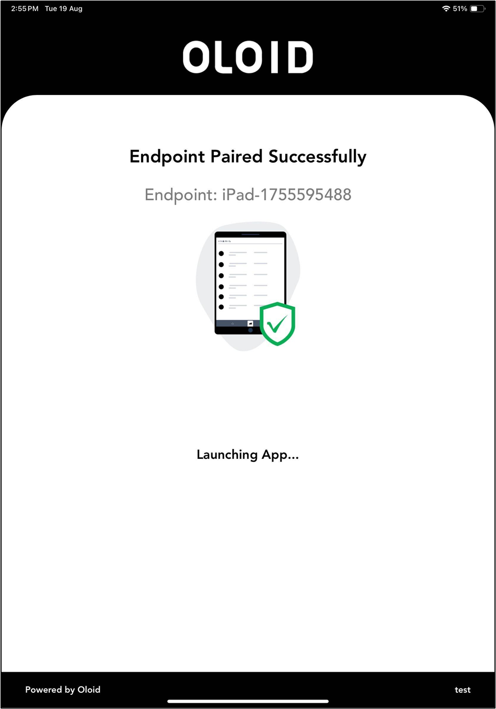
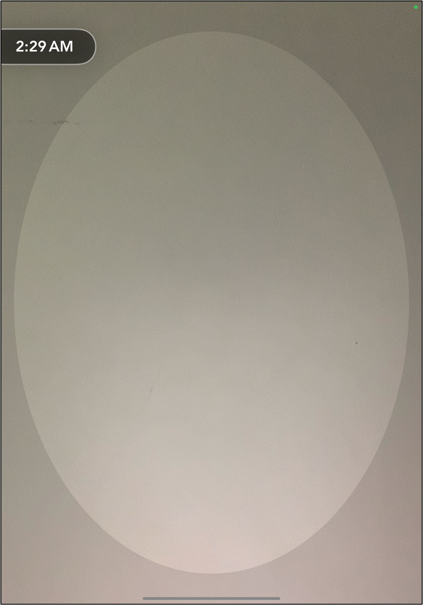

{/* Source: Intercom article 11822152 - https://oloid.help/en/articles/11822152-oloid-connect-how-to-pair-oloid-connect-app-using-auto-pair-config-file */}
{/* Generated by intercom_to_mintlify.py - re-running overwrites this file. */}

## Introduction

This document provides instructions to pair the Oloid Connect app using an auto-pair config file.

## Prerequisites

- The auto-pair config file must be generated, transferred to the iPad, and saved. For more, refer to [Oloid Connect - How to generate Auto-Pair config file in the Tenant Admin Portal](/platforms/ios/time-clock/oloid-connect/oloid-connect-how-to-generate-auto-pair-config-file-in-the-tenant)
- Select **Skip user confirmation for pairing** when generating the config file, so the endpoint pairs automatically without user confirmation. (Recommended)

## Steps to pair using Auto-Pair Config file

1. Launch the **Oloid Connect** app.

   

   The **Welcome** screen is displayed.

   

2. Tap **Auto-pair using config file.**

   

   The **Pair Device Using Config File** screen is displayed.
3. On the **Pair Device Using Config File**, tap on **Click here to pair file**.

   

4. Tap the auto-pair config file from your iPad.

   

   The auto-config file is uploaded successfully, and the selected file is displayed on the screen.

Tap **Upload** to initiate endpoint pairing.

The Pairing Initiated screen is displayed.

The Endpoint Paired Successfully.

After successful pairing, the preview screen is displayed.

