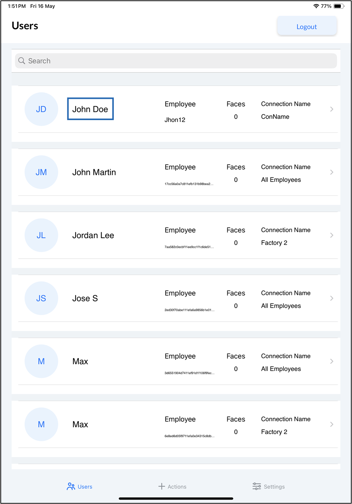
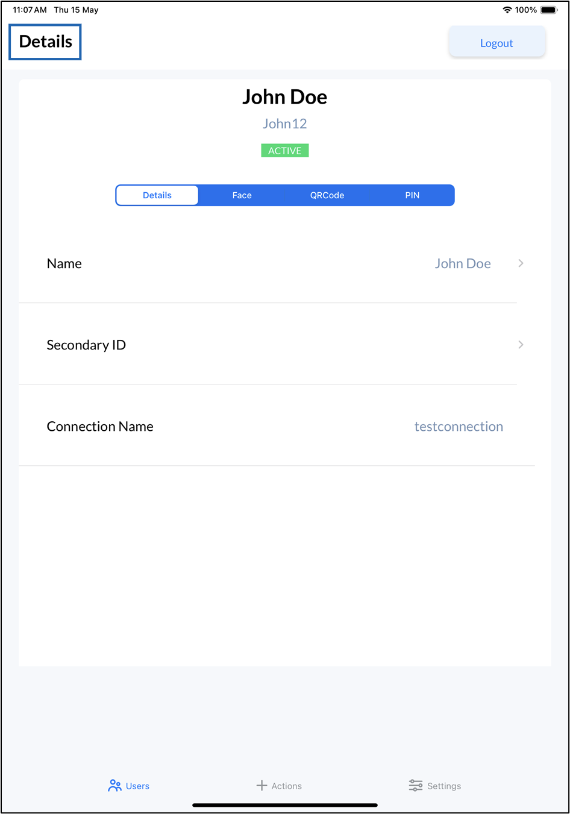
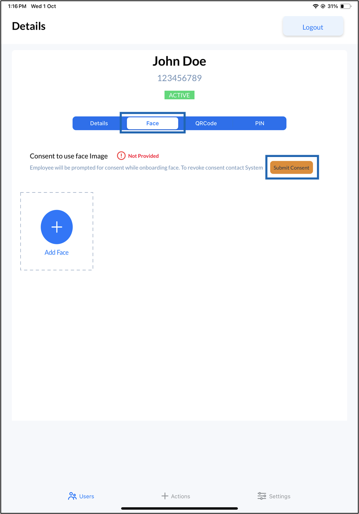
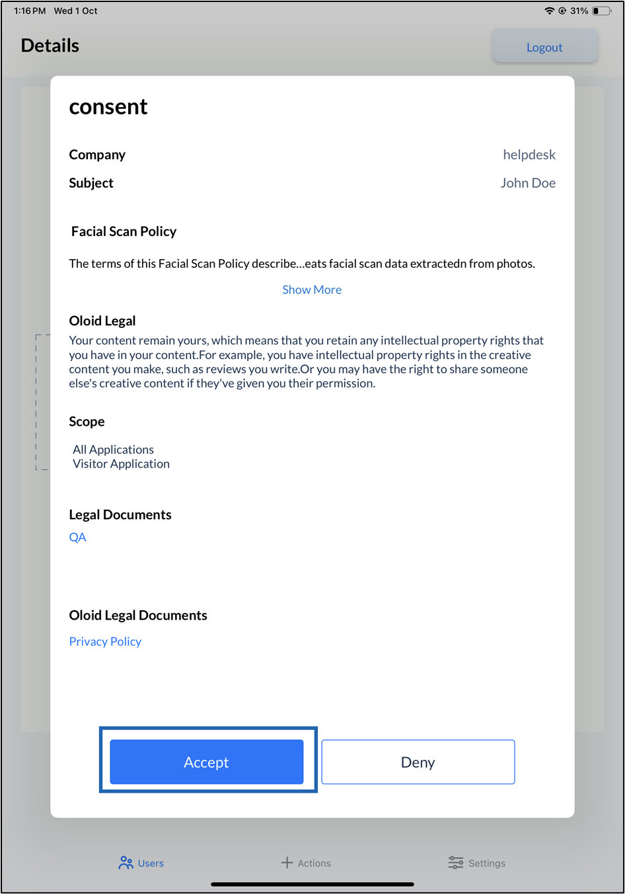
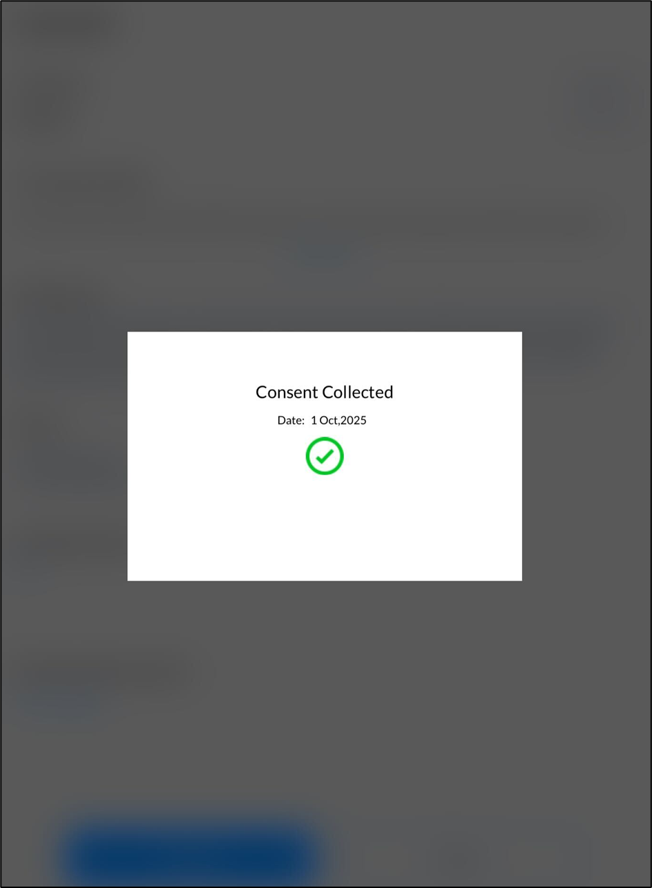
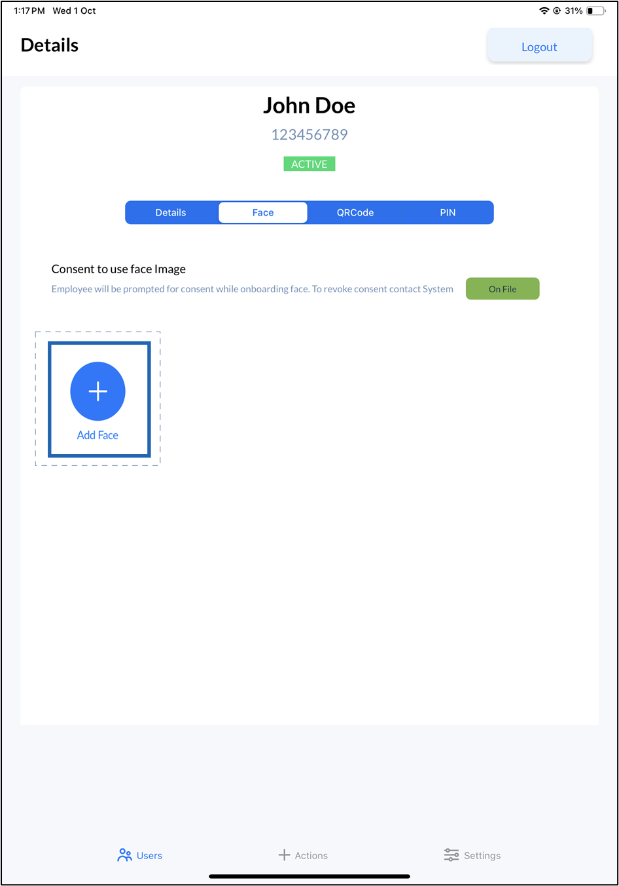
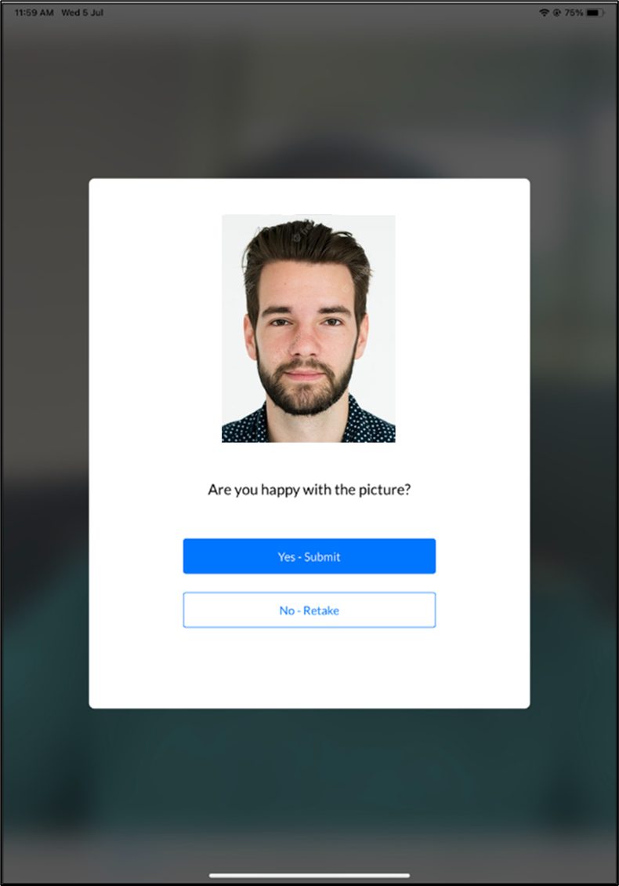

{/* Source: Intercom article 8535373 - https://oloid.help/en/articles/8535373-oloid-verify-add-faces */}
{/* Generated by intercom_to_mintlify.py - re-running overwrites this file. */}

## Introduction

The Add Faces feature in the Oloid Verify app allows Tenant Admins and Supervisors to register a user’s face as a credential.

<Note>
  **Note:** If consent option is enabled for connection to take consent for user, it will ask for consent before uploading the picture. To enable refer [How to add a Consent Template to a Connection in the Tenant Admin Portal](/platform/tenant-admin-portal/tenant-admin-portal-how-to-add-a-consent-template-to-a-connection-in).
</Note>

## Prerequisite

- You must have a Tenant Admin or Supervisor account.
- You must add the user. To add user refer [Oloid Verify-Add User](/platforms/ios/time-clock/oloid-verify/oloid-verify-add-user).
- The Oloid Verify endpoint must be paired. To pair, refer [How to pair an Oloid Verify endpoint](/platforms/ios/time-clock/oloid-verify/oloid-verify-how-to-pair-an-endpoint)

## Steps to add faces

1. Launch the **Oloid Verify** app.

   

2. Log in to Admin mode in Oloid Verify app. To login, refer [How to log in to the admin mode of Oloid Verify App as an Admin or Supervisor.](/platforms/ios/time-clock/oloid-verify/oloid-verify-how-to-log-in-to-admin-mode-as-admin-or-supervisor)
   The **Users** page is displayed with the list of users.
3. Select the preferred user to add a face.

   

   The user details page is displayed.

   

4. Go to **Face** tab > tap **Submit Consent.**

   

   The Consent form is displayed.
5. Tap **Accept.**

   

   The Consent is collected successfully.

   

6. Tap **+Add Face**.
   This opens the camera on your device.

   

7. Look at the camera to confirm your identity.
   The pop-up screen appears with the captured image.
8. Do one of the following:
   1. Tap **Yes- Submit** to submit the image.
      The face is submitted successfully and is displayed on the details screen.
   2. Tap **No- Retake** to take the photo again.
      The camera turns on to retake photo.

      

      The face credential is added successfully.

      

      <Note>
        **Note:** You can add a maximum of five faces per user.
      </Note>

      Ensure your face is clearly visible to avoid rejection. Avoid wearing items that cover facial features, such as sunglasses, masks, or headbands. For more details, refer to [Oloid’s Image Reference Guide](/platforms/web/webkey/guidelines-for-face-enrollment-onboarding-images) for face onboarding guidelines.

---

##### SEO Keywords

|Oloid Verify face credential setup | Add face in Oloid Verify app | register face in Oloid Verify|
