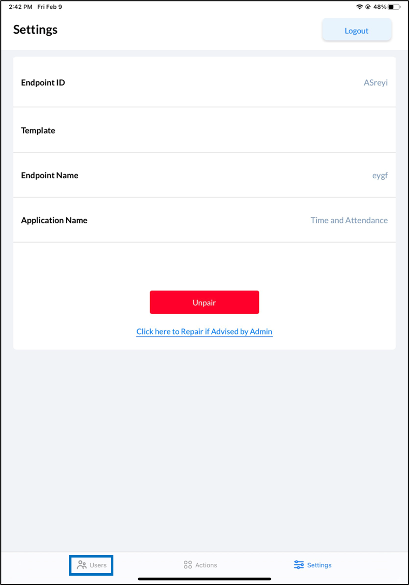
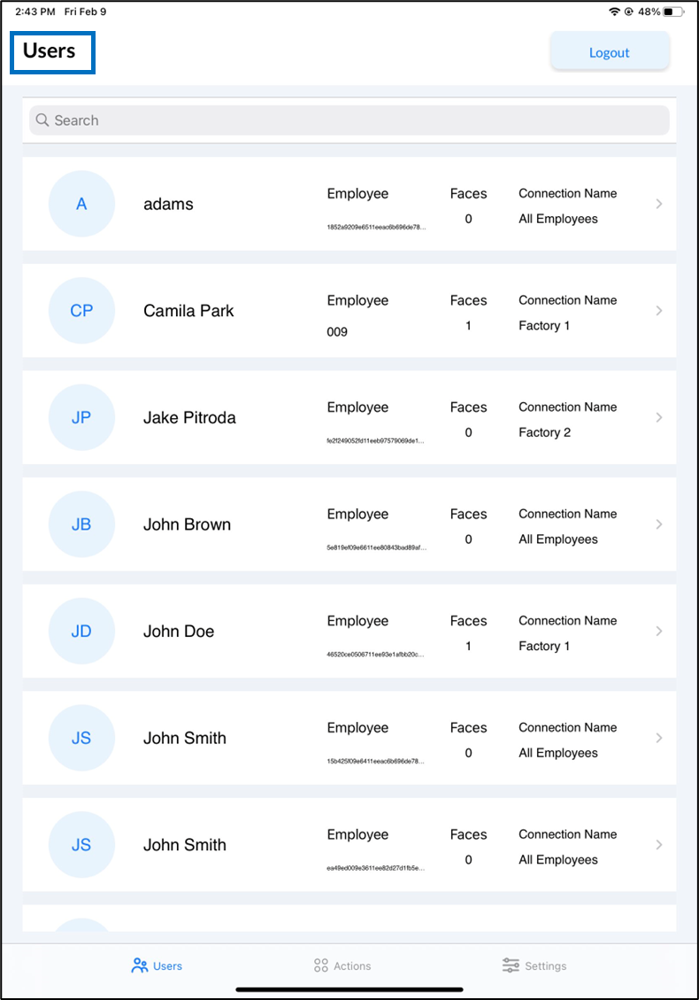
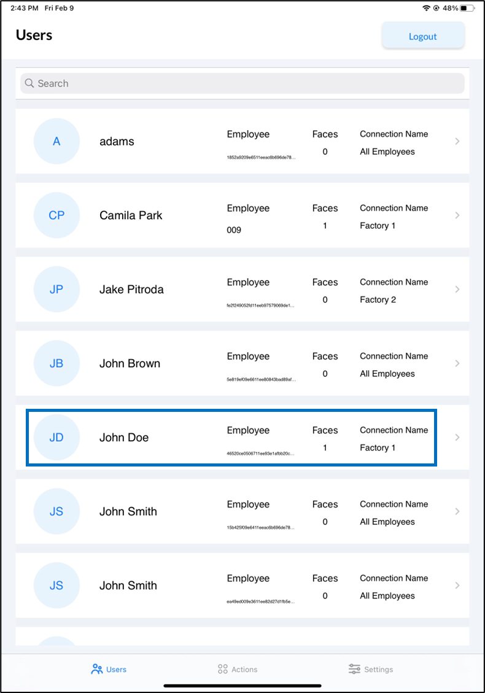
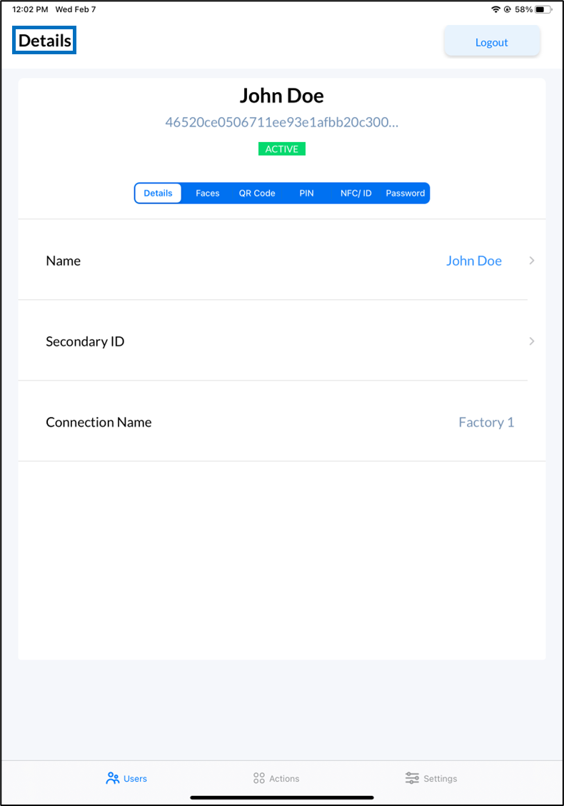
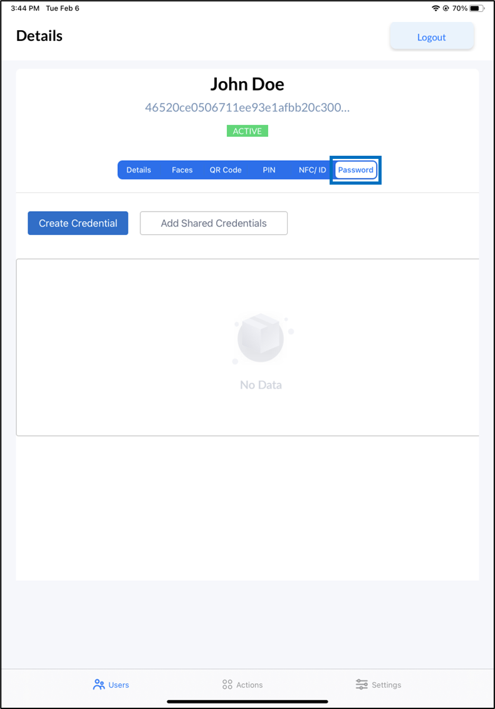
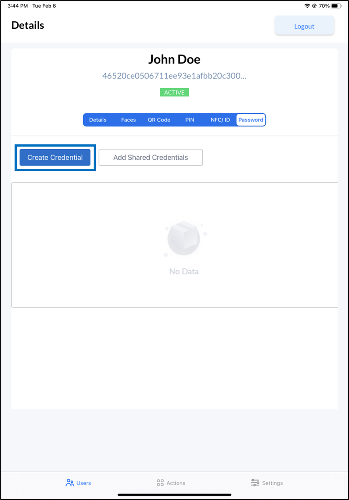
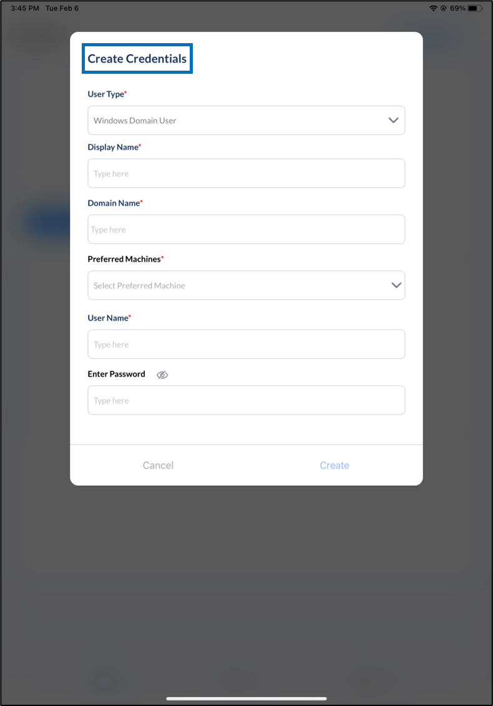
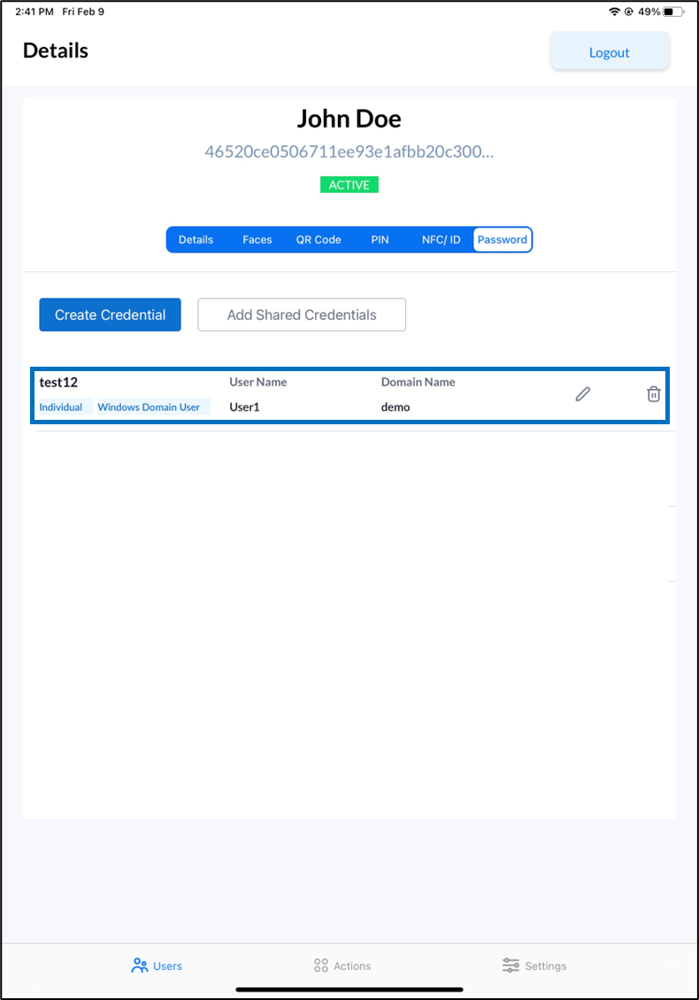

{/* Source: Intercom article 8929352 - https://oloid.help/en/articles/8929352-oloid-verify-add-password */}
{/* Generated by intercom_to_mintlify.py - re-running overwrites this file. */}

## Introduction

Oloid Verify app allows the supervisor to create password and perform the required action.

This document comprises of the following:

- [Create credential for domain](#create-credential-for-domain)
- [Create credential for local windows machine](#create-credential-for-local-windows-machine)

### Pre-requisite

User should be added to the connection.

To add Password:

1. Tap **Users** on the menu at the bottom of the screen.

   

   The **Users** page is displayed with the list of users.

   

2. Select a user to add Password from **Users** list.

   

   The User details screen opens.

   

3. Tap **Password** tab .

   

Tap **Create Credential**.

The **Create Credentials** pop-up box is displayed.

On the pop-up box, do the following:

#### Create credential for domain

1. Select user type as **Domain User** from **User Type** dropdown.
2. Enter **Display Name**.
3. Enter **Domain Name**.
4. Select **Preferred Machine(s)**.

   <Note>
     **Note:** You can select multiple machine name
   </Note>

5. Enter **User Name** of your Windows account.
6. Enter **Password** of your Windows account.
7. Click **Create**.
   The credential is created and displayed under the **Password** tab.

   

#### Create credential for local Windows machine

1. Select user type as **Local User** from **User Type** dropdown.
2. Enter **Display Name**.
3. Select **Machine Name**.

   <Note>
     **Note:** You can select only single machine name.
   </Note>

4. Enter **User Name**.
5. Enter **Password**.
6. Click **Create**.
   The credential is created and displayed under the **Password** tab.

   
