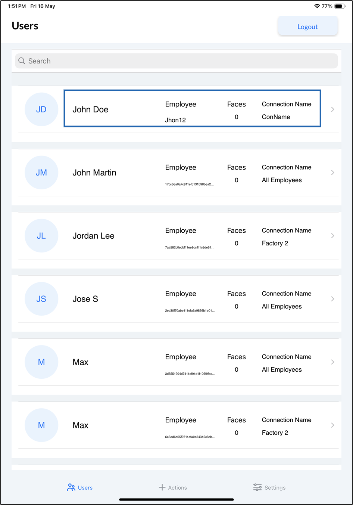
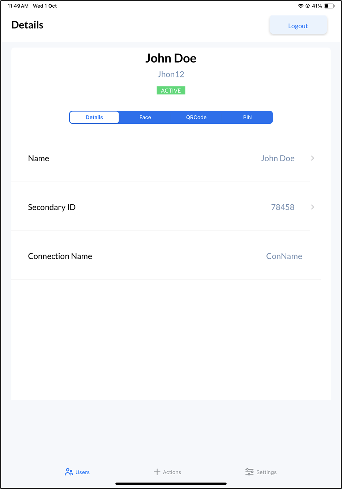
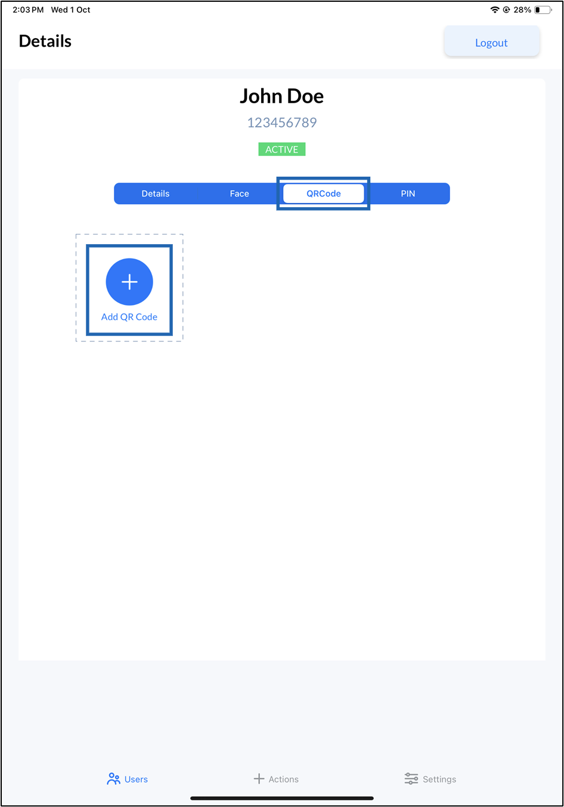
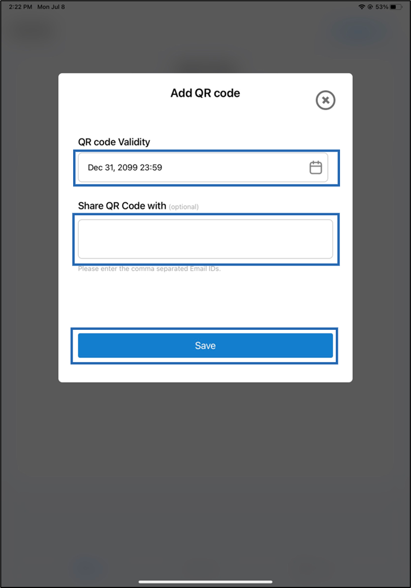
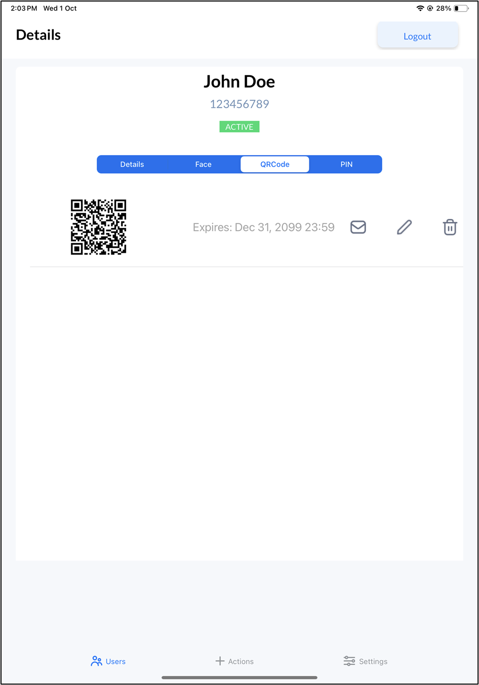

{/* Source: Intercom article 9570790 - https://oloid.help/en/articles/9570790-oloid-verify-add-qr-code */}
{/* Generated by intercom_to_mintlify.py - re-running overwrites this file. */}

## Introduction

The Add QR Code feature in the Oloid Verify app allows Tenant Admins and Supervisors to generate and add a QR Code credential.

## Prerequisites

- You must have a Tenant Admin or Supervisor account.
- You must add the user. To add user refer[Oloid Verify: Add User](/platforms/ios/time-clock/oloid-verify/oloid-verify-add-user).
- The Oloid Verify endpoint must be paired. To pair refer [How to pair an Oloid Verify endpoint](/platforms/ios/time-clock/oloid-verify/oloid-verify-how-to-pair-an-endpoint)

## Step to add QR Code

1. Launch the **Oloid Verify** app.

   

2. Log in to Admin mode in Oloid Verify app. To login, refer [How to log in to the admin mode of Oloid Verify App as an Admin or Supervisor.](/platforms/ios/time-clock/oloid-verify/oloid-verify-how-to-log-in-to-admin-mode-as-admin-or-supervisor)
   The **Users** screen with list of users is displayed.
3. Tap on the preferred **user**.

   

   The User details are displayed on the **Details** screen.

   

4. Go to **QR Code** > **Add QR Code**.

   

   The **Add QR Code** pop-up box is displayed.
5. On the pop-up box, do the following:
   1. Set **QR code Validity** from the calendar.
   2. Enter the recipient **Email ID(s)** to share **QR Code.** (Optional)
   3. Tap **Save**.

      

The QR code is successfully assigned to the user.

