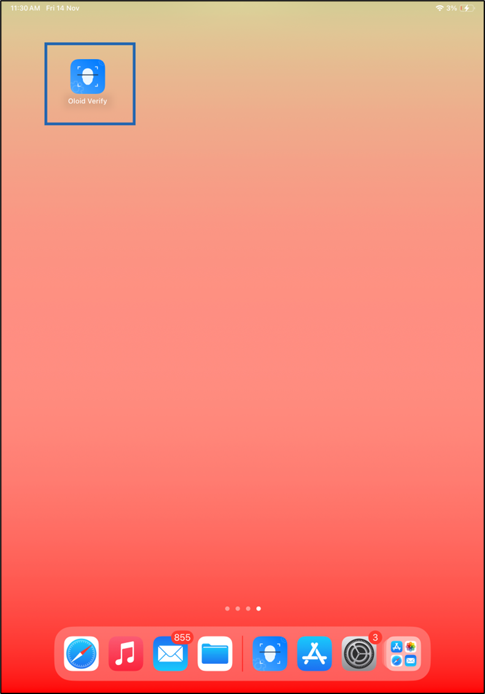
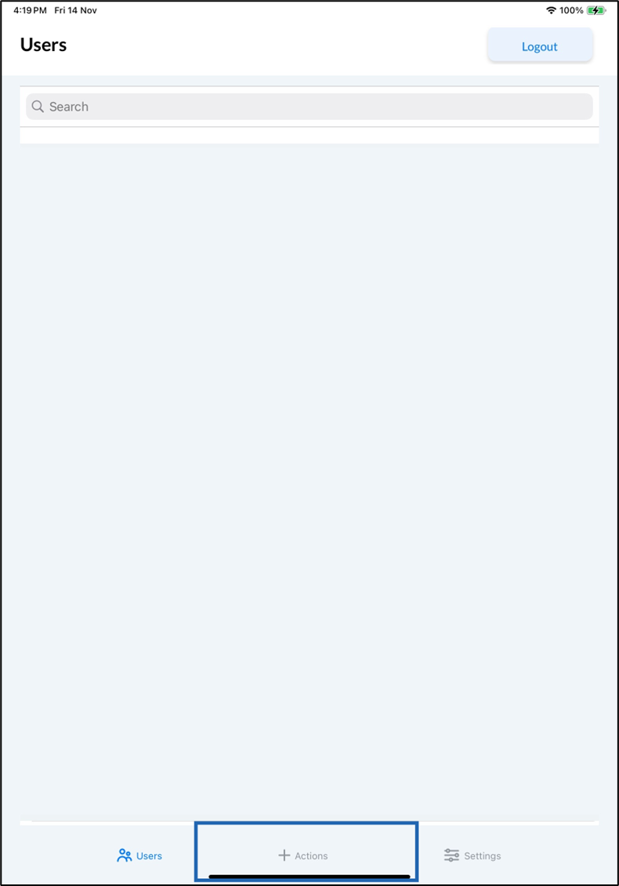
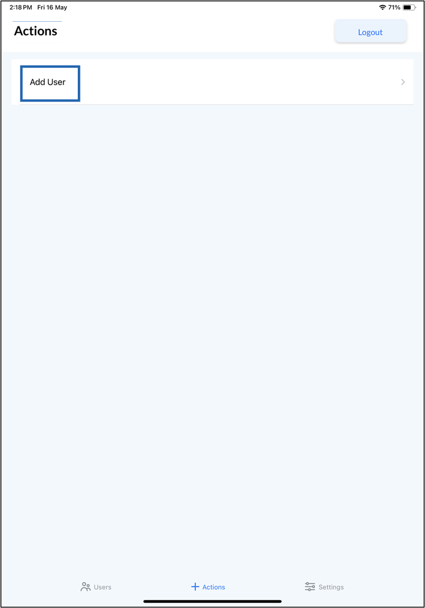
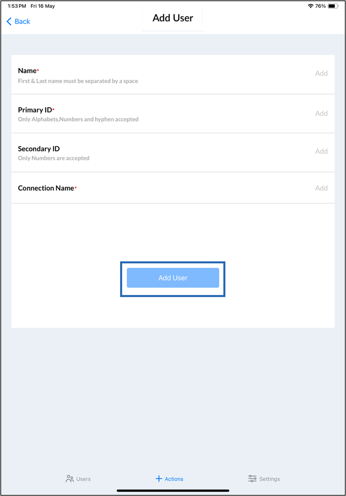
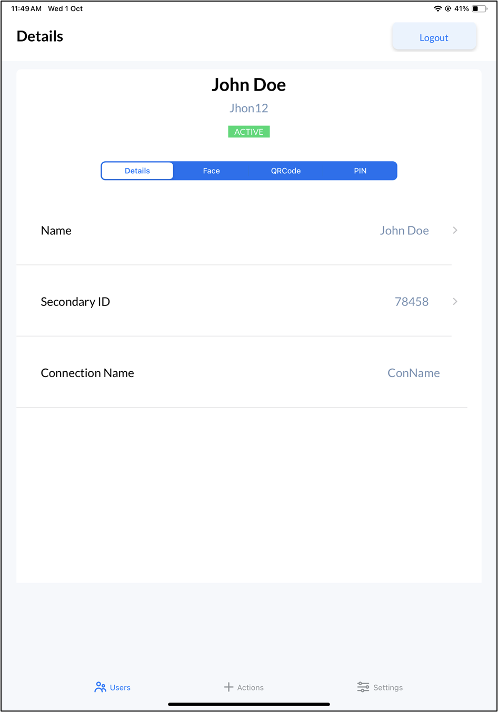

{/* Source: Intercom article 8601073 - https://oloid.help/en/articles/8601073-oloid-verify-add-user */}
{/* Generated by intercom_to_mintlify.py - re-running overwrites this file. */}

## Introduction

The Add User feature in the Oloid Verify app allows Admins and Supervisors to directly add user from the endpoint.

## Prerequisite

- You must complete the Admin Setup. To setup, refer [Oloid Verify - Admin Setup.](/platforms/ios/time-clock/oloid-verify/oloid-verify-how-to-complete-admin-setup)
- You must enable Supervisors privileges to allow the supervisor to add user. To enable, refer to [How to enable Add or Delete Users in Tenant Admin Portal for Supervisors](/platforms/windows/supervisor-app/windows-login-how-to-enable-add-delete-users-in-tenant-admin-portal)
- The Oloid Verify endpoint must be paired. To pair refer [How to pair an Oloid Verify endpoint](/platforms/ios/time-clock/oloid-verify/oloid-verify-how-to-pair-an-endpoint)

## Steps to Add user

1. Launch the **Oloid Verify** app.

   

2. Log in to Admin mode in Oloid Verify app. To login refer [How to log in to the admin mode of Oloid Verify App as an Admin or Supervisor](/platforms/ios/time-clock/oloid-verify/oloid-verify-how-to-log-in-to-admin-mode-as-admin-or-supervisor)
   The **Home** screen is displayed.
3. Tap **+Actions** on the menu at the bottom of the screen.

   

   The **Actions** screen is displayed.
4. Tap **Add User.**

   

   The **Add User** screen is displayed.
5. Enter **Name**.

   <Note>
     **Note:** First name and Last name should be separated by a space.
   </Note>

6. Enter **Primary ID**.
   Only alphabets, numbers, and hyphen are accepted.
7. Enter **Secondary ID** (Optional).
   Only numerals are accepted.
8. Select connection name from **Connection Name** list.
9. Tap **Add User**.

A new user is added and user details are displayed in User **Details** screen.

---

##### SEO Keywords

|Oloid Verify add user |Oloid Verify user onboarding | Oloid Verify create new user|
