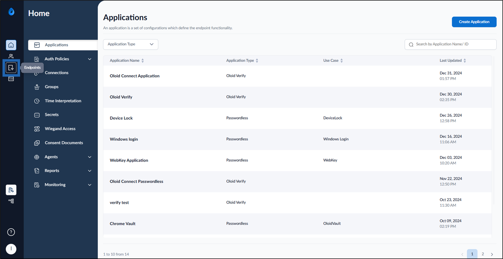
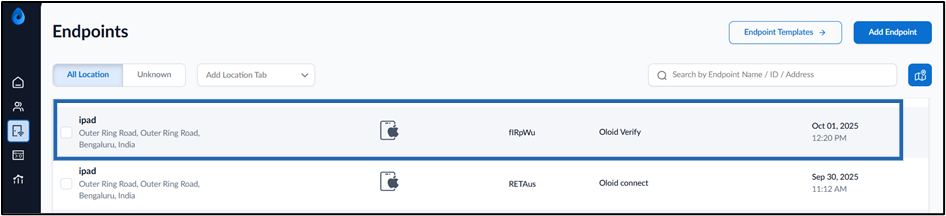
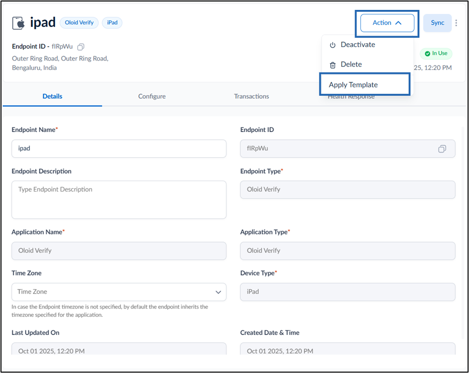
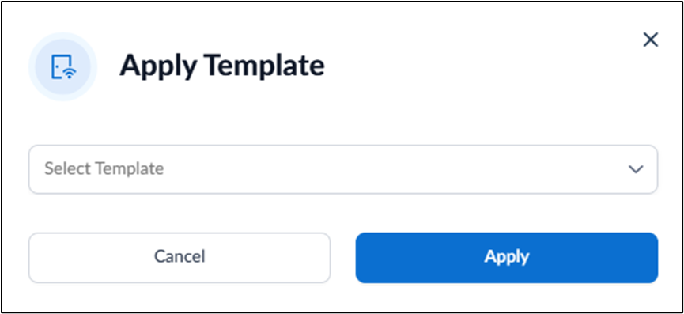
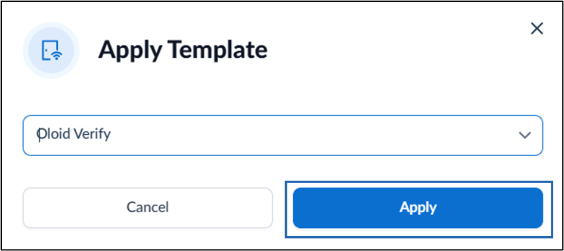
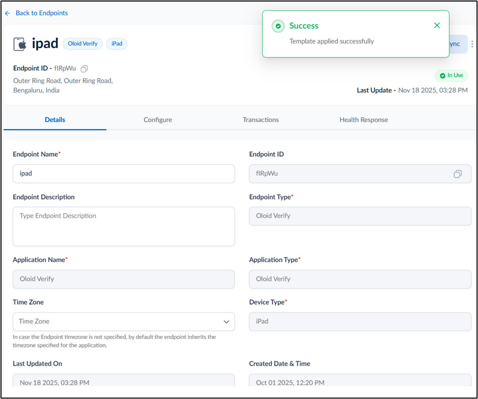

{/* Source: Intercom article 12866693 - https://oloid.help/en/articles/12866693-oloid-verify-how-to-apply-template-to-paired-endpoint-in-the-tenant-admin-portal */}
{/* Generated by intercom_to_mintlify.py - re-running overwrites this file. */}

## Introduction

This document explains how to apply an endpoint template to a paired Oloid Verify endpoint in the Tenant Admin Portal. Applying the template makes sure the pre-set settings are automatically applied to the endpoint.

## Prerequisites

- You must have admin access to Tenant Admin Portal.
- The Oloid Verify endpoint must be paired. To pair, refer [How to pair an Oloid Verify endpoint](/platforms/ios/time-clock/oloid-verify/oloid-verify-how-to-pair-an-endpoint)
- An Endpoint template must be created. To create, refer [How to create and configure Oloid Verify Endpoint Template](/platforms/ios/time-clock/oloid-verify/oloid-verify-how-to-create-and-configure-endpoint-template-in-tenant)

## Steps to Apply Endpoint Template

1. Log in to the **Tenant Admin Portal**.
2. On the Home page of the portal, click **Endpoints** from the left panel menu.

   

   The endpoint screen is displayed.
3. Select the **Endpoint**.

   

   The **Endpoint Detail** page is displayed.
4. Select **Action** dropdown > **Apply Template**.

   

   The **Apply Template** pop-up box is displayed.
5. Choose the applicable template from the **Select Template** dropdown.

   

   The selected template is displayed in the **Select Template** field.
6. Click **Apply**.

   

   The Endpoint Template is successfully applied to the endpoint.

   
