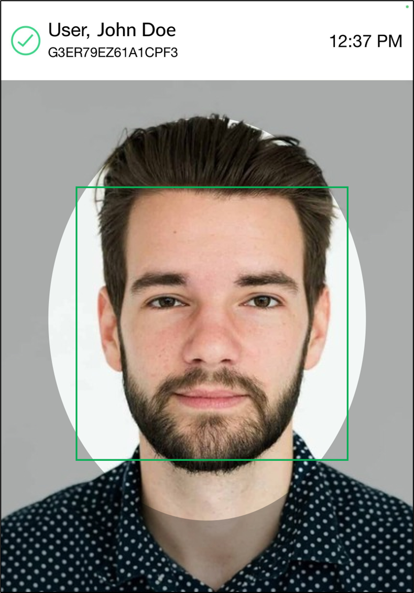
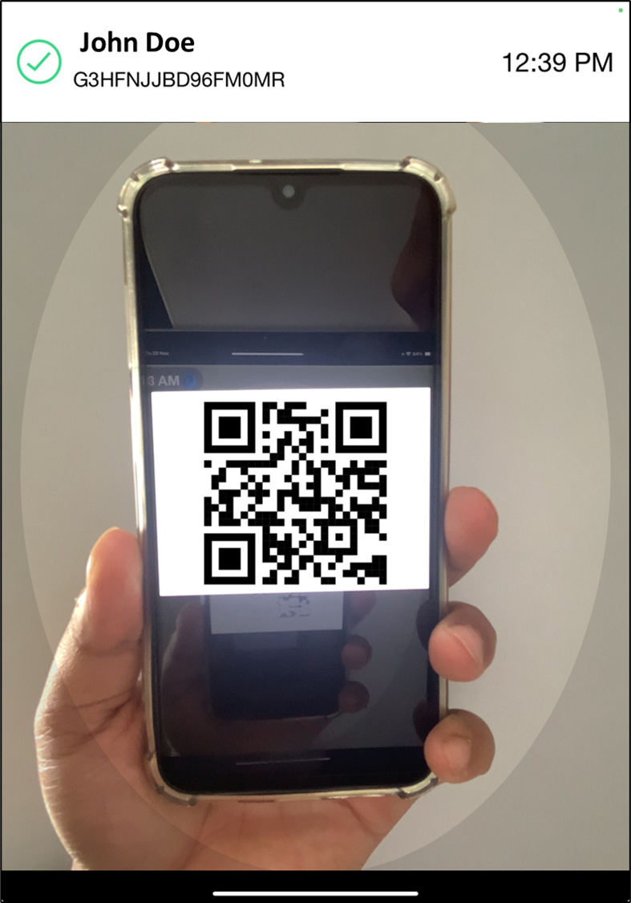

{/* Source: Intercom article 10353069 - https://oloid.help/en/articles/10353069-oloid-verify-how-to-authenticate-a-user-using-credentials */}
{/* Generated by intercom_to_mintlify.py - re-running overwrites this file. */}

## Introduction

The Oloid Verify app provides two secure authentication methods-facial recognition and QR code scanning.

## Prerequisites

- Your face must be registered in the Oloid Verify app.
- You must have your assigned QR code.
- The endpoint must be paired.
  For more, refer to[How to Pair an Oloid Verify Endpoint](/platforms/ios/time-clock/oloid-verify/oloid-verify-how-to-pair-an-endpoint)

You can authenticate by using one of the following method:

- [Authenticate using Face](#steps-to-authenticate-using-face)
- [Authenticate using QR Code](#steps-to-authenticate-using-qr-code)

## Steps to Authenticate using Face

1. Open **Oloid Verify App**.
   The **camera** opens to capture the face.
2. Position your face within the oval frame on the camera to capture your face for authentication.
   After successful authentication, the user details appear at the top of the screen.

   

## Steps to Authenticate using QR Code

1. Open **Oloid Verify App**.
   The **camera** opens to capture the QR Code.
2. Place your QR Code within the oval frame on the camera to capture your QR code for authentication.
   After successful authentication, the user details appear at the top of the screen.

   

---

##### SEO Keywords

|Oloid Verify authentication | Oloid Verify face authentication | Oloid Verify QR code authentication|
