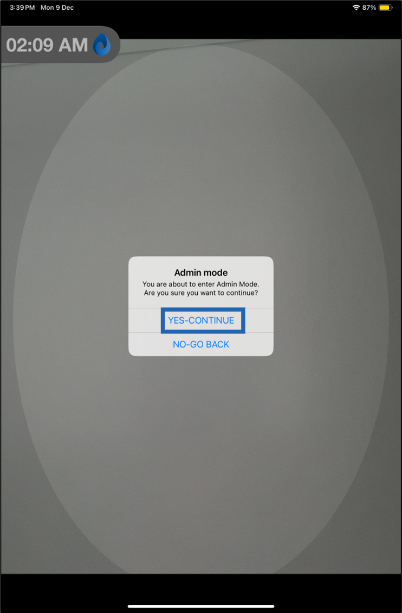
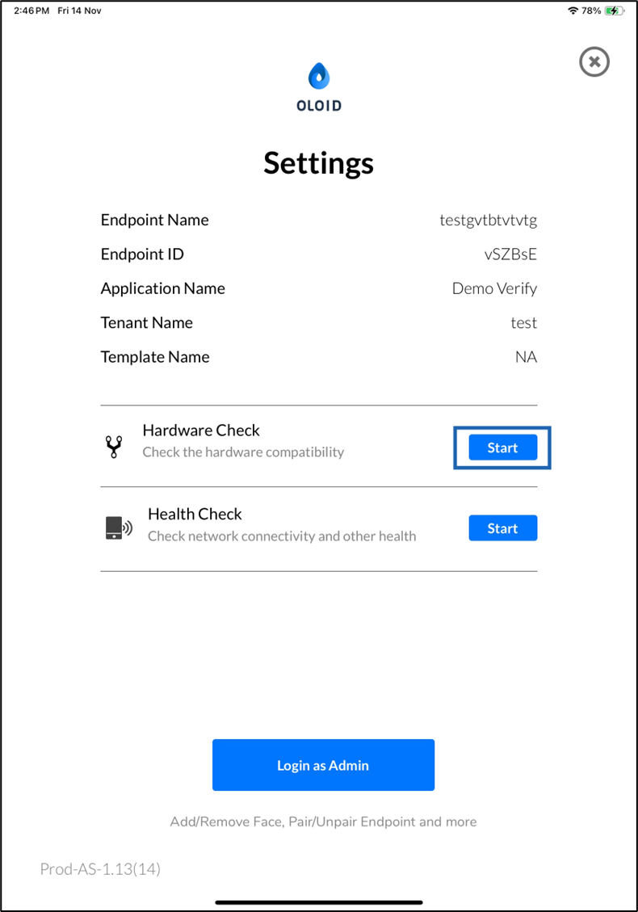
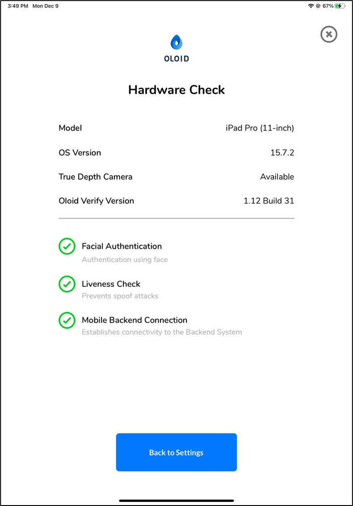

{/* Source: Intercom article 10255794 - https://oloid.help/en/articles/10255794-oloid-verify-how-to-check-hardware-compatibility-on-the-endpoint */}
{/* Generated by intercom_to_mintlify.py - re-running overwrites this file. */}

## Introduction

The Hardware Compatibility Check in the Oloid Verify app ensures that the iPad meets the required technical standards for smooth operation. It allows Tenant Admin and Supervisor to quickly verify that key hardware components are working properly before using the device.

## Prerequisite

You must complete the Admin Setup. To Setup. refer [Oloid Verify - Admin Setup.](/platforms/ios/time-clock/oloid-verify/oloid-verify-how-to-complete-admin-setup)

## Steps to check hardware compatibility

1. Launch the **Oloid Verify App**.

   <Note>
     **Note:** Since the endpoint is already paired, the App will launch in the initial screen of the App. For more information, refer to [How to pair an Oloid Verify endpoint.](/platforms/ios/time-clock/oloid-verify/oloid-verify-how-to-pair-an-endpoint)
   </Note>

   

   The Preview screen is displayed.
2. **Double**-**tap** on the Preview screen with two fingers.
   The Admin mode pop up box is displayed.
3. Tap **YES-CONTINUE** to log into **Admin Mode**.

   

   The **Settings** page is displayed.
4. Tap **Start** in the **Hardware Check** section.

The **Hardware Check** page is displayed to view.

---

##### SEO Keywords

|Oloid Verify hardware compatibility | Oloid Verify iPad hardware check | Oloid Verify device compatibility|
