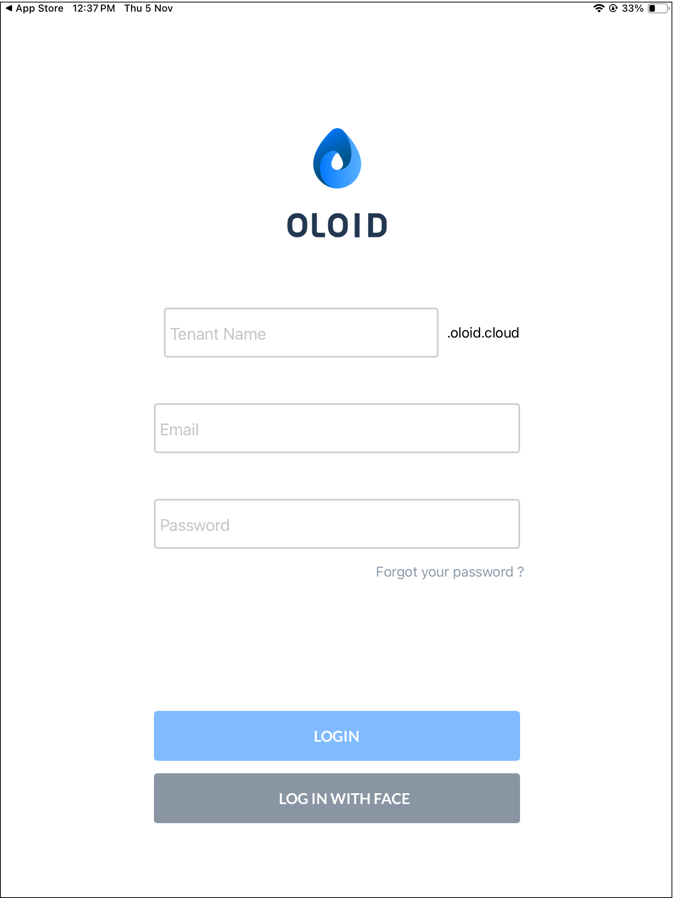
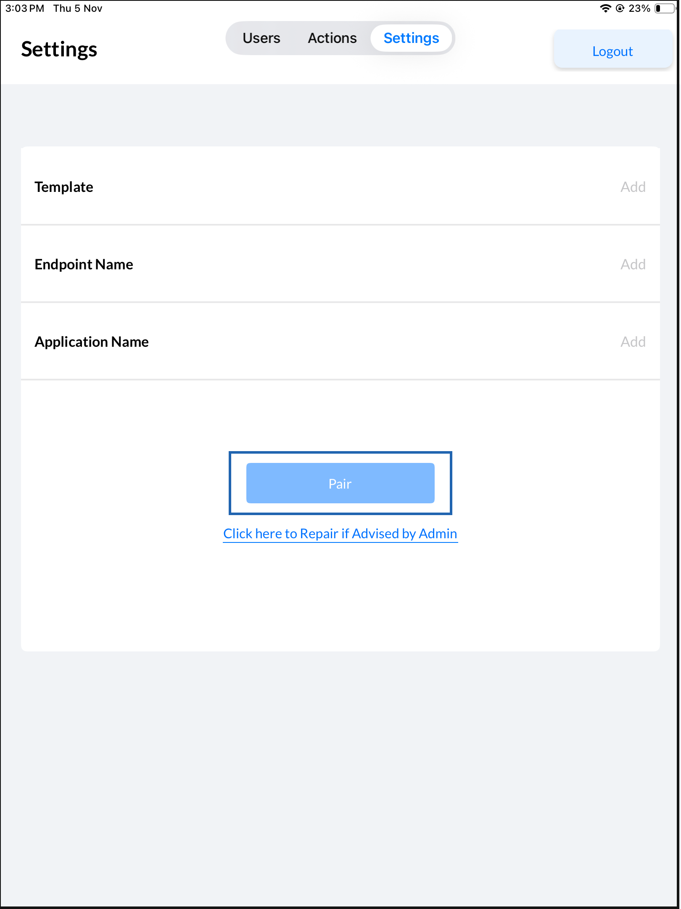
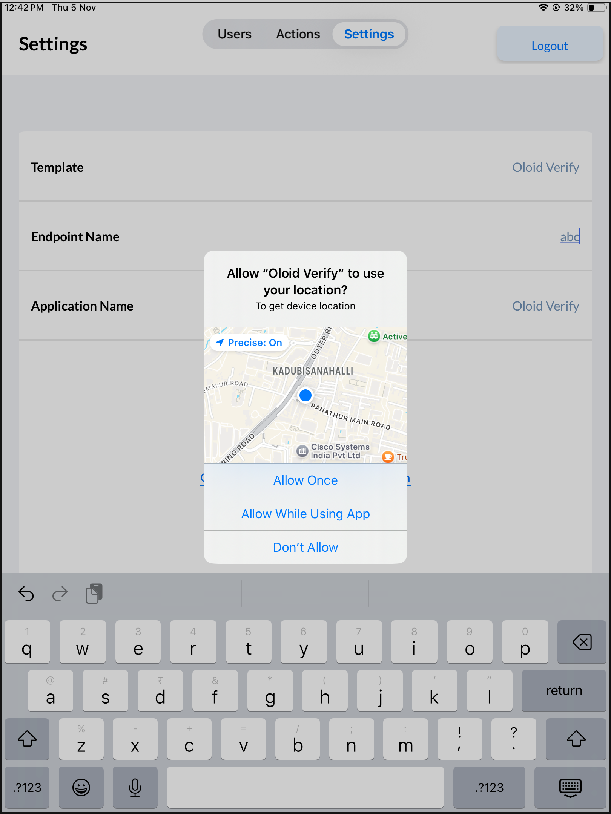
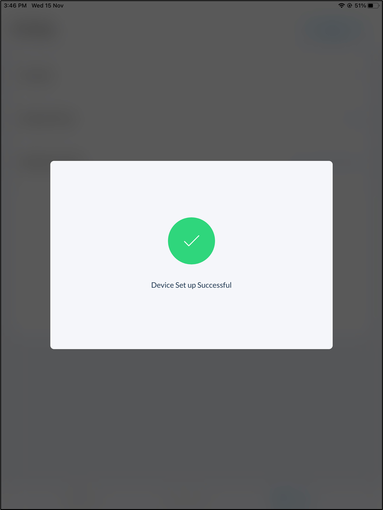

{/* Source: Intercom article 8601056 - https://oloid.help/en/articles/8601056-oloid-verify-how-to-complete-admin-setup */}
{/* Generated by intercom_to_mintlify.py - re-running overwrites this file. */}

## Introduction

This document explains how a Tenant Admin or Supervisor completes Admin Setup in the Oloid Verify app. During setup, you sign in to the app, pair the iPad with your Oloid Verify application, and enable location access. Once setup is done, the iPad is registered as an endpoint and ready to authenticate users.

## Prerequisites

- You must have a Tenant Admin or Supervisor account.
- An Oloid Verify application must be created and configured in the Tenant Admin Portal. For details, refer [How to create and configure Application Type - Oloid Verify](/platforms/ios/time-clock/oloid-verify/oloid-verify-how-to-create-and-configure-application-in-tenant-admin).
- The Oloid Verify app must be downloaded and installed from the App Store. For details ,refer [How to download and install Oloid Verify App](/platforms/ios/time-clock/oloid-verify/oloid-verify-how-to-download-and-install-the-app).

## Steps to Complete Admin Setup

1. Launch the Oloid Verify app.

   

   The Login screen is displayed.
2. Enter the **Tenant Name**.
3. Enter your email address in the **Email** field.
4. Enter your password in the **Password** field.
5. Tap **LOGIN**.
   **Note: LOG IN WITH FACE** is available only after the endpoint is paired.

   

   1. The **Settings** page is displayed.
6. On the **Settings** page, do the following:
   1. Add a **Template** (optional).
   2. Enter the **Endpoint Name**.
   3. Select an application from the **Application Name** list.
   4. Tap **Pair**.

      <Note>
        **Note:** On iPads running a version earlier than iOS 17, the **Settings** tab is at the bottom of the screen. On iOS 17 or later, it’s at the top.
      </Note>

      

      The location access pop-up is displayed
7. Tap one of the following options:
   - **Allow Once:** The app can use your location for this session only and asks again the next time you open it.
   - **Allow While Using App:** The app can use your location only while it’s open and in use.
   - **Don’t Allow:** The app can’t use your location at all.

     

     The **Device Set up Successfully** screen displayed.

     <Note>
       **Note:** After the iPad is paired, you can configure its other settings in the Tenant Admin Portal.
     </Note>

     

     Pop-up is displayed asking **Do you want to log out of Admin Mode to launch the application?**
8. Tap **Yes** to exit Admin mode and launch the application.

   <Note>
     **Note:** Tap **No** to stay in Admin mode.
   </Note>

   **Could not display content**
   In Admin Mode, you can do the following
   1. [View User Details](/platforms/ios/time-clock/oloid-verify/oloid-verify-view-user-details)
   2. [Add User](/platforms/ios/time-clock/oloid-verify/oloid-verify-add-user)
   3. [Add Faces](/platforms/ios/time-clock/oloid-verify/oloid-verify-add-faces)
