{/* Source: Intercom article 10511068 - https://oloid.help/en/articles/10511068-oloid-verify-how-to-configure-endpoint-in-tenant-admin-portal */}
{/* Generated by intercom_to_mintlify.py - re-running overwrites this file. */}

## Introduction

This document explains how to configure an endpoint in the Tenant Admin Portal. Endpoint configuration allows Tenant Admin to manage endpoint settings, appearance, groups and transaction behaviour for the **Oloid Verify** app.

<Note>
  **Note:** Once you pair an endpoint with Oloid Verify application, it gets saved and appears in the Tenant Admin Portal. After pairing, you can configure the endpoint.
</Note>

## Prerequisite

The Oloid Verify Endpoint must be paired. For more, refer to[How to Pair an Oloid Verify Endpoint](/platforms/ios/time-clock/oloid-verify/oloid-verify-how-to-pair-an-endpoint)

## Steps to Configure the Endpoint

1. Log in to the **Tenant Admin Portal**.
2. On the home page of the portal, click **Endpoints** on the left menu panel.

   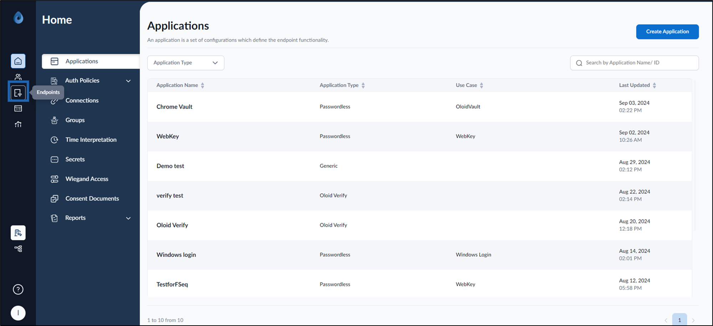

   The **Endpoints** page is displayed.
3. Select the paired Oloid Verify Endpoint.

   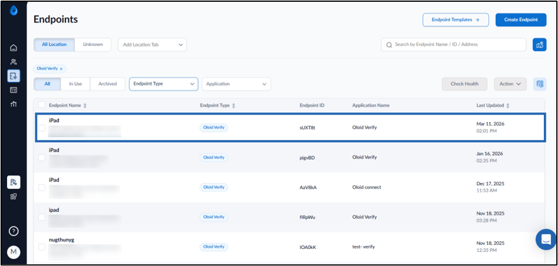

   The **Endpoint Details** page is displayed.

   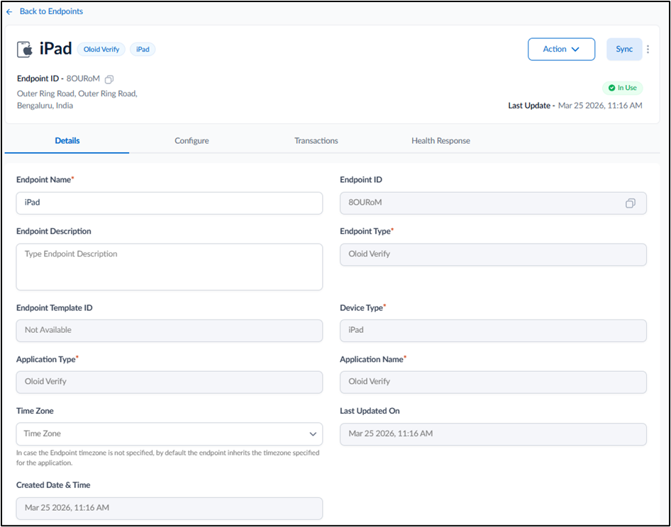

4. Do the following:
   1. [Configure Details Tab](/platforms/ios/time-clock/oloid-connect/oloid-connect-how-to-configure-endpoint-in-the-tenant-admin-portal)
   2. [Design Configure Tab](/platforms/ios/time-clock/oloid-connect/oloid-connect-how-to-configure-endpoint-in-the-tenant-admin-portal)
   3. [Configure Transactions Tab](/platforms/ios/time-clock/oloid-connect/oloid-connect-how-to-configure-endpoint-in-the-tenant-admin-portal)
   4. [Configure Health Response Tab](/platforms/ios/time-clock/oloid-connect/oloid-connect-how-to-configure-endpoint-in-the-tenant-admin-portal)
      The Endpoint is configured successfully.

## Configure Details Tab

1. Edit **Endpoint Name** if required.
2. Enter **Endpoint Description**. (Optional)
3. Select **Time Zone** from the dropdown list. (Optional)

   <Note>
     **Note:** If time zone is not set for the Endpoint, it automatically uses the application's default time zone.
   </Note>

4. Click **Save**.

   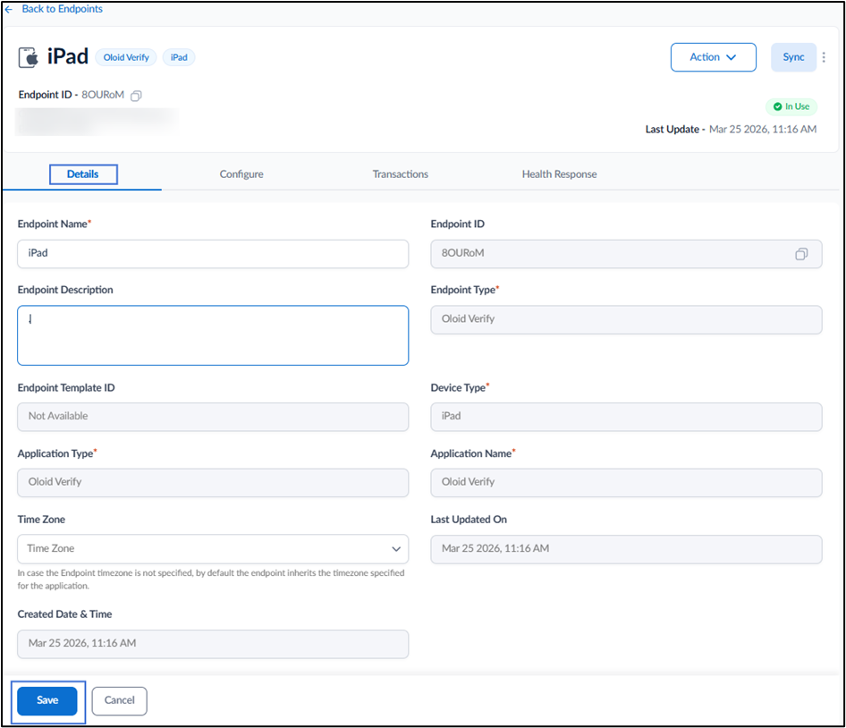

   The Details tab is configured successfully.

   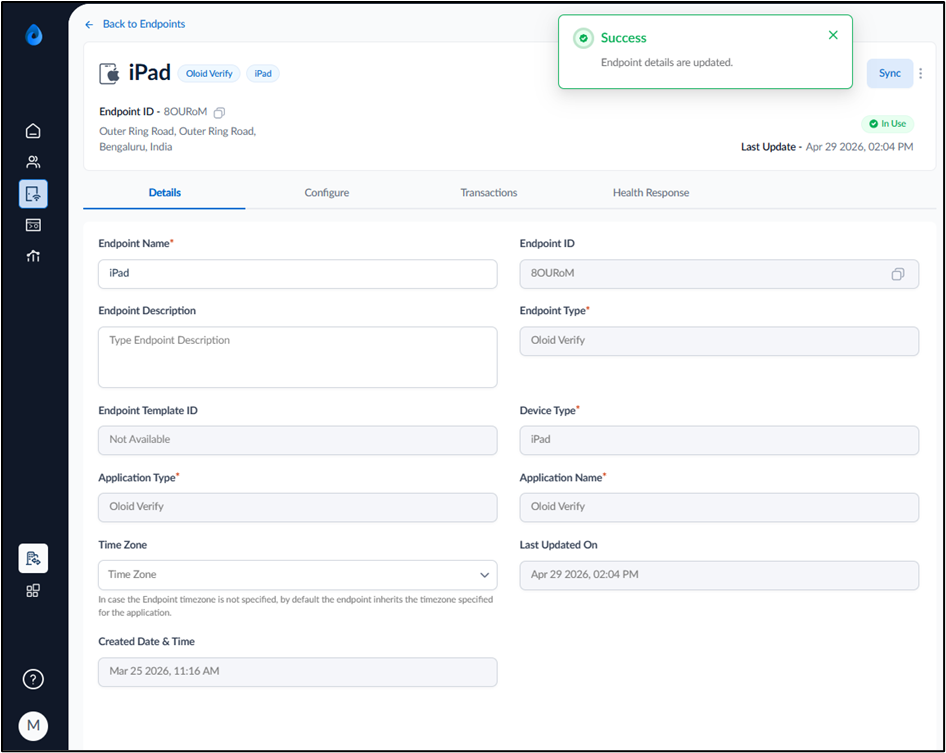

## Design Configure Tab

Configure the following:

- [Endpoint Settings](/platforms/ios/time-clock/oloid-connect/oloid-connect-how-to-configure-endpoint-in-the-tenant-admin-portal)
- [Groups](/platforms/ios/time-clock/oloid-connect/oloid-connect-how-to-configure-endpoint-in-the-tenant-admin-portal)
- [Web Button](/platforms/ios/time-clock/oloid-connect/oloid-connect-how-to-configure-endpoint-in-the-tenant-admin-portal)
- [Health Setup](/platforms/ios/time-clock/oloid-connect/oloid-connect-how-to-configure-endpoint-in-the-tenant-admin-portal)

#### Endpoint Settings

1. Turn on **Capture Location** toggleto activate location capture on the endpoint for each transaction.

   <Note>
     **Note:** The **Location Permission** of the device must be enabled to make the feature functional.
   </Note>

2. Turn on **Generate Debug Logs** toggle to activate log generation for the endpoint until disabled.
3. Click **Save**.

   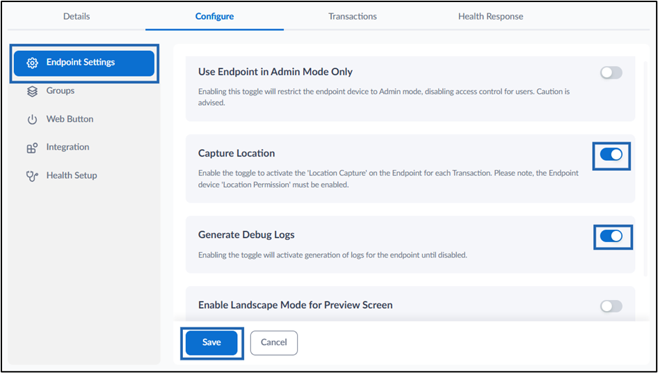

   The Endpoint setting is configured successfully.

   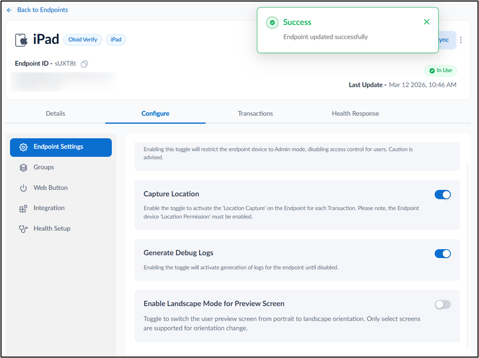

#### Groups

1. Turn on **One Face/User (On Device FR)** toggle to ensure that only one facial image of each user is stored on the device as a reference for On-device Transaction.

   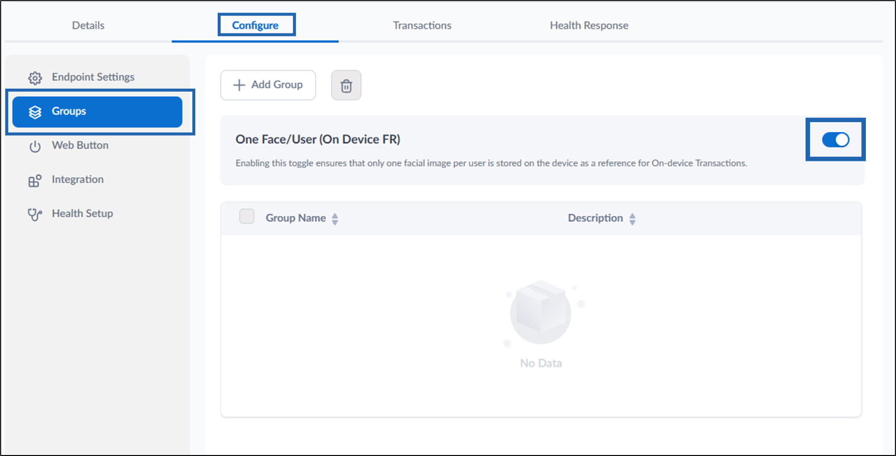

2. Click **+ Add Group**.

   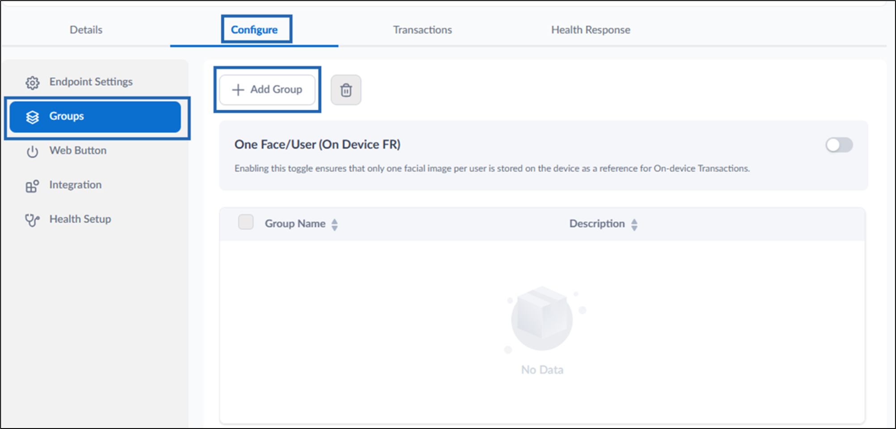

   The **Add Group** pop-up box is displayed.
3. Select group(s) in **Add Group** field.
4. Click **Save**.

   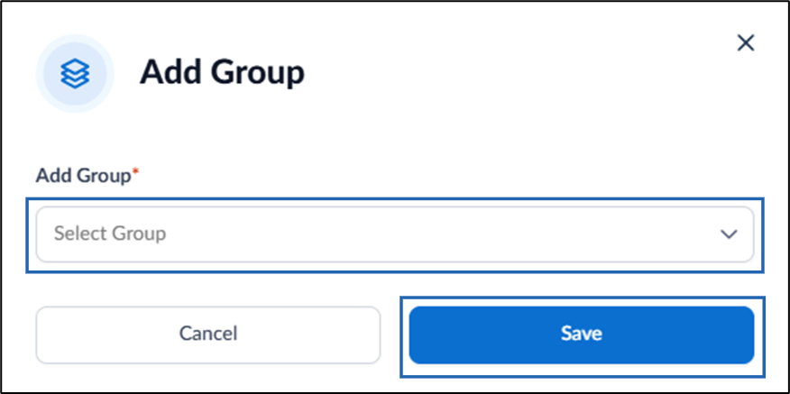

   The Group is added successfully.

   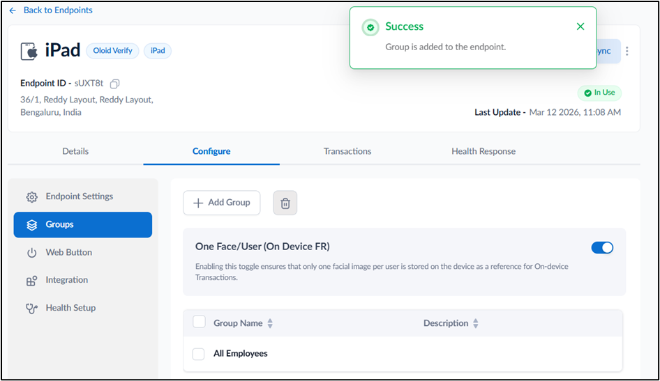

#### Web Button

1. Turn on **Web Button** toggle to display the Web Button on the endpoint preview screen. This button allows users to view transactions.
2. In the **URL** field, enter the complete URL of the website where users will review punch data.

   <Note>
     **Note:** You have to enter the URL of the website where the user will review the punches.
   </Note>

3. In the **Timeout** field, enter the delay (in minutes) before the URL launches.
4. Turn on **Show only on Auth** toggle to display the Web Button only after the user is successfully authorized. (Optional)
5. Turn on **Auto Launch** toggle to automatically launch the web button and view transaction. (Optional)

Click **Save**.

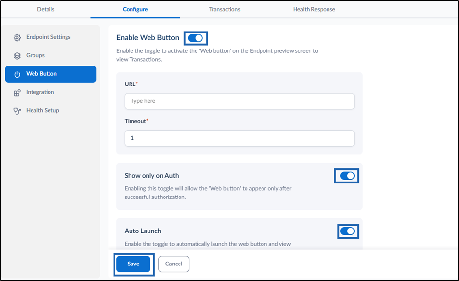

The Web Button is configured successfully.

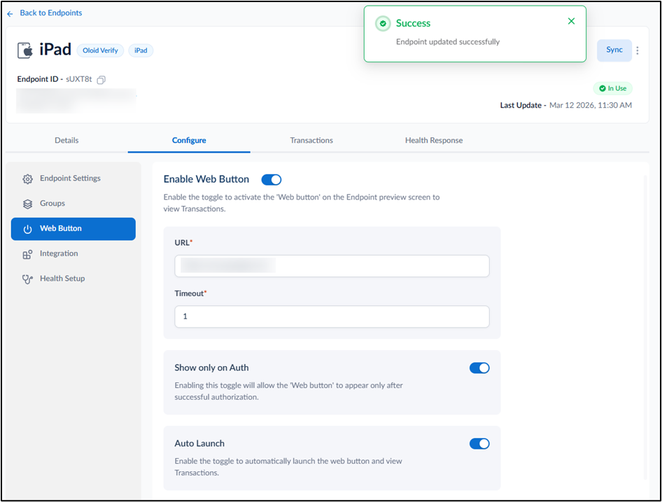

#### Health Setup

1. Enter **Server Name**.
2. Enter URL of the server in **Add URL that needs to be monitored** field.
3. Click **Add**.
   The monitored URLs will appear in the list below, with columns for **Server Name** and **URL**.

   <Note>
     **Note:** Configure the settings only if they are applicable. Consult your Oloid representative before making any changes.
   </Note>

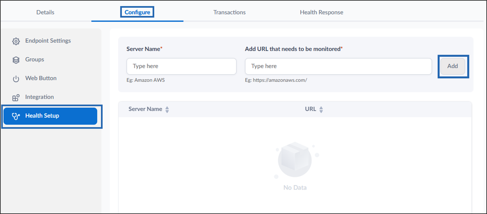

The Server is added along with its URL successfully.

## Configure Transactions Tab

The Transactions tab allows you to view detailed user transactions. You can monitor transaction statuses and filter results based on success or failure.

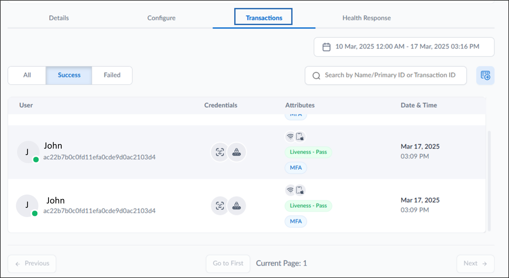

## Configure Health Response Tab

1. Turn on **Share Endpoint Logs** toggle to share logs.
2. Turn on **Relaunch** toggle to automatically apply changes made on the Tenant Admin Portal to the Oloid Verify app without manually closing or restarting the app.
3. Click **Check Health** to initiate a health check successfully.

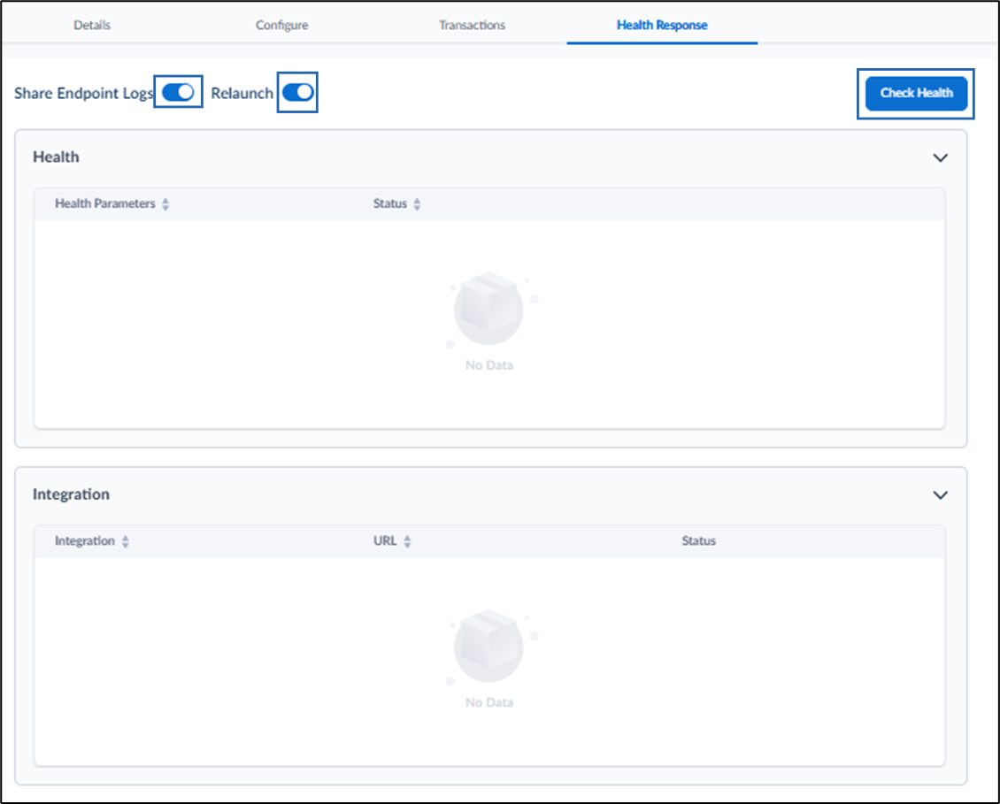

In this section, you can see the endpoint status, check health of the endpoint and configure health alert. For more information on health alert, see [How to configure health alert for an endpoint](/platform/tenant-admin-portal/how-to-add-health-alerts-in-the-endpoint).
