{/* Source: Intercom article 8300813 - https://oloid.help/en/articles/8300813-oloid-verify-how-to-create-and-configure-application-in-tenant-admin-portal */}
{/* Generated by intercom_to_mintlify.py - re-running overwrites this file. */}

## Introduction

This document explains how to create and configure an **Oloid Verify** application type in the Tenant Admin Portal.

## Prerequisite

You must have a Tenant Admin Account.

## Steps to create and configure Oloid Verify Application

1. Log in to the **Tenant Admin Portal**.
2. On the **Applications** page, click **Create Application**.

   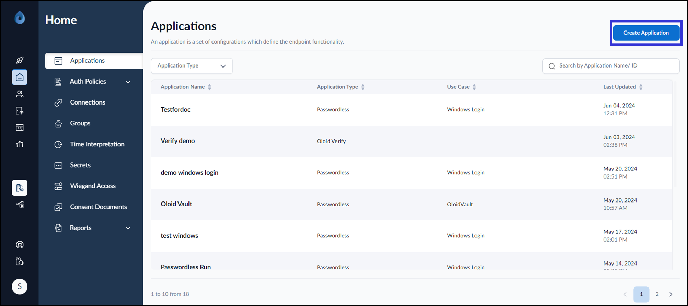

   The **Create New Application** pop-up box is displayed.

   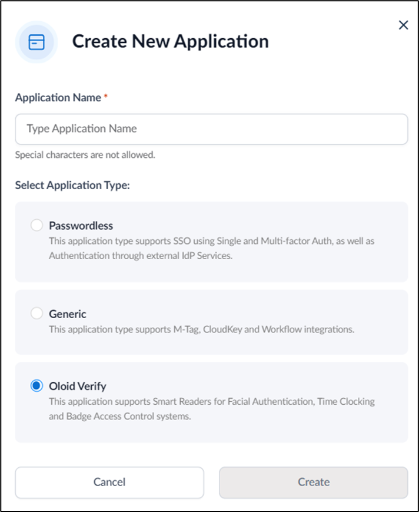

3. On the pop-up box, do the following:
   1. Enter **Application Name** and select **Oloid Verify** for **Application Type**.
   2. Click **Create**.
      The **Oloid Verify** application is created and the configuration page is displayed.
4. Configure the following:
   1. [Details tab](#configure-details-tab)
   2. [Authenticator tab](#configure-authenticator-tab)
   3. [Design Theme tab](#design-theme-tab)
   4. [Configure tab](#design-configure-tab)
   5. [Configure Health Setup tab](#configure-health-setup-tab)
   6. [Configure Connections tab](#configure-connections-tab)
   7. [Configure Integrations tab](#configure-integrations-tab)

      <Note>
        **Note:** These are one-time settings and all the default settings are recommended.
      </Note>

### Configure Details Tab

1. Modify **Application name** (if required).
2. Add **Description** (Optional).
3. Set **Time-zone** (Optional).
4. Set **Idle Screen Soft Time Limit** (Optional).
5. Set **Idle Screen Hard Time Limit** (Optional).
6. Click **Save**.

   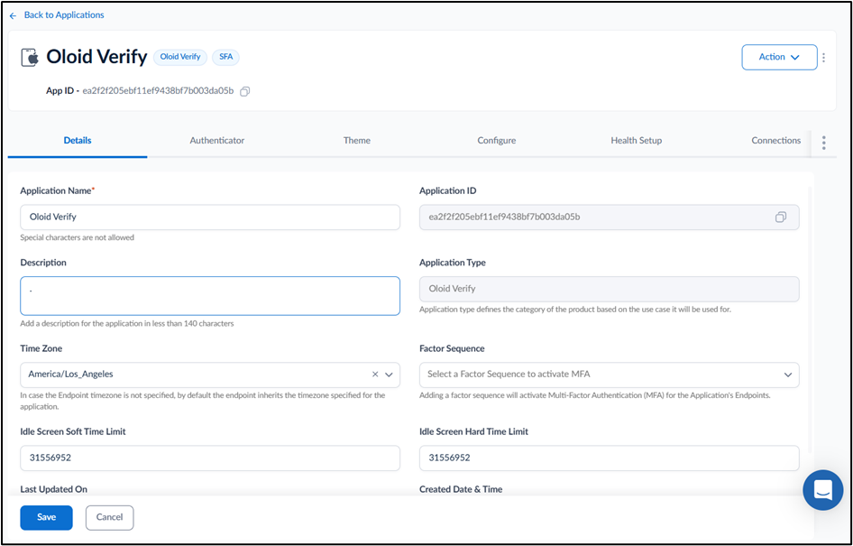

### Configure Authenticator Tab

#### Face

To use face as a credential, enable **Face** option.

<Note>
  **Note:**

  **Face** is enabled by default.
</Note>

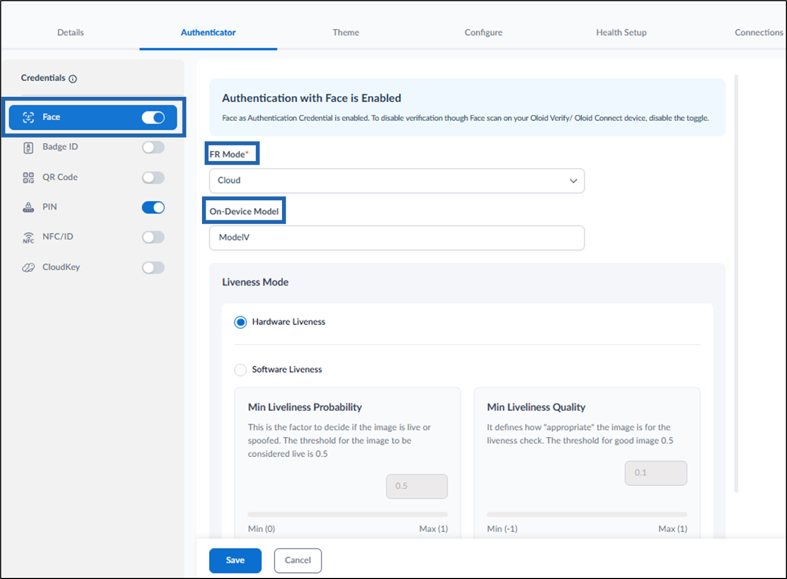

1. From the **FR Mode** drop-down, select the preferred face recognition mode:
   - **Hybrid**: Combines cloud and on-device facial recognition.
   - **Cloud**: Uses cloud-based facial recognition.
   - **On Device**: Uses on-device facial recognition.
2. Click **Save**.

#### Configure Liveness Mode

You can configure liveness detection for face authentication to protect against spoofing.

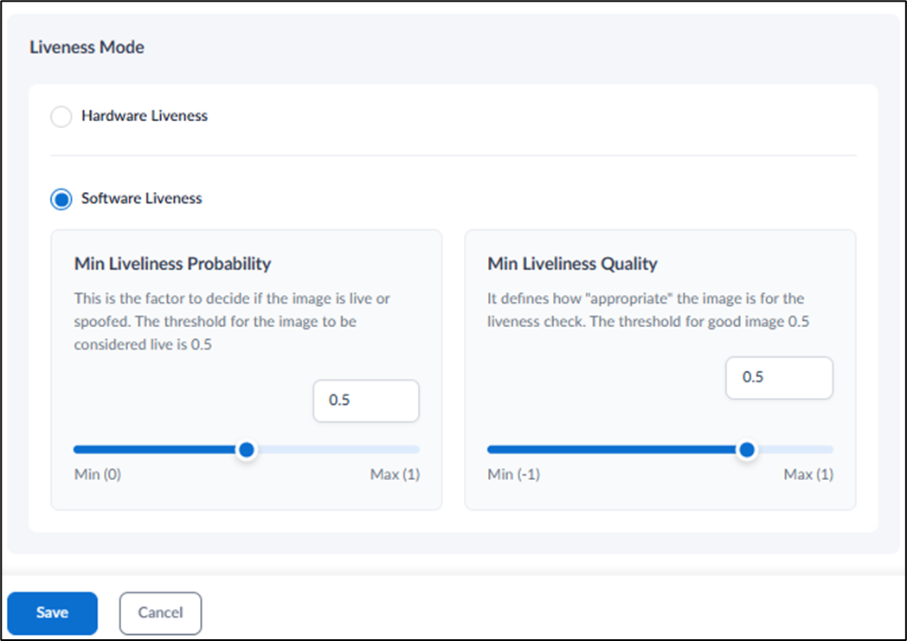

1. Choose a liveness mode:
   - Enable **Hardware Liveness** in devices with dedicated hardware sensors for higher accuracy.
2. Click **Save**.

<Note>
  **Note:** The parameters are pre-configured. This is done by Oloid admin.
</Note>

#### QR Code

To use **QR Code** credential, enable **QR Code**.

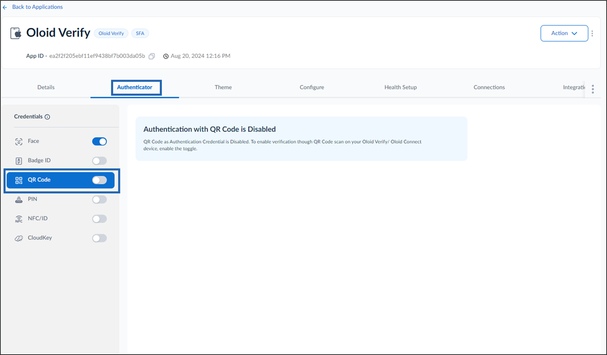

### Design Theme Tab

The **Theme** tab allows you to customize the appearance of the Oloid Connect app login page. (Optional)

Follow the on-screen instructions to customize your screen, then click **Deploy** to save your changes.

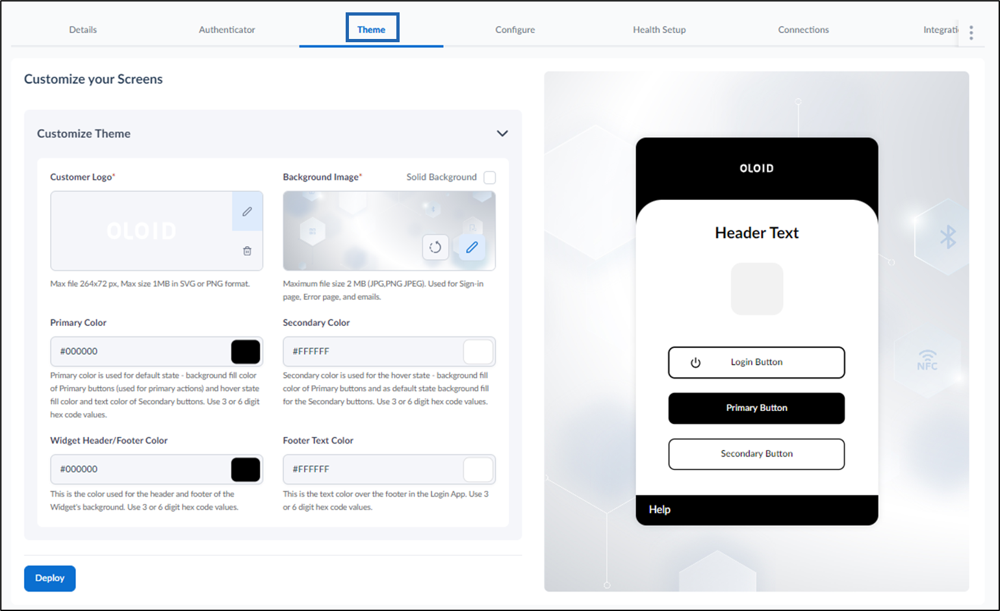

### Design Configure Tab

Do the following:

1. [Configure Settings tab](#configure-settings-tab)
2. [Customize Messages tab](/platforms/ios/connect-passwordless/how-to-create-and-configure-oloid-connect-passwordless-application-in)

### Configure Settings Tab

- **Enable Offline Mode**: Enable this option to allow endpoint transactions to be processed even without network connectivity.
- **Use Group Authorization**: Enable this option to restrict endpoint access to users within the same group associated with the endpoint connected to the application. This ensures that only users in the specified group can authenticate online and offline.
- **Server Response Ping Timeout**: Set an appropriate time to define how long the endpoint will wait for a response from the Oloid server before switching to Offline Mode.
- **Authentication Timeout**: Set an appropriate timeout value that determines how long the application waits for the user to begin the authentication process before being redirected to the initial screen.
- **Apply Endpoint Template**: Select Endpoint template from the dropdown.
- Enable **Show on Intent/Auth Screens** to display clock on all the intent, Authentication section and identity screens.

  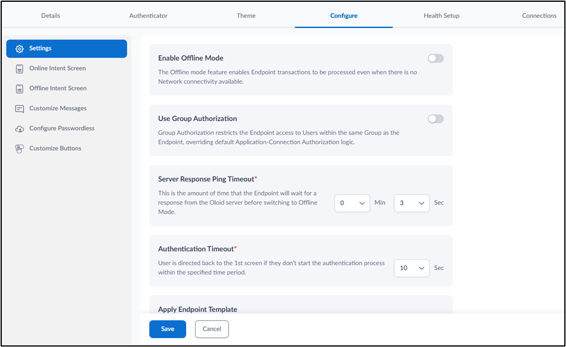

### Configure Intent Screen

Not applicable for Oloid Verify.

### Configure Offline Intent Screen

Not applicable for Oloid Verify.

### Customize Messages Tab

1. Turn on **Enable Action Status Messages** to display the action status of the user's facial transaction. You can customize the messages your user sees on the Oloid Verify App.
   - **Action Initializing Message**: Enter Action Processing Label in the text field.
   - **Action Success Message**: Enter Action Success Label in the text field.
   - **Action Failure Message**: Enter Action Failure Label in the text field.
   - Select **Auto-dismiss the error prompt after** to enter the preferred time (in seconds).
2. Edit **Authentication Failure Error Message** field (Optional).

   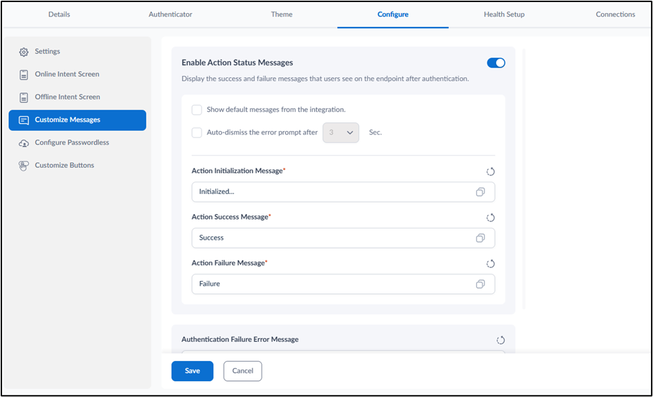

### Configure Passwordless Tab

Not applicable for Oloid Verify.

### Customize Buttons Tab

Not applicable for Oloid Verify.

### Configure Health Setup Tab

Do the following:

- Enter **Server Name**.
- Enter **URL that needs to be monitored**.
- Click **Add**.

  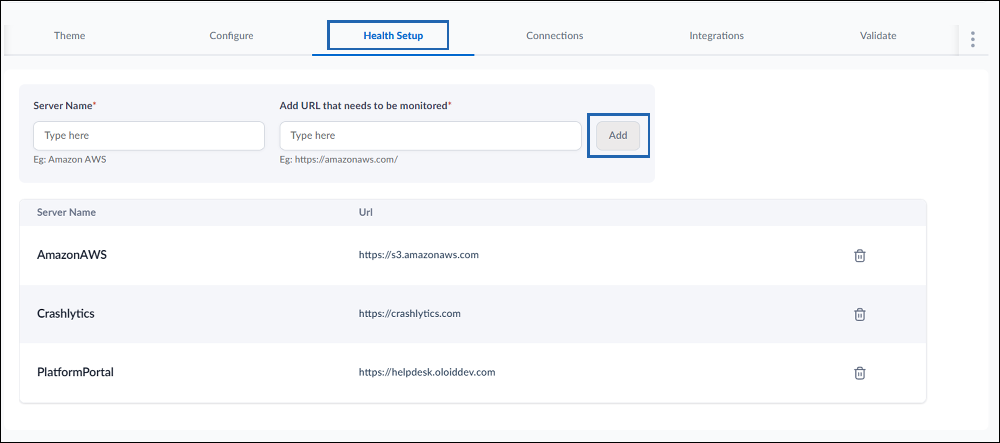

### Configure Connections Tab

1. Do the following:
   1. Select **+ Add Connections** to map a connection to the application.
   2. On the **Add Connections** pop-up box, select connection name(s) from the **Select Connection** dropdown list and click **Add**.

      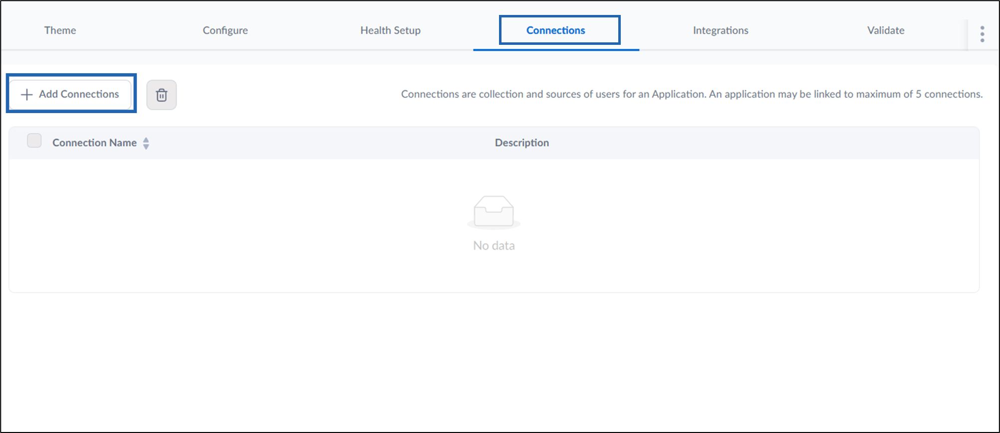

### Configure Integrations Tab

You can **Enable Integrations** to perform cloud-based actions (Optional).

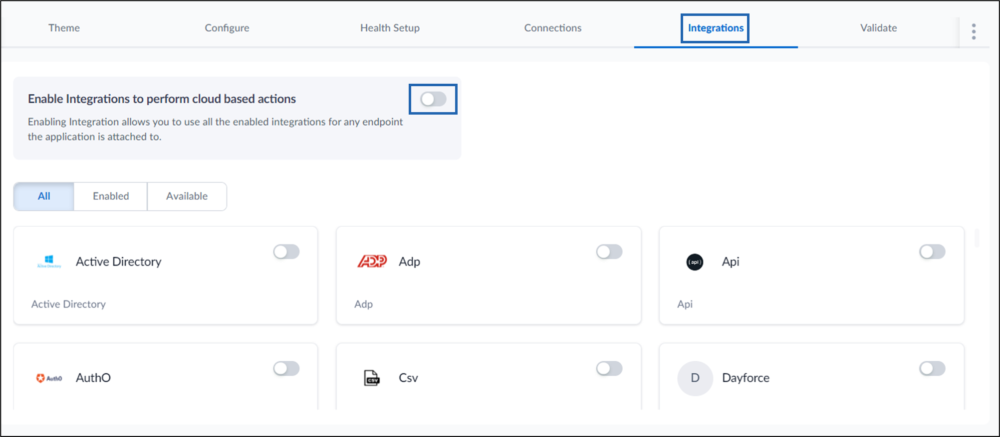

<Note>
  **Note:** Click **Save** after each action to save your configuration.
</Note>

The Verify application is configured and listed on the Application page.
