{/* Source: Intercom article 10506225 - https://oloid.help/en/articles/10506225-oloid-verify-how-to-create-and-configure-endpoint-template-in-tenant-admin-portal */}
{/* Generated by intercom_to_mintlify.py - re-running overwrites this file. */}

## Introduction

The Tenant Admin Portal allows Tenant Admin to create and configure Oloid Verify Endpoint Templates to standardize the setup and deployment of Oloid Verify endpoints. These templates streamline configuration by letting administrators predefine endpoint details, settings, groups, web buttons, integrations, and health monitoring options.

## Prerequisite

You must have a Tenant Admin access to Tenant Admin Portal.

## Steps to Create Endpoint Template

1. Log in to the **Tenant Admin Portal**.
   The **Application** page is displayed.
2. Select **Endpoint** from the left menu panel.

   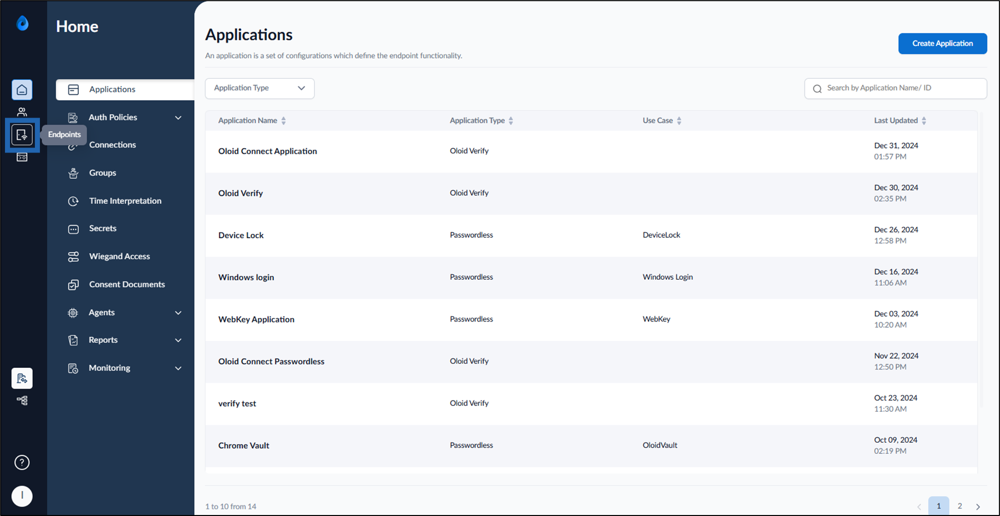

   The **Endpoint** page is displayed.
3. On the top right, click **Endpoint Template**.

   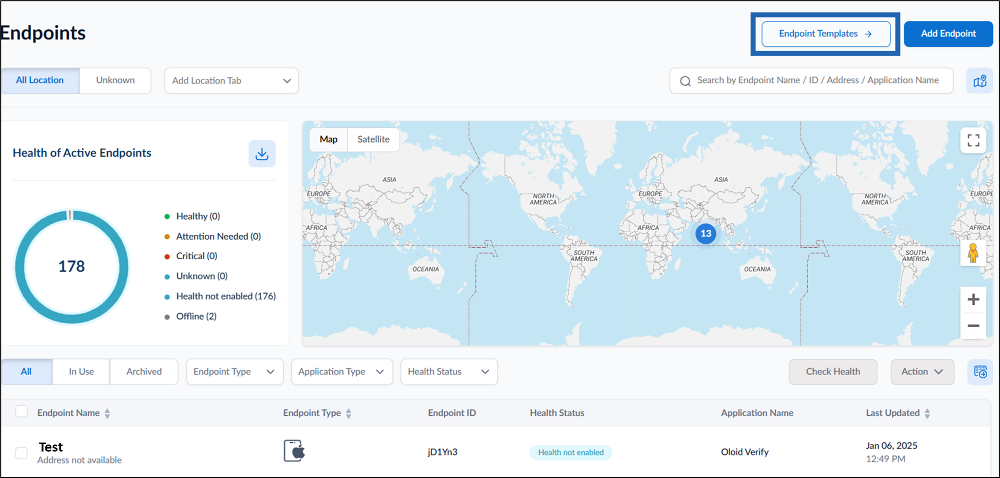

   The **Endpoint Template** page is displayed.
4. On the top right, click **Create Template**.

   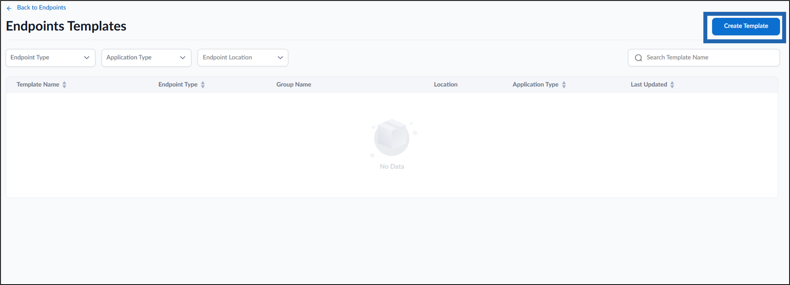

   The **Create New Template** pop-up box is displayed.
5. Do the following:
   1. Enter **Template Name**.
   2. Select **Application Type** as **Oloid Verify** from the dropdown list.
   3. Select **Endpoint Type** as **Oloid Verify** from the dropdown list.
   4. Click **Create**.

      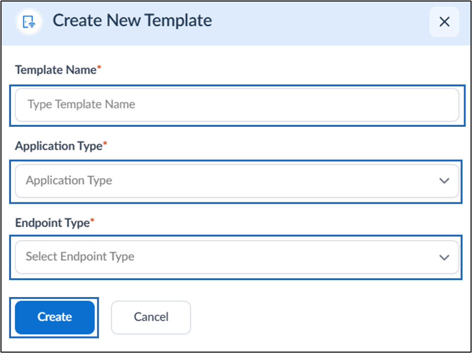

      The Endpoint is created and listed successfully in Endpoint Template page.

      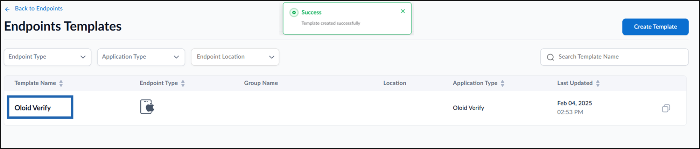

## Steps to Configure Endpoint Template

1. Click **Endpoint Template** to be configured from the listed templates.

   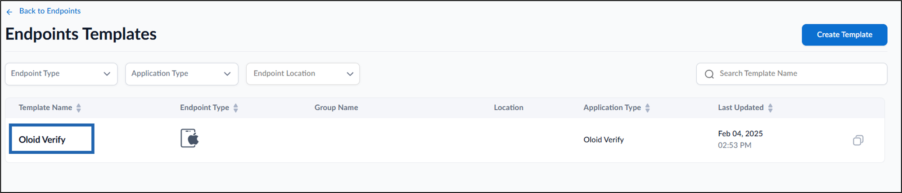

2. Configure the following:
   1. [Details tab](#configure-details-tab)
   2. [Configure tab](#setting-up-configure-tab)

### Configure Details Tab

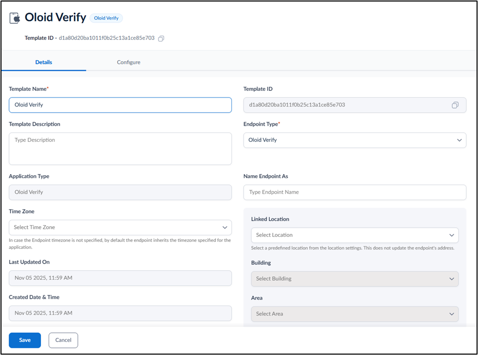

1. Edit **Template Name** (If required).
2. Enter **Template Description**. (Optional)
3. Select **Endpoint Type** from the dropdown list.
4. Select **Time Zone** from the dropdown list. (Optional)

   <Note>
     **Note:** In case the Endpoint time zone is not specified, by default the endpoint inherits the time zone specified for the application.
   </Note>

5. Enter name in **Name Endpoint As** text field. (Optional)
6. Select **Location** from the dropdown list. Once selected, this activates the **Building** field. For more information on creating a location, refer [How to create a new location and add location details](/platform/tenant-admin-portal/how-to-create-a-new-location-and-add-location-details). (Optional)
7. Select **Building** associated with the chosen locationfrom the dropdown list. Once selected, this activates the **area** field. (Optional)
8. Select **area** within the building from the dropdown list. (Optional)
9. Click **Save**.

   <Note>
     **Note:** The **Building** and **Area** fields remain disabled until a valid **Location** is selected.
   </Note>

   <Note>
     **Note:** Configure settings only if they are applicable. Consult your Oloid representative before making any changes.
   </Note>

   The **Details tab** is configured successfully.

   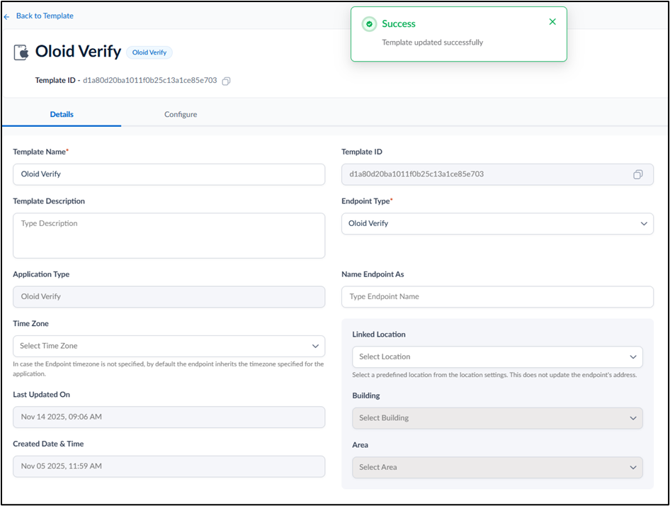

### Setting up Configure Tab

1. [Endpoint Settings](/platforms/ios/time-clock/oloid-connect/oloid-connect-how-to-create-and-configure-endpoint-template-in-the)
2. [Group tab](/platforms/ios/time-clock/oloid-connect/oloid-connect-how-to-create-and-configure-endpoint-template-in-the)
3. [Web Button tab](/platforms/ios/time-clock/oloid-connect/oloid-connect-how-to-create-and-configure-endpoint-template-in-the)
4. [Integration tab](/platforms/ios/time-clock/oloid-connect/oloid-connect-how-to-create-and-configure-endpoint-template-in-the)
5. [Health Setup tab](/platforms/ios/time-clock/oloid-connect/oloid-connect-how-to-create-and-configure-endpoint-template-in-the)

#### Configure Endpoint Setting

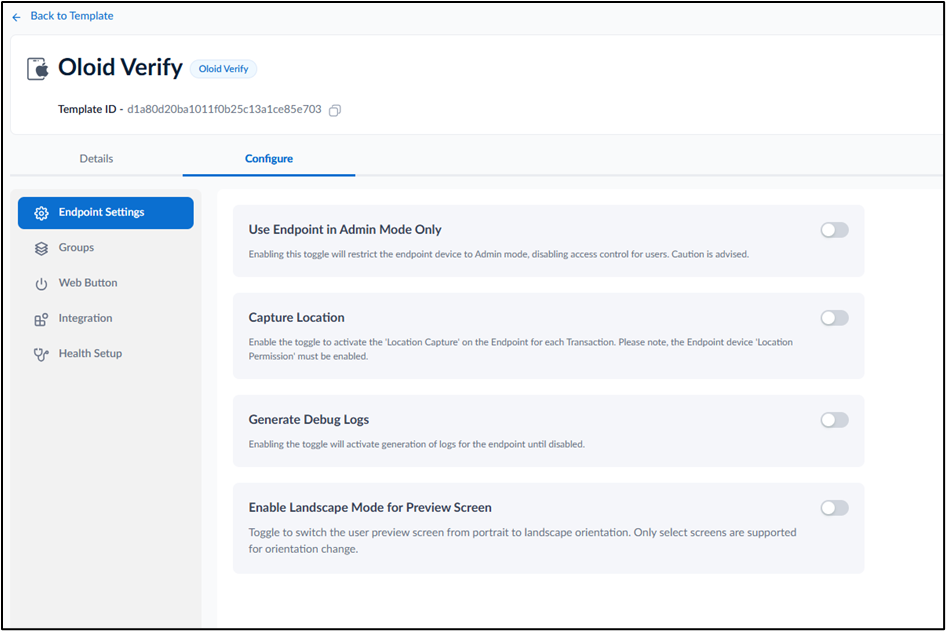

1. **Use Endpoint in Admin Mode Only:** *Coming Soon*
2. **Capture Location:** Turn on this toggle to capture location on the endpoint for each transaction.
   **Note: Location Permission** on the Endpoint device must be enabled to Capture Location.
3. **Generate Debug Logs:** Turn on this toggle to generate and send debug logs from the endpoint to the backend.
4. **Enable Landscape Mode for Preview Screen:** *Coming Soon*
5. Click **Save**.

   <Note>
     **Note:** Configure settings only if they are applicable. Consult your Oloid representative before making any changes.
   </Note>

The **Endpoint Settings** is configured successfully.

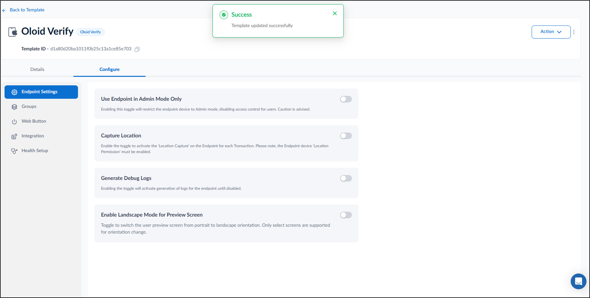

#### Groups

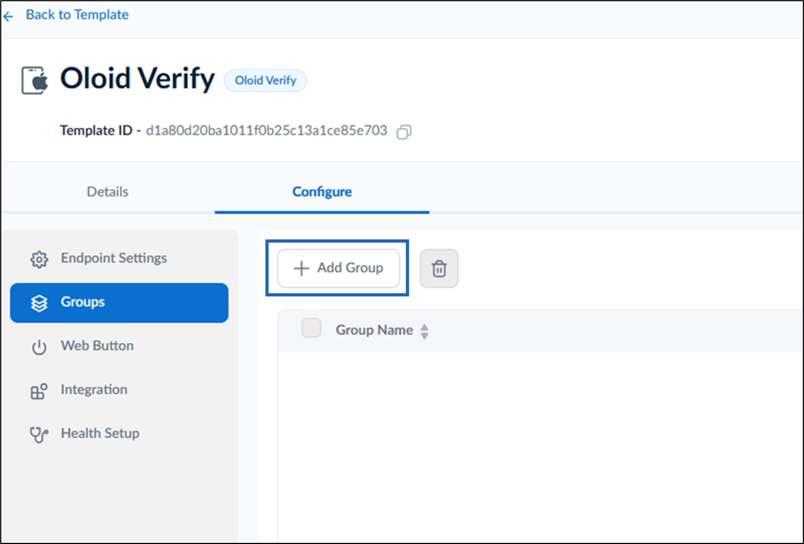

1. Click **+Add Group**.
   The **Add Group** pop-up box is displayed.

   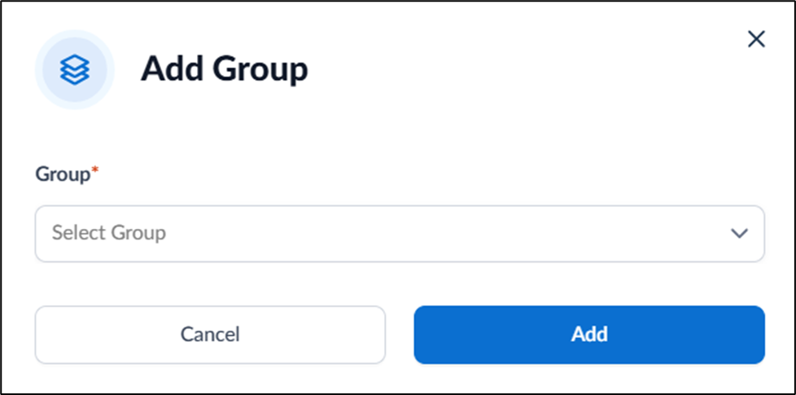

2. Select **Group(s)** from the dropdown list.
3. Click **Add**.

   <Note>
     **Note:** Configure settings only if they are applicable. Consult your Oloid representative before making any changes.
   </Note>

The group is added successfully.

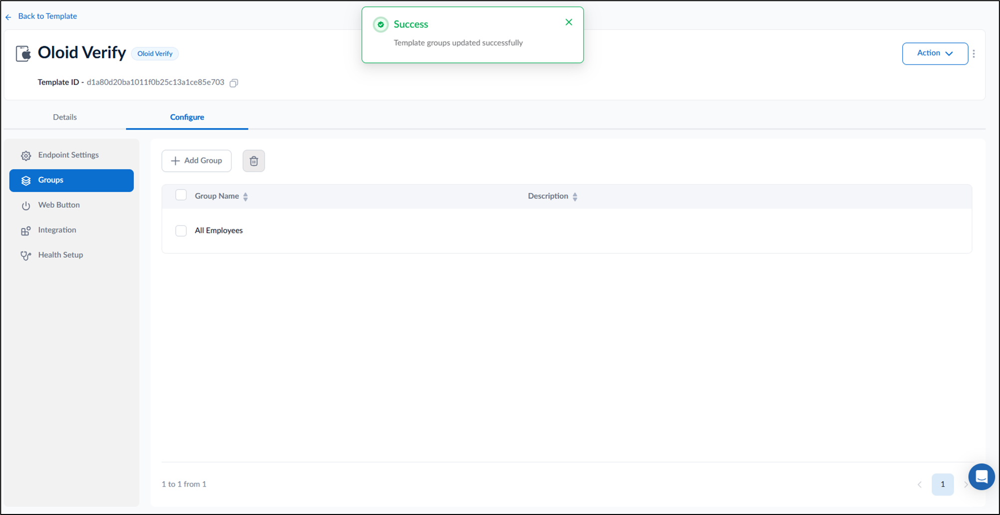

#### Configure Web Button

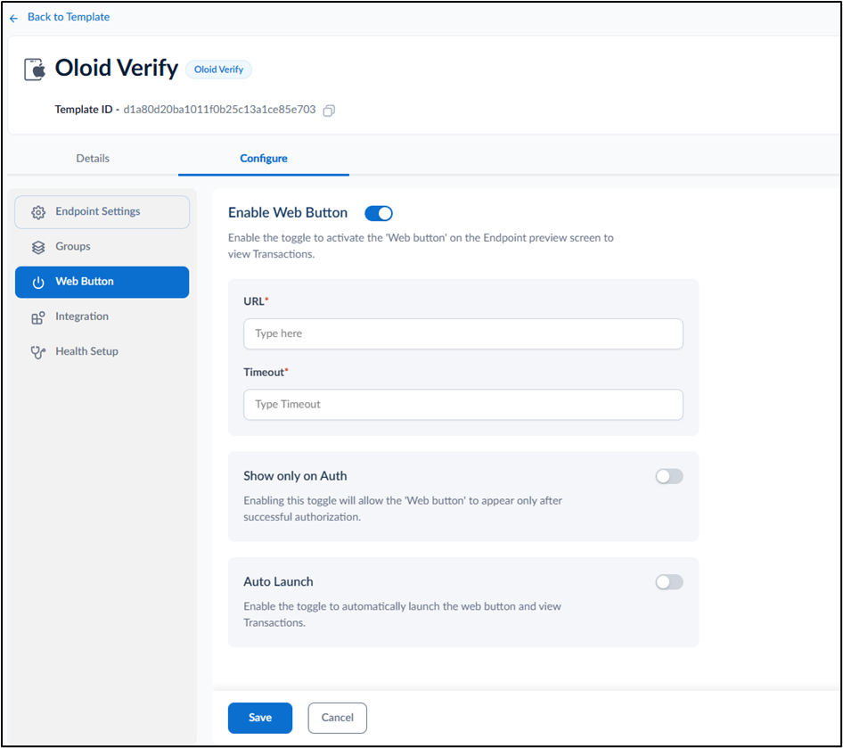

1. **Enable Web Button** toggle to activate the web button on the endpoint preview screen to view transaction.
   1. Enter **URL**.

      <Note>
        **Note:** You have to enter the URL of the website where the user will review the punches.
      </Note>

   2. Enter **Timeout** duration.
2. Turn on **Show only on Auth** toggle to allow the web button to appear only after successful authorization.
3. Turn on **Auto Launch** toggle to automatically launch the web button and view transaction.
4. Click **Save**.

   <Note>
     **Note:** Configure settings only if they are applicable. Consult your Oloid representative before making any changes.
   </Note>

The **Web Button** is configured successfully.

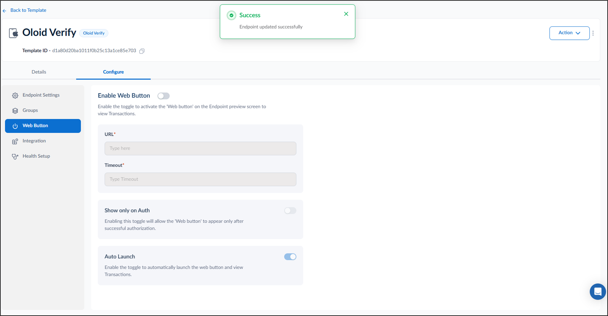

#### Configure Integration

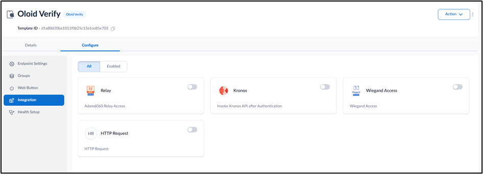

The Integration section allows the Oloid Admin to configure post-authentication actions after successful authentication. These actions can include API calls, relay triggers, or updates to external systems, triggered after user authentication. (Optional)

#### Configure Health Setup

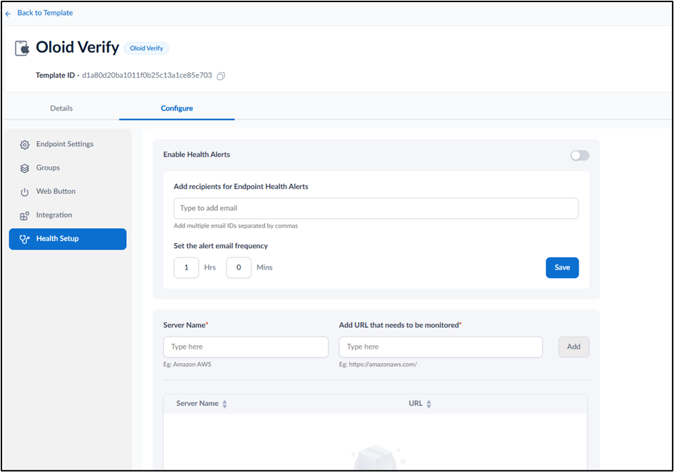

**Enable Health Alerts**

Do the following:

1. Turn on **Enable Health Alerts** toggle to monitor the health of the paired endpoints.
2. Enter email ID(s) in **Add recipients for Endpoint Health Alerts** whom you want to share the health alert notifications.
3. Set **Email frequency** in Hours and Mins to adjust the frequency of email notifications.
4. Click **Save** to apply your changes.
   The Health Alert is configured for the endpoint.

   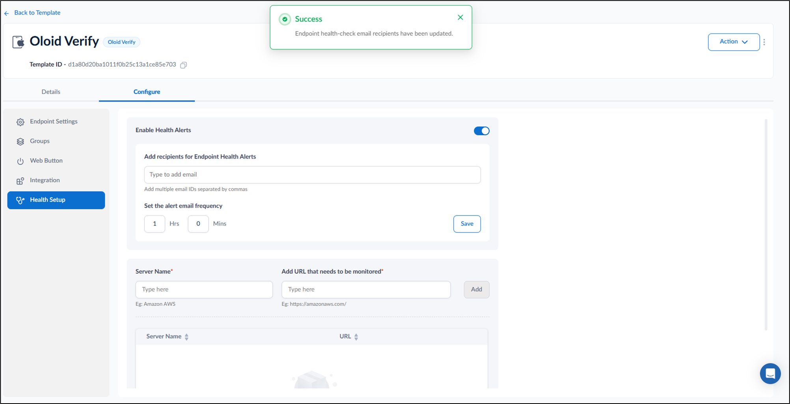

**Add URLs to Monitor**

Do the following:

1. Enter **Server Name**.
2. Enter URL in **Add URL that needs to be monitored** field.
3. Click **Add**.

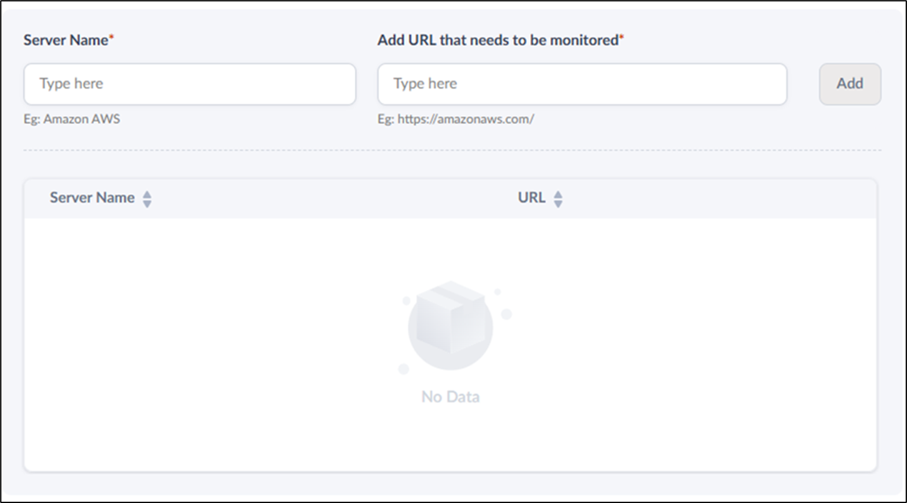

The health check server URL is added successfully.

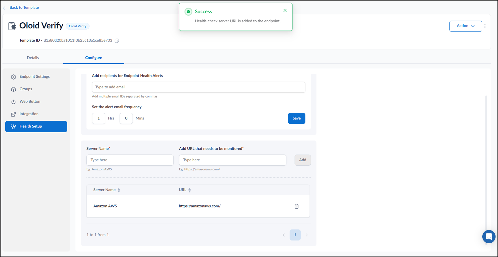

The Endpoint Template is created and configured successfully.
