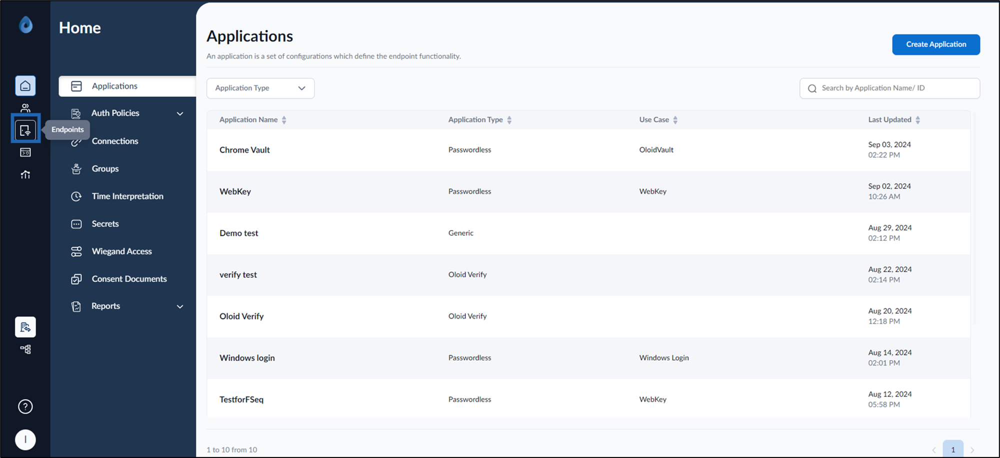
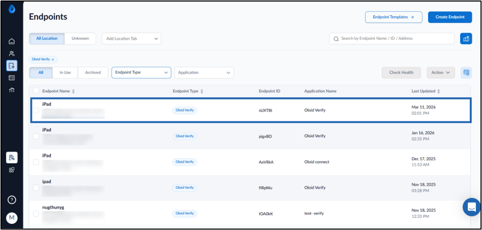
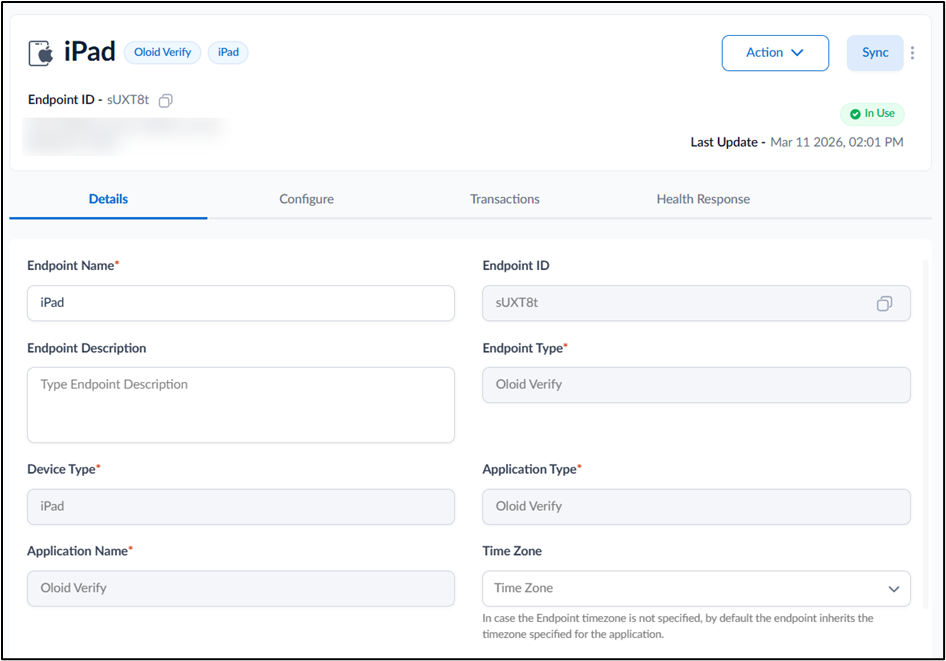
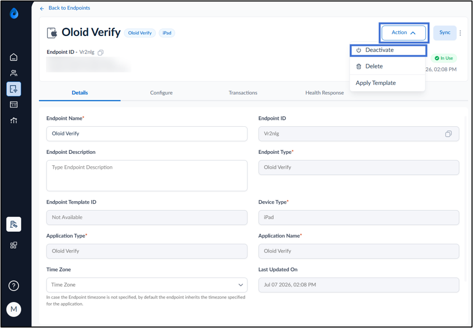
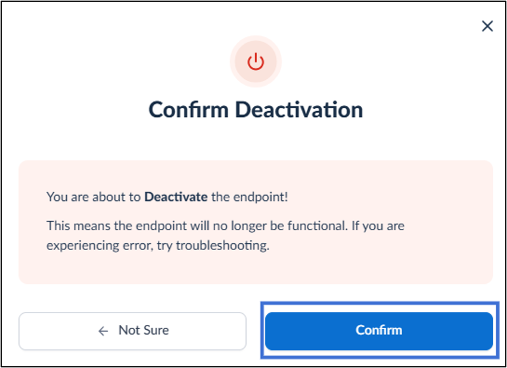
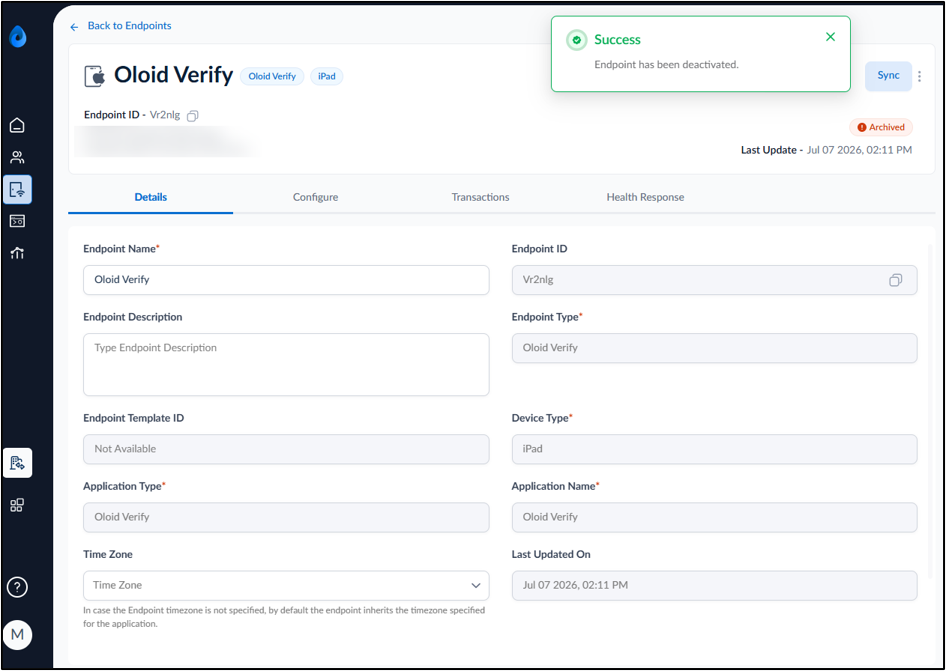

{/* Source: Intercom article 15857432 - https://oloid.help/en/articles/15857432-oloid-verify-how-to-deactivate-endpoint-in-tenant-admin-portal */}
{/* Generated by intercom_to_mintlify.py - re-running overwrites this file. */}

## Introduction

This document explains how to deactivate an endpoint in the Tenant Admin Portal.

<Note>
  **Note:** Once you pair an endpoint with Oloid Verify application, it gets saved and appears in the Tenant Admin Portal.
</Note>

## Prerequisite

You must pair Oloid Verify endpoint. For more, refer to[How to Pair an Oloid Verify Endpoint](/platforms/ios/time-clock/oloid-verify/oloid-verify-how-to-pair-an-endpoint)

## Steps to Deactivate Endpoint

1. Log in to the **Tenant Admin Portal**.
2. On the home page of the portal, click **Endpoints** on the left menu panel.

   

   The **Endpoints** page is displayed.
3. Select the paired Oloid Verify Endpoint.

   

   The **Endpoint Details** page is displayed.

   

4. Do the following to deactivate the endpoint:
   1. Click **Action**.
   1. From the drop-down menu, click **Deactivate**.

      

      The **Confirm Deactivation** Pop up box is displayed.
5. Click **Confirm**.

   

   Oloid Verify Endpoint is deactivated successfully.

   
