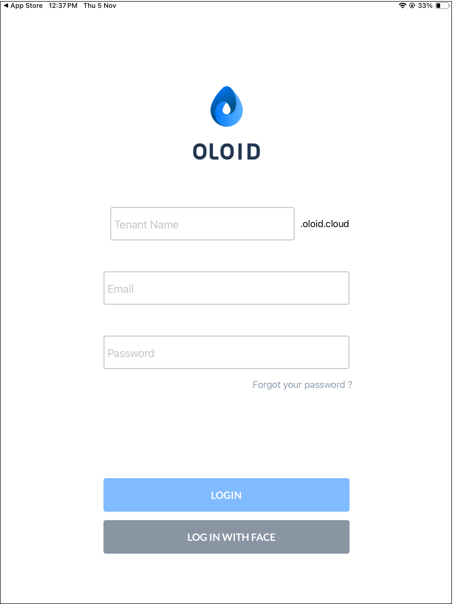
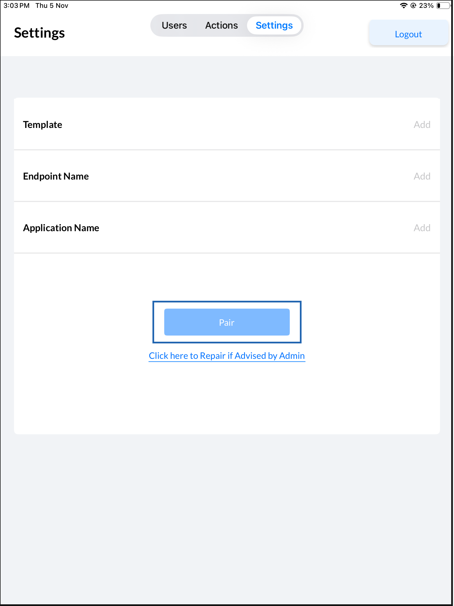
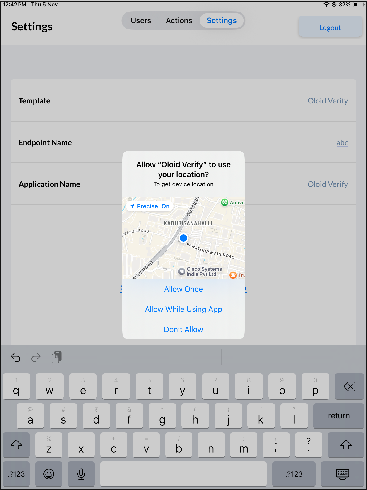

{/* Source: Intercom article 8601170 - https://oloid.help/en/articles/8601170-oloid-verify-how-to-enable-location-access-for-an-endpoint */}
{/* Generated by intercom_to_mintlify.py - re-running overwrites this file. */}

## Introduction

The Oloid Verify app lets a Tenant Admin or Supervisor enable location access for an endpoint during setup. With location access on, the endpoint’s location is recorded, which helps your organization track and manage its endpoints accurately.

## Prerequisites

- You must have a Tenant Admin or Supervisor account.
- The Oloid Verify app must be installed on the device. For details, refer [How to download Oloid Verify App](/platforms/ios/time-clock/oloid-verify/oloid-verify-how-to-download-and-install-the-app).

## Steps to Enable Location to an Endpoint

1. Launch the **Oloid Verify** app.

   

   The Login screen is displayed.
2. Log in to Admin Mode. For details, refer [How to log in to the admin mode of Oloid Verify App as an Admin or Supervisor.](/platforms/ios/time-clock/oloid-verify/oloid-verify-how-to-log-in-to-admin-mode-as-admin-or-supervisor)

   

   The **Settings** page is displayed.
3. On the **Settings** page, do the following:
   1. Add a **Template** (optional).
   2. Enter the **Endpoint Name**.
   3. Select an application from the **Application Name** list.
   4. Tap **Pair**.

      

      The location access pop-up is displayed.
4. Tap one of the following options:
   - **Allow Once:** The app can use your location for this session only and asks again the next time you open it.
   - **Allow While Using App:** The app can use your location only while it’s open and in use.
   - **Don’t Allow:** The app can’t use your location at all.

     <Note>
       **Note:** You can also change location access later in the device settings. For details, refer **[How to update location in Oloid Verify.](/platforms/ios/time-clock/oloid-verify/oloid-verify-how-to-update-location-permission-on-ipad)**
     </Note>

     

     <Note>
       **Note:** To confirm the location assigned to the endpoint, log in to the **Tenant Admin Portal** and open that endpoint.
     </Note>
