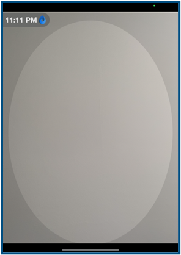
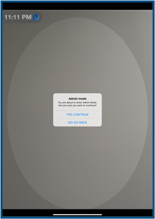
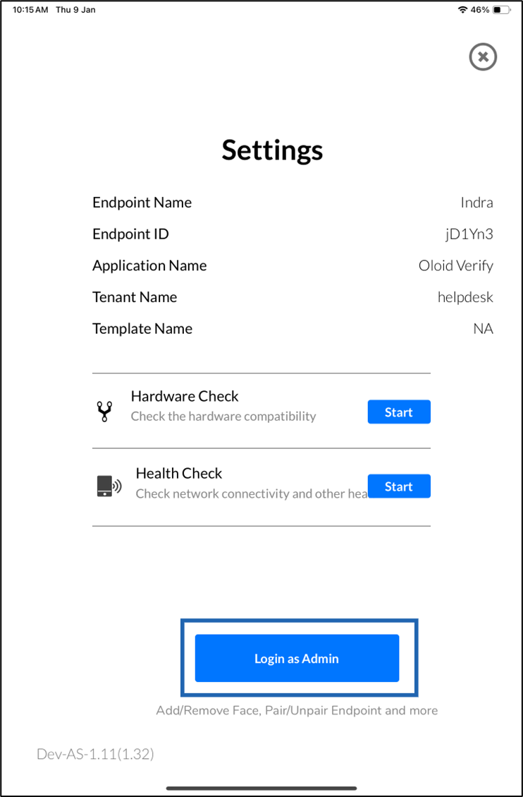
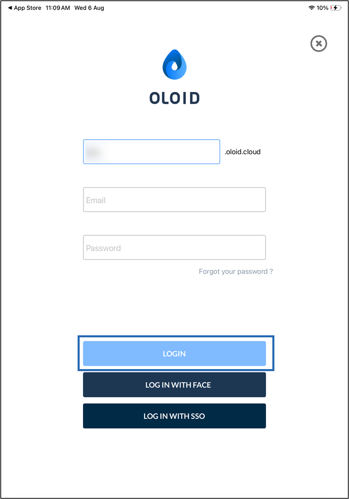
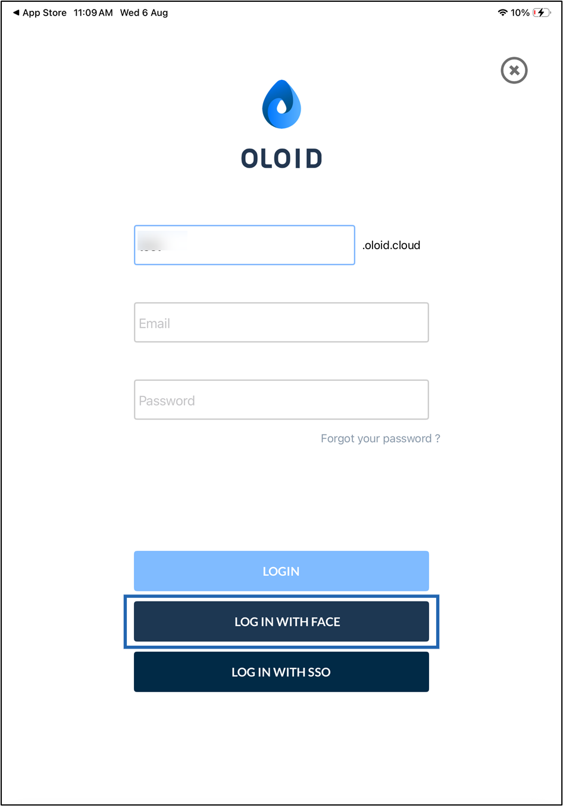
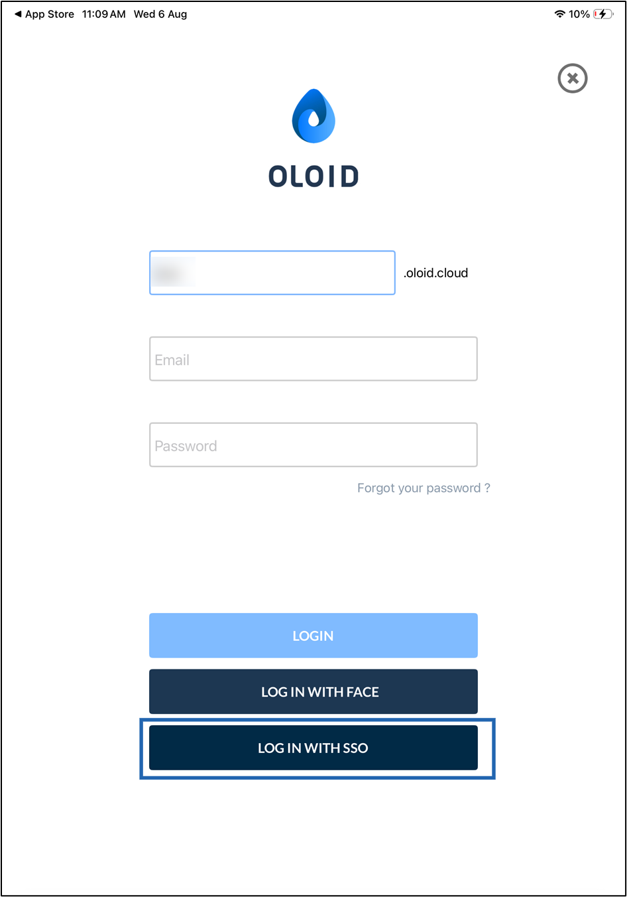
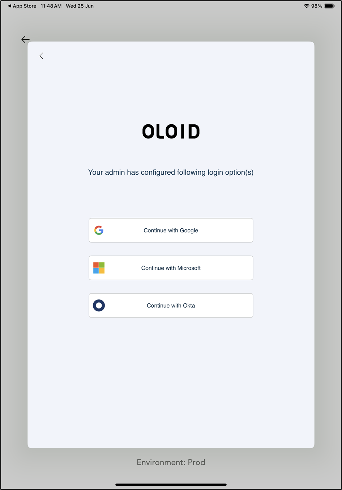
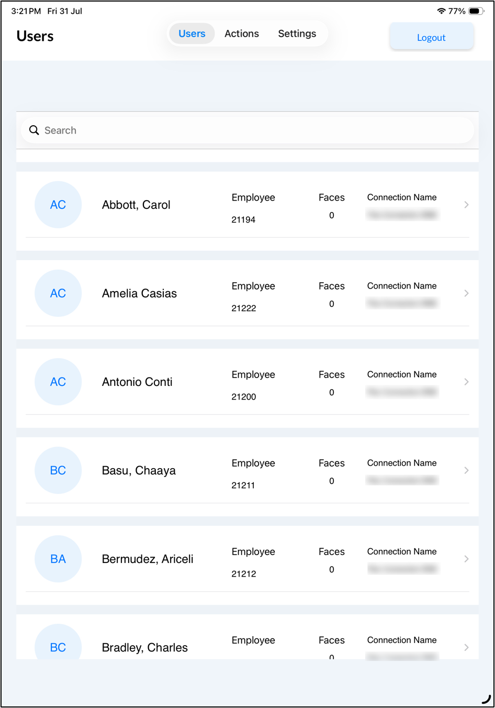

{/* Source: Intercom article 8671139 - https://oloid.help/en/articles/8671139-oloid-verify-how-to-log-in-to-admin-mode-as-admin-or-supervisor */}
{/* Generated by intercom_to_mintlify.py - re-running overwrites this file. */}

## Introduction

This document provides instructions for Admins and Supervisors to log in to Admin Mode in the Oloid Verify app using any of the following methods

1. [Log in using Email and Password](/drafts/platforms/ios/connect-passwordless/oloid-connect-app-how-to-log-in-to-admin-mode-as-a-supervisor-or-admin)
2. [Log in using Face](/drafts/platforms/ios/connect-passwordless/oloid-connect-app-how-to-log-in-to-admin-mode-as-a-supervisor-or-admin)
3. [Log in using SSO](#log-in-using-sso)

## Login using Email and Password

### Prerequisites

- You must complete the Admin Setup. For more details refer [Oloid Verify: App Installation and Admin Setup](/platforms/ios/time-clock/oloid-verify/oloid-verify-how-to-complete-admin-setup).
- Password must be updated using the invite email received by the Supervisor.

  <Note>
    **Note:** In case, supervisor has not received any invite email, they should contact the Tenant Admin.
  </Note>

### Steps to log in with Email and Password

1. Launch the **Oloid Verify** App.

   

   <Note>
     **Note:** Since the endpoint is already paired, the app will launch in the preview mode. For more, refer to [Oloid Verify - How to Pair an Endpoint](/platforms/ios/time-clock/oloid-verify/oloid-verify-how-to-pair-an-endpoint)
   </Note>

   

2. Double tap with two fingers on the screen to launch the Admin Mode.
3. Tap **Yes- Continue.**

   

   The Settings screen is displayed.
4. Tap **Login as Admin**.

   

   The Login screen is displayed and the tenant name is pre-populated.
5. Do the following:
   1. Enter **Email ID** in the **Email** field.
   2. Enter **Password** in the **Password** field.
   3. Tap **LOGIN**.

      

      You are logged in to the Admin Mode successfully.

      <Note>
        **Note:** After successfully logging in to Admin mode, the Users page is displayed. For more details, refer to the [sample screen](#sample-screen)
      </Note>

## Login using Face

### Prerequisites

- Face must be onboarded for the Supervisor/Admin.
- Endpoint must be paired in the iPad. For more details refer **[How to pair an Oloid Verify endpoint](/platforms/ios/time-clock/oloid-verify/oloid-verify-how-to-pair-an-endpoint).**
- The connection that the supervisor belongs to, must be linked to the application the endpoint is paired with.

### Steps to log in with Face

1. Launch the **Oloid Verify** App.

   

   <Note>
     **Note:** Since the endpoint is already paired, the app will launch in the preview mode.
   </Note>

   

2. Double tap with two fingers on the screen to launch the Admin Mode.
3. Tap **Yes- Continue.**

   

   The Settings screen is displayed.
4. Tap **Login as Admin**.

   

   The Login screen is displayed and the tenant name is pre-populated.
5. Tap **LOG IN WITH FACE**.

   

   This will open the camera preview screen.
6. Look at the camera to confirm your identity.

   

   You are logged in to the Admin Mode successfully.

   <Note>
     **Note:** After successfully logging in to Admin mode, the Users page is displayed. For more details, refer to the [sample screen](#sample-screen)
   </Note>

## Log in using SSO

### Prerequisites

- Endpoint must be paired in the iPad. For more details refer **[How to pair an Oloid Verify endpoint](/platforms/ios/time-clock/oloid-verify/oloid-verify-how-to-pair-an-endpoint).**
- Tenant admin and Supervisor's Email ID needs to be updated in the Tenant Admin Portal.

### Steps to log in with SSO

1. Launch the **Oloid Verify** App.

   

   <Note>
     **Note:** Since the endpoint is already paired, the App will launch in the preview screen of the App.
   </Note>

   

2. Double tap with two fingers on the preview screen to launch the Admin Mode.
3. Tap **Yes- Continue.**

   

   The **Settings** screen is displayed.
4. Tap **Login as Admin**.

   

   The Login screen is displayed.
5. On the login screen, tap **Login with SSO**.

   

   The screen with **SSO options** is displayed.
   Do one of the following:
   1. Login with [Google](/platforms/ios/time-clock/oloid-verify/oloid-verify-login-using-google-sso).
   2. Login with [Microsoft](/platforms/ios/time-clock/oloid-verify/oloid-verify-login-using-microsoft-sso).

Login with [Okta](/platforms/ios/time-clock/oloid-verify/oloid-verify-login-using-okta-sso).

<Note>
  **Note:** After successfully logging in to Admin mode, the Users page is displayed. For more details, refer to the [sample screen](#sample-screen)
</Note>

##### Sample Screen

