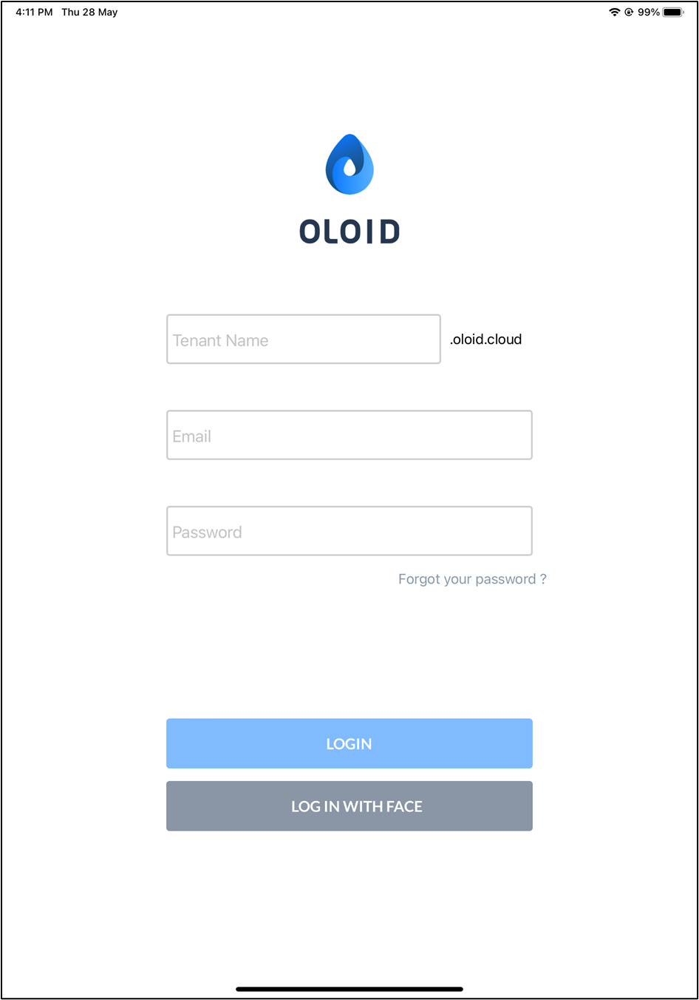
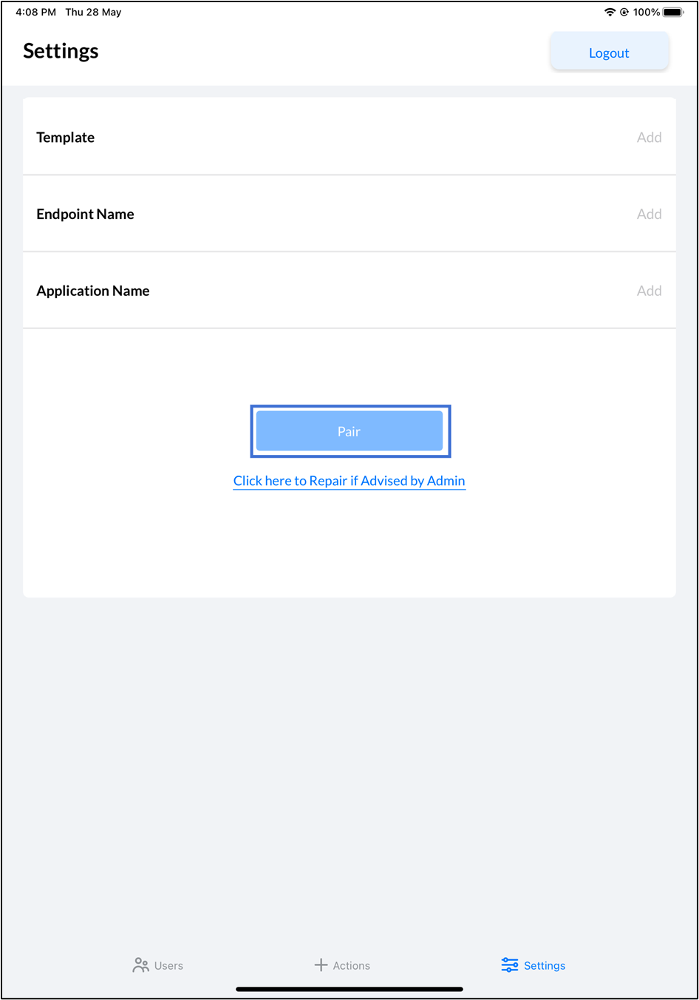
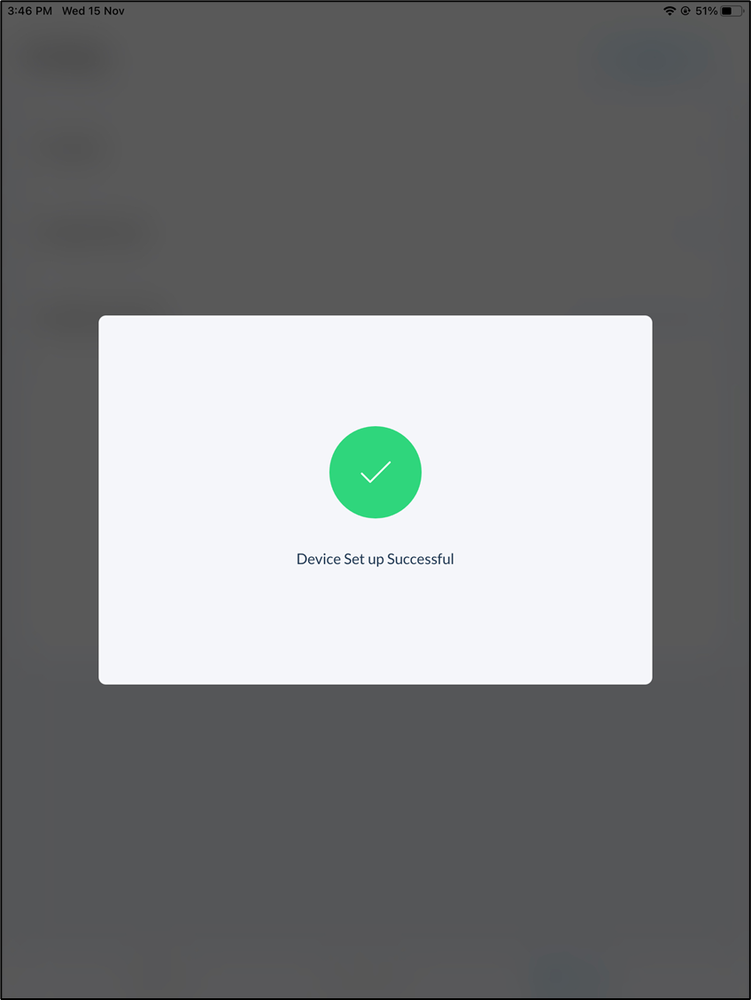
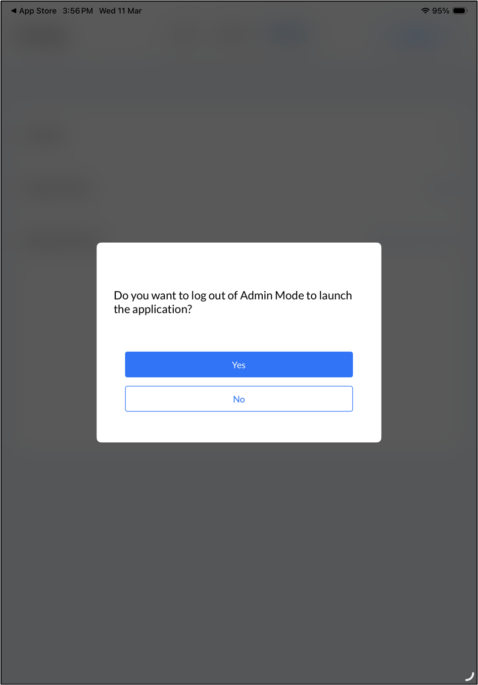

{/* Source: Intercom article 8616605 - https://oloid.help/en/articles/8616605-oloid-verify-how-to-pair-an-endpoint */}
{/* Generated by intercom_to_mintlify.py - re-running overwrites this file. */}

## Introduction

This document explains how to pair an endpoint using the **Oloid Verify** application. Pairing connects the endpoint to the Oloid Verify application in the Tenant Admin Portal and prepares the endpoint for authentication and transaction activities.

## Prerequisite

- You should be a Tenant Admin or Supervisor.
- You must create and configure Oloid Verify application in the Tenant Admin Portal. To create refer[How to create and configure Application Type - Oloid Verify](/platforms/ios/time-clock/oloid-verify/oloid-verify-how-to-create-and-configure-application-in-tenant-admin).
- You must download and install Oloid Verify app from the App store. To download and install refer [How to download and install Oloid Verify App](/platforms/ios/time-clock/oloid-verify/oloid-verify-how-to-download-and-install-the-app).

## Step to Pair an Endpoint

1. Launch the Oloid Verify app.

   

   The **LOGIN** page is displayed.
2. Enter **Tenant Name**.
3. Enter email id in the **Email** text field.
4. Enter password in the **Password** text field.
5. Tap **LOGIN**.

   

   The **Settings** page is displayed.
6. Do one of the following on the **Settings** page.
   1. Add **Template** (optional). For more, refer to [How to create and configure Oloid Verify Endpoint Template](/platforms/ios/time-clock/oloid-verify/oloid-verify-how-to-create-and-configure-endpoint-template-in-tenant).
   2. Enter **Endpoint Name**.
   3. Select Application Name from **Application Name** list.
   4. Tap **Pair.**

      

      The settings are saved and endpoint is successfully paired and Device Setup successful pop up box is displayed.

      

      The application prompts you to log out of Admin mode.
7. Do one of the following:
   1. Click **Yes** to log out and launch the application (**preview mode**).
      The app displays preview mode and allows you to do the transactions.
   2. Click **No** to stay logged in to the admin mode.

      

---

##### SEO Keywords

|Oloid Verify endpoint pairing | pair Oloid Verify endpoint | Oloid Verify endpoint setup guide|
