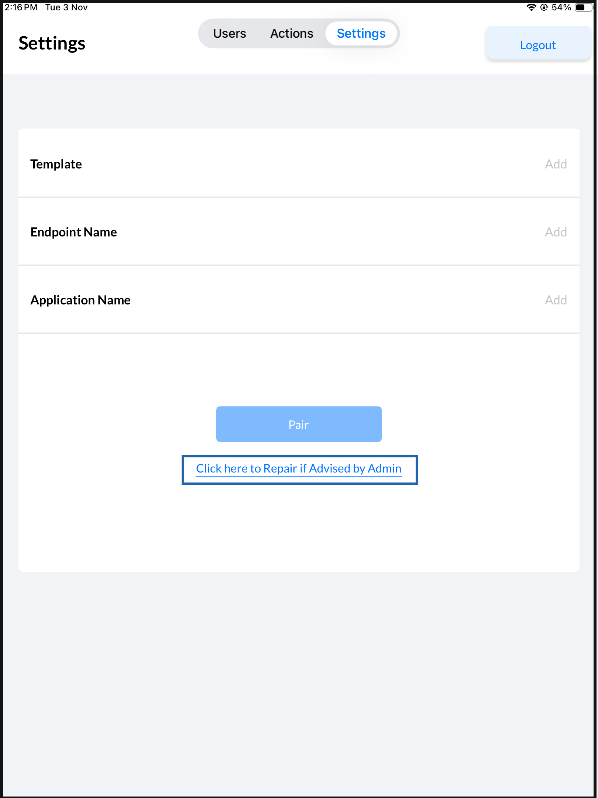
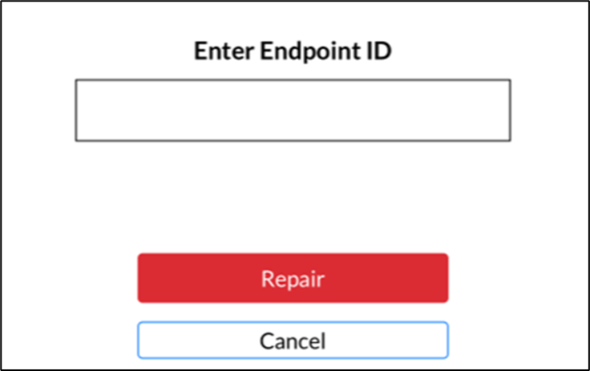
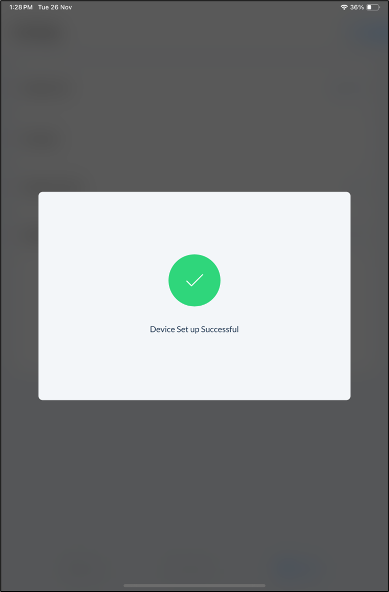
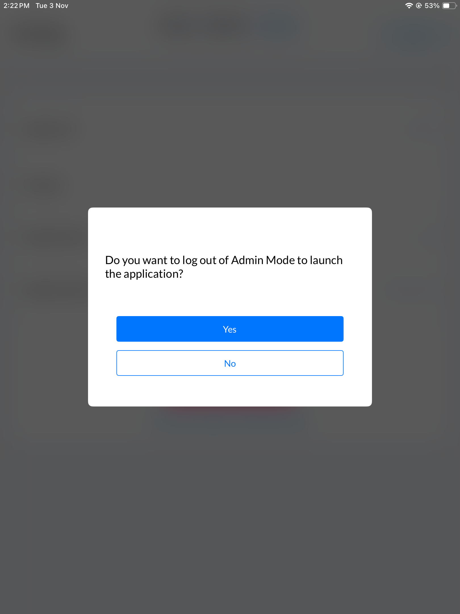

{/* Source: Intercom article 10198654 - https://oloid.help/en/articles/10198654-oloid-verify-how-to-re-pair-endpoint */}
{/* Generated by intercom_to_mintlify.py - re-running overwrites this file. */}

## Introduction

This document provides instructions to re-pair an endpoint in the Oloid Verify app. Re-pairing reconnects the endpoint to its assigned application so it continues to work as expected.

## Prerequisite

- You must have Admin access for Tenant Admin Portal.
- You must have the Endpoint ID of the endpoint.

## Steps to Re-pair an endpoint

1. Launch the **Oloid Verify** app on the device.
   **Could not display content**
2. Login to Admin mode with your Admin credentials. For more information, refer [How to log in to the admin mode of Oloid Verify App as an Admin or Supervisor.](/platforms/ios/time-clock/oloid-verify/oloid-verify-how-to-log-in-to-admin-mode-as-admin-or-supervisor)
   The **Settings** tab is displayed.

   <Note>
     **Note:** On iPads running iOS versions below 17, the Settings tab appears at the bottom. On iPads running iOS 17 or later, the Settings tab appears at the top.
   </Note>

   

   The **Enter Endpoint ID** pop-up box is displayed.
3. Enter the **Endpoint ID**
4. Tap **Re-pair**.

   

   The endpoint is re-paired successfully.

   

   Pop-up is displayed asking **Do you want to log out of Admin Mode to launch the application?**

Tap **Yes** to exit Admin mode and launch the application.

<Note>
  **Note:** Tap **No** to stay in Admin mode.
</Note>

