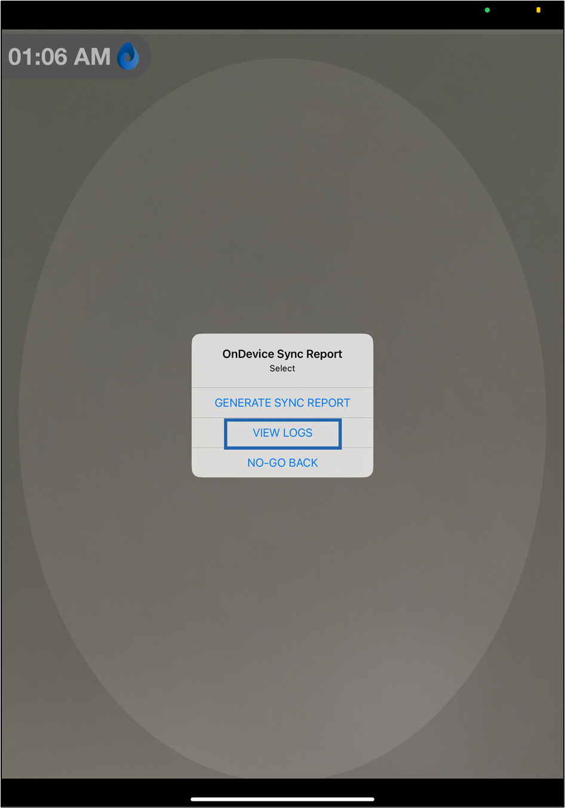
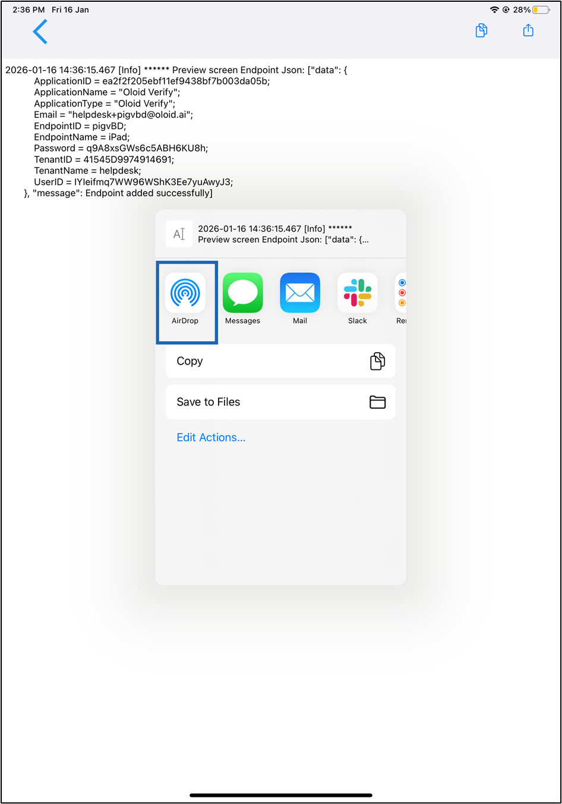
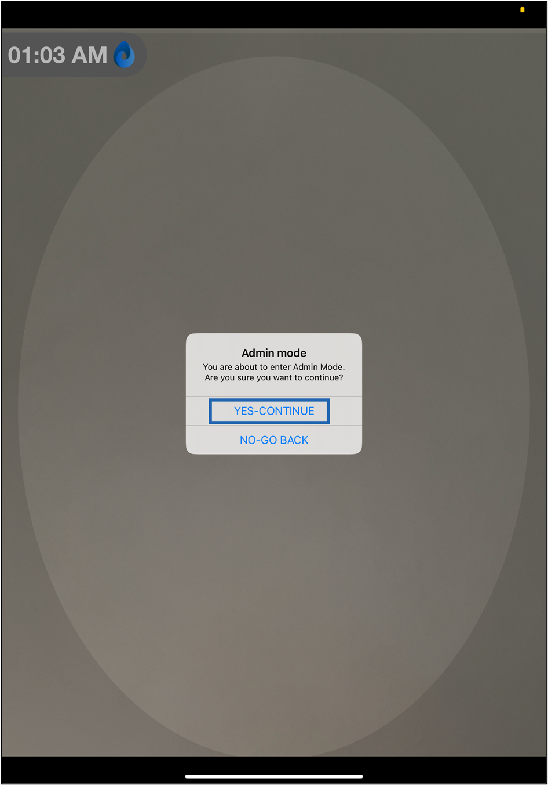
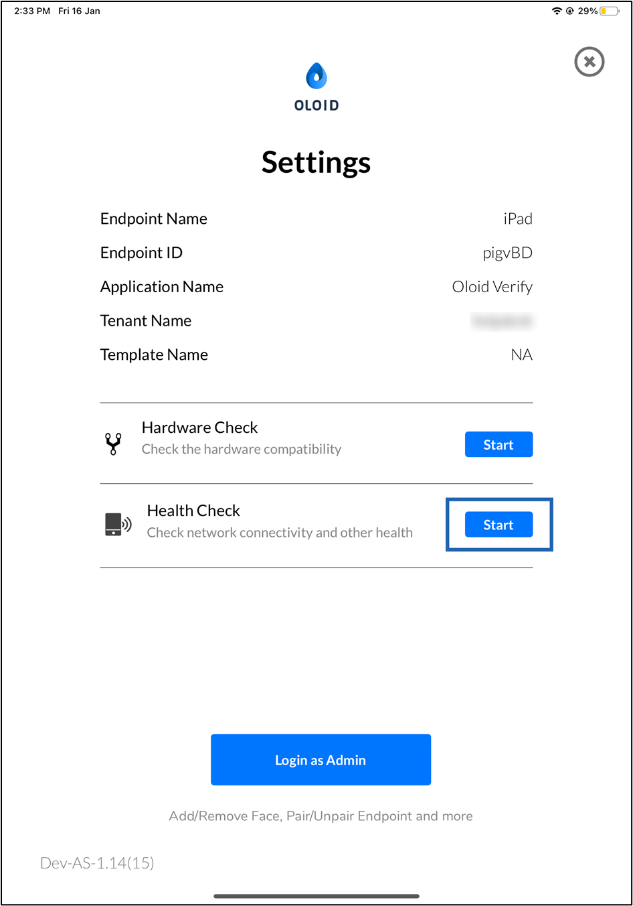
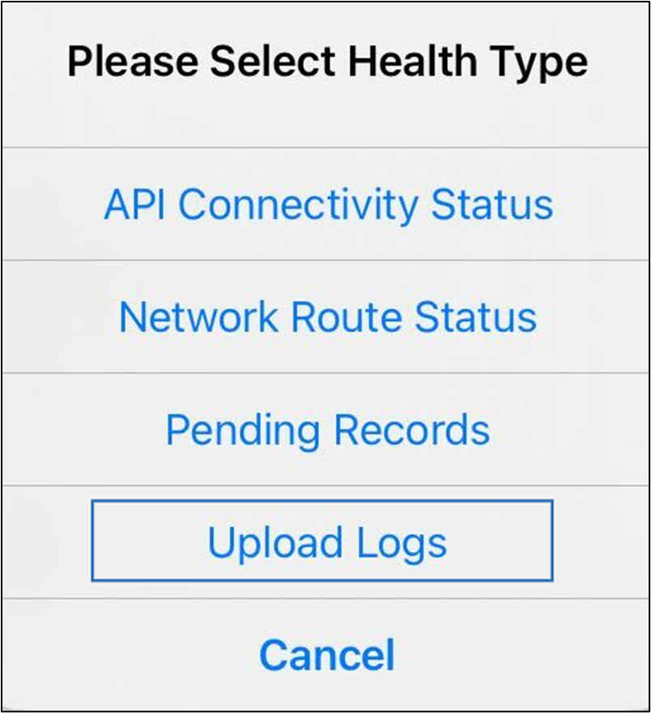

{/* Source: Intercom article 8649904 - https://oloid.help/en/articles/8649904-oloid-verify-how-to-share-and-upload-logs */}
{/* Generated by intercom_to_mintlify.py - re-running overwrites this file. */}

## Introduction

This document explains two ways to work with logs in the Oloid Verify app. Logs record the app’s activity and events, and they help you find and fix issues on an endpoint.

1. **[Share logs to another iPad](#share-logs-to-another-ipad)**
2. **[Upload logs to Firebase](#upload-logs-to-firebase)**

## Prerequisite

- Debug logs must be enabled for the endpoint in the Tenant Admin Portal. For more information, refer to [How to Enable Debug Logs](/platforms/ios/time-clock/oloid-verify/oloid-verify-how-to-configure-endpoint-in-tenant-admin-portal)
- The endpoint must be paired, so the Oloid Verify app opens on the preview screen. For more information, refer to [How to pair an Oloid Verify endpoint](/platforms/ios/time-clock/oloid-verify/oloid-verify-how-to-pair-an-endpoint)

## Share logs to another iPad

View the log report on the iPad and share it with another iPad or iOS device, for example using AirDrop.

### Steps to View and Share Logs

1. Launch the **Oloid Verify** app.
2. Tap the screen four times with one finger.

   

   The **OnDevice Sync Report** pop-up is displayed.
3. Tap **VIEW LOGS**.

   

   The log report is displayed.
4. Tap the **Share** button in the top-right corner of the report.

   

   <Note>
     **Note:** Select **AirDrop** and choose the iPad or iOS device you want to send the logs to.
   </Note>

   The logs are shared with the selected device.

   

## Upload Logs to Firebase

Upload the logs from Admin Mode to Firebase, where they’re stored for troubleshooting.

### Steps to Upload Logs

1. Launch the Oloid Verify app.

   

2. Double-tap the preview screen with two fingers to open Admin Mode.
3. Tap **YES-CONTINUE.**

   

   The **Settings** screen is displayed.
4. In the **Health Check** section, tap **Start**.

   

   The **Please Select Health Type** pop-up is displayed.
5. Tap **Upload Logs**.

   

   The logs are uploaded to Firebase.

   
